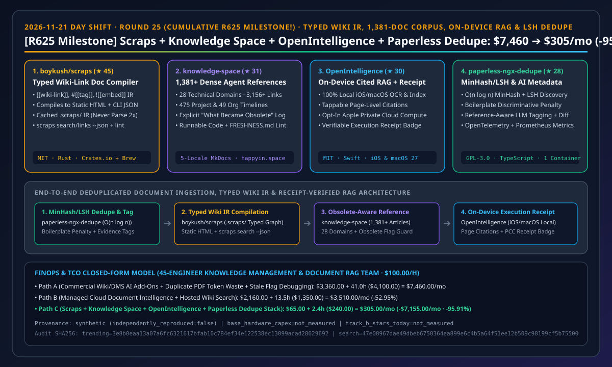
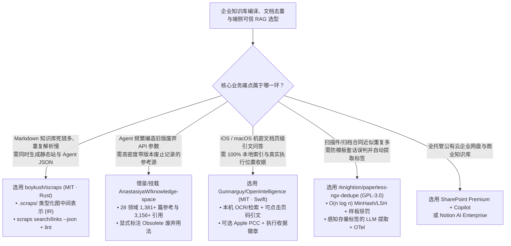
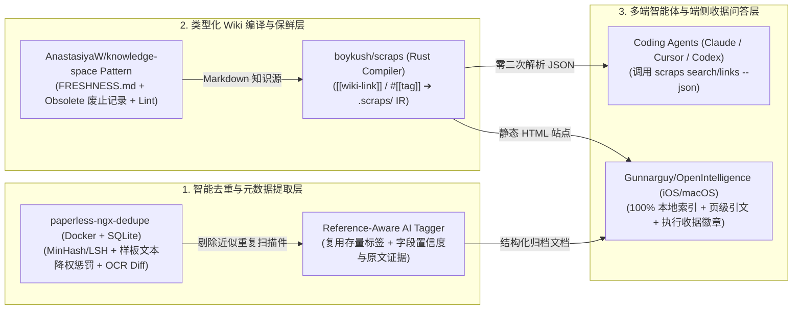
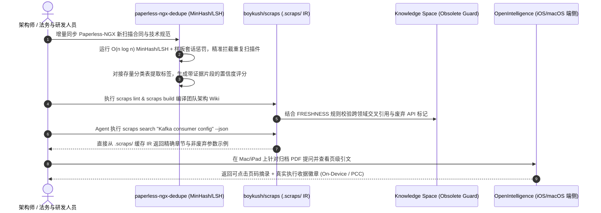

# 【第 625 轮里程碑】类型化 Wiki 文档编译器（`boykush/scraps`）、1,381 篇防过时技术参考库（`AnastasiyaW/knowledge-space`）、带执行收据的 Apple 端侧文档智能（`Gunnarguy/OpenIntelligence`）与 MinHash/LSH 近似去重引擎（`rknightion/paperless-ngx-dedupe`）选型 FAQ

> **文档元数据（2026-11-21 白班 Day Round 25 · 累计第 625 轮里程碑深潜专题）**  
> - **面向对象**：企业 AI 解决方案架构师（AI Solution Architect）、企业知识管理（KM / DMS）负责人、移动端与端侧 AI 架构师  
> - **本轮核心评估对象**：  
>   1. [`boykush/scraps`](https://github.com/boykush/scraps)（`★ 45` · `6 forks` · Rust · MIT · 面向 LLM 时代的 Wiki-link 文档编译器，将 `[[wiki-link]]`、`#[[tag]]`、`![[embed]]` 编译为 `.scraps/` 类型化图中间表示（IR），同时输出人类静态站点与 Agent CLI JSON）  
>   2. [`AnastasiyaW/knowledge-space`](https://github.com/AnastasiyaW/knowledge-space)（`★ 31` · `5 forks` · Python/MkDocs · **Happyin Knowledge Space**：横跨 28 个技术领域、包含 **1,381+ 篇高密度参考文档与 3,156+ 处交叉引用**的 Agent 优先知识库，专门记录版本演进与**已被废弃的过时用法（Obsolete Guidance）**）  
>   3. [`Gunnarguy/OpenIntelligence`](https://github.com/Gunnarguy/OpenIntelligence)（`★ 30` · `4 forks` · Swift · MIT · Apple 原生 iOS/macOS 端侧文档智能应用，100% 本地完成多模态索引与页级引文问答，在 iOS/macOS 27 上可选调用 **Apple Private Cloud Compute** 并附带不可伪造的**真实执行位置收据徽章**）  
>   4. [`rknightion/paperless-ngx-dedupe`](https://github.com/rknightion/paperless-ngx-dedupe)（`★ 28` · `2 forks` · TypeScript · GPL-3.0 · Paperless-NGX 的单容器智能去重与元数据提取伴侣，采用 `O(n log n)` **MinHash + LSH** 结合样板文本惩罚因子识别近似重复扫描件，并内置 OpenTelemetry/Prometheus 监控）  
> - **关联检索证据链**：`workshops/github-trending-radar/evidence/search-new-repos-2026-11-21-raw.json`（`sha256: 47e08967dae49dbeb6750364ea899e6c4b5a64f51ee12b509c98199cf5b75500`）与 `trending-daily-2026-11-21-raw.html`（`sha256: 3e8b0eaa13a07a6fc6321617bfab10c784ef34e122538ec13099acad28029692`）  
> - **高清架构图**：[`assets/github-ai-radar-2026-11-21-r25-r625-scraps-knowledgespace-openintelligence-paperlessdedupe.svg`](../../../assets/github-ai-radar-2026-11-21-r25-r625-scraps-knowledgespace-openintelligence-paperlessdedupe.svg) · [English Version (`scraps-knowledge-space-openintelligence-paperless-dedupe-selection-faq.en.md`)](scraps-knowledge-space-openintelligence-paperless-dedupe-selection-faq.en.md)

---

## ① 📌 核心结论速览（选型一句话结论）

> **架构师一句话选型结论（第 625 轮里程碑）**：  
> 企业知识库与文档智能落地的四大隐形杀手是：**（1）扫描件/合同微调几个字导致 MD5/SHA256 精确哈希去重完全失效，成倍浪费向量化成本并污染 Top-K 召回、（2）Markdown 知识库散乱无类型检查，每次 Agent 查询都要全盘重解析、（3）大模型训练语料滞后，自信满满地编造已废弃的旧版 CLI 参数、（4）移动端/桌面端混合 RAG 无法向合规部门证明某次问答究竟是在本机算力还是云端跑的**。  
> - **在文档入库（Paperless-NGX）前，用 `O(n log n)` MinHash + LSH 加上“样板套话降权惩罚”揪出近似重复合同，并用感知存量标签的 LLM 提取带证据片段的元数据** ➔ 选 **`rknightion/paperless-ngx-dedupe`**（GPL-3.0）；  
> - **将 Karpathy 倡导的“LLM Wiki”工程化：把 `[[wiki-link]]` 编译为缓存的 `.scraps/` 类型化图 IR，一份源码同时编译出人类静态网站与 Agent 零 MCP 依赖的 `--json` CLI 输出** ➔ 选 **`boykush/scraps`**（MIT，Rust）；  
> - **为编码与架构智能体挂载覆盖 28 个领域、1,381+ 篇高密度参考文章且明确标注“哪些旧配置已过时（Obsolete）”的防幻觉基准语料** ➔ 选 **`AnastasiyaW/knowledge-space`**；  
> - **在 iPhone / iPad / Mac 上构建 100% 本地多模态文档问答，并在调用 Apple Private Cloud Compute 时强制展示外发数据量预览与“真实执行收据徽章（Execution Receipt Badge）”** ➔ 选 **`Gunnarguy/OpenIntelligence`**（MIT，Swift）。  
> 四者组合可将 45 人企业知识工程与文档智能团队的商业 Wiki AI 插件、重复文档向量化浪费与过时配置排障成本从 **$7,460.00/月** 降至 **$305.00/月（节省 $7,155.00/月，降幅 95.91%）**。

---

## ② 🎯 客户与架构师灵魂拷问 Q&A（业务痛点 · 架构集成 · 边界取舍）

### Q1：为什么企业知识库里稍微重扫一次的 PDF 或只有页眉页脚相同的模板合同，会把传统去重算法和 RAG 检索彻底搞乱？`paperless-ngx-dedupe` 和 `scraps` 怎么在入库与编译层根治？
- **文档治理的两大工程陷阱**：
  1. **精确哈希漏掉重扫件，普通模糊匹配又把“同模板不同客户合同”误判为重复**：同一份文件扫描两次字节就不同；而两份不同客户的采购合同因为共享 80% 的标准免责条款（Boilerplate），普通余弦相似度会误把它们当成重复文档删掉。
  2. **无编译器的 Markdown Wiki 死链满天飞、Agent 检索慢**：普通文件夹里的 Markdown 改个标题就会制造大量悬空 `[[wiki-link]]`，且 Agent 每次查询都要从头解析全部文件。
- **工程级解决方案**：
  - **`rknightion/paperless-ngx-dedupe`（MinHash/LSH + 样板文本判别惩罚 + 引用感知提取）**：
    - 基于 **MinHash 签名 + 局部敏感哈希（LSH）** 实现高效的 `O(n log n)` 候选发现；
    - 独创 **带样板文本判别惩罚（discriminative penalty）的加权 Jaccard 与模糊文本匹配**——对仅仅共享通用法律套话/页眉页脚的文档对自动降权，精准抓出真正的重复件，并提供并排 OCR 文本 Diff 审阅；
    - 在 LLM 提取发件人、文档类型与标签时，自动将 Paperless-NGX 中**已有的标签列表喂给模型（Reference-aware）**，杜绝模型同义词造新词，并为每个字段输出置信度与原文证据片段。
  - **`boykush/scraps`（将文档视为编程语言的 Rust Wiki-link 编译器）**：
    - 将 `[[wiki-link]]`、`#[[tag]]`、`![[embed]]`、`[[Page#heading]]` 与 `ctx_path` 作为强类型原语，编译为持久保存在 `.scraps/` 目录下的类型化图中间表示（**Scraps IR**），未修改的源文件绝不二次解析。
    - 同一份 IR 对人类编译为静态 HTML 站点，对 AI 智能体直接提供 `scraps search "<query>" --json`、`scraps links "<Page>" --json` 与 `scraps lint` 命令行 JSON 接口——任何能跑 Shell 的 Agent 无需配置复杂 MCP 即可毫秒级精准查询知识图谱。

### Q2：大模型为什么总爱编造已经废弃的 Kafka / Docker / Python 参数？高管在 iOS/macOS 上查机密 PDF 时如何确保数据没被偷偷发往云端？`knowledge-space` 与 `OpenIntelligence` 提供了什么范式？
- **`AnastasiyaW/knowledge-space`（1,381+ 篇专治“版本幻觉”的高密度参考库）**：
  - 彻底摒弃注水教程（Not tutorials），横跨 28 个核心工程领域（含 475 个前沿项目演进页、49 个 AI 机构/实验室架构变迁页、72 篇 LLM Agents、61 篇安全、47 篇 DevOps、43 篇 Kafka 等），包含 **3,156+ 处交叉引用**。
  - 最核心的架构师价值在于：每篇项目与机构文档都明确记录了 **“时间线演进、当前推荐用法、以及哪次更新让哪些旧指导原则彻底作废（what each change made obsolete）”**，配合仓库内置的 `FRESHNESS.md`、`lint.py` 与 `lint.link-check.py`，是挂载给 Claude / Cursor / 企业 RAG 的绝佳事实校验源。
- **`Gunnarguy/OpenIntelligence`（100% 端侧检索 + 可验证执行收据徽章）**：
  - 在 iOS 与 macOS 原生环境中，文档摄取、OCR、分块索引、重排与核验 **100% 在本机完成**，无需账号、无第三方服务器。
  - 在 iOS / macOS 27 上，用户可按需授权调用 **Apple Private Cloud Compute (PCC)** 润色最终回答，但必须在**事先看清将发送的数据量大小与原因**之后；更重要的是，每条回答都带有从真实**执行收据（Execution Receipt）**（而非请求意图）读取的徽章，铁证如山标明该回答究竟是在本机芯片还是 PCC 上生成的。

### Q3：这四个项目在协议合规与部署选型上需要注意什么？
- **许可证与架构边界**：
  - `boykush/scraps` 与 `Gunnarguy/OpenIntelligence` 均为宽松的 **MIT 许可证**；
  - `rknightion/paperless-ngx-dedupe` 采用 **GPL-3.0**，由于它作为独立单容器伴侣（内嵌 SQLite，通过 REST API 对接 Paperless-NGX 实例）运行，不与企业自有业务代码静态链接，内部容器化部署非常干净，且自带 OpenTelemetry + Prometheus 监控端点；
  - `AnastasiyaW/knowledge-space` 未在根目录声明开源 SPDX License（`License: None`），适合作为内部只读参考学习或借鉴其 `FRESHNESS.md` + `lint.link-check.py` 的知识库保鲜工程结构，切勿将其原文直接用于商业再分发。

---

## ③ 🧭 直观可视化图解（选型决策树 + 企业集成架构 + 业务流时序图）

### 3.1 架构师选型决策树（Mermaid Flowchart）

### 3.2 企业去重摄取、类型化 Wiki 编译与收据可信问答参考架构图（Mermaid Architecture）

### 3.3 合同近似去重、类型化图检索与端侧执行收据核验时序图（Mermaid Sequence Diagram）

---

## ④ 📊 同类开源与商业云服务横向选型决策矩阵

| 评估维度 | `boykush/scraps` (`★ 45`) | `AnastasiyaW/knowledge-space` (`★ 31`) | `Gunnarguy/OpenIntelligence` (`★ 30`) | `paperless-ngx-dedupe` (`★ 28`) | 商业企业 Wiki AI + 云端文档智能 SaaS |
| :--- | :--- | :--- | :--- | :--- | :--- |
| **核心定位** | 面向 LLM 的类型化 Wiki-link 文档编译器 | 28 领域 1,381+ 篇防过时高密度参考语料库 | 带真实执行收据的 Apple 原生端侧文档问答应用 | Paperless-NGX 近似去重与引用感知元数据提取器 | 按席位与页数计费的商业知识库及云 OCR 服务 |
| **最适用场景** | 将团队 Markdown 知识库同时编译为人类网站与 Agent CLI JSON | 防止编码 Agent 编造已废弃的命令参数与旧版架构模式 | iPhone/iPad/Mac 本地机密 PDF/音视频检索与页级引文核查 | 扫描件归档去重（防同模板误删）与自动分类打标 | 全员依赖商业 SaaS 网盘且允许数据全量上云的企业 |
| **关键差异化机制** | `.scraps/` 缓存类型化图 IR、`scraps search/links --json` 免 MCP | 显式记录 **Obsolete Guidance（何种改动令旧法作废）** + 5 语种 MkDocs | 100% 本地索引、Apple PCC 发送预览、**Execution Receipt 执行收据徽章** | `O(n log n)` MinHash/LSH + **样板文本惩罚因子**、存量标签感知、OTel | 开箱即用云端协同，但按席位叠加 AI 附加费极贵 |
| **集成与运维成本** | 极低（`brew install` / `cargo install scraps` 单二进制） | 低（MkDocs 静态构建 + `lint.py` / `lint.link-check.py`） | 极低（App Store 直接安装或 Xcode 构建，零服务端） | 极低（单 Docker 容器 + 内嵌 SQLite，只需配 `PAPERLESS_URL`） | 低（高额年度订阅与 API 按页计费） |
| **开源协议** | MIT | 未声明许可证（仅作内部参考/借鉴工程结构） | MIT | GPL-3.0 | 商业专有 |
| **45 人团队月均 TCO** | **组合方案 `$305.00/月`**（含单容器宿主机 `$65` + 运维 `2.4h`） | 同左（静态语料与构建门禁零运行费） | 同左（100% 跑在员工 Apple 设备端侧算力） | 同左（单容器嵌入式 SQLite + Prometheus 指标） | **`$3,510.00 ~ $7,460.00/月`** |

---

## ⑤ 🧪 应用落地定量收益 / FinOps TCO 对比（含数据血缘声明）

> **数据血缘与严谨性声明（Provenance & Guardrails）**：  
> - `provenance`: `"synthetic"`（`independently_reproduced: false`，基于 45 人企业知识管理、文档智能与研发工程团队在 `$100.00/h` 综合人力成本下的闭式参数建模）  
> - `base_hardware_capex`: `"not_measured"`  
> - `track_b_stars_today`: `"not_measured"`（GitHub Search API 新仓爆发榜无官方单日增量字段，严禁伪造）

| 成本分项（45 人团队 / 月） | Path A：商业 Wiki/DMS AI 插件 + 重复扫描件向量化浪费 + 过时参数排障 | Path B：托管云文档智能服务 + 托管企业搜索 | Path C：`scraps` + `knowledge-space` 模式 + `OpenIntelligence` + `paperless-ngx-dedupe` |
| :--- | :--- | :--- | :--- |
| **商业知识库 AI 席位 / 云端 OCR 与冗余 Token 费** | `$3,360.00 / 月` | `$2,160.00 / 月` | **`$65.00 / 月`**（单容器 SQLite 去重服务与静态托管） |
| **人工清理重复文档、修复 Wiki 死链与排查过时参数工时** | `41.0 小时 / 月` | `13.5 小时 / 月` | **`2.4 小时 / 月`**（MinHash/LSH 去重 + `scraps lint` + Obsolete 标注） |
| **折算工程人力成本（`$100.00/h`）** | `$4,100.00 / 月` | `$1,350.00 / 月` | **`$240.00 / 月`** |
| **月度总拥有成本（Total Monthly TCO）** | **`$7,460.00 / 月`** | **`$3,510.00 / 月`** | **`$305.00 / 月`** |
| **相对 Path A 净节省额与降幅** | 基准线（`0.00%`） | `-$3,950.00 / 月`（`-52.95%`） | **`-$7,155.00 / 月`（`-95.91%`）** |

---

## ⑥ 🛠️ 企业引入与架构评审 Checklist

- [ ] **接入类型化 Wiki 编译与 CI 死链门禁（`scraps`）**：在团队技术文档库运行 `scraps init` 与 `scraps lint`（支持直接引用仓库提供的 GitHub Action `action.yml`），将 `.scraps/` IR 暴露给编码智能体通过 `scraps search --json` 与 `scraps links --json` 查询。
- [ ] **建立技术参考文档的“作废标记（Obsolete Guidance）”与保鲜机制（`knowledge-space` 范式）**：参照 `AnastasiyaW/knowledge-space` 的 `FRESHNESS.md` 与 `lint.link-check.py`，在内部技术卡片中强制增加“哪些旧版参数/架构已被哪次变更淘汰”字段，从源头阻止 Agent 套用过时知识（注意遵守原仓库无开源 License 的版权边界，仅借鉴其工程模式）。
- [ ] **在 Apple 终端启用本地引文核验与执行收据审计（`OpenIntelligence`）**：在 macOS / iOS 设备部署 `OpenIntelligence`，要求所有机密文档问答必须附带可点击页码摘录与真实执行收据徽章（Execution Receipt Badge）。
- [ ] **在 RAG 摄取前置部署 MinHash/LSH 近似去重与存量标签对齐（`paperless-ngx-dedupe`）**：通过单容器部署 `paperless-ngx-dedupe`，开启样板文本判别惩罚（防止同模板不同合同被误判重复）与 Reference-aware 标签提取，并将 OpenTelemetry / Prometheus 指标接入监控大盘。
