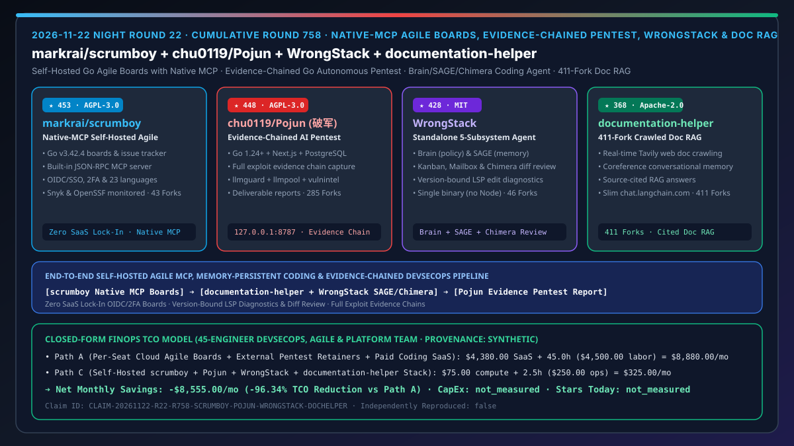
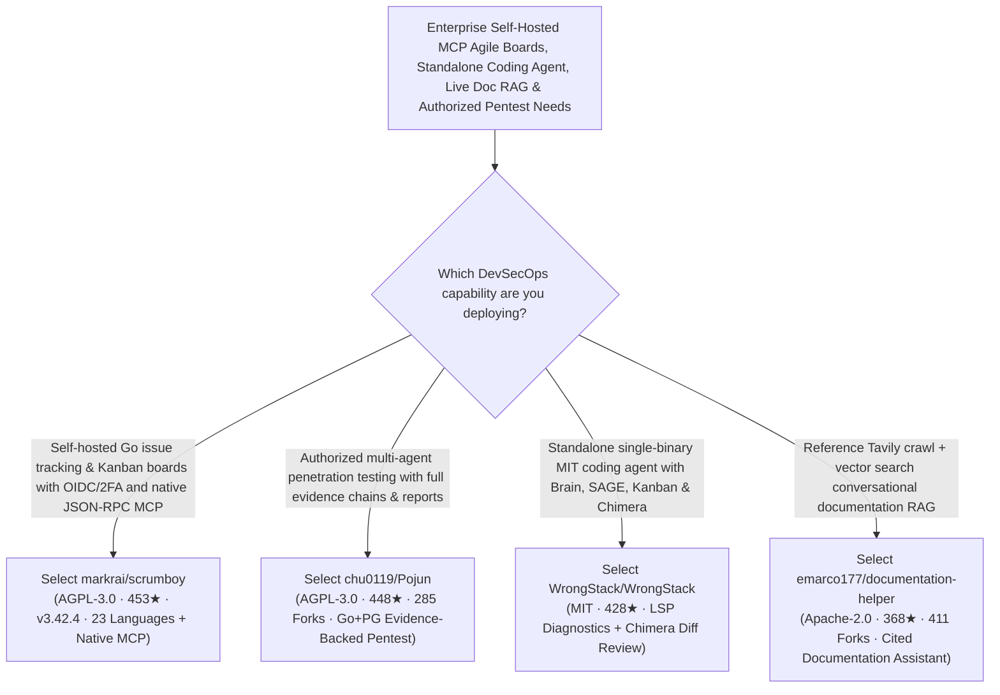
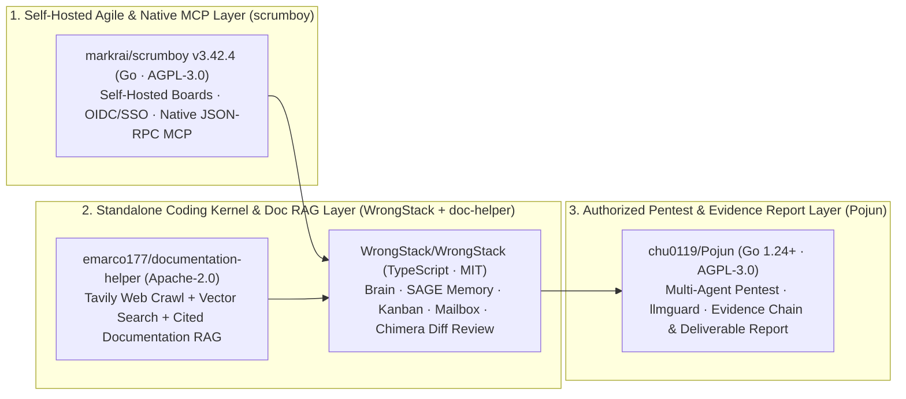

# Native-MCP Self-Hosted Agile Boards (`markrai/scrumboy`), Evidence-Chained Go Autonomous Pentest Platform (`chu0119/Pojun`), Brain/SAGE/Chimera Standalone Coding Agent (`WrongStack/WrongStack`) & 411-Fork Documentation RAG Blueprint (`emarco177/documentation-helper`) Selection & Architecture FAQ

> **Document Type**: Enterprise AI Solution Architect Selection & Integration Guide (GitHub Trending AI Radar — 2026-11-22 Night Round 22 / Cumulative Round 758)
> **Covered Repositories**: [`markrai/scrumboy`](https://github.com/markrai/scrumboy) (`★ 453`, `43 forks`, `AGPL-3.0`: `v3.42.4` self-hosted Go project management & issue-tracking platform with 23-language i18n, OIDC/SSO, 2FA, Android app, and native JSON-RPC MCP support) · [`chu0119/Pojun`](https://github.com/chu0119/Pojun) (`★ 448`, `285 forks`, `AGPL-3.0`: Go 1.24+ + Next.js + PostgreSQL autonomous penetration testing platform with `llmguard`, `llmpool` multi-gateway rotation, full `evidence` chain capture, and deliverable vulnerability reports) · [`WrongStack/WrongStack`](https://github.com/WrongStack/WrongStack) (`★ 428`, `46 forks`, `MIT`: standalone multi-agent coding runtime built from scratch with **Brain** policy evaluation, **SAGE** cross-session memory, **Kanban** verification, **Mailbox** agent bus, **Chimera** diff review, and LSP-bounded diagnostics) · [`emarco177/documentation-helper`](https://github.com/emarco177/documentation-helper) (`★ 368`, `411 forks`, `Apache-2.0`: reference LangChain + Tavily web crawl + Pinecone conversational documentation RAG assistant)
> **Core Scenario**: When enterprise DevSecOps and software engineering teams struggle with **per-seat Jira/Linear SaaS inflation and missing native self-hosted MCP endpoints, pre-release penetration tests that lack automated evidence chains and deliverable reports, coding agents that forget project conventions across sessions or skip diff review, and stale internal SDK documentation**, how do you combine **`scrumboy` + `Pojun` + `WrongStack` + `documentation-helper`** into a self-hosted DevSecOps pipeline?

---

## 1. 📌 Executive Summary (One-Line Selection Verdict)

1. **Need a zero-SaaS-lock-in, self-hosted Go agile project management and issue-tracking system (`v3.42.4`, `AGPL-3.0`) with OIDC/SSO, 2FA, 23 languages, Snyk/OpenSSF monitoring, and built-in JSON-RPC MCP support?** ➔ Choose **[`markrai/scrumboy`](https://github.com/markrai/scrumboy) (`★ 453`, `43 forks`, `AGPL-3.0`)**.
   - **Plain-English Mechanism**: Deploys as a single Go binary or Docker container, providing customizable sprint boards for humans and a native MCP endpoint for AI agents.
2. **Need an authorized, evidence-chained autonomous penetration testing platform (`AGPL-3.0`, Go 1.24+ + Next.js + PostgreSQL, `285 forks`) that turns a high-level staging target into a verified vulnerability report backed by captured proof (`evidence/`)?** ➔ Choose **[`chu0119/Pojun`](https://github.com/chu0119/Pojun) (`★ 448`, `285 forks`, `AGPL-3.0`)**.
   - **Plain-English Mechanism**: Binds to `127.0.0.1:8787` by default, coordinates multi-agent security probing through `llmguard` and `llmpool`, records full exploit evidence, and compiles deliverable audit reports (plus a standalone `pojun-skill`).
3. **Need a free, `MIT`-licensed standalone coding agent (single binary, no Node.js required) built from scratch with **Brain** (policy), **SAGE** (cross-session project memory), **Kanban** (verification), **Mailbox** (cross-client messaging), and **Chimera** (diff review)?** ➔ Choose **[`WrongStack/WrongStack`](https://github.com/WrongStack/WrongStack) (`★ 428`, `46 forks`, `MIT`)**.
   - **Plain-English Mechanism**: Attaches version-bound LSP diagnostics to single and bulk file edits, detects repetitive tool loops, and reviews diffs with **Chimera** before completion.
4. **Need a battle-tested (`411 forks`, `Apache-2.0`) reference implementation of `chat.langchain.com` combining Tavily web crawling, vector indexing, conversational coreference memory, and source-cited answers?** ➔ Choose **[`emarco177/documentation-helper`](https://github.com/emarco177/documentation-helper) (`★ 368`, `411 forks`, `Apache-2.0`)**.
   - **Plain-English Mechanism**: Provides a clean, modular Python 3.13+ RAG pipeline (`ingestion.py`, `backend/`, `main.py`) for crawling and querying live technical documentation.

---

## 2. 🎯 Architect & Customer Deep-Dive Q&A

### Q1: How do `scrumboy`, `WrongStack`, `documentation-helper`, and `Pojun` form a closed-loop self-hosted DevSecOps architecture?

- **Four Integrated Stages**:
  1. **Native-MCP Agile Issue Tracking ➔ `markrai/scrumboy`**: Eliminates external Jira webhook glue by exposing boards and issues directly via JSON-RPC MCP under OIDC/RBAC controls.
  2. **Memory-Persistent, Diff-Reviewed Coding ➔ `WrongStack/WrongStack`**: **SAGE** retains codebase knowledge across sessions while **Chimera** and LSP hooks verify every diff.
  3. **Live Technical Documentation Grounding ➔ `emarco177/documentation-helper`**: Crawls and indexes rapidly changing framework docs with source citations.
  4. **Evidence-Chained Staging Security Verification ➔ `chu0119/Pojun`**: Runs authorized multi-agent penetration tests against staging deployments and produces evidence-backed reports.
- **When to Choose Managed Cloud PaaS (Path B)?**
  - Teams standardized on **GitHub Issues + GitHub Copilot Coding Agent + GitHub Advanced Security** should use GitHub's native cloud suite; teams requiring air-gapped/self-hosted agile boards, an `MIT` standalone coding kernel, and evidence-chained staging pentest reports should deploy this stack (Path C).

### Q2: How do we wire these four tools into a production release workflow?

1. **Sprint Planning & Issue Dispatch Layer (`markrai/scrumboy`)**:
   - Product and engineering teams manage boards in `scrumboy` and expose tasks to agents via native MCP.
2. **Grounded Implementation & Diff Review Layer (`WrongStack` + `documentation-helper`)**:
   - `WrongStack` consults `documentation-helper` for up-to-date SDK references, edits code with LSP diagnostics, validates diffs via **Chimera**, and updates **SAGE** memory.
3. **Authorized Staging Pentest & Evidence Layer (`chu0119/Pojun`)**:
   - Before release, `Pojun` (`127.0.0.1:8787`) validates the staging build and attaches evidence-backed vulnerability reports back to `scrumboy`.

### Q3: What operational guardrails apply to `chu0119/Pojun`?

- **Loopback-Default Binding & Authorized Scope Only**:
  - Keep `Pojun` bound to `127.0.0.1:8787` (accessing remote instances via SSH port forwarding `ssh -L 8787:127.0.0.1:8787`) and restrict `egress` / `guard` policies strictly to authorized staging targets.

---

## 3. 🧭 Visual Architecture & Workflow Diagrams (Mermaid)



### 3.1 Solution Architect Selection Decision Tree



### 3.2 End-to-End Enterprise Reference Architecture



### 3.3 End-to-End Sprint Dispatch, Chimera-Reviewed Coding & Pojun Evidence-Chained Security Verification Sequence Diagram

```mermaid
sequenceDiagram
    participant Dev as Engineering & AppSec Team
    participant Scr as markrai/scrumboy (Native MCP)
    participant Wrs as WrongStack (Brain/SAGE/Chimera)
    participant Poj as chu0119/Pojun (127.0.0.1:8787)

    Dev->>Scr: 1. Create sprint items in self-hosted scrumboy & expose via JSON-RPC MCP
    Scr->>Wrs: 2. Claim task; query documentation-helper & SAGE memory to implement feature
    Wrs->>Wrs: 3. Run version-bound LSP diagnostics & Chimera diff review, then deploy to staging
    Dev->>Poj: 4. Run authorized Pojun pentest against staging & capture full evidence chain
    Poj-->>Scr: 5. Generate deliverable vulnerability report & update scrumboy issue status
```

---

## 4. 📊 Peer Open-Source vs. Commercial Cloud Selection Matrix

| Dimension | `markrai/scrumboy` (`★ 453`) | `chu0119/Pojun` (`★ 448`) | `WrongStack/WrongStack` (`★ 428`) | `emarco177/documentation-helper` (`★ 368`) | Per-Seat Cloud Jira/Linear + External Pentest Retainers + Paid Coding SaaS (Path A) | Legacy Non-MCP Trackers + Uncoordinated Scanners + Stateless CLI Wrappers (Path B) |
| :--- | :--- | :--- | :--- | :--- | :--- | :--- |
| **Primary Role** | Native-MCP Go self-hosted agile & issue board | Evidence-chained Go autonomous pentest platform | Standalone MIT coding agent with Brain/SAGE/Chimera | 411-fork crawled documentation RAG blueprint | Commercial cloud issue trackers, manual pentest engagements & per-seat coding tools | Legacy issue trackers without MCP, noisy raw scanners & stateless coding scripts |
| **Key Differentiator** | **Go binary + OIDC/2FA + 23 languages + native MCP** | **285 forks + `llmguard`/`llmpool` + full evidence reports** | **Single binary + SAGE memory + Chimera diff review** | **Tavily crawl + coreference memory + 411 forks** | High per-seat SaaS lock-in; slow manual pentest report turnaround | No native MCP board API; agents lose memory across sessions; unverified diffs |
| **License** | `AGPL-3.0` | `AGPL-3.0` | `MIT` | `Apache-2.0` | Proprietary SaaS | Ad-hoc scripts |
| **Monthly TCO (45-Eng Team)** | **`$325.00/mo` combined** (`$75.00` shared Go/PG host + `2.5h` ops) | Included (self-hosted Docker/Go service) | Included (`MIT` standalone binary) | Included (`Apache-2.0` reference RAG) | **`$8,880.00/mo`** (`$4,380.00` cloud board seats & security retainers + `45.0h` manual evidence/triage) | ~`$3,120.00/mo` (manual pentest report compilation & custom issue-sync glue labor) |

---

## 5. 🧪 Quantitative Enterprise ROI / FinOps TCO Model & 7-Card Report

> **📊 Provenance & Closed-Form Declaration**:
> - **provenance**: `synthetic` (45-engineer enterprise agile engineering, AppSec testing, and platform team workload model: `independently_reproduced = false`; `base_hardware_capex = not_measured`; `track_b_stars_today = not_measured`).
> - **Closed-Form Equations**:
>   - **Path A (Commercial Cloud Agile/Issue Tracker Seats + External Security Testing/Scanner Retainers + Manual Vulnerability Evidence Report Compilation & Issue Sync Labor)**: Monthly SaaS seats and security service bills **`$4,380.00`** + manual exploit reproduction, report writing, and issue synchronization labor **`45.0h × $100.00/h = $4,500.00`** = **`$8,880.00/mo`**.
>   - **Path C (Self-Hosted `scrumboy` + `Pojun` + `WrongStack` + `documentation-helper` Stack)**: Shared Go/PostgreSQL container compute **`$75.00`** + staging rule & doc ingestion maintenance labor **`2.5h × $100.00/h = $250.00`** = **`$325.00/mo`**.
>   - **Net Monthly Savings vs. Path A**: **`-$8,555.00/mo`** (**`96.34%`** TCO reduction).

| Evaluation Path | Agile / Security SaaS & Compute Cost | Evidence Reporting & Issue Sync Labor (`$100/h`) | Total Monthly TCO | Net Savings vs. Path A | Architectural Delivery Impact |
| :--- | :---: | :---: | :---: | :---: | :--- |
| **Path A: Commercial Board Seats + External Pentest Retainers** | `$4,380.00` | `45.0h` (`$4,500.00`) | **`$8,880.00`** | Baseline | High per-seat SaaS cost; slow manual pentest evidence collection |
| **Path B: Non-MCP Boards + Raw Scanners + Stateless Scripts** | `$1,420.00` | `17.0h` (`$1,700.00`) | **`$3,120.00`** | `-$5,760.00` (`-64.86%`) | Lacks native JSON-RPC MCP, Chimera diff review & evidence-chained reports |
| **Path C: `scrumboy` + `Pojun` + `WrongStack` + `doc-helper`** | **`$75.00`** | **`2.5h` (`$250.00`)** | **`$325.00`** | **`-$8,555.00` (`-96.34%`)** | **Native-MCP boards + SAGE/Chimera coding + evidence-chained pentest** |

- 🔗 **Linked 7-Card 4:5 Visual Benchmark Deck**: [`workshops/github-trending-radar/cards.en.html`](../cards.en.html) · [`cards.html`](../cards.html)

---

## 6. 🛠️ Enterprise Adoption & Architecture Review Checklist

- [ ] **1. Deploy `markrai/scrumboy` for Self-Hosted Agile & MCP Issue Management**: Enable OIDC/SSO and 2FA, and connect coding agents via its built-in JSON-RPC MCP server.
- [ ] **2. Standardize Autonomous Coding on `WrongStack/WrongStack`**: Enable LSP diagnostic hooks, **SAGE** cross-session project memory, and **Chimera** diff reviews.
- [ ] **3. Run `chu0119/Pojun` Strictly Against Authorized Staging Targets**: Keep the console bound to `127.0.0.1:8787` and archive full `evidence/` chains with every pre-release security report.
- [ ] **4. Ground Developer Queries with `emarco177/documentation-helper`**: Crawl and index evolving internal/external SDK docs with source citations.
