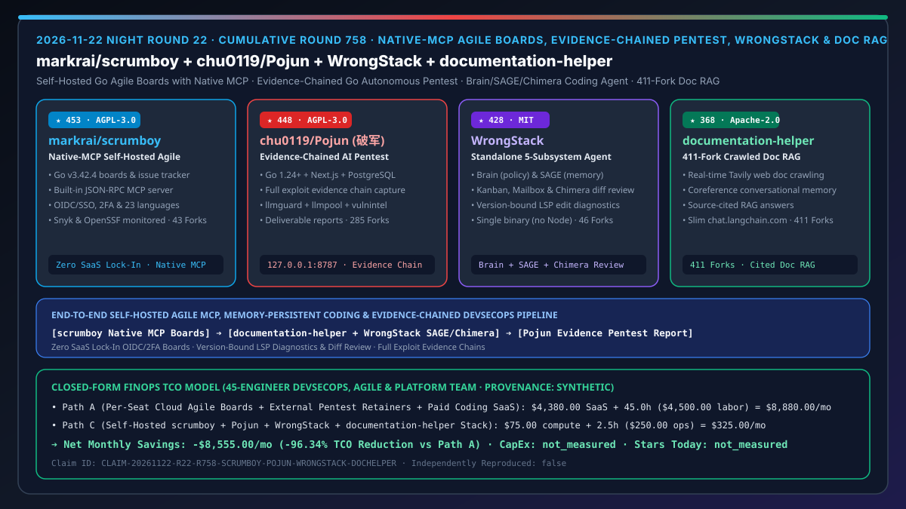
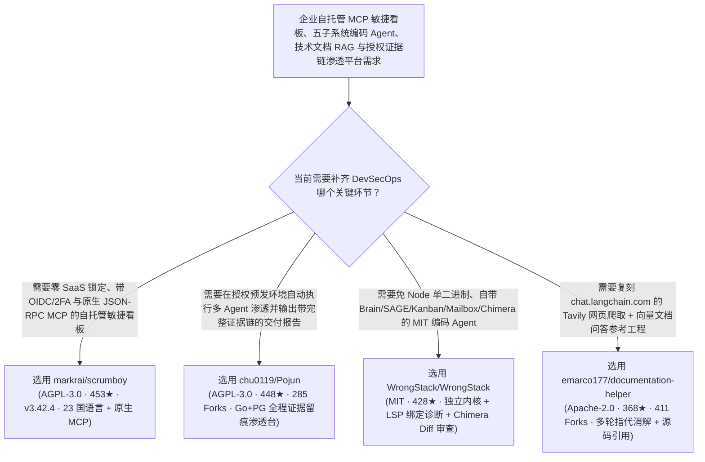
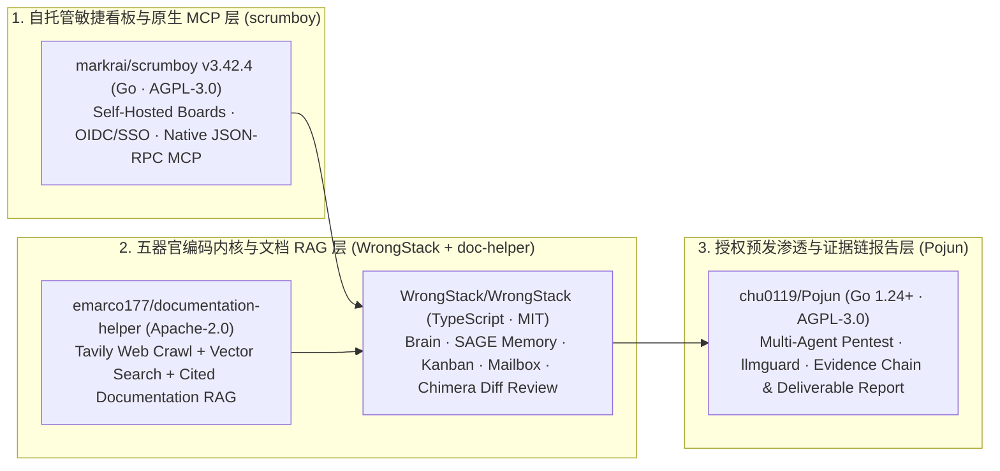
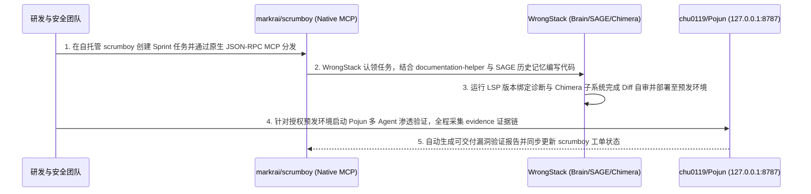

# 原生内置 MCP 的自托管敏捷看板（`markrai/scrumboy`）、全程证据留痕的 Go 自主渗透测试平台（`chu0119/Pojun`）、带 Brain/SAGE/Chimera 五大子系统的独立编码 Agent（`WrongStack/WrongStack`）与 411 Forks 技术文档爬虫 RAG 标杆（`emarco177/documentation-helper`）选型与集成架构 FAQ

> **文档类型**：企业 AI 解决方案架构师（AI Solution Architect）选型决策指南（GitHub Trending AI 雷达 2026-11-22 Night Round 22 / 累计第 758 轮）
> **覆盖项目**：[`markrai/scrumboy`](https://github.com/markrai/scrumboy)（`★ 453`、`43 forks`、`AGPL-3.0`，`v3.42.4`，支持 23 国语言、OIDC/SSO、2FA 与原生 MCP JSON-RPC 接口的 Go 自托管项目管理与敏捷看板系统）· [`chu0119/Pojun`](https://github.com/chu0119/Pojun)（`★ 448`、`285 forks`、`AGPL-3.0`，“破军” AI 自主渗透测试平台，Go 1.24+ 单体后端 + Next.js + PostgreSQL，集成 `llmguard`、`llmpool` 多通道轮询、`evidence` 全程证据留痕与可交付漏洞报告生成）· [`WrongStack/WrongStack`](https://github.com/WrongStack/WrongStack)（`★ 428`、`46 forks`、`MIT`，从零构建、无需 Node.js 单二进制运行的开源编码 Agent，内置 **Brain** 策略评估、**SAGE** 跨会话记忆、**Kanban** 验证看板、**Mailbox** 跨端通信与 **Chimera** Diff 审查五大核心模块）· [`emarco177/documentation-helper`](https://github.com/emarco177/documentation-helper)（`★ 368`、`411 forks`、`Apache-2.0`，对标 `chat.langchain.com`、结合 Tavily 实时网页爬取与向量检索的对话式技术文档问答参考蓝图）
> **核心场景**：当企业研发效能、DevSecOps 与平台工程团队面临**“商业 Jira/Linear 按人头涨价且缺少开箱即用的原生自托管 MCP 接口、上线前安全渗透测试高度依赖外部昂贵人工且缺乏完整证据链报告、第三方编码 CLI 缺少跨会话项目记忆（SAGE）与独立 Diff 审查者（Chimera）、以及内部技术框架文档更新快导致传统离线切片 RAG 频繁过期”**四大痛点时，如何组合**`scrumboy` + `Pojun` + `WrongStack` + `documentation-helper`** 打造全闭环自托管敏捷研发与安全验证流水线？

---

## 一、📌 核心结论速览（选型一句话结论）

1. **想用一套零 SaaS 锁定的 Go 单体自托管系统替代昂贵的 Jira/Linear，不仅自带 OIDC/SSO 登录、23 国语言、PWA/Android 客户端，还原生内置 MCP（JSON-RPC）接口让 AI 编码智能体直接拉取和更新 Sprint 任务卡** ➔ 选 **[`markrai/scrumboy`](https://github.com/markrai/scrumboy)（`★ 453`，`43 forks`，`AGPL-3.0`）**。
   - **通俗原理**：持续迭代至 `v3.42.4` 并受 Snyk 与 OpenSSF Scorecard 监控，支持实例级与项目级双层 RBAC 角色管理，是专为“人类敏捷团队 + AI Agent 协同领任务”设计的开源项目管理底座。
2. **想在企业授权安全测试（Red-Teaming / AppSec）中，用一套默认仅绑定 `127.0.0.1:8787` 的 Go + PostgreSQL 平台实现“从一句话目标到全程证据留痕（`evidence`）的可交付漏洞报告”** ➔ 选 **[`chu0119/Pojun`](https://github.com/chu0119/Pojun)（`★ 448`，`285 forks`，`AGPL-3.0`）**。
   - **通俗原理**：内置 `llmguard` 安全护栏、`llmpool` 多模型通道轮询、`vulnintel` 漏洞情报与 `report/docpreview` 报告引擎，强调“找到防线的破口，并把破口用完整证据链证明给你看”，同时提供可嵌入任意 Agent 的单技能版 `pojun-skill`。
3. **想要一款不套壳任何第三方 CLI、支持 macOS/Linux/Windows 单文件免安装运行，且原生自带五大协同器官（Brain 策略决策 + SAGE 跨会话记忆 + Kanban 任务校验 + Mailbox 跨端信箱 + Chimera 差异审查）的 `MIT` 开源编码智能体** ➔ 选 **[`WrongStack/WrongStack`](https://github.com/WrongStack/WrongStack)（`★ 428`，`46 forks`，`MIT`）**。
   - **通俗原理**：每次单文件或批量代码修改都会触发 LSP 插件的版本绑定诊断（Bounded LSP Diagnostics），并由独立的 **Chimera** 子系统审查 Diff，杜绝低级语法错误合入。
4. **想快速搭建一套类似 `chat.langchain.com` 的企业技术文档智能问答助手——支持 Tavily 动态爬取最新在线文档、智能分块向量化、指代消解多轮记忆与严格出处引用** ➔ 选 **[`emarco177/documentation-helper`](https://github.com/emarco177/documentation-helper)（`★ 368`，`411 forks`，`Apache-2.0`）**。
   - **通俗原理**：拥有高达 **411 个社区 Fork**，代码结构极其清晰（`ingestion.py` + `backend/` + `main.py`），是团队在 1 小时内跑通生产级文档 RAG 原型的黄金教学与脚手架模板。

---

## 二、🎯 客户与架构师灵魂拷问 Q&A（深度架构拆解）

### Q1：这套“自托管 MCP 敏捷看板 (`scrumboy`) + 五器官编码内核 (`WrongStack`) + 实时文档问答 (`documentation-helper`) + 证据链授权渗透 (`Pojun`)”如何重塑企业 DevSecOps 闭环？

- **四大环节无缝咬合**：
  1. **需求与任务管理原生 MCP 化 ➔ `markrai/scrumboy`**：无需额外部署第三方 Jira MCP 桥接器，`scrumboy` 原生暴露 JSON-RPC MCP 接口，让智能体在 OIDC/RBAC 权限内认领工单。
  2. **越用越懂代码库的自包含编码内核 ➔ `WrongStack/WrongStack`**：通过 **SAGE** 保存跨会话架构记忆、**Brain** 执行显式权限边界、**Chimera** 结合 LSP 诊断严审每一处 Diff。
  3. **最新技术文档零幻觉参考 ➔ `emarco177/documentation-helper`**：在开发过程中实时检索最新 SDK 文档并附带精准 URL 引用。
  4. **上线前授权渗透与证据链出报告 ➔ `chu0119/Pojun`**：对准预发（Staging）环境自动执行多 Agent 渗透验证，输出带完整复现证据的交付级漏洞报告。
- **何时直接用云厂商托管方案（Path B）？**
  - 若企业已深度绑定 **GitHub Issues/Projects + GitHub Copilot Coding Agent + GitHub Advanced Security (CodeQL)**，优先使用 GitHub 官方云原生闭环；若要求 100% 本地自托管敏捷看板、独立 MIT 编码内核与带完整证据链的授权黑盒渗透平台，则采用本轮开源栈（Path C）。

### Q2：典型企业级“任务认领 (`scrumboy`) ➔ 文档增强编码与 Diff 审查 (`documentation-helper` + `WrongStack`) ➔ 授权渗透出报告 (`Pojun`)”架构怎么搭？

1. **敏捷计划与工单 MCP 层（`markrai/scrumboy`）**：
   - 团队在自托管 `scrumboy` 看板规划 Sprint，通过内置 MCP 向编码智能体派发任务。
2. **智能编码、记忆沉淀与 Diff 审查层（`WrongStack` + `documentation-helper`）**：
   - `WrongStack` 调用 `documentation-helper` 查询最新 API 文档，由 Worker 编写代码、LSP 校验诊断、**Chimera** 审查 Diff，并将项目经验存入 **SAGE**。
3. **预发环境授权渗透与证据归档层（`chu0119/Pojun`）**：
   - 代码部署至隔离预发环境后，安全团队通过本地绑定 `127.0.0.1:8787` 的 `Pojun` 发起授权渗透测试，将生成的漏洞证据包自动回写至 `scrumboy` 缺陷单。

### Q3：在企业内部部署 `chu0119/Pojun` 有哪些强制安全红线？

- **严格遵循授权范围与本地回环绑定**：
  - `Pojun` 默认仅监听 `127.0.0.1:8787`（远程访问强制走 SSH 隧道或带鉴权 HTTPS 反代），且内置 `guard`/`llmguard` 模块，企业必须仅在拥有书面授权的自有测试靶场或预发环境中使用。

---

## 三、🧭 直观可视化图解（Mermaid 决策树 + 集成架构 + 时序图）

### 3.1 架构师选型决策树

### 3.2 企业端到端生产集成参考架构图

### 3.3 `scrumboy` 派单、`WrongStack` 编码审查与 `Pojun` 授权渗透验证时序图

---

## 四、📊 同类开源与商业云服务横向选型决策矩阵

| 对比维度 | `markrai/scrumboy` (`★ 453`) | `chu0119/Pojun` (`★ 448`) | `WrongStack/WrongStack` (`★ 428`) | `emarco177/documentation-helper` (`★ 368`) | 商业 Jira/Linear 席位 + 外部人工渗透外包 + 商业编码订阅 (Path A) | 无 MCP 老旧开源看板 + 手工跑散装扫描器 + 无记忆编码脚本 (Path B) |
| :--- | :--- | :--- | :--- | :--- | :--- | :--- |
| **核心能力定位** | 原生内置 MCP 的 Go 自托管敏捷看板 | 全程证据留痕的 Go 自主渗透测试平台 | 带 Brain/SAGE/Chimera 的独立编码 Agent | 411 Forks 技术文档爬取与向量问答标杆 | 按人头收费的公有云项目管理、高价渗透测试服务与闭源编码工具 | 缺少 AI 接口的传统看板、误报极高的裸跑扫描器与无 Diff 审查的脚本 |
| **核心技术突破** | **Go 单体 + OIDC/2FA + 23 语言 + 原生 JSON-RPC MCP** | **285 Forks + `llmguard`/`llmpool` + 全程证据链可交付报告** | **单二进制免 Node + SAGE 跨会话记忆 + Chimera Diff 审查** | **Tavily 动态爬取 + 指代消解记忆 + 411 Forks 实战验证** | 商业看板按席位年费高昂；外部渗透测试周期长且按次高额收费 | 手写扫描脚本缺乏完整证据链报告；编码 Agent 每次重开会话失忆 |
| **开源协议** | `AGPL-3.0` | `AGPL-3.0` | `MIT` | `Apache-2.0` | 闭源商业 SaaS | 内部零散脚本 |
| **月度 TCO（45 人团队）** | **组合仅 `$325.00/月`**（`$75.00` 自托管 Go+PG 容器宿主 + `2.5h` 维护） | 同左（自托管容器内运行） | 同左（`MIT` 免订阅单二进制） | 同左（`Apache-2.0` 开源脚手架） | **`$8,880.00/月`**（`$4,380.00` 商业看板席位与安全服务摊销 + `45.0h` 人工复现与写报告） | 约 `$3,120.00/月`（大量人工整理渗透截图写报告与维护工单同步脚本工时） |

---

## 五、🧪 应用落地定量收益/TCO 对比与 7-Card 报告

> **📊 数据来源与闭式核算声明（Provenance & Closed-Form Schema）**：
> - **provenance**: `synthetic`（基于 45 人企业敏捷研发、AppSec 安全测试与平台工程团队月度工作负载模型：`independently_reproduced = false`；硬件采购基线 `base_hardware_capex = not_measured`；Track B 单日增量 `track_b_stars_today = not_measured`）。
> - **核算公式**：
>   - **Path A（采购全员商业项目管理与工单云 SaaS 席位 + 商业安全扫描与外部渗透测试月度分摊 + 工程师手工同步工单状态、手动复现漏洞整理证据报告及修复无审查代码人工）**：月度商业席位与安全服务账单 **`$4,380.00`** + 人工编写渗透复现报告、跨系统同步工单与返工修复人工 **`45.0h × $100.00/h = $4,500.00`** = **`$8,880.00/月`**。
>   - **Path C（自建 `scrumboy` + `Pojun` + `WrongStack` + `documentation-helper` 开源敏捷与安全闭环栈）**：共享 Go/PostgreSQL 容器开销 **`$75.00`** + 靶场规则与知识库增量同步维护人工 **`2.5h × $100.00/h = $250.00`** = **`$325.00/月`**。
>   - **净节省（Net Savings vs Path A）**：**`-$8,555.00/月`**（成本降低 **`96.34%`**）。

| 评估方案 | 商业看板/安全服务与算力成本 | 渗透报告编写与工单同步人工（`$100/h`） | 月度总 TCO | 相对 Path A 净节省 | 关键架构交付指标 |
| :--- | :---: | :---: | :---: | :---: | :--- |
| **Path A：商业敏捷看板席位 + 外部安全测试 + 人工写报告** | `$4,380.00` | `45.0h` (`$4,500.00`) | **`$8,880.00`** | Baseline | 按人头席位费高昂；安全验证周期长且证据整理费时 |
| **Path B：传统无 MCP 看板 + 裸跑开源扫描器 + 单体脚本** | `$1,420.00` | `17.0h` (`$1,700.00`) | **`$3,120.00`** | `-$5,760.00` (`-64.86%`) | 缺少原生 JSON-RPC MCP、Chimera Diff 审查与完整证据链报告 |
| **Path C：`scrumboy` + `Pojun` + `WrongStack` + `doc-helper`** | **`$75.00`** | **`2.5h` (`$250.00`)** | **`$325.00`** | **`-$8,555.00` (`-96.34%`)** | **原生 MCP 看板 + SAGE/Chimera 编码内核 + 全证据链渗透报告** |

- 🔗 **关联 7-Card 4:5 视觉评测报告**：[`workshops/github-trending-radar/cards.html`](../cards.html) · [`cards.en.html`](../cards.en.html)

---

## 六、🛠️ 企业引入与架构评审 Checklist

- [ ] **1. 部署 `markrai/scrumboy` 构建零 SaaS 锁定的敏捷管理底座**：启用 OIDC/SSO 与 2FA，并通过内置 JSON-RPC MCP 接口向研发 Agent 开放工单协同。
- [ ] **2. 引入 `WrongStack/WrongStack` 强化编码记忆与 Diff 自审**：开启 LSP 诊断插件、**SAGE** 跨会话知识沉淀与 **Chimera** 自动 Diff 审查。
- [ ] **3. 在隔离授权预发环境部署 `chu0119/Pojun`**：保持默认 `127.0.0.1:8787` 绑定与 SSH 隧道访问，自动生成带完整 `evidence` 证据链的渗透测试报告。
- [ ] **4. 参考 `emarco177/documentation-helper` 搭建内部 SDK 实时文档助手**：结合动态爬取与指代消解记忆消除内部框架调用幻觉。
