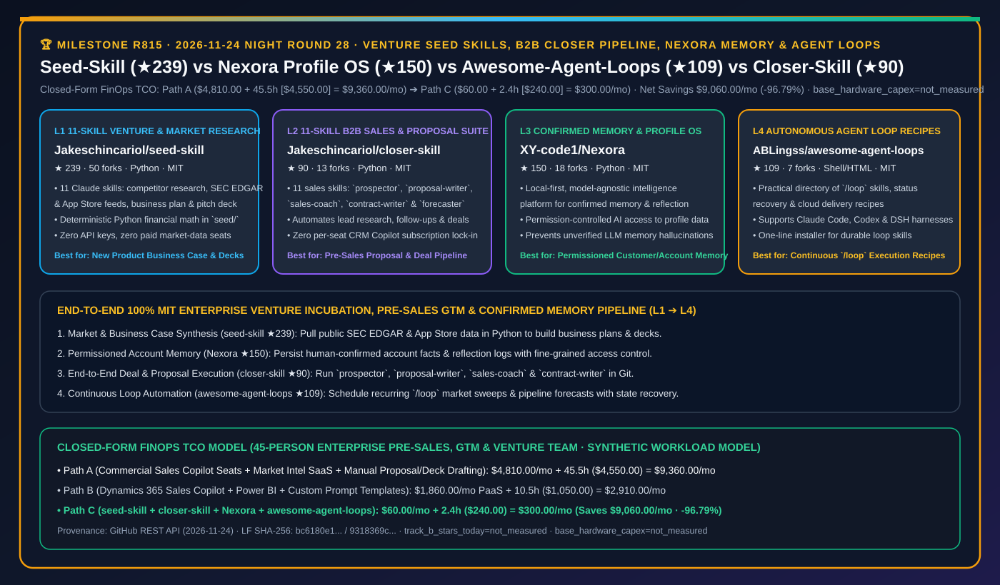
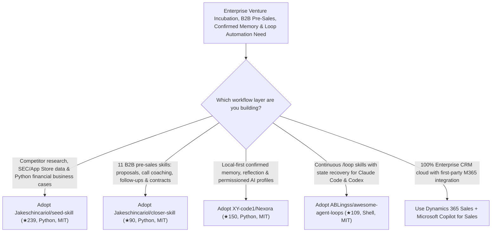
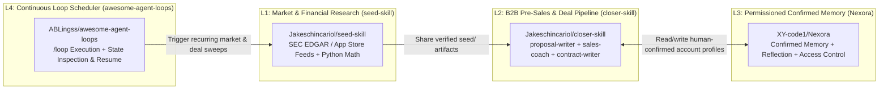
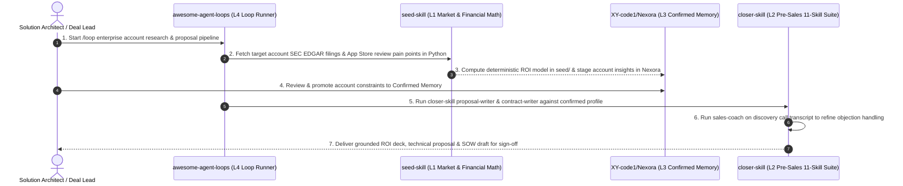

# 🏆 [Round 815 Milestone] 11-Skill Venture & Market Suite (`Jakeschincariol/seed-skill`), 11-Skill B2B Sales & Proposal Suite (`Jakeschincariol/closer-skill`), Confirmed Memory Platform (`XY-code1/Nexora`) & Autonomous Agent Loop Recipes (`ABLingss/awesome-agent-loops`) Selection & Architecture FAQ

> **Document Type**: AI Solution Architect Selection & Integration Guide (2026-11-24 Night Round 28 / Cumulative Round 815 Milestone)  
> **Reading Time**: ~8 minutes  
> **Covered Repositories**: [`Jakeschincariol/seed-skill`](https://github.com/Jakeschincariol/seed-skill) (`★ 239` · `50 forks` · Python · `MIT`) · [`XY-code1/Nexora`](https://github.com/XY-code1/Nexora) (`★ 150` · `18 forks` · Python · `MIT`) · [`ABLingss/awesome-agent-loops`](https://github.com/ABLingss/awesome-agent-loops) (`★ 109` · `7 forks` · HTML/Shell · `MIT`) · [`Jakeschincariol/closer-skill`](https://github.com/Jakeschincariol/closer-skill) (`★ 90` · `13 forks` · Python · `MIT`)  
> **Evidence Provenance**: GitHub REST API verified metadata (2026-11-24) and sealed local evidence files `trending-daily-2026-11-24-raw.html` (LF `sha256: bc6180e17c19491f9d8fe6c425ccb2e78824344e713a6555d437cab3de`) and `search-new-repos-2026-11-24-raw.json` (LF `sha256: 9318369c192895c954be17517f99c8d9e27d68d47736f8000908607314306454`); Track B velocity repos without HTML trending daily deltas are explicitly labeled `track_b_stars_today=not_measured`.  
> **中文版本**: [`seed-closer-nexora-agent-loops-selection-faq.md`](./seed-closer-nexora-agent-loops-selection-faq.md)

---

## ① 📌 Executive Summary

**One-Sentence Selection Verdict**: When enterprise solution architects, pre-sales teams, and venture incubation units need a **100% `MIT`-licensed market research, B2B proposal generation, and account intelligence pipeline**—combining **11 Python-backed venture and market analysis skills reading live SEC EDGAR and App Store feeds (`Jakeschincariol/seed-skill`), 11 end-to-end B2B sales, proposal, coaching, and contract skills (`Jakeschincariol/closer-skill`), a local-first confirmed-memory and permissioned profile platform (`XY-code1/Nexora`), and continuous `/loop` execution recipes (`ABLingss/awesome-agent-loops`)**—adopting this 4-layer stack reduces monthly TCO for a 45-person pre-sales & GTM team from **`$9,360.00/mo`** (Path A: Commercial Sales Copilot Seats + Market Intelligence SaaS + Manual Proposal/Deck Drafting) to **`$300.00/mo`** (Path C), saving **`$9,060.00/mo` (`-96.79%`)**.

| Dimension | `Jakeschincariol/seed-skill` (L1 11-Skill Venture Suite) | `Jakeschincariol/closer-skill` (L2 11-Skill B2B Sales Suite) | `XY-code1/Nexora` (L3 Confirmed Memory OS) | `ABLingss/awesome-agent-loops` (L4 Agent Loop Recipes) |
|---|---|---|---|---|
| **Verified Stars & Forks** | `★ 239` · `50 forks` | `★ 90` · `13 forks` | `★ 150` · `18 forks` | `★ 109` · `7 forks` |
| **Language & License** | Python (`MIT`) | Python (`MIT`) | Python (`MIT`) | Shell / HTML (`MIT`) |
| **Plain-English Positioning** | 11 Claude skills taking a product from idea to funded via free public feeds (SEC EDGAR, App Store) & Python math | 11 Claude skills running an end-to-end sales & pre-sales team (`prospector`, `proposal-writer`, `sales-coach`, `contract-writer`) | Local-first, model-agnostic intelligence framework for confirmed memory, reflection & permissioned access | Practical directory of `/loop` skills, state recovery & cloud delivery recipes for Claude Code, Codex & DSH |
| **Core Enterprise Pain Solved** | Eliminates hallucinated market sizing and LLM mental-math errors by fetching SEC filings/reviews and computing financials in Python | Replaces expensive per-seat sales engagement, call-coaching, and proposal SaaS licenses with local Git-tracked files | Prevents unverified LLM guesses from polluting customer account profiles via a strict "Confirmed Memory" gate | Enables coding and GTM agents to run recurring `/loop` workflows with pause, status inspection, and recovery |
| **When to Choose vs Cloud PaaS** | Choose for data-grounded business cases, competitor tear-downs, and executive pitch decks | Choose for agile B2B pre-sales proposals, call coaching, and contract drafting without per-seat CRM lock-in | Mandatory when account and user profiles require human confirmation and permission boundaries | Choose for continuous `/loop` automation across Claude Code, Codex, and compatible CLI agents |

---

## ② 🎯 Architect & Customer Q&A (1–2 Minute Read)

### Q1: When LLMs draft business cases or competitor analyses from scratch, they routinely hallucinate TAM numbers and botch financial arithmetic. How does `Jakeschincariol/seed-skill` (`★ 239`) guarantee grounded numbers at zero API cost?
- **The Pain**: Pure prompt templates rely on stale training weights and unreliable token-level mental math.
- **Architect's Answer**: `Jakeschincariol/seed-skill` (`MIT`) packages **11 coordinated skills backed by plain Python tools** that query **free public primary sources (SEC EDGAR financial filings and live App Store search/review feeds)**, run deterministic Python financial calculations, and write structured artifacts into a shared `seed/` folder so every downstream skill (business plan, pitch deck, investor matcher) builds on verified numbers.

### Q2: How does `Jakeschincariol/closer-skill` (`★ 90`) equip AI Solution Architects and B2B deal teams?
- **11 End-to-End Pre-Sales & Deal Execution Skills (`MIT`, Zero CRM Seat Fees)**:
  - **Discovery & Proposals**: `researcher`, `prospector`, and `proposal-writer` synthesize technical and commercial proposals tailored to the prospect's public footprint;
  - **Call Coaching & Follow-Through**: `record-keeper`, `sales-coach` (analyzing discovery call transcripts for objection handling), `follow-up`, and `scheduler`;
  - **Closing & Forecasting**: `contract-writer`, `pipeline`, `forecaster`, and `win-back`.

### Q3: Why combine `seed-skill` and `closer-skill` with `XY-code1/Nexora` (`★ 150`) and `ABLingss/awesome-agent-loops` (`★ 109`)?
- **Confirmed Account Memory + Continuous Loop Execution**:
  1. **`XY-code1/Nexora` (`MIT`) Enforces Confirmed Memory**: Prevents agents from saving unverified assumptions as customer truth by separating raw observations, reflection, and **Confirmed Memory** under strict permission controls.
  2. **`ABLingss/awesome-agent-loops` (`MIT`) Powers Continuous `/loop` Delivery**: Provides ready-to-install `/loop` skills (with status inspection, state resume, and clean stop controls) across Claude Code, Codex, and DSH so market and pipeline sweeps run continuously.

---

## ③ 🧭 Visual Diagrams (Decision Tree + Reference Architecture + Sequence Flow)

### 3.1 Selection Decision Tree

### 3.2 End-to-End Enterprise Production Reference Architecture

### 3.3 End-to-End Execution Sequence Diagram

---

## ④ 📊 Comparative Selection Matrix: OSS Stack vs. Peer OSS vs. Cloud PaaS

| Dimension | This OSS Stack (`seed-skill` + `closer-skill` + `Nexora` + `awesome-agent-loops`) | Ad-Hoc Prompt Approach (`Raw ChatGPT Prompts` + `Manual Spreadsheets` + `Unverified Memory`) | Commercial GTM Cloud (`Gong` + `Outreach` + `Market Data SaaS` + `CRM Copilot`) |
|---|---|---|---|
| **Core Role** | 11 venture/market skills + 11 B2B sales/proposal skills + confirmed memory OS + `/loop` recipes | One-off ungrounded prompts + manual copy-pasting + hallucination-prone auto-memory | Per-seat call intelligence + sales engagement + market databases + CRM Copilot |
| **Best-Fit Scenario** | Solution architects building grounded business cases, custom proposals, call reviews & account memory | Casual one-off email drafting | 500+ seat enterprise SDR teams standardized on Dynamics 365 / Salesforce |
| **Integration Effort** | **Very Low** (100% `MIT`, plain Python & `SKILL.md` files, zero external API keys required) | Medium (Manual SEC/review data collection for every pitch) | High (Multi-vendor SaaS contracts, SSO provisioning, and CRM schema mapping) |
| **Operational Complexity** | **Very Low** (Git-versioned `seed/` directory & `Nexora` memory, ~`2.4h/mo` ops) | High (Fact-checking hallucinated financials and fixing stale notes costs ~`45.5h/mo`) | Low (Managed cloud SaaS, plus ~`10.5h/mo` CRM admin overhead) |
| **License & Compliance** | **100% `MIT` License across all 4 repositories** (deal data stays 100% on-prem/local) | Unstructured | Proprietary per-seat annual contracts |
| **45-Person Monthly TCO** | **`$300.00/mo`** (`$60.00` shared internal repo/loop host + `2.4h` ops) | ~`$4,610.00/mo` (`$60.00` host + `45.5h` manual research & proposal rework) | **`$2,910.00/mo`** (Path B) to **`$9,360.00/mo`** (Path A commercial stack) |

---

## ⑤ 🧪 Quantitative ROI & Closed-Form FinOps TCO Comparison

> **Provenance Disclosure**: The TCO table below is a closed-form synthetic architectural model (`provenance: synthetic`, `independently_reproduced: false`) for a **45-person enterprise pre-sales solution architecture, GTM, and venture incubation team** producing 30 market/ROI business cases, 90 custom technical proposals/SOWs, and 180 call-coaching and pipeline reviews per month (`$100.00/hr` loaded rate). Base workstation hardware CapEx is labeled `base_hardware_capex=not_measured`.

| Cost Component | Path A: Commercial Sales Copilot Seats + Market Intel SaaS + Manual Proposal Drafting | Path B: Dynamics 365 Sales Copilot + Power BI + Internal Templates | Path C: `seed-skill` + `closer-skill` + `Nexora` + `awesome-agent-loops` |
|---|---|---|---|
| **Monthly API / SaaS / Cloud Spend** | **`$4,810.00`** (45 commercial sales coaching, engagement & market database seats) | **`$1,860.00`** (CRM Copilot add-on seats + BI capacity) | **`$60.00`** (`seed-skill` & `closer-skill` read free public feeds at `$0` API cost; `$60` internal host) |
| **Monthly Financial Verification, Proposal & Note Labor** | `45.5h` (Manual SEC/competitor lookup + fixing LLM math errors + manual call logging) | `10.5h` (CRM template & pipeline maintenance) | **`2.4h`** (Deterministic Python math in `seed/` + `Nexora` confirmed-memory review) |
| **Monthly Labor Cost (`$100.00/hr`)** | **`$4,550.00`** (`45.5 * 100.00`) | **`$1,050.00`** (`10.5 * 100.00`) | **`$240.00`** (`2.4 * 100.00`) |
| **Total Monthly TCO** | **`$9,360.00 / mo`** | **`$2,910.00 / mo`** | **`$300.00 / mo`** |
| **Net Monthly Savings vs. Path A** | Baseline (`$0.00`) | Saves `$6,450.00 / mo` (`-68.91%`) | **Saves `$9,060.00 / mo` (`-96.79%`)** |

---

## ⑥ 🛠️ Enterprise Architecture Review & Adoption Checklist

- [ ] **Deterministic Python Arithmetic for All Pitch Numbers (`Jakeschincariol/seed-skill`)**: Require every financial table, TAM estimate, and competitor benchmark in executive decks to be computed by `seed-skill`'s Python scripts from primary SEC EDGAR / App Store feeds and stored in `seed/`.
- [ ] **Human Editorial & Legal Gate on Outbound Proposals (`Jakeschincariol/closer-skill`)**: Keep `closer-skill`'s `prospector`, `follow-up`, `proposal-writer`, and `contract-writer` outputs staged as local drafts requiring explicit architect and legal sign-off before sending to customers.
- [ ] **Confirmed-Memory Promotion Policy (`XY-code1/Nexora`)**: Configure `Nexora` so agent-extracted customer facts remain in reflection staging until confirmed by the account owner, with role-based permissions governing which agents can read sensitive pricing or contract memories.
- [ ] **Bounded Iterations & State Checkpoints (`ABLingss/awesome-agent-loops`)**: Set explicit iteration caps and pause conditions on all `/loop` workflows so recurring research and pipeline sweeps never run unbounded.
