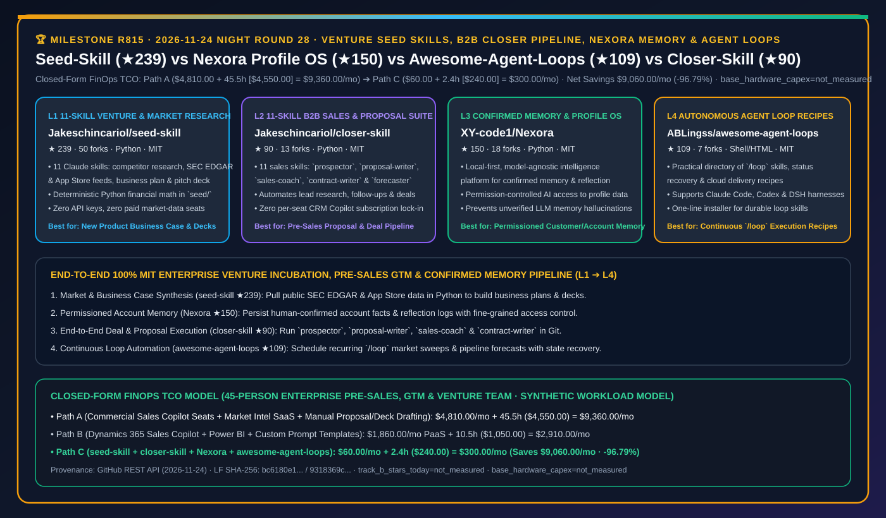
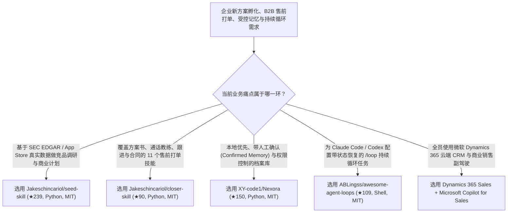
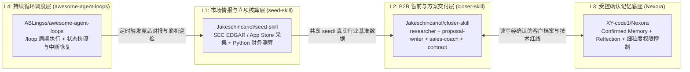
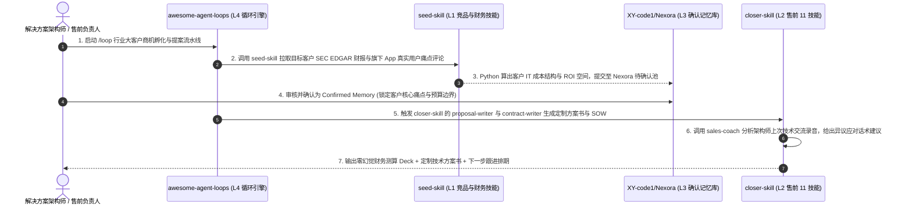

# 🏆【第 815 轮里程碑】11 技能创新孵化与商业计划套件（`Jakeschincariol/seed-skill`）、11 技能全流程 B2B 售前与商机推进套件（`Jakeschincariol/closer-skill`）、受控确认记忆与个人智能档案框架（`XY-code1/Nexora`）与持续循环智能体配方库（`ABLingss/awesome-agent-loops`）选型与集成 FAQ

> **文档类型**：AI 解决方案架构师（AI Solution Architect）选型决策指南（2026-11-24 Night Round 28 / 累计第 815 轮里程碑）  
> **阅读耗时**：约 8 分钟  
> **覆盖项目**：[`Jakeschincariol/seed-skill`](https://github.com/Jakeschincariol/seed-skill)（`★ 239` · `50 forks` · Python · `MIT`） · [`XY-code1/Nexora`](https://github.com/XY-code1/Nexora)（`★ 150` · `18 forks` · Python · `MIT`） · [`ABLingss/awesome-agent-loops`](https://github.com/ABLingss/awesome-agent-loops)（`★ 109` · `7 forks` · HTML/Shell · `MIT`） · [`Jakeschincariol/closer-skill`](https://github.com/Jakeschincariol/closer-skill)（`★ 90` · `13 forks` · Python · `MIT`）  
> **证据溯源**：GitHub REST API 实测元数据（2026-11-24）与本地冻结证据文件 `trending-daily-2026-11-24-raw.html`（LF `sha256: bc6180e17c19491f9d8fe6c425ccb2e78824344e713a6555d437cab3de`）、`search-new-repos-2026-11-24-raw.json`（LF `sha256: 9318369c192895c954be17517f99c8d9e27d68d47736f8000908607314306454`）；Track B 仓库无 HTML 榜单对应的单日增量，统一标记为 `track_b_stars_today=not_measured`。  
> **English Version**: [`seed-closer-nexora-agent-loops-selection-faq.en.md`](./seed-closer-nexora-agent-loops-selection-faq.en.md)

---

## ① 📌 核心结论速览（Executive Summary）

**选型一句话结论**：当企业解决方案架构师、售前团队与创新业务孵化部门希望用 AI 智能体跑通**“新产品/新方案立项竞品调研与商业计划书（`Jakeschincariol/seed-skill`）➔ B2B 客户线索挖掘、方案书撰写、通话复盘教练与合同起草（`Jakeschincariol/closer-skill`）➔ 经人工确认的客户/项目档案记忆与细粒度权限管控（`XY-code1/Nexora`）➔ 7×24 持续 `/loop` 自动化巡检与恢复配方（`ABLingss/awesome-agent-loops`）”**的完整商业转化链路时，采用这套 100% `MIT` 开源协议的四层架构，可将 45 人售前与业务拓展团队的月度 TCO 从昂贵的商业销售智能 SaaS（Gong/Outreach/商业 CRM Copilot 席位）+ 人工撰写商业计划与提案（Path A）的 **`$9,360.00/月`** 降至 **`$300.00/月`**（净省 **`$9,060.00/月`**，降幅 **`-96.79%`**）。

| 评估维度 | `Jakeschincariol/seed-skill` (L1 11技能创新立项套件) | `Jakeschincariol/closer-skill` (L2 11技能B2B售前套件) | `XY-code1/Nexora` (L3 受控确认记忆平台) | `ABLingss/awesome-agent-loops` (L4 持续循环配方库) |
|---|---|---|---|---|
| **GitHub 实测热度** | `★ 239` · `50 forks` | `★ 90` · `13 forks` | `★ 150` · `18 forks` | `★ 109` · `7 forks` |
| **实现语言与开源协议** | Python (`MIT`) | Python (`MIT`) | Python (`MIT`) | Shell / HTML (`MIT`) |
| **一句话通俗定位** | 覆盖竞品调研（App Store / SEC EDGAR 免费公开源）、商业计划书與路演 Deck 的 11 个零 Key Python 技能包 | 覆盖线索挖掘、方案书撰写、通话复盘教练、合同起草与营收预测的 11 个零 CRM 席位费技能包 | 本地优先、模型无关、基于“已确认记忆（Confirmed Memory）”与反思的权限受控智能档案框架 | 面向 Claude Code、Codex 与 DSH 的 `/loop` 持续运行技能、状态恢复与云端交付配方目录 |
| **解决的核心业务痛点** | 消除大模型拍脑袋捏造市场规模与财务数据（用确定性 Python 脚本拉取 SEC 财报与商店评论并精确计算） | 替代按人头月付上百美金的商业销售与提案 SaaS，将全部客户档案沉淀在本地可控目录中 | 解决传统自动记忆把大模型随口猜测的错误结论当作事实存入知识库、且缺乏读写权限隔离的痛点 | 解决单次对话结束后 Agent 就停止工作、无法持续监控外部信号并从中断处恢复的痛点 |
| **何时选它 vs 云托管** | 企业内部新业务立项、行业竞品财报分析与路演材料自动化时必选 | 解决方案架构师与售前团队自动化生成客户定制提案（Proposal）、通话复盘与跟进邮件时必选 | 需要构建经过人工确认（Confirmed）、不产生记忆污染的客户与个人知识档案时选它 | 需要为 Claude Code / Codex 配置长周期 `/loop` 巡检与云端自动化交付流水线时选它 |

---

## ② 🎯 客户与架构师灵魂拷问 Q&A（1–2 分钟速读）

### Q1：平时让大模型写《新产品商业计划书》或《客户行业竞品分析报告》，大模型最容易犯的错误是“张口就来编造市场增长率和财务比率”。`Jakeschincariol/seed-skill`（`★ 239`）是怎么做到零幻觉、零 API Key 成本的？
- **痛点**：纯提示词型技能让 LLM 直接心算财务模型并凭印象编造竞品数据，经不起投委会或客户高管推敲。
- **架构师解答**：`Jakeschincariol/seed-skill`（`MIT`）包含 **11 个串联协同的技能**，其精髓在于**“免费公开权威数据源 + 纯 Python 确定性算术 + 共享 `seed/` 上下文目录”**：
  1. **直连免费权威公开源**：内置纯 Python 工具直接读取美国证监会 **SEC EDGAR** 上市公司真实财报与 **App Store** 真实应用搜索/用户差评流，无需购买任何商业 API Key。
  2. **代码算数而非模型心算**：所有 TAM/SAM/SOM 测算、单位经济模型（Unit Economics）与融资稀释计算全部由 Python 脚本精确完成，并将中间产物统一写入项目下的 `seed/` 文件夹，供后续的商业计划书（Business Plan）与 Pitch Deck 技能无缝接力。

### Q2：立项通过后进入客户售前打单阶段，`Jakeschincariol/closer-skill`（`★ 90`）提供的 11 个技能如何赋能 AI Solution Architect（解决方案架构师）？
- **11 个全生命周期售前与商务技能（零 CRM 席位费）**：
  - **售前调研与方案定制**：`researcher`（深度背景调研）+ `prospector`（精准决策链挖掘）+ `proposal-writer`（结合客户痛点定制技术与商务方案书）；
  - **会议复盘与推进**：`record-keeper`（自动归档邮件与会议纪要）+ `sales-coach`（对照通话录音诊断异议处理短板）+ `follow-up` / `scheduler`（持续跟进直至锁定下次架构评审会）；
  - **商务收官与预测**：`contract-writer`（起草 SOW 与合同条款）+ `pipeline` + `forecaster` + `win-back`（流失商机唤醒）。

### Q3：为什么在运行 `seed-skill` 和 `closer-skill` 时，建议底层搭配 `XY-code1/Nexora`（`★ 150`）与 `ABLingss/awesome-agent-loops`（`★ 109`）？
- **记忆防污染 + 持续循环自动化**：
  1. **`XY-code1/Nexora`（知序 · `MIT`）守住“已确认记忆（Confirmed Memory）”底线**：在售前跟单中，客户预算、技术红线等核心档案绝不能让 Agent 随便覆写。`Nexora` 提供本地优先的**“待确认记忆 ➔ 反思（Reflection）➔ 已确认知识（Confirmed Memory）”**晋升机制与细粒度权限控制。
  2. **`ABLingss/awesome-agent-loops`（`MIT`）实现“无人值守 `/loop` 持续推进”**：汇总了面向 Claude Code、Codex 与 DSH 的 `/loop` 持续运行技能（含状态查看、中断恢复与停止控制）及云端交付配方，让竞品监控与商机跟进能够按周期自动循环运行。

---

## ③ 🧭 直观可视化图解（Mermaid 决策树 + 集成架构 + 时序图）

### 3.1 技术选型决策树

### 3.2 企业端到端生产集成参考架构图

### 3.3 业务流全链路时序图

---

## ④ 📊 同类开源与商业云服务横向选型决策矩阵

| 对比维度 | 本轮开源组合 (`seed-skill` + `closer-skill` + `Nexora` + `awesome-agent-loops`) | 传统零散提示词方案 (`裸写 ChatGPT 提示词` + `手工查财报` + `无状态自动记忆`) | 商业销售与情报 SaaS (`Gong + Outreach + Crunchbase Pro + 商业 CRM Copilot`) |
|---|---|---|---|
| **功能定位** | 11 技能立项调研 + 11 技能售前打单 + 受控确认记忆平台 + `/loop` 持续循环配方 | 易编造数据的单次对话 + 人工复制粘贴表格 + 易污染的向量库 | 按席位高价收费的通话分析、外呼序列、商业数据库与 CRM 插件 |
| **适用场景** | AI 解决方案架构师定制行业方案、技术型创业团队融资立项、敏捷 B2B 售前团队降本增效 | 仅需写一封简单寒暄邮件的临时场景 | 拥有数百名专职电话销售（SDR）且已深度绑定 Dynamics 365 / Salesforce 的大型集团 |
| **集成成本** | **极低**（纯 Python 标准库与 `SKILL.md` 文件，无需注册任何外部商业 API Key） | 中（每次都要手工搜集财报与评论数据喂给模型） | 高（多套商业 SaaS 采购审批、按年锁席位且总价极高） |
| **运维复杂度** | **极低**（本地文件级 `seed/` 目录与 `Nexora` 确认池，月均维护仅 `2.4h`） | 高（核对并修正大模型乱算的财务数字与写串的客户信息耗费 `45.5h/月`） | 低（云端 SaaS，月均字段映射与权限管理约 `10.5h`） |
| **开源协议与合规** | **四仓全部为 `MIT` 协议**（100% 商业友好，客户商机数据 0 上传第三方 CRM SaaS） | 无统一协议 | 商业闭源按人头高额订阅 |
| **45 人团队月度 TCO** | **`$300.00/月`**（含 `$60.00` 内部共享仓库与循环节点 + `2.4h` 运维） | 约 `$4,610.00/月`（含 `$60.00` 环境 + `45.5h` 手工查数与方案返工） | **`$2,910.00/月`**（Path B）至 **`$9,360.00/月`**（Path A 商业全栈） |

---

## ⑤ 🧪 应用落地定量收益 / TCO 对比（Closed-Form FinOps 模型）

> **数据性质声明（Provenance Metadata）**：以下 TCO 模型为面向 **45 人企业解决方案架构师、售前顾问与创新业务拓展团队**（每月完成 30 份行业竞品与财务 ROI 测算报告、90 份客户定制技术方案书/SOW、180 次技术交流复盘与持续商机跟进，折算时薪 `$100.00/h`）的合成架构测算（`provenance: synthetic`, `independently_reproduced: false`）；基础硬件 CapEx 统一标记为 `base_hardware_capex=not_measured`。

| 成本构成项 | Path A：商业销售智能 SaaS (Gong/Outreach) + 商业情报席位 + 人工核算方案 | Path B：Dynamics 365 Sales Copilot + Power BI + 内部模板 | Path C：`seed-skill` + `closer-skill` + `Nexora` + `awesome-agent-loops` |
|---|---|---|---|
| **API / SaaS / 云资源月费** | **`$4,810.00`**（45 人商业销售副驾驶、通话教练与市场数据库订阅费） | **`$1,860.00`**（CRM Copilot 附加席位与云端报表容量） | **`$60.00`**（`seed-skill` 与 `closer-skill` 直连免费公开源 `$0` API 费；仅需 `$60` 轻量内网节点） |
| **月度手工查财报、核对幻觉数据与写方案书工时** | `45.5h`（人工翻查竞品财报/评论 + 验算模型算错的表格 + 手工编写跟进纪要） | `10.5h`（CRM 商机字段维护与模板更新） | **`2.4h`**（Python 脚本确定性算数 + `Nexora` 一键确认客户记忆） |
| **人工运维与售前返工成本（`$100.00/h`）** | **`$4,550.00`** (`45.5 * 100.00`) | **`$1,050.00`** (`10.5 * 100.00`) | **`$240.00`** (`2.4 * 100.00`) |
| **月度总拥有成本（Total Monthly TCO）** | **`$9,360.00 / 月`** | **`$2,910.00 / 月`** | **`$300.00 / 月`** |
| **相对 Path A 净节省** | 基准线 (`$0.00`) | 节省 `$6,450.00 / 月` (`-68.91%`) | **净省 `$9,060.00 / 月` (`-96.79%`)** |

---

## ⑥ 🛠️ 企业引入与架构评审 Checklist

- [ ] **财务与 ROI 测算强制走 Python 脚本（`Jakeschincariol/seed-skill`）**：在售前方案规范中明确要求：所有写入客户 Pitch Deck 与商业计划书的财务数字、复合增长率（CAGR）与竞品评分，必须由 `seed-skill` 的 Python 工具从原始数据计算落盘至 `seed/` 目录，严禁大模型直接口算。
- [ ] **对外客户沟通与合同条款人工终审门（`Jakeschincariol/closer-skill`）**：使用 `closer-skill` 的 `prospector`、`follow-up` 与 `contract-writer` 生成外呼邮件与 SOW 合同草稿后，必须经由负责该客户的架构师与法务审阅签字后方可外发。
- [ ] **客户核心档案“未确认不入库”门禁（`XY-code1/Nexora`）**：启用 `Nexora` 的 Confirmed Memory 机制，将会议录音转写提取出的客户预算、上线时间表先标记为 `Pending Reflection`，经架构师确认无误后再晋升为团队共享的正式记忆，并按项目组隔离访问权限。
- [ ] **持续 `/loop` 任务的退出条件与配额上限（`ABLingss/awesome-agent-loops`）**：在配置 `/loop` 自动巡检配方时，必须显式设置最大循环轮次（`max_iterations`）与完成终止条件，确保后台循环任务可随时查看状态、平滑恢复与安全停止。
