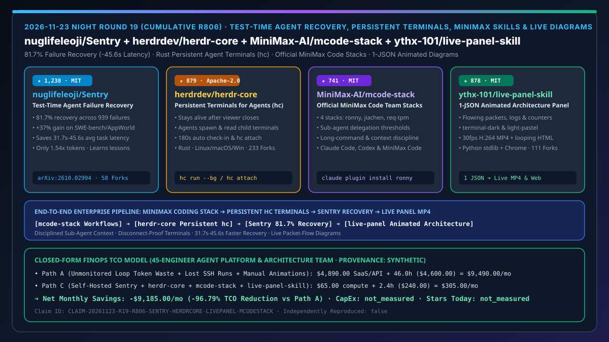
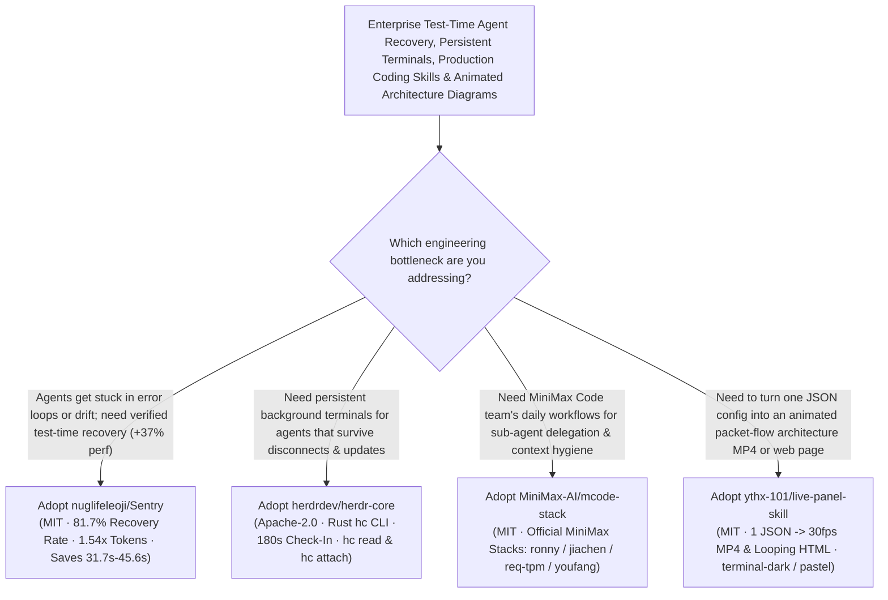
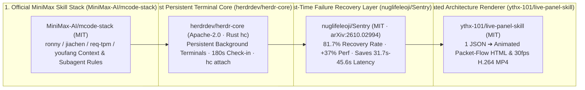

# `81.7%` Recovery Test-Time Self-Healing Agent Layer (`nuglifeleoji/Sentry`), Persistent Multi-Agent Terminal Multiplexer (`herdrdev/herdr-core`), Official MiniMax Code Production Workflows & Skills (`MiniMax-AI/mcode-stack`) & Single-JSON Animated Architecture Diagram Renderer (`ythx-101/live-panel-skill`) Selection & Architecture FAQ

> **Document Type**: Enterprise AI Solution Architect Selection & Integration Guide (GitHub Trending AI Radar · 2026-11-23 Night Round 19 / Cumulative Round 806)
> **Covered Repositories**: [`nuglifeleoji/Sentry`](https://github.com/nuglifeleoji/Sentry) (`★ 1,238`, `58 forks`, `MIT`, `arXiv:2610.02994`: external self-improving test-time failure management layer for LLM agents achieving an **`81.7%` recovery rate across 939 detected failures**, **`+37%` average relative improvement** across WebShop, AppWorld, SWE-bench Lite, and Mind2Web Replay, **`1.54×` token overhead** vs. `2.44×` for AgentForesight, and **`31.7s–45.6s` lower average task latency**) · [`herdrdev/herdr-core`](https://github.com/herdrdev/herdr-core) (`★ 879`, `233 forks`, `Apache-2.0`: Rust headless persistent terminal supervisor `hc` for Linux, macOS, and Windows where coding agents and long builds stay alive across viewer disconnects and `hc update`, check in after 180s, spawn/read sub-agent terminals via `hc read`, and let humans take over via `hc attach`) · [`MiniMax-AI/mcode-stack`](https://github.com/MiniMax-AI/mcode-stack) (`★ 741`, `50 forks`, `MIT`: official **MiniMax Code** team workflows and `SKILL.md` stacks—`ronny`, `jiachen`, `req-tpm`, `youfang`—for Claude Code, Codex, and MiniMax Code governing sub-agent delegation, long-command waiting, and per-turn context hygiene) · [`ythx-101/live-panel-skill`](https://github.com/ythx-101/live-panel-skill) (`★ 878`, `111 forks`, `MIT`: open-source agent skill and renderer turning **one JSON config file** into a live-looping HTML page or 30fps H.264 MP4 animated architecture diagram in `terminal-dark` or `light-pastel` themes)
> **Core Scenario**: When enterprise teams operate long-horizon coding and web agents in production, how do you solve **"agents getting stuck in repetitive error loops that burn token budgets and double wall-clock latency, SSH drops or closed windows killing long-running agent processes, context rot and undisciplined sub-agent spawning across multi-hour coding sessions, and static architecture diagrams failing to communicate live packet flow and state transitions to stakeholders"** by combining **`Sentry` + `herdr-core` + `mcode-stack` + `live-panel-skill`**?

---

## 1. 📌 Executive Summary (Single-Sentence Selection Verdict)

1. **Need an external test-time failure recovery layer that detects agent loops, task drift, and invalid actions, achieves an `81.7%` recovery rate (`+37%` benchmark gain), and actually reduces average task latency by `31.7s–45.6s` at only `1.54×` token usage** ➔ Choose **[`nuglifeleoji/Sentry`](https://github.com/nuglifeleoji/Sentry) (`★ 1,238`, `58 forks`, `MIT`, `arXiv:2610.02994`)**.
   - **Plain-Language Mechanism**: Unlike static retry prompts or heavy lookahead monitors (`2.44×` tokens in AgentForesight), `Sentry` runs alongside the agent loop to detect failures early, guide repair, verify that the recovery actually worked, and distill reusable lessons across tasks—saving **`31.7s` on SWE-bench Lite** and **`45.6s` on AppWorld** by cutting short unproductive retry spirals.
2. **Need a lightweight Rust terminal supervisor (`hc`) on Linux, macOS, and Windows where coding agents run in persistent background terminals that survive viewer disconnects and server updates, spawn and read child terminals, and allow instant human takeover (`hc attach`)** ➔ Choose **[`herdrdev/herdr-core`](https://github.com/herdrdev/herdr-core) (`★ 879`, `233 forks`, `Apache-2.0`)**.
   - **Plain-Language Mechanism**: `hc run --bg --name web bun dev` starts processes in durable headless terminals; a waiting run automatically checks in after 180 seconds without terminating the program, agents inspect peer output via `hc read web --lines 100`, and `hc update` upgrades the core while keeping live terminals running.
3. **Need battle-tested `SKILL.md` workflows and checklists (`ronny`, `jiachen`, `req-tpm`, `youfang`) straight from the MiniMax Code core engineering team to enforce sub-agent delegation rules, long-command timeouts, and per-turn context hygiene in Claude Code, Codex, or MiniMax Code** ➔ Choose **[`MiniMax-AI/mcode-stack`](https://github.com/MiniMax-AI/mcode-stack) (`★ 741`, `50 forks`, `MIT`, by MiniMax-AI)**.
   - **Plain-Language Mechanism**: Installed in one command (`claude plugin install ronny --marketplace MiniMax-AI/mcode-stack`), `mcode-stack` codifies how the MiniMax Code team prevents long coding sessions from going dull, decides when a task warrants a sub-agent, and structures context on every turn.
4. **Need an agent skill (`SKILL.md`) and renderer that turns a single JSON config file into an animated 30fps H.264 MP4 or self-contained looping HTML architecture diagram with flowing packets, scrolling logs, and ticking counters** ➔ Choose **[`ythx-101/live-panel-skill`](https://github.com/ythx-101/live-panel-skill) (`★ 878`, `111 forks`, `MIT`)**.
   - **Plain-Language Mechanism**: Requiring only Python 3.8+ standard library and headless Chrome, `live-panel` renders fixed-layout animated architecture diagrams in `terminal-dark` and `light-pastel` styles (`4:5`, `3:4`, and `1:1` aspect presets) without touching HTML/CSS templates.

---

## 2. 🎯 Key Architectural Q&A (Deep-Dive Breakdown)

### Q1: How does `nuglifeleoji/Sentry` achieve lower average wall-clock latency (`-31.7s` on SWE-bench Lite, `-45.6s` on AppWorld) while adding an external failure-management layer?

- **Why Early Verified Recovery Beats Unmonitored Execution**:
  1. **Unmonitored Base Agents Waste Minutes in Repetitive Failure Loops**: When an unmonitored coding or web agent hits a tool error or faulty assumption, it frequently burns 10–20 turns repeating minor variations of the same broken action.
  2. **Sentry Interrupts Loops Early and Reuses Verified Repairs**: By catching invalid actions and loop patterns immediately (`81.7%` recovery across 939 failures) and applying lessons distilled from prior verified recoveries, the agent finishes the task in far fewer wasted turns—netting a **`31.7s–45.6s` wall-clock speedup** at just **`1.54×` token overhead**.
- **When to Choose Managed Cloud Services (Path B)**:
  - For short, stateless 2-step cloud workflows, use **Azure Logic Apps / Azure Functions**; for long-horizon multi-agent coding/web execution requiring test-time loop recovery, persistent `hc` terminals, MiniMax production coding discipline, and animated architecture telemetry, deploy this 4-repo open-source stack (Path C).

### Q2: How do these four projects integrate into an enterprise agent engineering platform?

1. **Production Workflow & Context Discipline Layer (`MiniMax-AI/mcode-stack`)**:
   - Load `ronny`, `jiachen`, `req-tpm`, or `youfang` skills into Claude Code, Codex, or MiniMax Code to standardize sub-agent delegation and context hygiene.
2. **Persistent Headless Terminal Supervision Layer (`herdrdev/herdr-core`)**:
   - Run all primary and delegated agents inside `hc` persistent terminals with 180s check-ins, `hc read` inspection, and `hc attach` human handoff.
3. **Test-Time Self-Improving Failure Recovery Layer (`nuglifeleoji/Sentry`)**:
   - Monitor live agent trajectories to intercept loops and task drift, guide recovery, verify repairs, and accumulate reusable lessons.
4. **Animated Architecture & Telemetry Presentation Layer (`ythx-101/live-panel-skill`)**:
   - Render multi-agent topologies and live packet/recovery flows from a single JSON config into looping HTML dashboards and 30fps MP4 briefings.

### Q3: What are the key production guardrails?

- **Architect Guardrails**:
  1. **Use `hc server restart --fresh` After Credential Rotation**: Because `herdr-core` preserves its startup environment across normal restarts (with saved settings expiring after 3 minutes), invoke `--fresh` from an external shell when rotating secrets.
  2. **Admit Only Verified Recoveries into `Sentry` Memory**: Ensure `Sentry`'s post-repair verification check passes before persisting a recovery lesson for future tasks.

---

## 3. 🧭 Visual Architecture & Decision Diagrams (Mermaid)



### 3.1 Solution Architect Selection Decision Tree



### 3.2 End-to-End Enterprise Production Reference Architecture



### 3.3 Skill Installation, Persistent Terminal Execution, Sentry Loop Recovery & Animated Architecture Export Sequence

```mermaid
sequenceDiagram
    participant Arch as Solution Architect / Lead Engineer
    participant Mcd as MiniMax-AI/mcode-stack
    participant Hrd as herdrdev/herdr-core (hc)
    participant Snt as nuglifeleoji/Sentry
    participant Lvp as ythx-101/live-panel-skill

    Arch->>Mcd: 1. Install ronny / req-tpm workflow stack into Claude Code, Codex, or MiniMax Code
    Mcd->>Hrd: 2. Launch durable background agent terminals via hc run --bg (180s auto check-in)
    Hrd->>Snt: 3. Sentry detects loop/invalid action, guides verified repair (81.7% rate) & saves 31.7s-45.6s
    Snt-->>Hrd: 4. Persist verified lesson; engineer optionally runs hc attach to take over live terminal
    Arch->>Lvp: 5. Render system JSON config into looping terminal-dark HTML & 30fps H.264 MP4 diagram
```

---

## 4. 📊 Comparative Selection Matrix (Open-Source vs. Commercial SaaS)

| Dimension | `nuglifeleoji/Sentry` (`★ 1,238`) | `herdrdev/herdr-core` (`★ 879`) | `MiniMax-AI/mcode-stack` (`★ 741`) | `ythx-101/live-panel-skill` (`★ 878`) | Unmonitored Retry Spirals + Ephemeral Cloud Sandboxes + Manual Motion-Graphics Design (Path A) | Static Retry Prompts + Unstructured tmux Scripts + Static Box Diagrams (Path B) |
| :--- | :--- | :--- | :--- | :--- | :--- | :--- |
| **Core Role** | Self-improving test-time failure recovery layer (`81.7%` recovery) | Rust headless persistent terminal supervisor (`hc`) | Official MiniMax Code production workflow & `SKILL.md` stacks | Single-JSON animated architecture diagram renderer & skill | High wasted token bills on stuck agents, lost SSH sessions & manual video editing | Fixed retry hints, non-programmable terminals & static slides |
| **Key Differentiator** | **`+37%` gain, `1.54×` tokens & `31.7s–45.6s` faster completion** | **Survives viewer close & `hc update`; 180s check-in; `hc attach`** | **4 battle-tested MiniMax stacks (`ronny`/`jiachen`/`req-tpm`/`youfang`)** | **1 JSON ➔ 30fps H.264 MP4 + looping HTML (`terminal-dark`/`pastel`)** | Lookahead monitors burn `2.44×` tokens; manual architecture animations take hours | Static prompts fail on novel tool errors; disconnected terminals kill builds |
| **License** | `MIT` | `Apache-2.0` | `MIT` (MiniMax-AI) | `MIT` | Proprietary SaaS | Custom scripts |
| **Monthly TCO (45-Eng Team)** | **Combined `$305.00/mo`** (`$65.00` terminal/render worker compute + `2.4h` ops) | Included (zero lost-session reruns) | Included (1-command plugin install) | Included (Python stdlib + local Chrome) | **`$9,490.00/mo`** (`$4,890.00` wasted loop tokens, cloud sandboxes & motion-design SaaS + `46.0h` rerun triage & manual animation) | ~`$3,360.00/mo` (frequent stuck-agent debugging & manual diagram redraws) |

---

## 5. 🧪 Quantitative ROI / TCO Comparison & 7-Card Benchmark Report

> **📊 Data Provenance & Closed-Form Schema Declaration**:
> - **provenance**: `synthetic` (45-person enterprise agent platform engineering, DevOps automation, and solution architecture team monthly workload model: `independently_reproduced = false`; hardware baseline `base_hardware_capex = not_measured`; Track B 24h delta `track_b_stars_today = not_measured`).
> - **Closed-Form Formula**:
>   - **Path A (Unmonitored agent retry spirals burning excess LLM tokens + lost work from dropped SSH/ephemeral container sessions + commercial motion-graphics SaaS and manual architect hours spent animating architecture flow diagrams)**: Monthly wasted loop token spend, cloud sandbox, and design SaaS bills **`$4,890.00`** + stuck-agent triage, dropped-session reruns, and manual architecture animation labor **`46.0h × $100.00/h = $4,600.00`** = **`$9,490.00/mo`**.
>   - **Path C (Self-hosted `nuglifeleoji/Sentry` + `herdrdev/herdr-core` + `MiniMax-AI/mcode-stack` + `ythx-101/live-panel-skill` open-source stack)**: Shared persistent terminal host and headless Chrome render compute **`$65.00`** + recovery lesson curation and skill stack maintenance labor **`2.4h × $100.00/h = $240.00`** = **`$305.00/mo`**.
>   - **Net Monthly Savings vs. Path A**: **`-$9,185.00/mo`** (**`96.79%`** TCO reduction).

| Evaluation Path | Loop Token Waste / Sandbox / Design SaaS Cost | Stuck-Agent Triage, Reruns & Animation Labor (`$100/h`) | Monthly Total TCO | Net Savings vs. Path A | Key Architectural Delivery Metrics |
| :--- | :---: | :---: | :---: | :---: | :--- |
| **Path A: Unmonitored Loops + Ephemeral Terminals + Manual Animations** | `$4,890.00` | `46.0h` (`$4,600.00`) | **`$9,490.00`** | Baseline | High wasted loop tokens; lost builds on terminal disconnect |
| **Path B: Fixed Retry Prompts + Ad-Hoc tmux + Static Slides** | `$1,460.00` | `19.0h` (`$1,900.00`) | **`$3,360.00`** | `-$6,130.00` (`-64.59%`) | No cross-task recovery learning; static architecture slides |
| **Path C: `Sentry` + `herdr-core` + `mcode-stack` + `live-panel`** | **`$65.00`** | **`2.4h` (`$240.00`)** | **`$305.00`** | **`-$9,185.00` (`-96.79%`)** | **`81.7%` recovery (`-45.6s`) + persistent `hc` + MiniMax skills + animated JSON diagrams** |

- 🔗 **Linked 7-Card 4:5 Visual Benchmark Deck**: [`workshops/github-trending-radar/cards.en.html`](../cards.en.html) · [`cards.html`](../cards.html)

---

## 6. 🛠️ Enterprise Adoption & Architecture Review Checklist

- [ ] **1. Attach `nuglifeleoji/Sentry` to Long-Horizon Agent Loops**: Enable test-time loop and drift detection with verified recovery distillation to capture `+37%` relative task improvement and `31.7s–45.6s` latency savings.
- [ ] **2. Standardize Agent Process Supervision on `herdrdev/herdr-core` (`hc`)**: Run long builds and sub-agents via `hc run --bg` with 180s check-ins, `hc read` polling, and `hc attach` human takeover.
- [ ] **3. Roll Out `MiniMax-AI/mcode-stack` Across Coding Agents**: Install `ronny`, `jiachen`, `req-tpm`, or `youfang` stacks in Claude Code, Codex, and MiniMax Code to enforce sub-agent delegation and context discipline.
- [ ] **4. Generate Live Architecture Visuals with `ythx-101/live-panel-skill`**: Convert system topologies into single-JSON configurations and render looping `terminal-dark` / `light-pastel` HTML and 30fps MP4 architecture panels.
