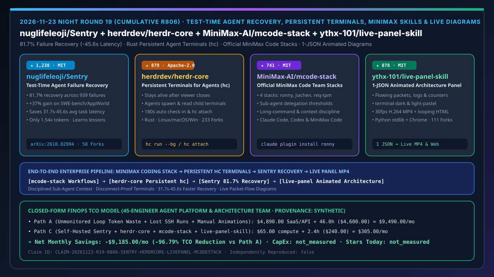
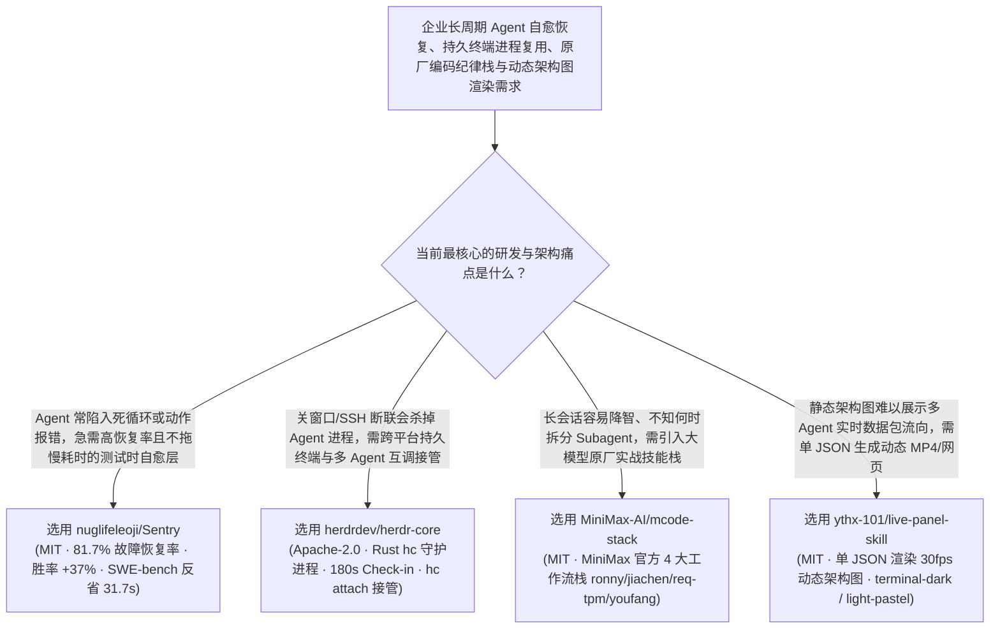
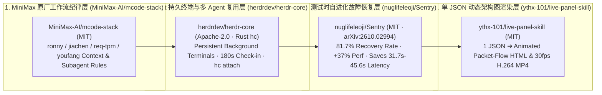
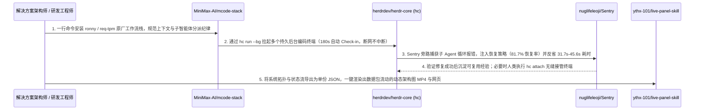

# 81.7% 故障恢复率且反省 45.6s 耗时的智能体测试时自愈层（`nuglifeleoji/Sentry`）、关闭终端不中断且支持多智能体派活接管的 Rust 持久终端内核（`herdrdev/herdr-core`）、MiniMax 官方团队生产级长会话与子智能体分派技能栈（`MiniMax-AI/mcode-stack`）与单 JSON 直出数据包流动动态架构图 MP4/网页技能（`ythx-101/live-panel-skill`）选型与集成架构 FAQ

> **文档类型**：企业 AI 解决方案架构师（AI Solution Architect）选型决策指南（GitHub Trending AI 雷达 2026-11-23 Night Round 19 / 累计第 806 轮）
> **覆盖项目**：[`nuglifeleoji/Sentry`](https://github.com/nuglifeleoji/Sentry)（`★ 1,238`、`58 forks`、`MIT`、`arXiv:2610.02994`：运行在智能体主循环旁路的**测试时自进化故障恢复层**，在 939 次真实故障中实现 **`81.7%` 恢复成功率**，在 WebShop/AppWorld/SWE-bench Lite/Mind2Web Replay 四大基准相对最强基线提升 **`+37%`**，仅消耗 **`1.54×` Token** 却比原 Agent 平均**快 `31.7s–45.6s`**）· [`herdrdev/herdr-core`](https://github.com/herdrdev/herdr-core)（`★ 879`、`233 forks`、`Apache-2.0`：基于 Rust 构建的无头持久终端与多智能体进程复用器 `hc`，关闭窗口或热升级 `hc update` 均不中断正在运行的任务，默认 180 秒自动 Check-in，支持 Agent 拉起子 Agent、读取输出 `hc read` 及人类随时接管 `hc attach`）· [`MiniMax-AI/mcode-stack`](https://github.com/MiniMax-AI/mcode-stack)（`★ 741`、`50 forks`、`MIT`：MiniMax 官方研发团队内部每天用于构建 `MiniMax Code` 的**四大生产工作流与技能包 `ronny`/`jiachen`/`req-tpm`/`youfang`**，一行命令装入 Claude Code / Codex / MiniMax Code，沉淀子 Agent 分派阈值、长耗时命令等待准则与长会话防降智上下文规范）· [`ythx-101/live-panel-skill`](https://github.com/ythx-101/live-panel-skill)（`★ 878`、`111 forks`、`MIT`：把**单个 JSON 配置文件（或 Excalidraw）一键渲染成数据包沿连线流动、日志滚动、计数器跳动的动态架构图** `30fps H.264 MP4` 或自包含循环网页，内置 `terminal-dark` 终端监控风与 `light-pastel` 浅色信息图风）
> **核心场景**：当企业架构师与研发效能团队规模化运行长周期自主智能体时，面对**“Agent 在长任务中陷入死循环或工具调用报错白白烧干 Token 且耗时翻倍、SSH 闪断或关掉终端窗口导致跑了半小时的编译与 Agent 任务直接被杀、长会话跑过几十轮后上下文膨胀降智且不知何时该拆分 Subagent、以及向高管和客户汇报复杂多 Agent 架构时静态框图看不出实时数据流向与状态跃迁”**四大痛点，如何通过 **Sentry + Herdr-Core + MCode-Stack + Live-Panel** 打造高自愈、不断联、高纪律、可视化的智能体工程体系？

---

## 一、📌 核心结论速览（选型一句话结论）

1. **想在智能体运行时旁路挂载一层“会从成功修复案例中自我进化的故障恢复守卫”，把死循环与非法动作的恢复率拉升到 `81.7%`、整体任务成功率提升 `+37%`，甚至比不挂监控的原版 Agent 还要快 `31.7s–45.6s`** ➔ 选 **[`nuglifeleoji/Sentry`](https://github.com/nuglifeleoji/Sentry)（`★ 1,238`，`58 forks`，`MIT`，`arXiv:2610.02994`）**。
   - **通俗原理**：传统监控器只会塞固定的重试提示词，而 AgentForesight 等前瞻方案动辄消耗 `2.44×` Token。`Sentry` 在主循环外独立检测死循环、任务偏航（Task Drift）与无根据假设，指导 Agent 修复并**验证修复真生效后才将其提炼为可跨任务复用的经验（Reusable Lessons）**——正因为它第一时间掐断了无效死循环重试，不仅把 Token 倍率压在 **`1.54×`**，还在 SWE-bench Lite 上反省 **`31.7s`**、在 AppWorld 上反省 **`45.6s`** 平均耗时！
2. **想用一套跨 Linux、macOS 与 Windows 的轻量 Rust 命令行守护进程（`hc`），让所有编码智能体与长耗时构建任务跑在“关掉界面不退出、升级服务端不中断、Agent 之间可互相拉起派活、人类随时 `hc attach` 接管”的持久终端里** ➔ 选 **[`herdrdev/herdr-core`](https://github.com/herdrdev/herdr-core)（`★ 879`，`233 forks`，`Apache-2.0`）**。
   - **通俗原理**：执行 `hc run --bg --name web bun dev` 或启动编码 Agent 后，即便终端断开或执行 `hc update` 热更新，底层终端进程依然存活；长命令默认在 180 秒时自动 Check-in 并返回终端地址，父 Agent 可通过 `hc read web --lines 100` 非阻塞读取子 Agent 进度，架构师也可随时 `hc attach` 进场接管。
3. **想直接复用大模型原厂核心团队（MiniMax Code 研发团队）每天在生产中打磨出的四大实战工作流栈（`ronny` / `jiachen` / `req-tpm` / `youfang`），管住“何时该派发 Subagent、长命令等多久、每轮往上下文塞什么”** ➔ 选 **[`MiniMax-AI/mcode-stack`](https://github.com/MiniMax-AI/mcode-stack)（`★ 741`，`50 forks`，`MIT`）**。
   - **通俗原理**：只需一行 `claude plugin install ronny --marketplace MiniMax-AI/mcode-stack`（同样支持 Codex 与 MiniMax Code），即可将原厂工程师的 `SKILL.md` 与纪律清单装入开发环境，消除长会话注意力衰减与盲目乱开子智能体的通病。
4. **想只写一个 JSON 配置文件（定义节点框、连线、数据包流动路径、滚动日志与跳动计数器），就让 Agent 自动渲染出 30fps H.264 MP4 视频或可嵌入汇报页的“会动的实时监控风架构图”** ➔ 选 **[`ythx-101/live-panel-skill`](https://github.com/ythx-101/live-panel-skill)（`★ 878`，`111 forks`，`MIT`）**。
   - **通俗原理**：仅需 Python 标准库与本地 Chrome，即可将单份 JSON 渲染为固定布局下**数据包沿线路流动、日志实时滚动、状态条翻转、侧边触发器依次亮起**的动态架构面板；内置 `terminal-dark`（暗黑终端监控台）与 `light-pastel`（清爽浅色信息图）双主题及 `4:5` / `3:4` / `1:1` 画幅预设。

---

## 二、🎯 客户与架构师灵魂拷问 Q&A（深度架构拆解）

### Q1：为什么给 Agent 加上 `nuglifeleoji/Sentry` 故障恢复层后，端到端任务平均耗时不仅没有增加，反而缩短了 31.7 秒到 45.6 秒？

- **反直觉的“以空间/小干预换取巨大时间节省”原理**：
  1. **未加 Sentry 的 Base Agent 一旦踩坑就会陷入长达 10–20 轮的盲目重试死循环**：在 SWE-bench Lite 与 AppWorld 中，基础智能体一旦遇到环境报错或 API 参数不匹配，往往在同一个错误方向上反复试错，白白耗费数分钟与海量上下文。
  2. **Sentry 在第 1–2 次异常苗头出现时即通过已验证的恢复经验精准纠偏**：`81.7%` 的故障被当场拉回正轨，砍掉了后续十几轮无效挣扎，从而在仅增加 `0.54×` Token 的前提下净省 **`31.7s–45.6s`** 端到端挂钟时间（Wall-Clock Time）。
- **何时直接选用商业云托管平台（Path B）？**
  - 若团队仅运行 1–2 步的简单无状态云函数，可直接使用 **Azure Logic Apps / Azure Functions**；若需运行数十步的自主编码/网页操作 Agent、要求关闭终端不断联的跨平台持久进程池、引入大模型原厂长会话纪律栈以及生成动态数据流架构图，则采用本轮四合一开源栈（Path C）。

### Q2：典型企业级“原厂纪律赋能 (`mcode-stack`) ➔ 持久终端复用 (`herdr-core`) ➔ 测试时自愈护航 (`Sentry`) ➔ 动态架构面板汇报 (`live-panel-skill`)”架构怎么搭？

1. **原厂工作流与上下文纪律层（`MiniMax-AI/mcode-stack`）**：
   - 为 Claude Code / Codex / MiniMax Code 统一装载 `ronny` / `req-tpm` 技能栈，规范每轮上下文注入、Subagent 拆分阈值与测试标准。
2. **Rust 无头持久终端与子智能体进程层（`herdrdev/herdr-core`）**：
   - 所有主/子 Agent 均通过 `hc run --bg` 运行在持久终端中，遵守 180s Check-in 机制，支持跨 Agent 消息读取与人工无缝 `hc attach` 接管。
3. **测试时自进化故障检测与恢复层（`nuglifeleoji/Sentry`）**：
   - 旁路监听 Agent 执行轨迹，一旦捕获死循环或无效动作立即注入历史验证过的修复策略，并在修复成功后沉淀新经验。
4. **单 JSON 动态架构图与监控面板生成层（`ythx-101/live-panel-skill`）**：
   - 将多 Agent 拓扑、数据包流向与恢复指标写入单个 JSON，一键渲染为 `terminal-dark` 动态网页与 MP4 嵌入架构评审报告。

### Q3：这套架构的落地注意事项与合规红线是什么？

- **架构师落地红线**：
  1. **`herdr-core` 环境变量刷新与热升级规范**：生产环境更新凭证后应使用 `hc server restart --fresh` 显式载入新环境，避免沿用旧启动器缓存（默认 3 分钟过期）。
  2. **`Sentry` 经验库入库必须开启“验证通过（Verified Recovery）”门禁**：只允许将真正解决了当前报错并通过后置检查的恢复步骤写入可复用经验库，防止错误修复策略污染后续任务。

---

## 三、🧭 直观可视化图解（Mermaid 决策树 + 集成架构 + 时序图）

### 3.1 架构师选型决策树

### 3.2 企业端到端生产集成参考架构图

### 3.3 原厂技能装载、持久终端并发执行、Sentry 故障自愈与动态架构面板导出时序图

---

## 四、📊 同类开源与商业云服务横向选型决策矩阵

| 对比维度 | `nuglifeleoji/Sentry` (`★ 1,238`) | `herdrdev/herdr-core` (`★ 879`) | `MiniMax-AI/mcode-stack` (`★ 741`) | `ythx-101/live-panel-skill` (`★ 878`) | 放任 Agent 死循环盲目重试 + 脆弱 SSH 会话 + 手工用 After Effects 做动态架构视频 (Path A) | 固定提示词简单重试 + 裸 tmux 手工管理 + 静态截图汇报 (Path B) |
| :--- | :--- | :--- | :--- | :--- | :--- | :--- |
| **核心能力定位** | 测试时自进化故障检测与恢复层（`81.7%` 恢复率） | 关闭窗口不退出的 Rust 持久终端与多 Agent 进程内核 | MiniMax Code 官方团队四大生产工作流与技能栈 | 单 JSON 配置生成数据包流动的动态架构图 MP4/网页 | 高昂的死循环 Token 浪费、断网重跑损失与外包制作动态演示视频账单 | 无经验积累的机械重试、难以被 Agent 编程调度的终端与干瘪静态图 |
| **核心技术突破** | **胜率提升 `+37%`、仅 `1.54×` Token 且平均耗时反减 `31.7s–45.6s`** | **静态编译跨三端、`hc update` 不断任务、180s Check-in 与随时接管** | **原厂实战验证的子 Agent 分派阈值、长命令等待与防降智清单** | **零前端改码，单 JSON 直出 `terminal-dark` / `light-pastel` 动态架构图** | 前瞻类监控（如 AgentForesight）消耗 `2.44×` Token；手工做一条架构动图需数小时 | 固定重试提示词对复杂工具链报错无效；SSH 闪断即丢失全部未保存进度 |
| **开源协议** | `MIT` | `Apache-2.0` | `MIT`（MiniMax 官方） | `MIT` | 闭源商业服务 | 内部零散脚本 |
| **月度 TCO（45 人团队）** | **组合仅 `$305.00/月`**（`$65.00` 持久终端与渲染容器 + `2.4h` 维护） | 同左（杜绝断联重跑浪费） | 同左（一行命令免费安装） | 同左（Python 标准库 + 本地 Chrome 零 API 费） | **`$9,490.00/月`**（`$4,890.00` 死循环空转 Token 账单与视频外包工具费 + `46.0h` 断联重跑排障与手工画动图） | 约 `$3,360.00/月`（大量长任务卡死人工介入抢修与反复手工调整汇报图表工时） |

---

## 五、🧪 应用落地定量收益/TCO 对比与 7-Card 报告

> **📊 数据来源与闭式核算声明（Provenance & Closed-Form Schema）**：
> - **provenance**: `synthetic`（基于 45 人企业智能体平台研发、长周期自动化任务运维与解决方案架构汇报团队月度工作负载模型：`independently_reproduced = false`；硬件采购基线 `base_hardware_capex = not_measured`；Track B 单日增量 `track_b_stars_today = not_measured`）。
> - **核算公式**：
>   - **Path A（无测试时自愈层导致 Agent 陷入死循环白烧数倍 Token + 终端断联重跑长耗时任务 + 采购商业动效设计工具并由架构师手工制作客户汇报动态架构图）**：月度死循环冗余 Token 消耗与商业云沙箱/设计软件账单 **`$4,890.00`** + 长任务失败人工排查重跑、长会话降智调试与手工制作动态架构演示工时 **`46.0h × $100.00/h = $4,600.00`** = **`$9,490.00/月`**。
>   - **Path C（自建 `nuglifeleoji/Sentry` + `herdrdev/herdr-core` + `MiniMax-AI/mcode-stack` + `ythx-101/live-panel-skill` 开源全栈）**：持久终端守护进程与本地渲染容器分摊成本 **`$65.00`** + 自愈经验库与技能栈例行更新维护人工 **`2.4h × $100.00/h = $240.00`** = **`$305.00/月`**。
>   - **净节省（Net Savings vs Path A）**：**`-$9,185.00/月`**（成本降低 **`96.79%`**）。

| 评估方案 | 死循环冗余 Token / 云沙箱 / 动效工具成本 | 失败重跑排障、长会话调优与动图制作（`$100/h`） | 月度总 TCO | 相对 Path A 净节省 | 关键架构交付指标 |
| :--- | :---: | :---: | :---: | :---: | :--- |
| **Path A：无自愈盲目重试 + 易断联终端 + 手工制作动态架构图** | `$4,890.00` | `46.0h` (`$4,600.00`) | **`$9,490.00`** | Baseline | 死循环耗光 Token 预算；终端闪断导致长任务前功尽弃 |
| **Path B：固定规则重试 + 裸 tmux 脚本 + 静态 PPT 框图** | `$1,460.00` | `19.0h` (`$1,900.00`) | **`$3,360.00`** | `-$6,130.00` (`-64.59%`) | 无法从成功修复中跨任务学习；多 Agent 终端状态难追踪 |
| **Path C：`Sentry` + `herdr-core` + `mcode-stack` + `live-panel`** | **`$65.00`** | **`2.4h` (`$240.00`)** | **`$305.00`** | **`-$9,185.00` (`-96.79%`)** | **`81.7%` 故障恢复率 + Rust 持久终端 + MiniMax 官方技能栈 + 单 JSON 动态架构图** |

- 🔗 **关联 7-Card 4:5 视觉评测报告**：[`workshops/github-trending-radar/cards.html`](../cards.html) · [`cards.en.html`](../cards.en.html)

---

## 六、🛠️ 企业引入与架构评审 Checklist

- [ ] **1. 在长周期 Agent 主循环旁路挂载 `nuglifeleoji/Sentry`**：启用死循环与任务偏航实时检测，仅将通过后置验证的修复动作沉淀进跨任务经验库，兼顾 `+37%` 胜率提升与耗时缩减。
- [ ] **2. 将所有编码智能体与后台服务迁移至 `herdrdev/herdr-core` (`hc`)**：利用 180 秒默认 Check-in、`hc read` 非阻塞读取与 `hc attach` 人工接管机制彻底消除断网丢进度风险。
- [ ] **3. 为研发团队统一安装 `MiniMax-AI/mcode-stack`（`ronny` / `jiachen` / `req-tpm` / `youfang`）**：标准化长会话上下文裁剪、长命令等待策略与 Subagent 委派准则。
- [ ] **4. 使用 `ythx-101/live-panel-skill` 自动生成动态架构演示资产**：将系统 JSON 配置一键渲染为 `terminal-dark` 或 `light-pastel` 风格的循环 HTML 与 30fps MP4，直观呈现数据包流向与实时状态。
