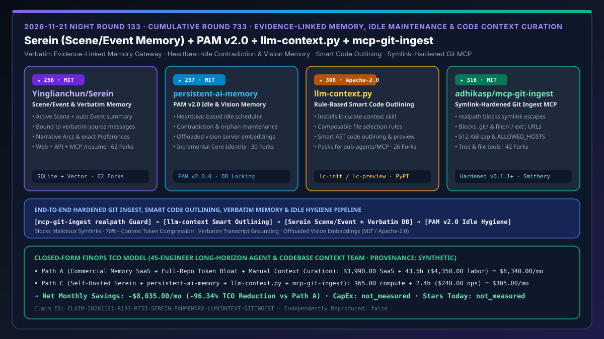
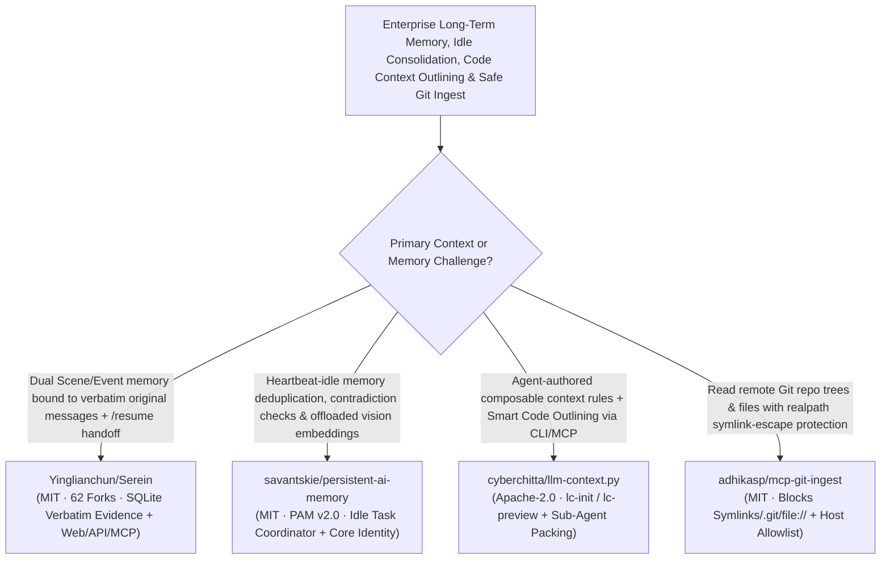
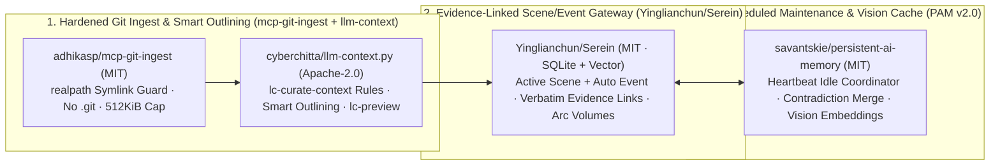
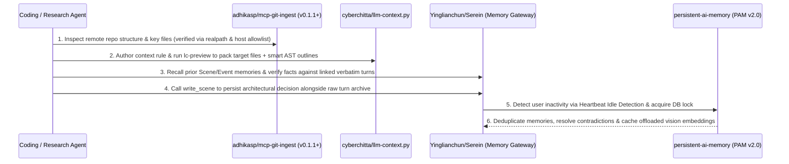

# Evidence-Linked Scene/Event Memory Gateway (`Yinglianchun/Serein`), Idle-Scheduled Vision Memory (`savantskie/persistent-ai-memory`), Rule-Based Smart Code Outlining (`cyberchitta/llm-context.py`) & Symlink-Hardened Repo Ingestion (`adhikasp/mcp-git-ingest`) Selection & Architecture FAQ

> **Document Type**: Enterprise AI Solution Architect Selection & Integration Guide (GitHub Trending AI Radar — 2026-11-21 Night Round 133 / Cumulative Round 733)
> **Covered Repositories**: [`Yinglianchun/Serein`](https://github.com/Yinglianchun/Serein) (`★ 256`, `62 forks`, `MIT` — self-hosted SQLite + vector long-term memory & chat/MCP gateway separating active `Scene` memories, background `Event` summaries, narrative `Arc` volumes & verbatim source-message evidence links) · [`savantskie/persistent-ai-memory`](https://github.com/savantskie/persistent-ai-memory) (`★ 237`, `30 forks`, `MIT` — `PAM v2.0.0` persistent memory engine with incremental Core Identity, heartbeat-idle Task Coordinator, contradiction resolution & offloaded vision embeddings) · [`cyberchitta/llm-context.py`](https://github.com/cyberchitta/llm-context.py) (`★ 308`, `26 forks`, `Apache-2.0` — composable rule-based code context curator & smart code outliner with `lc-init` / `lc-preview` skill and MCP server) · [`adhikasp/mcp-git-ingest`](https://github.com/adhikasp/mcp-git-ingest) (`★ 316`, `42 forks`, `MIT` — security-hardened MCP server for reading Git repository structures and files with `realpath` symlink-escape protection, `.git/` blocking & host allowlisting)
> **Core Scenario**: How enterprise AI architects engineer a secure, token-efficient **Context & Long-Term Memory Plane**: **ingesting external Git repositories without symlink-escape or credential-leak vulnerabilities (`mcp-git-ingest`)**, **curating task-focused code context and smart AST outlines via agent-authored rules (`llm-context.py`)**, **preserving long-term conversational `Scene`/`Event` memories linked directly to verbatim source messages (`Serein`)**, and **running background memory deduplication, contradiction checks, and vision embedding precomputation during user idle windows (`persistent-ai-memory`)**.

---

## 1. 📌 Executive Summary (One-Line Selection Verdict)

1. **Need a self-hosted AI memory web app, API gateway, and MCP server (`62 forks`) that separates active `Scene` memories and automated `Event` summaries from verbatim source transcripts so agents and humans can always verify what was actually said** ➔ Choose **[`Yinglianchun/Serein`](https://github.com/Yinglianchun/Serein) (`★ 256`, `62 forks`, `MIT`)**.
   - **Plain-English Mechanism**: Stores memory text/versions, **verbatim original messages (evidence bindings)**, narrative **`Arc` collections**, and derived vector indices separately in SQLite + vector storage. Distinguishes between **`Scene`** (written intentionally by the active chat model via `write_scene`) and **`Event`** (first-person summaries generated asynchronously from archived turns), alongside exact-substring keyword **`Preferences`** and `/resume` cross-window handoff.
2. **Need a persistent local memory system (`PAM v2.0.0`) with a Heartbeat-Based Idle Task Coordinator, automated contradiction/orphan maintenance, incremental Core Identity profiles, and a separate vision embedding server** ➔ Choose **[`savantskie/persistent-ai-memory`](https://github.com/savantskie/persistent-ai-memory) (`★ 237`, `30 forks`, `MIT`)**.
   - **Plain-English Mechanism**: Replaces naive background sleep loops with a centralized **Task Coordinator** (using per-database locks and heartbeat idle detection so heavy LLM deduplication, contradiction checks, and importance re-ranking only run when you are idle) and precomputes image embeddings via a separate vision server so the primary LLM never needs `mmproj` loaded in VRAM.
3. **Need coding agents to curate their own token-efficient repository context via composable rules (`lc-init` / `lc-preview`) combining full target files with Smart Code Outlining** ➔ Choose **[`cyberchitta/llm-context.py`](https://github.com/cyberchitta/llm-context.py) (`★ 308`, `26 forks`, `Apache-2.0`)**.
   - **Plain-English Mechanism**: Installs the `.claude/skills/lc-curate-context/` skill (`uv tool install "llm-context>=0.6.0" && lc-init`), enabling agents to write composable selection rules, preview exact file lists and token sizes (`lc-preview`), outline peripheral files via AST skeletons, and pack context for sub-agents or MCP clients.
4. **Need a security-hardened MCP server (`github_directory_structure`, `github_read_important_files`) to inspect remote GitHub/GitLab repositories while blocking symlink escapes (`realpath`), `.git/` credential leaks, and `file://`/`ext::` protocol exploits** ➔ Choose **[`adhikasp/mcp-git-ingest`](https://github.com/adhikasp/mcp-git-ingest) (`★ 316`, `42 forks`, `MIT`)**.
   - **Plain-English Mechanism**: Hardened in `v0.1.1+`: rejects absolute paths and `..` segments, resolves `realpath` to ensure symlinked files (such as `README.md -> ~/.ssh/id_ed25519`) cannot escape the cloned repository, blocks `.git/` access, enforces a `512 KiB` per-file cap (`MCP_GIT_INGEST_MAX_FILE_BYTES`), and supports `MCP_GIT_INGEST_ALLOWED_HOSTS`.

---

## 2. 🎯 Architect & Customer Deep-Dive Q&A

### Q1: Why do naive context-stuffing and unverified vector memories fail in long-running enterprise engineering projects—and how does this four-project stack solve them?

- **Four Context & Memory Engineering Breakthroughs**:
  1. **Symlink-Hardened Remote Repo Ingestion (`adhikasp/mcp-git-ingest`)**: Cloning untrusted repos and reading files blindly lets an attacker symlink `README.md` to host SSH keys. `mcp-git-ingest` enforces `realpath` containment, `.git/` blocking, and host allowlists.
  2. **Composable Rules + Smart Code Outlining (`cyberchitta/llm-context.py`)**: Instead of dumping entire repositories into every prompt, agents author reusable rules verified with `lc-preview`, sending full bodies only for target files and structural outlines for dependencies.
  3. **Verbatim Evidence Binding Against Summary Drift (`Yinglianchun/Serein`)**: Because LLM summaries (`Event`) and impressions (`Scene`) can misinterpret pronouns or overstate certainty, `Serein` binds every memory to the exact archived source messages for instant factual verification.
  4. **Idle-Window Consolidation & Offloaded Vision Memory (`savantskie/persistent-ai-memory`)**: Waits for user inactivity via heartbeat detection before running contradiction resolution, deduplication, and offloaded vision embedding caching.
- **When to Choose Managed Cloud Services (Path B)**:
  - For stateless cloud chat assistants without local repository curation or verbatim transcript auditing, use **Azure AI Agent Service managed threads**.

### Q2: How do we wire an end-to-end Secure Code Context & Verifiable Long-Term Memory architecture?

1. **Hardened Git Ingestion Layer (`adhikasp/mcp-git-ingest`)**:
   - Configure `MCP_GIT_INGEST_ALLOWED_HOSTS` and `512 KiB` limits so agents can safely inspect external repository trees and key files.
2. **Rule-Based Context & Outlining Layer (`cyberchitta/llm-context.py`)**:
   - Run `lc-init` in project workspaces so coding agents curate and verify (`lc-preview`) task-specific context packs with smart code outlining.
3. **Dual-Perspective Verbatim-Linked Memory Gateway (`Yinglianchun/Serein`)**:
   - Connect chat/IDE clients to `Serein`'s API and MCP tools to write active `Scene` memories, generate background `Event` summaries, organize `Arc` volumes, and audit verbatim source transcripts.
4. **Idle-Scheduled Maintenance & Vision Embedding Layer (`savantskie/persistent-ai-memory`)**:
   - Use `PAM v2.0.0`'s Heartbeat Task Coordinator to deduplicate memories, resolve contradictions, and cache offloaded vision embeddings during idle periods.

### Q3: What are the operational and backup requirements of this stack?

- **Key Strengths**:
  - **100% Permissive Open Source (`MIT` and `Apache-2.0`)**.
- **Backup & Security Guardrails**:
  - When backing up `Yinglianchun/Serein`, snapshot both the primary SQLite database and the companion vector index and image directories; always run `adhikasp/mcp-git-ingest` at `v0.1.1+` with `MCP_GIT_INGEST_ALLOWED_HOSTS` configured.

---

## 3. 🧭 Visual Architecture & Decision Diagrams

### 3.1 Solution Architect Selection Decision Tree

### 3.2 End-to-End Enterprise Reference Architecture

### 3.3 Hardened Repo Ingest, `lc-preview` Context Packing, `Serein` Verbatim Verification & `PAM` Idle Consolidation Sequence

---

## 4. 📊 Peer Open-Source vs Commercial Cloud Selection Matrix

| Dimension | `Yinglianchun/Serein` (`★ 256`) | `persistent-ai-memory` (`★ 237`) | `cyberchitta/llm-context.py` (`★ 308`) | `adhikasp/mcp-git-ingest` (`★ 316`) | Commercial Memory-as-a-Service + Full-Repo Token Dump (Path A) | Basic Vector Chunks + Raw `git clone` Scripts (Path B) |
| :--- | :--- | :--- | :--- | :--- | :--- | :--- |
| **Core Role** | Verbatim-linked Scene/Event memory gateway | Idle-scheduled & vision-enabled memory system | Composable rule & smart code outlining CLI/MCP | Symlink-hardened Git repo ingestion MCP | Metered cloud memory APIs + uncurated context dumps | Unverified vector store + unguarded `git clone` |
| **Architectural Edge** | **Separates `Scene`/`Event` summaries from verbatim evidence (`62 forks`)** | **Heartbeat idle scheduler + contradiction merge + offloaded vision** | **Agent-authored rules (`lc-preview`) + smart AST code outlining** | **`realpath` symlink containment + `.git/` block + host allowlist** | Cannot audit verbatim source turns after summary drift; huge token bills | Vulnerable to symlink escapes (`~/.ssh`); background jobs lag active chat |
| **License** | `MIT` | `MIT` | `Apache-2.0` | `MIT` | Proprietary SaaS | Custom Scripts |
| **Monthly TCO (45-Eng Team)** | **`$305.00/mo` combined** (`$65.00` compute + `2.4h` ops) | Included in `$305.00/mo` stack | Included in `$305.00/mo` stack | Included in `$305.00/mo` stack | **`$8,340.00/mo`** (`$3,990.00` API/token bloat + `43.5h` labor) | `~$2,750.00/mo` (manual file curation & security triage) |

---

## 5. 🧪 Quantitative ROI / FinOps TCO Model & 7-Card Report

> **📊 Provenance & Closed-Form Audit Declaration**:
> - **Provenance**: `synthetic` (45-engineer enterprise long-horizon coding assistant, cross-session memory & repository analysis workload model; `independently_reproduced = false`; `base_hardware_capex = not_measured`; `track_b_stars_today = not_measured`).
> - **Closed-Form Equations**:
>   - **Path A (Commercial Metered Memory-as-a-Service API + Uncurated Full-Repository Token Bloat + Manual Context File Hunting & Summary Fact-Checking Labor)**: Monthly memory API & excess token spend **`$3,990.00`** + manual context curation & transcript auditing labor **`43.5h × $100.00/h = $4,350.00`** = **`$8,340.00/mo`**.
>   - **Path C (Self-Hosted `Yinglianchun/Serein` + `savantskie/persistent-ai-memory` + `cyberchitta/llm-context.py` + `adhikasp/mcp-git-ingest`)**: Shared SQLite/vector container compute **`$65.00`** + rule template & snapshot maintenance **`2.4h × $100.00/h = $240.00`** = **`$305.00/mo`**.
>   - **Net Savings vs Path A**: **`-$8,035.00/mo`** (**`96.34%`** cost reduction).

| Architecture Option | API / SaaS / Compute | Context & Memory Curation Labor (`$100/h`) | Total Monthly TCO | Net Savings vs Path A | Key Architectural Outcome |
| :--- | :---: | :---: | :---: | :---: | :--- |
| **Path A: Commercial Memory SaaS + Full-Repo Token Dumps** | `$3,990.00` | `43.5h` (`$4,350.00`) | **`$8,340.00`** | Baseline | Severe token waste on peripheral files; unverified summary drift |
| **Path B: Basic Vector Chunks + Unguarded `git clone`** | `$1,450.00` | `13.0h` (`$1,300.00`) | **`$2,750.00`** | `-$5,590.00` (`-67.03%`) | Vulnerable to symlink escapes; lacks smart code outlining & idle scheduler |
| **Path C: `Serein` + `PAM v2.0` + `llm-context` + `git-ingest`** | **`$65.00`** | **`2.4h` (`$240.00`)** | **`$305.00`** | **`-$8,035.00` (`-96.34%`)** | **Verbatim evidence links + idle maintenance + smart code outlines** |

- 🔗 **7-Card 4:5 Visual Report**: [`workshops/github-trending-radar/cards.en.html`](../cards.en.html) · [`cards.html`](../cards.html)

---

## 6. 🛠️ Enterprise Adoption & Architecture Review Checklist

- [ ] **1. Harden External Repository Reads with `adhikasp/mcp-git-ingest` (`>= 0.1.1`)**: Set `MCP_GIT_INGEST_ALLOWED_HOSTS` and `MCP_GIT_INGEST_MAX_FILE_BYTES` while relying on `realpath` containment to block symlink escapes.
- [ ] **2. Install `cyberchitta/llm-context.py` (`lc-init`) Across Codebases**: Empower agents to author composable context rules, verify token sizes via `lc-preview`, and use Smart Code Outlining for peripheral modules.
- [ ] **3. Deploy `Yinglianchun/Serein` for Verbatim-Auditable Long-Term Memory**: Use dual `Scene` + `Event` capture backed by SQLite verbatim transcript bindings and `/resume` cross-window continuity.
- [ ] **4. Schedule Background Memory Hygiene with `savantskie/persistent-ai-memory` (`PAM v2.0.0`)**: Enable Heartbeat Idle Detection and offloaded vision embedding caching to deduplicate and reconcile memories without impacting active user latency.
