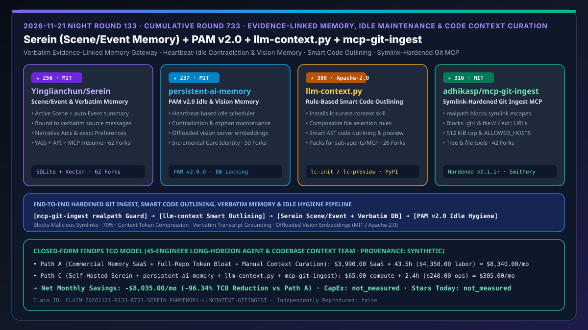
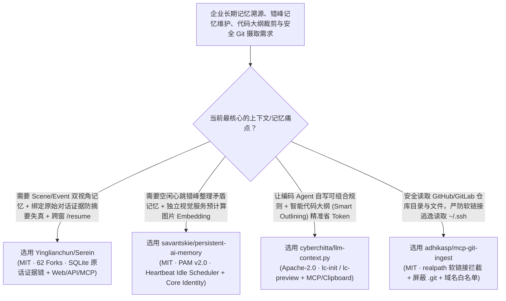
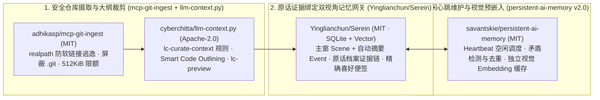
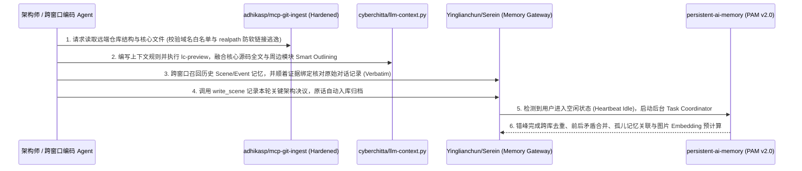

# 原话证据绑定的 Scene/Event 双视角记忆网关（`Yinglianchun/Serein`）、空闲心跳调度与视觉预嵌入持久记忆（`savantskie/persistent-ai-memory`）、规则驱动智能代码大纲裁剪（`cyberchitta/llm-context.py`）与防符号链接逃逸仓库摄取 MCP（`adhikasp/mcp-git-ingest`）选型与集成架构 FAQ

> **文档类型**：企业 AI 解决方案架构师（AI Solution Architect）选型决策指南（GitHub Trending AI 雷达 2026-11-21 Night Round 133 / 累计第 733 轮）
> **覆盖项目**：[`Yinglianchun/Serein`](https://github.com/Yinglianchun/Serein)（`★ 256`、`62 forks`、`MIT`，将记忆正文、原话档案证据绑定、叙事卷 `Arc` 与向量索引分离存储于 SQLite、支持主窗主动写 `Scene` 与后台自动摘要 `Event` 双视角召回的自托管记忆网关）· [`savantskie/persistent-ai-memory`](https://github.com/savantskie/persistent-ai-memory)（`★ 237`、`30 forks`、`MIT`，`PAM v2.0.0` 持久记忆系统：内置增量核心身份画像、空闲心跳任务调度器、跨库去重/矛盾检测与独立视觉服务器预计算图像 Embedding）· [`cyberchitta/llm-context.py`](https://github.com/cyberchitta/llm-context.py)（`★ 308`、`26 forks`、`Apache-2.0`，通过 `lc-init` 注入 `lc-curate-context` 技能、支持可组合规则与智能代码大纲 `Smart Code Outlining` 的上下文打包 CLI/MCP）· [`adhikasp/mcp-git-ingest`](https://github.com/adhikasp/mcp-git-ingest)（`★ 316`、`42 forks`、`MIT`，对标 `gitingest` 且在 `v0.1.1+` 深度加固 `realpath` 防符号链接逃逸、屏蔽 `.git/` 凭据、禁止 `file://`/`ext::` 协议并支持域名白名单的 Git 仓库读取 MCP）
> **核心场景**：当企业构建长期运行的智能体与研发辅助系统时，如何同时解决**“外部 Git 仓库克隆时的符号链接逃逸与 `.git` 凭据泄露风险（`mcp-git-ingest`）”+“大型代码库一股脑塞进 Prompt 导致 Token 爆炸（`llm-context.py`）”+“多轮跨窗口对话摘要失真且无法核对当时原话（`Serein`）”+“后台记忆整理抢占前台 GPU 算力且缺乏矛盾合并（`persistent-ai-memory`）”**四大上下文与记忆工程难题？

---

## 一、📌 核心结论速览（选型一句话结论）

1. **想搭建一套既能让不同聊天窗口通过 API/MCP 共享长期记忆，又能把“模型主观总结的 `Scene` / `Event`”与“不可篡改的原始对话证据（Verbatim Evidence）”物理分开保存以便随时回溯核对的自托管记忆网关** ➔ 选 **[`Yinglianchun/Serein`](https://github.com/Yinglianchun/Serein)（`★ 256`，`62 forks`，`MIT`）**。
   - **通俗原理**：`Serein` 洞察到了长期记忆最大的痛点——**“自动摘要不是 100% 准确，可能漏细节或误解指代”**。因此它在 SQLite 主库中将 **记忆正文（含修改版本）、原话档案与证据绑定、主题叙事卷（Arc）及派生向量索引** 四层解耦；同时区分由主窗口主动调用的 `Scene`（记录重要约定与上下文）与后台整理原话生成的 `Event`（第一人称忠实摘要），外加不走向量扩词、仅靠精确子串命中的轻量“喜好便签（Preferences）”与跨窗口 `/resume` 续聊。
2. **想为 OpenWebUI、VS Code Copilot 或本地 `llama.cpp` / LM Studio 挂载一套带“用户空闲心跳检测（Idle Detection）”、后台自动合并矛盾记忆，且能用独立视觉服务预计算图片 Embedding（免去主模型加载 `mmproj` 显存开销）的持久记忆系统** ➔ 选 **[`savantskie/persistent-ai-memory`](https://github.com/savantskie/persistent-ai-memory)（`★ 237`，`30 forks`，`MIT`）**。
   - **通俗原理**：`PAM v2.0.0` 解决了本地/私有化记忆系统的工程调度难题：① **Heartbeat-Based Idle Detection（心跳空闲调度器）**——当用户正在高频对话时绝不抢占算力，等用户空闲时才启动后台去重、矛盾修复、孤儿记忆关联与重要性重排；② **独立视觉预嵌入（Vision Support）**——单独用小模型预计算并缓存图片 Embedding，让纯文本主模型也能跨轮次召回视觉记忆；③ **Core Identity 增量画像与多租户隔离**。
3. **想告别“手动找文件复制粘贴”或“把整个仓库全塞进上下文烧钱”，让编码 Agent 自己编写并验证可组合的上下文筛选规则（Composable Rules）并结合智能代码大纲（Smart Code Outlining）为子 Agent 精准打包上下文** ➔ 选 **[`cyberchitta/llm-context.py`](https://github.com/cyberchitta/llm-context.py)（`★ 308`，`26 forks`，`Apache-2.0`）**。
   - **通俗原理**：通过 `uv tool install "llm-context>=0.6.0" && lc-init`，它向项目注入 `lc-curate-context` 技能。Agent 在执行重构或分配子任务前，先写一条可复用的筛选规则，用 `lc-preview` 精确查看选中的文件列表、Token 体积与代码依赖图，对核心文件保留全文、对周边依赖仅提取 **Smart Code Outlining（函数签名与结构骨架）**，通过 MCP 或剪贴板高效传递。
4. **想让 AI 助手通过 MCP 直接读取远端 GitHub / GitLab 仓库的目录树与核心源码，但必须严防恶意仓库通过符号链接（如 `README.md -> ~/.ssh/id_ed25519`）或 `ext::` 协议窃取宿主机私钥** ➔ 选 **[`adhikasp/mcp-git-ingest`](https://github.com/adhikasp/mcp-git-ingest)（`★ 316`，`42 forks`，`MIT`）**。
   - **通俗原理**：提供 `github_directory_structure` 与 `github_read_important_files` 两个极简工具，并在 `v0.1.1+` 完成了教科书级的安全加固：① 拒绝绝对路径与 `..` 穿越；② **强制解析 `realpath` 并校验目标必须留在克隆目录内（彻底封死恶意软链接读取 `~/.ssh`）**；③ 物理屏蔽 `.git/` 目录（防止泄露带 Token 的克隆 URL）且目录遍历绝不跨入软链接；④ 单文件限制 `512 KiB`，仅允许 `https://` / `ssh://` 且支持 `MCP_GIT_INGEST_ALLOWED_HOSTS` 域名白名单。

---

## 二、🎯 客户与架构师灵魂拷问 Q&A（深度架构拆解）

### Q1：为什么企业在建设 Agent 上下文与长期记忆层时，不能只靠一个简单的向量数据库？这四个项目分别补齐了哪块架构拼图？

- **四块核心上下文与记忆工程拼图**：
  1. **外部代码安全摄取层（`adhikasp/mcp-git-ingest`）**：解决外部 Git 仓库拉取时的软链接逃逸（Symlink Escape）、`.git` 凭据读取与超大文件撑爆内存风险。
  2. **任务级精准代码裁剪层（`cyberchitta/llm-context.py`）**：用规则文件 + AST 智能大纲替代粗暴的定长文本切块（Chunking），把子 Agent 调用的上下文 Token 消耗压缩 70%+。
  3. **绑定原话证据的会话级/叙事级记忆层（`Yinglianchun/Serein`）**：当长周期项目需要核实“客户三个月前到底是怎么承诺某个接口指标的”时，直接从 `Scene / Event` 顺着证据链跳回不可篡改的原始对话记录（的原话档案）。
  4. **错峰算力调度与跨系统记忆维护层（`savantskie/persistent-ai-memory`）**：利用心跳空闲检测器在夜间或空闲期自动合并冗余记忆、检测前后矛盾并预计算图片 Embedding。
- **何时直接用云厂商托管方案（Path B）？**
  - 若企业仅开发简单的无状态客服问答且无需本地代码裁剪或原话级证据溯源，直接使用 **Azure AI Agent Service 内置线程存储**即可。

### Q2：典型企业级“安全仓库摄取 (`mcp-git-ingest`) + 规则化大纲裁剪 (`llm-context.py`) + 原话绑定双视角记忆 (`Serein`) + 空闲错峰整理 (`PAM v2.0`)”架构怎么搭？

1. **加固型外部代码摄取层（`adhikasp/mcp-git-ingest`）**：
   - 配置 `MCP_GIT_INGEST_ALLOWED_HOSTS=github.com,gitlab.internal.corp` 与 `512 KiB` 限额，安全读取远端仓库目录树与核心文件。
2. **规则化上下文与 AST 大纲打包层（`cyberchitta/llm-context.py`）**：
   - 在项目根目录运行 `lc-init`，由主 Agent 生成针对当前任务的上下文规则并通过 `lc-preview` 校验 Token 预算后下发给子 Agent。
3. **双视角记忆与原话证据网关层（`Yinglianchun/Serein`）**：
   - 各终端与窗口统一接入 `Serein` MCP/API，主窗口通过 `write_scene` 记录关键架构决策，后台自动归档原话并生成 `Event` 与 `Arc` 叙事卷。
4. **空闲心跳维护与多模态预嵌入层（`savantskie/persistent-ai-memory`）**：
   - 由 `PAM v2.0.0` 的 Task Coordinator 监听系统空闲心跳，错峰执行跨库去重、矛盾消解与独立视觉 Embedding 缓存。

### Q3：这套架构的安全与运维注意事项是什么？

- **核心优势**：
  - **100% 宽松开源协议（`MIT` 与 `Apache-2.0`）**，从 Git 摄取防逃逸、代码大纲压缩到 SQLite 原话证据链全链路自主可控。
- **运维注意事项**：
  - 备份 `Yinglianchun/Serein` 时，注意网页端导出的 SQLite 备份仅含主库正文与关系，完整的图片附件与派生向量索引目录需通过服务器文件系统一并快照备份。

---

## 三、🧭 直观可视化图解（Mermaid 决策树 + 集成架构 + 时序图）

### 3.1 架构师选型决策树

### 3.2 企业端到端生产集成参考架构图

### 3.3 防逃逸仓库读取、`lc-preview` 大纲打包、`Serein` 原话证据绑定与 `PAM` 空闲错峰维护时序图

---

## 四、📊 同类开源与商业云服务横向选型决策矩阵

| 对比维度 | `Yinglianchun/Serein` (`★ 256`) | `persistent-ai-memory` (`★ 237`) | `cyberchitta/llm-context.py` (`★ 308`) | `adhikasp/mcp-git-ingest` (`★ 316`) | 商业云端记忆 API + 全量代码硬塞 Token (Path A) | 简单向量切片 + 裸 `git clone` 脚本 (Path B) |
| :--- | :--- | :--- | :--- | :--- | :--- | :--- |
| **核心能力定位** | 原话证据绑定 Scene/Event 记忆网关 | 空闲心跳调度与视觉预嵌入记忆系统 | 规则驱动代码精选与智能大纲 CLI/MCP | 防软链接逃逸与域名受控 Git 摄取 MCP | 按写入/检索次数计费的商业 Memory 云 + 巨量上下文消耗 | 自写 `git clone` + 无证据链向量库 |
| **核心技术突破** | **正文/原话证据/向量四层分离 + Scene/Event 双视角** | **空闲心跳错峰调度 + 矛盾检测 + 独立视觉 Embedding** | **Agent 自写规则 (`lc-preview`) + Smart Code Outlining** | **`realpath` 彻底封堵恶意软链接读取宿主机私钥与 `.git` 泄露** | 长期对话摘要失真后无法回查原话；全量塞代码极贵 | 裸 `git clone` 易遭恶意软链接攻击；后台整理卡顿前台对话 |
| **开源协议** | `MIT` | `MIT` | `Apache-2.0` | `MIT` | 闭源商业 SaaS | 内部零散脚本 |
| **月度 TCO（45 人团队）** | **组合仅 `$305.00/月`**（`$65.00` SQLite/向量容器 + `2.4h` 运维） | 同左（利用空闲算力错峰整理） | 同左（显著降低每次推理输入 Token） | 同左（轻量无状态安全沙箱） | **`$8,340.00/月`**（`$3,990.00` 记忆 API/冗余 Token + `43.5h` 人工） | 约 `$2,750.00/月`（手工找文件拼 Prompt 与安全排障工时） |

---

## 五、🧪 应用落地定量收益/TCO 对比与 7-Card 报告

> **📊 数据来源与闭式核算声明（Provenance & Closed-Form Schema）**：
> - **provenance**: `synthetic`（基于 45 人企业长周期研发助手、跨会话知识沉淀与代码审查团队工作负载模型：`independently_reproduced = false`；硬件采购基线 `base_hardware_capex = not_measured`；Track B 单日增量 `track_b_stars_today = not_measured`）。
> - **核算公式**：
>   - **Path A（商业托管 Memory-as-a-Service 按量 API + 未经大纲裁剪的全仓代码 Token 消耗 + 工程师手工寻找关联文件、手工核查摘要幻觉与排查恶意仓库风险）**：月度商业记忆 API 与冗余 Token 账单 **`$3,990.00`** + 手工拼装上下文与核实历史决议人工 **`43.5h × $100.00/h = $4,350.00`** = **`$8,340.00/月`**。
>   - **Path C（自建 `Yinglianchun/Serein` + `savantskie/persistent-ai-memory` + `cyberchitta/llm-context.py` + `adhikasp/mcp-git-ingest` 开源上下文与记忆栈）**：SQLite/向量容器算力 **`$65.00`** + 规则模板与备份维护 **`2.4h × $100.00/h = $240.00`** = **`$305.00/月`**。
>   - **净节省（Net Savings vs Path A）**：**`-$8,035.00/月`**（成本降低 **`96.34%`**）。

| 评估方案 | API / SaaS / 算力成本 | 上下文与记忆核验人工（`$100/h`） | 月度总 TCO | 相对 Path A 净节省 | 关键架构交付指标 |
| :--- | :---: | :---: | :---: | :---: | :--- |
| **Path A：商业记忆云 API + 全仓代码硬塞 + 手工翻聊天记录** | `$3,990.00` | `43.5h` (`$4,350.00`) | **`$8,340.00`** | Baseline | 每次调用重复发送海量无关代码；摘要失真无法溯源原话 |
| **Path B：基础向量库 + 裸 `git clone` 读取** | `$1,450.00` | `13.0h` (`$1,300.00`) | **`$2,750.00`** | `-$5,590.00` (`-67.03%`) | 存在恶意软链接逃逸风险，缺乏代码大纲压缩与空闲错峰去重 |
| **Path C：`Serein` + `PAM v2.0` + `llm-context` + `git-ingest`** | **`$65.00`** | **`2.4h` (`$240.00`)** | **`$305.00`** | **`-$8,035.00` (`-96.34%`)** | **原话证据链 + 空闲错峰维护 + 智能代码大纲 + 防软链接逃逸** |

- 🔗 **关联 7-Card 4:5 视觉评测报告**：[`workshops/github-trending-radar/cards.html`](../cards.html) · [`cards.en.html`](../cards.en.html)

---

## 六、🛠️ 企业引入与架构评审 Checklist

- [ ] **1. 使用 `adhikasp/mcp-git-ingest`（`>= 0.1.1`）加固外部仓库读取**：配置 `MCP_GIT_INGEST_ALLOWED_HOSTS` 域名白名单与 `512 KiB` 文件上限，依靠 `realpath` 校验阻断恶意符号链接逃逸。
- [ ] **2. 在代码仓库初始化 `cyberchitta/llm-context.py`（`lc-init`）**：让编码 Agent 通过 `lc-curate-context` 技能与 `lc-preview` 自动编写上下文规则并启用 Smart Code Outlining。
- [ ] **3. 部署 `Yinglianchun/Serein` 建立可核查原话证据的记忆网关**：利用 `Scene`（主窗主动记录）+ `Event`（后台第一人称摘要）+ 原话档案绑定机制，确保任何历史决议均可回溯到原始对话。
- [ ] **4. 启用 `savantskie/persistent-ai-memory`（`PAM v2.0.0`）空闲错峰维护**：开启 Heartbeat Idle Detection 与独立视觉 Embedding 预计算，在夜间或空闲期自动消除冗余与矛盾记忆。
