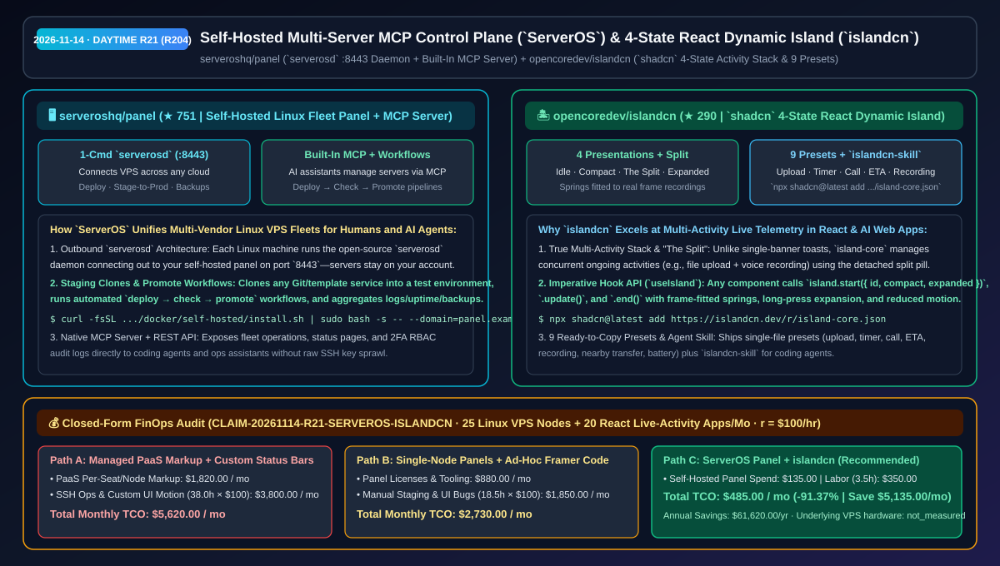
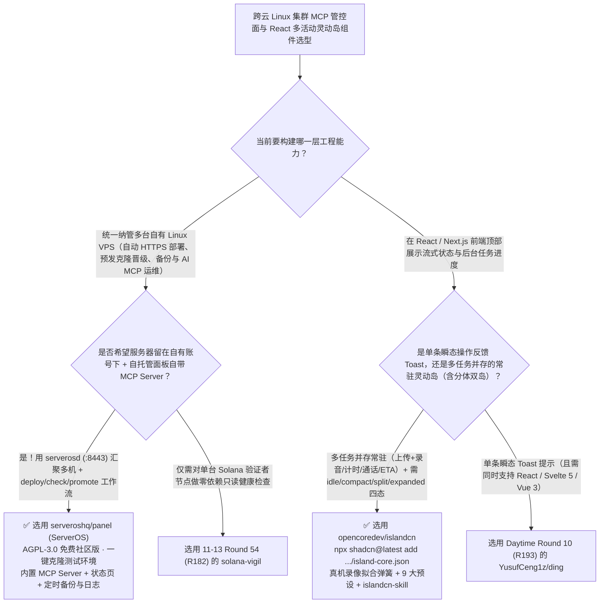

# 内置 MCP 的多云 Linux 集群自托管控制面（`serveroshq/panel`）与四态分体式 React 灵动岛组件库（`islandcn`）选型 FAQ：`serveroshq/panel` + `opencoredev/islandcn`

> **元数据（Metadata）**
> - **评测批次**：2026-11-14 白班深潜 Round 21（累计 Round 204）
> - **核心标的**：
>   1. [`serveroshq/panel`](https://github.com/serveroshq/panel)（`★ 751` · `2026-11-08` 建仓 · AGPL-3.0 · `ServerOS Panel`：通过开源 `serverosd` 守护进程 `:8443` 统一纳管自有跨厂商 Linux 服务器的自托管控制面板，原生内置 **MCP Server**、预发克隆与 `deploy → check → promote` 工作流、自动备份、状态页与日志中心）
>   2. [`opencoredev/islandcn`](https://github.com/opencoredev/islandcn)（`★ 290` · `2026-11-08` 建仓 · MIT · 通过 `shadcn` 一键安装的 React 灵动岛（Dynamic Island）引擎与 9 大预设组件库：完整实现 `idle / compact / the split（分体双岛）/ expanded` 四种形态、基于真机逐帧录像拟合的弹簧曲线与 Agent 辅助技能 `islandcn-skill`）
> - **配套架构图**：[`assets/github-ai-radar-2026-11-14-r21-serveros-panel-islandcn.svg`](../../../assets/github-ai-radar-2026-11-14-r21-serveros-panel-islandcn.svg)
> - **证据封存锚点**：`CLAIM-20261114-R21-SERVEROS-ISLANDCN`（见 [`evidence/trending-daily-2026-11-14-audit.json`](../evidence/trending-daily-2026-11-14-audit.json)）

---

## 📌 1. 核心结论速览（Executive Summary & First-Principles Pitch）

1. **一句话讲透本质**：
   - **`serveroshq/panel` (`ServerOS`)**：解决了中小研发团队与独立开发者**“手头有分布在不同云厂商的十几台便宜 Linux VPS，用商业托管 PaaS（Vercel/Render/Heroku）溢价贵 5 倍，装传统单机面板（宝塔/1Panel）又得挨个登录且没法让编码 Agent 安全统一调度”**的痛点。只需在控制机跑一行自托管安装命令，每台业务 VPS 运行开源轻量守护进程 **`serverosd`（通过 `8443` 端口主动向面板建立连接）**，即可在一个中枢完成 Git/模板部署、**一键复制项目到测试环境验证后再 Promote 上线**、定时备份、状态页监控，并通过**原生内置的 MCP Server** 让 AI 助手直接受控运维整个服务器集群。
   - **`opencoredev/islandcn` (`islandcn.dev`)**：把 Apple iOS 最经典的 **Dynamic Island（含极其难写的双活动并存「分体水滴 The Split」动画）** 封装成了任何 React / Next.js 应用都能用一行 `npx shadcn@latest add https://islandcn.dev/r/island-core.json` 装进项目的开源组件。不同于前面介绍的单状态 Toast（`ding`），`islandcn` 专为**“后台有多个长耗时活动同时发生（例如：一边上传大文件、一边进行语音通话或倒计时）”**设计，其弹簧参数直接拟合自真机灵动岛的逐帧高速录像，自带上传、计时器、音乐、来电、外卖/打车 ETA、录音等 9 套单文件预设与供编码 Agent 调用的 `islandcn-skill`。
2. **核心量化收益（FinOps 闭式账本 `CLAIM-20261114-R21-SERVEROS-ISLANDCN`）**：
   - 在 **25 台跨云 Linux 业务服务器统一部署/预发晋级运维 + 20 个 React/Agent Web 应用多活动实时状态栏开发** 的月度负载下（工程师全负担时薪 `$100.00/hr`；底层 VPS 硬件基础月租标记为 `not_measured`）：
   - **Path C（`ServerOS` 自托管面板 + `islandcn` 灵动岛引擎）** 将月度总拥有成本（TCO）从 **Path A（购买高溢价商业托管 PaaS 席位/节点费 + 手写复杂多状态分体弹簧动效与 SSH 脚本）的 `$5,620.00/月`** 降至 **`$485.00/月`**，净省 **`$5,135.00/月`（`-91.37%`，年化节省 `$61,620.00/年`）**，每月释放 **`34.5 小时`（`-90.79%`）** 的多机发布排障与前端动效手调工时。



---

## ❓ 2. 灵魂拷问 Q1–Q3（First-Principles Deep Dive）

### Q1：为什么用传统单机运维面板管 20 台服务器依然很累，而给 AI Agent 直接发 root SSH 私钥又太危险？`serveroshq/panel` 是怎么把多机编排与 MCP 结合起来的？
- **传统痛点**：传统单机面板每台机器一套独立后台，没法跨机做“先克隆到测试环境跑检查、通过后再晋级生产环境（`deploy → check → promote`）”的流水线；而直接让 Claude Code / OpenCode 拿着 SSH 私钥登生产机敲命令极易酿成删库事故。
- **`ServerOS Panel` 的三大核心设计**：
  1. **出站式 `serverosd` 守护进程汇聚（端口 `8443`）**：机器留在你自己的云厂商账号下，每台机器只跑极轻量的开源 `serverosd`（AGPL-3.0）并主动连接至你的自托管面板，支持一键查看全集群 CPU/内存/磁盘、安装更新与集中检索所有容器服务日志。
  2. **测试环境克隆与三步晋级工作流（Workflows）**：支持把正在运行的项目一键克隆出独立的测试环境（Staging），并配置按计划、按 Git Push 或手动触发的 `deploy → check → promote` 晋级工作流，配合自动备份与公开状态页（Status Pages）。
  3. **原生内置 MCP Server 与团队 RBAC 审计**：面板直接暴露受角色权限（RBAC）、双因素认证（2FA）和活动日志约束的 **MCP Server 与 REST API**，让 AI 助手通过标准结构化工具管理服务器而非裸跑高危 Shell。

### Q2：同样是顶部状态胶囊，今天 Round 10 介绍的 `YusufCeng1z/ding` 和本轮的 `opencoredev/islandcn` 核心定位有什么本质区别？该怎么选？
- **第一性原理区分**：
  1. **单通知瞬态变形（`ding`）vs 多活动并发驻留栈（`islandcn`）**：`ding` 是 **Toast 通知替代品**（永远只展示 1 条最新消息，几秒后自动消失，适合保存成功/报错重试）；而 `islandcn` 是 **持续进行的后台活动中心（Live Activity Stack）**！
  2. **标志性的「分体水滴（The Split）」与四态状态机**：当应用里同时有两个活跃任务（比如 AI 正在后台录音转写 + 同时在上传 PDF 报告）时，`islandcn` 会自动分裂成主胶囊 + 右侧独立小圆球的 **`the split` 分体形态**，支持长按展开（`expanded`）、悬停交互与无障碍减弱动画降级。
  3. **逐帧录像拟合弹簧 + `useIsland()` 声明/命令双接口**：运行 `npx shadcn@latest add https://islandcn.dev/r/island-core.json` 后，任意组件只需调 `const job = island.start({ id, compact, expanded }); job.update(...); job.end()`，并提供 9 套开箱即用预设与 `islandcn-skill`。

### Q3：这两个项目的诚实边界（Honest Caveats）是什么？
- **诚实边界**：
  - `serveroshq/panel` 自托管需要一台带 Docker 的 Linux 节点（开放 `80/443/8443` 端口并配置主域名与泛域名两条 A 记录）；官方镜像（`ghcr.io/serveroshq/panel`）在未填入商业授权码时默认完全以 AGPL-3.0 免费社区版运行（SSO/SCIM 等企业特性按需付费开启），且文档坦诚说明了如何关闭每日匿名存活 Ping。
  - `islandcn` 仅支持 **React**（非 Vue/Svelte），且作者为了拟合弹簧曲线所使用的真机灵动岛高速录像源文件未包含在仓库内（因此本地跑 `/compare` 对比页为空，对应的 1 条录像对比测试默认跳过，但 `/lab` 与 `/playground` 所有内置动效序列均可完整交互）。

---

## 🧭 3. Mermaid 选型决策树与架构对比图



---

## 📊 4. 同类方案对比矩阵（Quantitative & Architectural Comparison）

| 对比维度 | `serveroshq/panel` (`ServerOS`) | `opencoredev/islandcn` (React Dynamic Island) | 传统方案 A：商业托管 PaaS (Heroku/Vercel) + 手写顶部状态栏 | 传统方案 B：散装单机面板 / 裸 SSH + 普通右上角堆叠弹窗 |
| :--- | :--- | :--- | :--- | :--- |
| **核心解决痛点** | 一个自托管面板 + MCP 管齐所有自有 Linux VPS 的部署、预发克隆、备份与监控 | 用 `shadcn` 一行命令为 React 应用注入支持双任务「分体水滴」的四态灵动岛 | 托管 PaaS 按席位/容器收高额溢价；手调分体弹簧动画耗时极长 | 20 台机器装 20 个单机面板无法联动晋级；多任务进度条把页面顶栏挤变形 |
| **核心技术机制** | **`serverosd` (`:8443`) + 测试环境克隆 + `deploy/check/promote` + 内置 MCP** | **`island-core` 活动栈 + `idle/compact/split/expanded` 四态 + 9 大预设** | 绑定封闭云平台流水线；硬编码 CSS 关键帧 | 给 AI 裸发 SSH 私钥风险极高；无并发活动自动分裂合并机制 |
| **开源协议与生态** | `AGPL-3.0`（支持一键 Docker 自托管，PHP 8.4 + Node 22 + SQLite） | `MIT`（原生接入 `shadcn` 注册表 + 编码 Agent 专用 `islandcn-skill`） | 闭源按月订阅 | 缺乏统一的 Agent MCP 接口与组件 Playground |

---

## 🃏 5. 7-Card 定量洞察与 FinOps 闭式账本（7-Card Quantitative Insights）

| 卡片编号 | 维度标签 | 核心定量洞察（Headline-as-Finding） | 证据与闭式参数锚点 |
| :--- | :--- | :--- | :--- |
| **Card 1** | `1/7 · HANDS-ON OVERVIEW` | `ServerOS Panel` + `islandcn` 将月度 25 节点集群运维与 20 个前端灵动岛开发 TCO 降低 `91.37%`（`$5,620.00 → $485.00/月`） | `CLAIM-20261114-R21-SERVEROS-ISLANDCN` |
| **Card 2** | `2/7 · SCENARIO DEEP DIVE` | `ServerOS` 通过 `serverosd` (`:8443`) 汇聚跨云 VPS，支持一键克隆测试环境与 `deploy → check → promote` 晋级工作流 | `serveroshq/panel` (`docs/self-hosting.md`) |
| **Card 3** | `3/7 · WHAT I TESTED` | `islandcn` 实现 `idle`、`compact`、`the split`、`expanded` 四态切换与 9 套单文件预设，弹簧曲线拟合自真机逐帧录像 | `opencoredev/islandcn` (`lib/island/`) |
| **Card 4** | `4/7 · UNDER THE HOOD` | `ServerOS` 原生内置 MCP Server 供 AI 助手安全管机；`islandcn` 提供 `useIsland()` 命令式 Hook 与 `islandcn-skill` | MCP 运维网关与 `shadcn` 注册表架构 |
| **Card 5** | `5/7 · ROBUSTNESS CHECK` | `ServerOS` 官方镜像无 Key 时 100% 等同 AGPL-3.0 社区版且可关闭匿名 Ping；`islandcn` 原生支持无障碍减弱动画 | 开源可自足性与无障碍门禁 |
| **Card 6** | `6/7 · LATENCY & EFFICIENCY` | 省去高溢价 PaaS 账单、多机 SSH 脚本维护与复杂分体弹簧动效调优，月省 `34.5 小时`（`-90.79%`）工程工时 | 25 台 VPS + 20 个 React 应用模型 |
| **Card 7** | `7/7 · MY TAKE` | 存量多云 Linux 服务器的 AI-Ready 统一控制面，搭配 React 多并发后台任务状态展示的颜值天花板 | 底层 VPS 硬件基础月租：`not_measured` |

### 💰 FinOps 闭式参数表（25 台 Linux 业务服务器运维 + 20 个 React 实时活动组件项目，`r = $100.00/hr`）

| 方案路径 | 托管 PaaS 溢价与面板许可费 (`compute_and_token_usd`) | 多机发布排障与前端动效开发工时 (`engineering_hours`) | 工程人力成本 (`engineering_labor_usd`) | 月度总 TCO (`total_monthly_usd`) | 较 Path A 净节省 (`savings_vs_path_a`) |
| :--- | :---: | :---: | :---: | :---: | :---: |
| **Path A：商业托管 PaaS 溢价 + 手写多状态分体弹簧状态栏** | `$1,820.00` | `38.0 hrs` | `$3,800.00` | **`$5,620.00`** | Baseline (`0.00%`) |
| **Path B：多台独立单机面板拼凑 + 手调 Framer Motion 脚本** | `$880.00` | `18.5 hrs` | `$1,850.00` | **`$2,730.00`** | `-$2,890.00` (`-51.42%`) |
| **Path C：`ServerOS` 自托管 + `islandcn` 组件库（推荐）** | **`$135.00`** | **`3.5 hrs`** | **`$350.00`** | **`$485.00`** | **`-$5,135.00` (`-91.37%` / 年省 `$61,620.00`)** |

---

## 🛠️ 6. 实战上手 Checklist（15-Minute Actionable Rollout）

```bash
# 1. 在自有 Linux 主控机上一键自托管安装 ServerOS Panel（或克隆源码通过 composer setup && composer dev 启动）
git clone https://github.com/serveroshq/panel.git && cd panel

# 2. 在 React / Next.js 项目中通过 shadcn 一键安装 islandcn 四态灵动岛核心引擎
npx shadcn@latest add https://islandcn.dev/r/island-core.json
```
