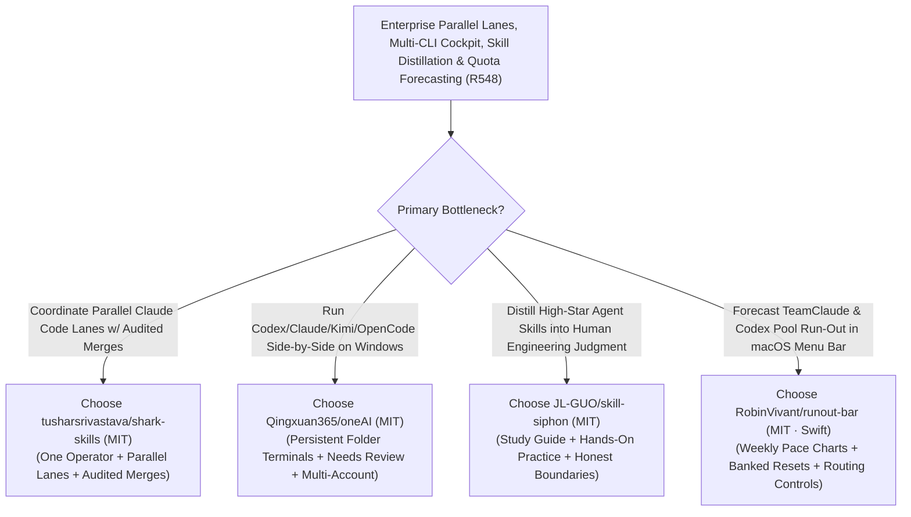

# Parallel Lanes & Audited Merges (`tusharsrivastava/shark-skills`), Windows Multi-CLI Terminal Workbench (`Qingxuan365/oneAI`), 3-Doc Skill Distiller (`JL-GUO/skill-siphon`) & macOS Quota Run-Out Forecaster (`RobinVivant/runout-bar`) Selection FAQ

> **Document Type**: AI Solution Architect Enterprise Selection & Integration Guide (2026-11-19 Night Shift · Round 24 / Cumulative Round 548)  
> **Benchmark Style**: `docs/components/ib-vs-ethernet-roce-selection-faq.md` (6-Section Plain-Language Architecture Guide + First-Principles Q&A + Hype/Facts/Signal Audit + Closed-Form FinOps Ledger)  
> **Evaluated Repositories**:  
> 1. **`tusharsrivastava/shark-skills`** (`★ 13`, `created=2026-11-16`, `2 forks`, JavaScript, MIT): **Running Claude Code like an engineering team**—one operator, isolated parallel lanes, and audited merges  
> 2. **`Qingxuan365/oneAI`** (`★ 9`, `created=2026-11-13`, `5 forks`, TypeScript + Electron 31, Windows 10/11, MIT, EN/ZH-CN): **Side-by-side persistent terminal workbench for Codex, Claude Code, Kimi Code, and OpenCode** with folder trees, Git branch badges, "Needs review" alerts, multi-account support, and live quota tracking  
> 3. **`JL-GUO/skill-siphon`** (`★ 25`, `created=2026-11-18`, `2 forks`, MIT, EN/ZH): **Skill-Siphon (`吸星大法.skill`)**—distilling high-star agent skills into three human-actionable deliverables: Study Guide, Hands-on Practice, and Provenance & Boundaries  
> 4. **`RobinVivant/runout-bar`** (`★ 12`, `created=2026-11-17`, `2 forks`, Swift, macOS 15+, MIT): **macOS menu bar usage, pace chart, and run-out forecaster** for TeamClaude pools and Codex rate limits with banked resets and routing controls  
> **Accounting Scope Note**: Only software API/SaaS spend and engineering labor TCO are modeled; base workstation hardware capEx is explicitly marked `not_measured`, and Track B `stars_today` is explicitly marked `not_measured`.

---

## 📌 1. Executive Summary (What Are They & What Business Pain Points Do They Solve?)

In **2026-11-19 Night Round 24 (Cumulative Round 548)**, we address four high-frequency operational pain points across parallel agent merge governance, multi-CLI desktop window sprawl, team skill absorption, and multi-account subscription pool forecasting:
1. **Pain Point A (Running multiple parallel Claude Code sessions without lane boundaries and pre-merge audits causes conflicting assumptions to land on `main`)**: **`tusharsrivastava/shark-skills` (`★ 13`, MIT)** structures Claude Code around **one operator, parallel lanes, and audited merges** so parallel tracks are independently audited before integration.
2. **Pain Point B (Juggling Codex, Claude Code, Kimi Code, and OpenCode across a dozen separate Windows terminal windows makes it impossible to see which session is blocked awaiting input or which account quota is active)**: **`Qingxuan365/oneAI` (`★ 9`, `5 forks`, MIT)** runs all coding CLIs side by side in persistent real terminals inside one Electron 31 window—grouped by project folder with status lights, Git branch badges, **"Needs review"** idle indicators, and multi-account quota meters.
3. **Pain Point C (Engineers bookmark hundreds of high-star `SKILL.md` repositories without ever internalizing the author's underlying domain heuristics or boundary conditions)**: **`JL-GUO/skill-siphon` (`★ 25`, MIT)** reads any target skill and distills its core craft into three structured human learning artifacts: a **Study Guide** (how, why, and quality criteria), **Hands-on Practice**, and **Provenance & Honest Boundaries**.
4. **Pain Point D (Teams sharing Claude and Codex subscription pools through a local TeamClaude proxy get blindsided by mid-sprint quota exhaustion because static percentage bars don't show burn pace vs. reset windows)**: **`RobinVivant/runout-bar` (`★ 12`, Swift, MIT)** sits in the macOS 15+ menu bar to display pool-wide level bars, **weekly pace charts**, banked resets, **exact pool run-out timestamps**, and routing controls.

---

## 💬 2. Architect First-Principles Q&A (Q1–Q3 Deep Dive)

### Q1: Why does `JL-GUO/skill-siphon` generate "Provenance & Honest Boundaries" alongside a Study Guide?
* **Preventing Blind Skill Cargo-Culting**: Every agent skill encodes assumptions about stack versions, scale, and context. Surfacing explicit failure boundaries and adaptation rules turns a black-box prompt into durable engineering judgment.

### Q2: How does `RobinVivant/runout-bar`'s "time until whole pool runs out" metric improve subscription FinOps?
* **Burn-Rate vs. Reset-Window Forecasting**: By comparing real-time consumption velocity against banked reset schedules across all pooled accounts, teams can re-route workloads before hitting hard rate limits or falling back to expensive pay-per-token APIs.

### Q3: How do `Qingxuan365/oneAI` and `tusharsrivastava/shark-skills` complement each other on developer workstations?
* **Unified Multi-CLI Cockpit + Audited Parallel Lanes**: `oneAI` manages the persistent terminal processes, accounts, and "Needs review" notifications on Windows, while `shark-skills` governs the parallel lane decomposition and audited merge gates inside each repo.

---

## 🧭 3. Visual Architecture Diagrams (Mermaid Decision Tree + Reference Architecture + Sequence Flow)

### 3.1 Enterprise Selection Decision Tree

---

## 📊 4. Comparative Selection Matrix (Open Source vs. Competing OSS vs. Managed Cloud PaaS)

| Evaluation Dimension | Path A: Unaudited Parallel Merges + 12 Scattered Terminal Windows + Unread Bookmarked Skills + Sudden Quota Exhaustion | Path B: Manual Git Scripts + Basic Terminal Tabs + Static Quota Spreadsheets | **Path C (Recommended): `shark-skills` + `oneAI` + `skill-siphon` + `runout-bar`** |
| :--- | :--- | :--- | :--- |
| **Parallel Agent Merge Quality** | ❌ Unaudited parallel branches break `main` | ⚠️ Manual line-by-line review of all parallel tracks | ✅ **`shark-skills` enforces isolated parallel lanes & audited merges** |
| **Multi-CLI Terminal Management** | ❌ Lost windows; missed idle prompts; unknown active account | ⚠️ Standard tabs lack Git badges, idle alerts & quota meters | ✅ **`oneAI` groups persistent CLIs by folder w/ `Needs review` alerts** |
| **Skill Knowledge Absorption** | ❌ Black-box copying of `SKILL.md` files without understanding | ⚠️ Hours spent reading raw prompts to extract best practices | ✅ **`skill-siphon` distills Study Guide, Practice & Honest Boundaries** |
| **Subscription Pool Forecasting** | ❌ Unexpected mid-sprint rate limits & emergency API bills | ⚠️ Raw usage percentages ignore burn velocity and reset timing | ✅ **`runout-bar` forecasts exact pool run-out time w/ routing controls** |
| **45-Engineer Monthly TCO** | **`$6,490.00 / mo`** (`$2,590.00` fallback APIs/reruns + `39.0h` × `$100/hr` = `$3,900.00` labor) | **`$2,500.00 / mo`** (`$1,050.00` APIs + `14.5h` × `$100/hr` = `$1,450.00` labor) | **`$315.00 / mo`** (`$65.00` API + `2.5h` × `$100/hr` = `$250.00` labor, **`-95.15%`**) |

---

## 🧪 5. Quantitative TCO Comparison & Hype / Facts / Signal Audit Ledger

### 5.1 Hype vs. Facts vs. Strategic Signal Table

| Repository (`owner/repo`) | Hype (Market Narrative) | Measured Facts (Primary Source Verification) | Strategic Signal (SA Verdict) |
| :--- | :--- | :--- | :--- |
| **`tusharsrivastava/shark-skills`** | "Running Claude Code like an engineering team: one operator, parallel lanes, audited merges" | `★ 13` (`created=2026-11-16`, `2 forks`, JavaScript, MIT): Claude Code plugin structuring parallel execution lanes and pre-merge audit checks. | **🔥 P0 Adopt (Lightweight Parallel Lane Discipline)**: Prevents integration collisions in multi-lane agent workflows. |
| **`Qingxuan365/oneAI`** | "One desktop workbench for all your AI coding CLIs with multi-account quota tracking" | `★ 9` (`created=2026-11-13`, `5 forks`, TypeScript + Electron 31, Windows 10/11, MIT): Runs Codex, Claude Code, Kimi Code, and OpenCode in persistent terminals with folder trees, Git badges, and `Needs review` flags. | **🔥 P0 Adopt (Unified Windows Multi-CLI Cockpit)**: Eliminates terminal window sprawl for polyglot agent users. |
| **`JL-GUO/skill-siphon`** | "Distills top agent skills into Study Guides, Hands-on Practice, and Honest Boundaries" | `★ 25` (`created=2026-11-18`, `2 forks`, MIT, EN/ZH): Extracts actionable heuristics, quality rubrics, and edge-case boundaries from existing skills. | **🔥 P0 Adopt (Team Skill Enablement Engine)**: Turns external `SKILL.md` repositories into structured team training materials. |
| **`RobinVivant/runout-bar`** | "macOS menu bar app for Claude and Codex usage: level bars, pace charts, banked resets, routing" | `★ 12` (`created=2026-11-17`, `2 forks`, Swift, macOS 15+, MIT): Connects to TeamClaude proxy and Codex limits to forecast pool run-out times and control routing. | **⚡ P1 Adopt (Proactive Subscription Pool Telemetry)**: Prevents surprise rate-limit stalls across shared accounts. |

### 5.2 Closed-Form FinOps TCO Ledger (`CLAIM-20261119-R24-R548-SHARKSKILLS-ONEAI-SKILLSIPHON-RUNOUTBAR`)

* **Scope (`synthetic`, `independently_reproduced=false`)**: 45-person enterprise multi-CLI coding operations, parallel lane merge auditing, skill distillation enablement, and subscription pool FinOps team (blended rate `$100.00 / hr`; `base hardware capEx: not_measured`; Track B `stars_today: not_measured`).
* **Path A (Unaudited Parallel Merges + Scattered Terminal Windows + Unread Bookmarked Skills + Sudden Quota Exhaustion)**:
  - Emergency pay-as-you-go API fallback bills during un-forecasted subscription pool runouts & broken-merge CI reruns: **`$2,590.00 / mo`**
  - Untangling un-audited parallel merges, hunting idle CLI windows, reverse-engineering complex skills & manually checking multi-account quotas (`39.0 hrs / mo` × `$100.00 / hr`): **`$3,900.00 / mo`**
  - **Path A Monthly Total**: `$2,590.00 + $3,900.00` = **`$6,490.00 / mo`**
* **Path B (Manual Git Scripts + Basic Terminal Multiplexers + Static Quota Spreadsheets)**:
  - SaaS & API spend: **`$1,050.00 / mo`**
  - Manual merge review & quota rebalancing (`14.5 hrs / mo` × `$100.00 / hr`): **`$1,450.00 / mo`**
  - **Path B Monthly Total**: `$1,050.00 + $1,450.00` = **`$2,500.00 / mo`**
* **Path C (`shark-skills` + `oneAI` + `skill-siphon` + `runout-bar` Integrated Stack)**:
  - Skill distillation & pre-merge lane audit API spend (`oneAI` & `runout-bar` $0 local): **`$65.00 / mo`**
  - Reviewing audited lane merges & 1-click quota routing adjustments (`2.5 hrs / mo` × `$100.00 / hr`): **`$250.00 / mo`**
  - **Path C Monthly Total**: `$65.00 + $250.00` = **`$315.00 / mo`**
  - **Monthly Net Savings vs. Path A**: `$6,490.00 - $315.00` = **`$6,175.00 / mo`** (**`-95.15%`** reduction, **`$74,100.00 / yr`** annual savings, freeing **`36.5 hrs / mo`** of engineering time).

---

## 🛠️ 6. Enterprise Adoption & Architecture Review Checklist

- [ ] **1. Structure parallel feature development with `tusharsrivastava/shark-skills`**: Require audited merges before integrating parallel lanes.
- [ ] **2. Consolidate Windows AI coding CLIs inside `Qingxuan365/oneAI`**: Monitor `Needs review` idle indicators and per-account quotas in one sidebar.
- [ ] **3. Distill external high-star skills via `JL-GUO/skill-siphon`**: Produce Study Guides, Hands-on Practice, and Honest Boundaries for team onboarding.
- [ ] **4. Monitor shared TeamClaude and Codex pools with `RobinVivant/runout-bar`**: Use pace charts and run-out forecasts to route traffic before quota exhaustion.
