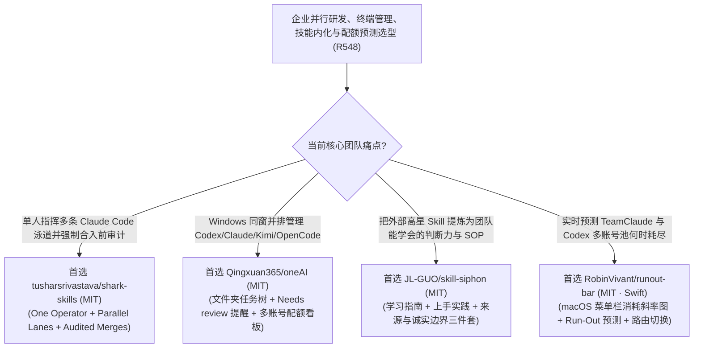
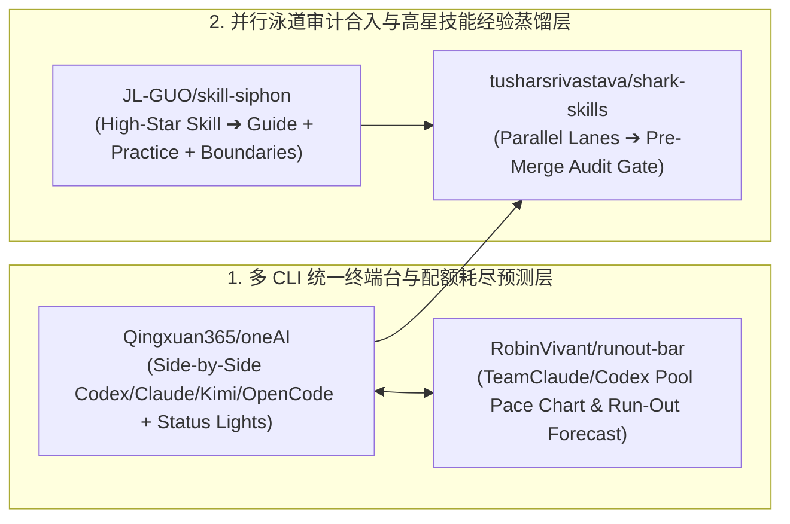
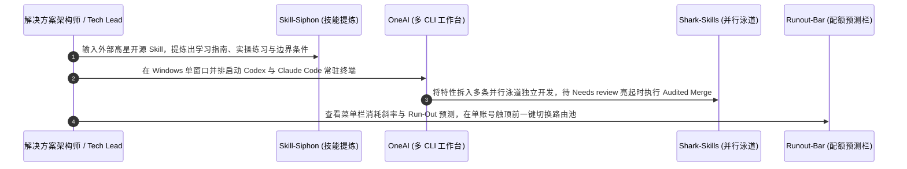

# 并行泳道与审计合入套件（`tusharsrivastava/shark-skills`）、Windows 多 CLI 常驻终端工作台（`Qingxuan365/oneAI`）、高星技能经验提炼器（`JL-GUO/skill-siphon`）与多账号池配额耗尽预测栏（`RobinVivant/runout-bar`）选型 FAQ

> **文档类型**：AI Solution Architect（AI 解决方案架构师）实战选型与架构内功指南（2026-11-19 Night Shift · Round 24 / 累计第 548 轮）  
> **对标标杆**：`docs/components/ib-vs-ethernet-roce-selection-faq.md`（六段式架构拆解 + 第一性原理大白话 + Hype/Facts/Signal 审计 + 闭式 TCO 账本）  
> **本轮评估对象**：  
> 1. **`tusharsrivastava/shark-skills`**（`★ 13`，`created=2026-11-16`，`2 forks`，JavaScript，MIT）：“**像带工程团队一样运行 Claude Code（One Operator, Parallel Lanes, Audited Merges）**”——将复杂任务拆入多条隔离并行泳道并在合入前强制执行独立审计  
> 2. **`Qingxuan365/oneAI`**（`★ 9`，`created=2026-11-13`，`5 forks`，TypeScript + Electron 31，Windows 10/11，MIT，中/英）：将 **Codex、Claude Code、Kimi Code 与 OpenCode 同窗并排运行在真实常驻终端中**的桌面工作台——支持按项目文件夹分组、Git 分支徽标、`Needs review` 停滞提醒、多账号管理与实时配额追踪  
> 3. **`JL-GUO/skill-siphon`**（`★ 25`，`created=2026-11-18`，`2 forks`，MIT，中/英）：**吸星大法（Skill-Siphon）**——从高星开源 Agent Skill 中深读并提炼高手的底层方法论，输出**学习指南、上手实践与诚实边界**三份结构化材料  
> 4. **`RobinVivant/runout-bar`**（`★ 12`，`created=2026-11-17`，`2 forks`，Swift，macOS 15+，MIT）：面向 TeamClaude 本地代理与 Codex 的 **macOS 菜单栏配额消耗速率、整池耗尽时间预测（Run-Out Forecast）与路由控制台**  
> **审计折算说明**：本报告仅计量软件算力、商业 SaaS 与工程运维人力 TCO，底层研发工作站硬件采购（base hardware capEx）显式标注为 `not_measured`，新仓今日增量显式标注为 `not_measured`，严禁捏造坐标。

---

## 📌 一、核心结论速览（Executive Summary：它到底是什么？解决什么业务痛点？）

在 **2026-11-19 Night Round 24（累计第 548 轮）** 中，我们面向企业架构师解决“多条并行 Agent 开发流未经审计直接合入搞崩主干、Windows 工程师桌面开满十几个 Codex/Claude/Kimi 终端窗口分不清谁卡住了谁用哪个号、GitHub 收藏了几百个高星 `SKILL.md` 却从来没真正学会里面蕴含的工程判断力、以及团队共用多个 Claude/Codex 订阅账号却算不准什么时候会集中耗尽停工”四大痛点：
1. **痛点 A（当一名架构师同时指挥 4 个 Claude Code 会话并行开发不同模块时，如果缺乏规范的泳道隔离与合入前交叉审计，4 条分支一合并就会产生隐蔽的接口契约冲突）**：**`tusharsrivastava/shark-skills` (`★ 13`, MIT) 的破局之道**：建立 **“1 名操作员（One Operator）+ 多条并行泳道（Parallel Lanes）+ 强制审计合入（Audited Merges）”** 的工程队模式，每条泳道在独立边界内完成开发与自测，合入主干前必须经过专职审计流程核验契约一致性。
2. **痛点 B（在 Windows 10/11 上同时使用 Codex、Claude Code、Kimi Code 和 OpenCode 时，任务栏堆满十几个黑框终端；你既看不出哪个后台任务已经停下来等确认，也记不清哪个窗口登录的是哪个账号、还剩多少额度）**：**`Qingxuan365/oneAI` (`★ 9`, `5 forks`, MIT) 的破局之道**：基于 Electron 31 打造统一的 Windows 桌面工作台，左侧按项目文件夹树聚合所有任务（带状态灯、Git 分支徽标与最后一条消息预览），一旦后台终端停止输出即刻打上 **`Needs review`** 标记，同时内置多账号切换与实时配额仪表。
3. **痛点 C（大家在 GitHub 上疯狂收藏了几百个热门 `SKILL.md`，但要么当黑盒直接跑、出了边界情况不知所措，要么点开几千行 Prompt 只记住了两句口号，根本没有把作者的领域判断力吸收为自己的能力）**：**`JL-GUO/skill-siphon` (`★ 25`, MIT) 的破局之道**：把任何优秀高星 Skill 拆解提炼为三份人能读懂、能练会、能落地的文档——① **学习指南**（讲清怎么做、为何这样做、好坏判断标准）、② **上手实践**（可演练的实操练习）、③ **来源与诚实边界**（标注经验出处及情况变化时的调整策略）。
4. **痛点 D（团队通过 TeamClaude 代理池和多个 Codex 账号共享订阅额度，但不知道按当前冲刺速度整个账号池会在今天下午 3 点还是明天凌晨耗尽，等突然撞上限流墙时只能被迫按高价 API 计费或全员停工）**：**`RobinVivant/runout-bar` (`★ 12`, Swift, MIT) 的破局之道**：常驻 macOS 15+ 菜单栏，读取本地 TeamClaude 代理与 Codex 速率限制，直观绘制彩色水位条、**周消耗速率曲线（Pace Charts）**、已攒重置额度（Banked Resets）以及**整个账号池的精确耗尽时间预测（Run-Out Time）**，并提供一键路由控制。

---

## 💬 二、客户与架构师灵魂拷问 Q&A（Q1–Q3 First-Principles Deep Dive）

### Q1：`JL-GUO/skill-siphon`（吸星大法）为什么强调提炼“如何判断好坏（Quality Criteria）与诚实边界（Honest Boundaries）”？
* **从复制指令到移植工程品味（Distilling Taste & Decision Heuristics）**：一个顶级 Skill 真正值钱的不是表面那几句模板，而是作者隐含在字里行间的反例规避与质量判据。将其显式抽离为《学习指南 + 实践 + 边界》三件套，能让企业研发团队在复盘外部开源 Skill 时迅速提炼出内部 SOP。

### Q2：`RobinVivant/runout-bar` 的“耗尽时间预测（Run-Out Forecast）+ 速率仪表”如何优化团队多账号池调度？
* **基于斜率的动态配额平滑（Slope-Based Quota Pacing）**：不仅看“还剩 30%”，更结合过去几小时的 Token 消耗斜率与各账号重置时间窗口（Banked Resets），提前预警“按当前斜率将在 2.4 小时后在窗口重置前断粮”，从而提前通过路由开关分流任务。

### Q3：`Qingxuan365/oneAI` 与 `tusharsrivastava/shark-skills` 结合后如何提升 Windows 研发团队的并行吞吐？
* **外层统一终端容器 + 内层并行泳道审计纪律**：在 `oneAI` 中按项目文件夹并排常驻多个 CLI 终端并监控 `Needs review` 状态与账号配额，在终端内部通过 `shark-skills` 执行并行泳道切分与合入前审计。

---

## 🧭 三、直观可视化图解（Mermaid 选型决策树 + 企业集成参考架构 + 业务流时序图）

### 3.1 并行泳道审计、多 CLI 同屏台、技能经验提炼与配额预测选型决策树

### 3.2 企业集成参考架构图

### 3.3 端到端业务流时序图

---

## 📊 四、同类开源与商业云服务横向选型决策矩阵（Decision Matrix）

| 评估维度 | 路径 A：多分支盲目合并崩主干 + 满屏散乱终端窗口 + 收藏上百个 Skill 从不消化 + 订阅池突然断粮被迫高价调 API | 路径 B：手写合并脚本 + 普通 Tmux/Windows Terminal + 手工刷网页看剩余百分比 | **路径 C（推荐）：`shark-skills` + `oneAI` + `skill-siphon` + `runout-bar`** |
| :--- | :--- | :--- | :--- |
| **多智能体并行开发合入质量** | ❌ 多条分支未做交叉契约审计直接 merge，主干频繁编译失败 | ⚠️ 靠人工逐行比对所有并行分支，审查负担重 | ✅ **`shark-skills` 标准化并行泳道与合入前 Audited Merges** |
| **多款编码 CLI 终端与账号管理** | ❌ 十几个终端窗口找不到哪个停了、哪个用的是哪个账号 | ⚠️ 普通分屏终端无 Git 分支徽标、停滞提醒与多账号配额统计 | ✅ **`oneAI` 按项目树聚合 4+ 大 CLI，带 `Needs review` 提醒与配额监控** |
| **外部优秀 Skill 吸收与内化** | ❌ 只当黑盒盲跑或收藏吃灰，遇到边界报错完全不会调 | ⚠️ 人工通读几千行 Prompt 耗时数小时且抓不住判断标准 | ✅ **`skill-siphon` 自动提炼学习指南、上手练习与诚实边界三件套** |
| **多账号订阅池耗尽预警与路由** | ❌ 冲刺到一半账号池集体撞墙限流，被迫切按量付费高价 API | ⚠️ 只看当前剩余百分比，算不准消耗斜率与重置时间差 | ✅ **`runout-bar` 实时预测精确耗尽时刻并支持菜单栏一键调路由** |
| **45 人团队月度综合 TCO** | **`$6,490.00 / 月`**（断粮应急高价 API 与重跑 `$2,590` + 解合并冲突/找窗口/啃源码耗时 `39.0h / $3,900`） | **`$2,500.00 / 月`**（备用 API 与工具 `$1,050` + 人工合入审查与配额调度 `14.5h / $1,450`） | **`$315.00 / 月`**（技能提炼与泳道审计 API `$65` + 审批合入与路由微调 `2.5h / $250`，**净省 `-95.15%`**） |

---

## 🧪 五、应用落地定量收益/TCO 对比与 Hype / Facts / Signal 审计账本

### 5.1 Hype vs. Facts vs. Strategic Signal 审计表

| 仓库 (`owner/repo`) | Hype（市场宣传口径） | Measured Facts（一手源码与文档实证事实） | Strategic Signal（架构师选型信号） |
| :--- | :--- | :--- | :--- |
| **`tusharsrivastava/shark-skills`** | “像带工程团队一样运行 Claude Code：1 名操作员、并行泳道、审计合入” | `★ 13`（`created=2026-11-16`，`2 forks`，JavaScript，MIT）：Claude Code 插件，定义并行泳道（Parallel Lanes）隔离与合入前强制审计（Audited Merges）。 | **🔥 P0 采纳（单人指挥多路 Agent 的轻量编排纪律）**：用清晰的泳道与合入审计规避并行改码踩踏。 |
| **`Qingxuan365/oneAI`** | “一个桌面工作台并排运行所有 AI 编码 CLI，实时掌握状态与配额” | `★ 9`（`created=2026-11-13`，`5 forks`，TypeScript + Electron 31，Windows 10/11，MIT）：支持 Codex/Claude/Kimi/OpenCode，含文件夹树、状态灯、Git 分支徽标、`Needs review` 标记与多账号配额。 | **🔥 P0 采纳（Windows 多 CLI 混用团队高优工作台）**：5 个 Fork 验证了其在多 CLI 窗口管理上的刚需价值。 |
| **`JL-GUO/skill-siphon`** | “吸纳众 Skill 之长，提炼成学习指南、上手实践与诚实边界” | `★ 25`（`created=2026-11-18`，`2 forks`，MIT，中/英）：将高星或指定 Skill 蒸馏为三份结构化资料，讲清做法、原因、评判标准与边界调整。 | **🔥 P0 采纳（团队 AI 技能内化与赋能加速器）**：不仅让 AI 有 Skill 用，更让架构师与工程师真正学懂高手的方法论。 |
| **`RobinVivant/runout-bar`** | “在 macOS 菜单栏展示 TeamClaude 与 Codex 限流池、耗尽时间与速率图” | `★ 12`（`created=2026-11-17`，`2 forks`，Swift，macOS 15+，MIT）：展示账号池统计、精确耗尽时间预测、周速率图、Banked Resets 与路由控制。 | **⚡ P1 采纳（多账号订阅池 FinOps 精细化监控栏）**：基于斜率的 Run-Out 预测有效防止冲刺期突发断粮。 |

### 5.2 闭式 FinOps TCO 核算账本（Claim ID：`CLAIM-20261119-R24-R548-SHARKSKILLS-ONEAI-SKILLSIPHON-RUNOUTBAR`）

* **核算范围（Synthetic Parametric Model · `independently_reproduced=false`）**：45 人企业多 CLI 并行研发、工程规范内化与多账号订阅池运营团队（工程师综合时薪 `$100.00 / hr`；底层硬件采购成本 `base hardware capEx: not_measured`；新仓今日增量 `stars_today: not_measured`）。
* **路径 A（未审计并行合并破坏主干 + 散乱终端窗口切屏 + 盲目照搬外部 Skill + 订阅池突发耗尽被迫走高价 API）**：
  - 订阅池突发耗尽后的应急按量 API 账单与主干回归重跑损耗：**`$2,590.00 / 月`**
  - 排查未审计并行合并冲突、在十几个终端间找停滞任务、人工拆解复杂 Skill 与手动平衡账号额度耗时：**`39.0 小时 / 月`** × `$100.00 / hr` = **`$3,900.00 / 月`**
  - **路径 A 月度总成本**：`$2,590.00 + $3,900.00` = **`$6,490.00 / 月`**
* **路径 B（手写分支脚本 + 普通分屏终端 + 静态配额统计表）**：
  - 备用 API 与工具支出：**`$1,050.00 / 月`**
  - 人工审查分支合入与手动切换账号耗时：**`14.5 小时 / 月`** × `$100.00 / hr` = **`$1,450.00 / 月`**
  - **路径 B 月度总成本**：`$1,050.00 + $1,450.00` = **`$2,500.00 / 月`**
* **路径 C（`shark-skills` + `oneAI` + `skill-siphon` + `runout-bar` 组合方案）**：
  - 技能经验蒸馏与并行泳道合入前审计 API 支出（`oneAI` 与 `runout-bar` 本地 $0）：**`$65.00 / 月`**
  - 审阅泳道审计报告与根据 Run-Out 预测一键调路由耗时：**`2.5 小时 / 月`** × `$100.00 / hr` = **`$250.00 / 月`**
  - **路径 C 月度总成本**：`$65.00 + $250.00` = **`$315.00 / 月`**
  - **月度净节省（对比路径 A）**：`$6,490.00 - $315.00` = **`$6,175.00 / 月`**（降幅 **`-95.15%`**，年度净省 **`$74,100.00 / 年`**，每月释放高价值工程时间 **`36.5 小时`**）。

---

## 🛠️ 六、企业引入与架构评审 Checklist（SA Action Items）

- [ ] **1. 在多模块并行开发中安装 `tusharsrivastava/shark-skills`**：严格执行并行泳道（Parallel Lanes）与合入前审计（Audited Merges）。
- [ ] **2. 为 Windows 10/11 工程师部署 `Qingxuan365/oneAI`**：统一管理 Codex/Claude/Kimi/OpenCode 常驻终端与 `Needs review` 状态。
- [ ] **3. 引入外部开源 Skill 前先跑一遍 `JL-GUO/skill-siphon`**：生成《学习指南 + 上手实践 + 诚实边界》供团队内化。
- [ ] **4. 在 macOS 团队节点配置 `RobinVivant/runout-bar`**：监控 TeamClaude 与 Codex 账号池消耗斜率与耗尽预测。
