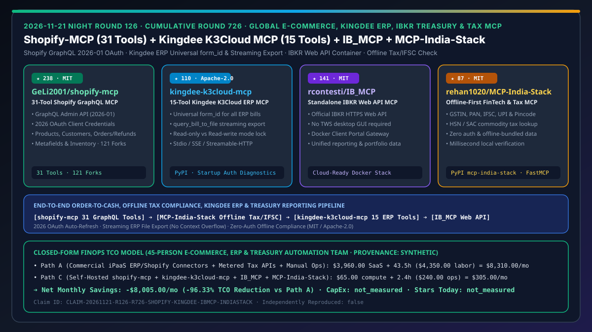
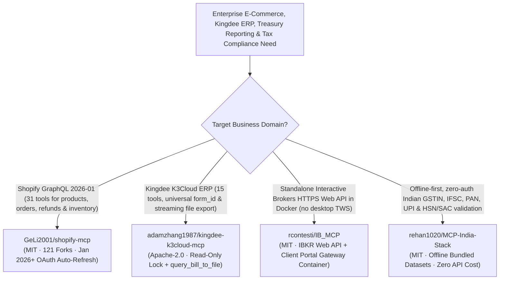
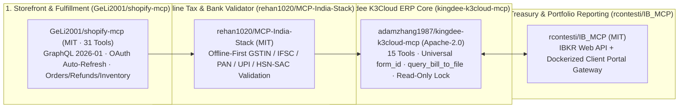
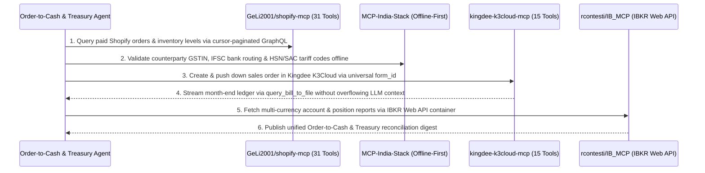

# 31-Tool Shopify GraphQL MCP (`GeLi2001/shopify-mcp`), 15-Tool Kingdee K3Cloud ERP MCP (`adamzhang1987/kingdee-k3cloud-mcp`), Standalone IBKR Web API MCP (`rcontesti/IB_MCP`) & Offline-First FinTech/Tax Validation MCP (`rehan1020/MCP-India-Stack`) Selection & Architecture FAQ

> **Document Type**: Enterprise AI Solution Architect Selection & Integration Guide (GitHub Trending AI Radar — 2026-11-21 Night Round 126 / Cumulative Round 726)
> **Covered Repositories**: [`GeLi2001/shopify-mcp`](https://github.com/GeLi2001/shopify-mcp) (`★ 238`, `121 forks`, `MIT` — 31-tool Shopify GraphQL Admin API `2026-01` MCP server with automatic Jan 2026+ OAuth client-credential token refresh) · [`adamzhang1987/kingdee-k3cloud-mcp`](https://github.com/adamzhang1987/kingdee-k3cloud-mcp) (`★ 110`, `30 forks`, `Apache-2.0` — 15-tool Kingdee K3Cloud ERP MCP server with universal `form_id`, streaming file export `query_bill_to_file`, read-only lock & `stdio`/`SSE`/`streamable-http` transports) · [`rcontesti/IB_MCP`](https://github.com/rcontesti/IB_MCP) (`★ 141`, `26 forks`, `MIT` — containerized Interactive Brokers official Web API & Client Portal Gateway MCP server without desktop TWS) · [`rehan1020/MCP-India-Stack`](https://github.com/rehan1020/MCP-India-Stack) (`★ 87`, `17 forks`, `MIT` — offline-first, zero-auth MCP server for Indian tax & banking validation: `GSTIN`, `IFSC`, `PAN`, `UPI`, `pincode`, `HSN/SAC`)
> **Core Scenario**: How global commerce, manufacturing ERP, and corporate treasury teams wire an end-to-end Order-to-Cash and Treasury automation pipeline: **managing storefront products, customers, refunds, and inventory across 31 GraphQL tools (`shopify-mcp`)**, **validating tax IDs (`GSTIN`/`PAN`), bank routing (`IFSC`), and tariff codes (`HSN/SAC`) offline with zero API fees (`MCP-India-Stack`)**, **executing streaming ERP reconciliation and sales-order push-downs in Kingdee K3Cloud (`kingdee-k3cloud-mcp`)**, and **aggregating brokerage/FX portfolio reports via the standalone IBKR Web API (`IB_MCP`)**.

---

## 1. 📌 Executive Summary (One-Line Selection Verdict)

1. **Need a battle-tested (`121 forks`) Shopify MCP server built on the `2026-01` GraphQL Admin API with 31 tools across Products, Customers, Orders/Refunds, Metafields, Inventory, and Tags—plus automatic 24-hour OAuth Client Credentials token refresh** ➔ Choose **[`GeLi2001/shopify-mcp`](https://github.com/GeLi2001/shopify-mcp) (`★ 238`, `121 forks`, `MIT`)**.
   - **Plain-English Mechanism**: Exposes **31 structured GraphQL tools** (8 product, 8 customer, 10 order/fulfillment/refund, 3 metafield, 1 inventory, 1 tag) with cursor pagination and native Shopify query syntax pass-through, while supporting both legacy `shpat_` tokens and Shopify's mandatory January 2026+ Dev Dashboard OAuth Client Credentials flow.
2. **Need a 15-tool MCP server (`stdio`, `SSE`, `streamable-http`) that lets AI assistants query and operate Kingdee K3Cloud ERP (`金蝶云星空`) across any document type without blowing up the LLM context window** ➔ Choose **[`adamzhang1987/kingdee-k3cloud-mcp`](https://github.com/adamzhang1987/kingdee-k3cloud-mcp) (`★ 110`, `30 forks`, `Apache-2.0`)**.
   - **Plain-English Mechanism**: Published on PyPI (`pip install kingdee-k3cloud-mcp`), it uses a single universal `form_id` parameter across all ERP forms (materials, customers, sales/purchase orders) and introduces three high-order query primitives—**`query_bill_all` (auto-pagination), `query_bill_to_file` (streaming disk export), and `query_bill_range` (date-range sharding)**—plus read-only vs read-write mode enforcement, Pydantic input validation, and startup credential diagnostics.
3. **Need a cloud-ready, Dockerized Interactive Brokers (`IBKR`) MCP server built on the official HTTPS Web API (rather than desktop TWS TCP sockets) for portfolio reporting, account management, and market inspection** ➔ Choose **[`rcontesti/IB_MCP`](https://github.com/rcontesti/IB_MCP) (`★ 141`, `26 forks`, `MIT`)**.
   - **Plain-English Mechanism**: Pairs a FastMCP server with a Dockerized **Interactive Brokers Client Portal Gateway** over HTTPS, eliminating the need to run the heavy TWS desktop GUI while unifying account reporting and portfolio analytics.
4. **Need an offline-first, zero-authentication MCP server (`pip install mcp-india-stack`) to validate Indian tax, banking, identity, and tariff codes (`GSTIN`, `IFSC`, `PAN`, `UPI`, `pincode`, `HSN/SAC`) with zero third-party API fees or latency** ➔ Choose **[`rehan1020/MCP-India-Stack`](https://github.com/rehan1020/MCP-India-Stack) (`★ 87`, `17 forks`, `MIT`)**.
   - **Plain-English Mechanism**: Bundles jsDelivr-synced regulatory and banking datasets locally so AI agents can verify supplier GSTIN/PAN numbers, IFSC branch routing, and HSN/SAC tax rates offline in milliseconds.

---

## 2. 🎯 Architect & Customer Deep-Dive Q&A

### Q1: Why do enterprise ERP and e-commerce agents fail when calling raw REST APIs—and how do `kingdee-k3cloud-mcp`, `shopify-mcp`, `IB_MCP`, and `MCP-India-Stack` solve context overflow and auth drift?

- **Three Enterprise Integration Bottlenecks Solved**:
  1. **ERP Result-Set Context Overflow (`adamzhang1987/kingdee-k3cloud-mcp`)**: Querying a month of ERP invoices directly into an LLM prompt overflows the context window. `kingdee-k3cloud-mcp` provides `query_bill_to_file` (streaming large exports directly to disk), `query_bill_range` (date sharding), and `query_bill_all` (automatic pagination), plus startup auth diagnostics and read-only mode locks.
  2. **Shopify 2026 OAuth Token Expiration (`GeLi2001/shopify-mcp`)**: Apps created in Shopify's Dev Dashboard since January 2026 issue 24-hour OAuth tokens via Client Credentials. `shopify-mcp` automatically exchanges and refreshes tokens before expiry across all 31 GraphQL tools.
  3. **Desktop GUI Dependencies & Paid Verification APIs (`rcontesti/IB_MCP` + `rehan1020/MCP-India-Stack`)**: `IB_MCP` replaces desktop TWS sockets with the standalone HTTPS Web API in Docker, while `MCP-India-Stack` replaces metered tax/IFSC lookup APIs with offline-bundled datasets.
- **When to Choose Managed Cloud Services (Path B)**:
  - Organizations standardized on Microsoft Dynamics 365 and Power Platform should use **Microsoft Copilot for Finance / Dynamics 365 native connectors**.

### Q2: How do we wire an end-to-end Cross-Border Order-to-Cash, ERP & Treasury architecture?

1. **Global Storefront & Order Fulfillment Layer (`GeLi2001/shopify-mcp`)**:
   - Connect customer-ops and fulfillment agents to Shopify's `2026-01` GraphQL Admin API via 31 tools with cursor pagination and OAuth auto-refresh.
2. **Offline-First Tax, Bank & Tariff Verification Layer (`rehan1020/MCP-India-Stack`)**:
   - Validate vendor/customer `GSTIN`, `PAN`, `IFSC`, `UPI`, and `HSN/SAC` codes locally with zero external API calls.
3. **Kingdee K3Cloud ERP Core Layer (`adamzhang1987/kingdee-k3cloud-mcp`)**:
   - Expose read-only inventory/order queries to internal chat channels (`OpenClaw` / WeChat / Telegram) and run gated read-write workflows (`submit`, `audit`, `push-down`, `query_bill_to_file`) over `streamable-http`.
4. **Containerized Brokerage & Treasury Reporting Layer (`rcontesti/IB_MCP`)**:
   - Run the Dockerized IBKR Client Portal Gateway + `IB_MCP` to pull multi-currency account and hedging reports over HTTPS.

### Q3: What are the governance and safety boundaries of this stack?

- **Key Strengths**:
  - **100% Permissive Open Source (`MIT` and `Apache-2.0`)**.
- **Production Guardrails**:
  - Enforce **Read-Only Mode** on `kingdee-k3cloud-mcp` for general employee chat bots; require explicit human approval before executing `shopify-mcp` refunds, Kingdee `un-audit/delete/push-down` actions, or `IB_MCP` order endpoints.

---

## 3. 🧭 Visual Architecture & Decision Diagrams

### 3.1 Solution Architect Selection Decision Tree

### 3.2 End-to-End Enterprise Reference Architecture

### 3.3 Order Sync, Offline Tax/HSN Verification, Kingdee ERP Push-Down & IBKR Treasury Reconciliation Sequence

---

## 4. 📊 Peer Open-Source vs Commercial Cloud Selection Matrix

| Dimension | `GeLi2001/shopify-mcp` (`★ 238`) | `kingdee-k3cloud-mcp` (`★ 110`) | `rcontesti/IB_MCP` (`★ 141`) | `MCP-India-Stack` (`★ 87`) | Commercial iPaaS Connectors + Metered Tax APIs (Path A) | Manual CSV Exports & Fragile Scripts (Path B) |
| :--- | :--- | :--- | :--- | :--- | :--- | :--- |
| **Core Role** | 31-tool Shopify GraphQL Admin MCP | 15-tool Kingdee K3Cloud ERP MCP | Containerized IBKR Web API MCP | Offline-first GSTIN/IFSC/PAN/HSN MCP | Enterprise iPaaS (MuleSoft/Workato) + per-call APIs | Manual spreadsheet reconciliation |
| **Architectural Edge** | **121 forks + 2026 OAuth auto-refresh + 31 CRUD tools** | **Universal `form_id` + `query_bill_to_file` + read-only lock** | **Standalone HTTPS Web API without desktop TWS** | **Zero-auth, offline-bundled datasets with zero latency** | High annual connector fees & per-lookup tax API charges | Error-prone manual CSV exports & context-window crashes |
| **License** | `MIT` | `Apache-2.0` | `MIT` | `MIT` | Proprietary SaaS | Internal Scripts |
| **Monthly TCO (45-Eng Team)** | **`$305.00/mo` combined** (`$65.00` compute + `2.4h` ops) | Included in `$305.00/mo` stack | Included in `$305.00/mo` stack | Included in `$305.00/mo` stack | **`$8,310.00/mo`** (`$3,960.00` iPaaS/API + `43.5h` labor) | `~$2,700.00/mo` (manual ops & script maintenance) |

---

## 5. 🧪 Quantitative ROI / FinOps TCO Model & 7-Card Report

> **📊 Provenance & Closed-Form Audit Declaration**:
> - **Provenance**: `synthetic` (45-person enterprise e-commerce, ERP operations & treasury automation workload model; `independently_reproduced = false`; `base_hardware_capex = not_measured`; `track_b_stars_today = not_measured`).
> - **Closed-Form Equations**:
>   - **Path A (Commercial Enterprise iPaaS ERP/Shopify Connectors + Metered FinTech/Tax Validation APIs + Manual ERP Ledger Export & Order Reconciliation Labor)**: Monthly iPaaS & validation API spend **`$3,960.00`** + manual ERP/order reconciliation labor **`43.5h × $100.00/h = $4,350.00`** = **`$8,310.00/mo`**.
>   - **Path C (Self-Hosted `GeLi2001/shopify-mcp` + `adamzhang1987/kingdee-k3cloud-mcp` + `rcontesti/IB_MCP` + `rehan1020/MCP-India-Stack`)**: Shared lightweight container compute **`$65.00`** + connector & schema maintenance **`2.4h × $100.00/h = $240.00`** = **`$305.00/mo`**.
>   - **Net Savings vs Path A**: **`-$8,005.00/mo`** (**`96.33%`** cost reduction).

| Architecture Option | API / SaaS / Compute | ERP & Commerce Ops Labor (`$100/h`) | Total Monthly TCO | Net Savings vs Path A | Key Architectural Outcome |
| :--- | :---: | :---: | :---: | :---: | :--- |
| **Path A: Commercial iPaaS Connectors + Metered Tax APIs** | `$3,960.00` | `43.5h` (`$4,350.00`) | **`$8,310.00`** | Baseline | Expensive ERP/Shopify connectors & per-call tax lookup bills |
| **Path B: Basic Webhook Scripts + Manual ERP Portal Exports** | `$1,200.00` | `15.0h` (`$1,500.00`) | **`$2,700.00`** | `-$5,610.00` (`-67.51%`) | Lacks `query_bill_to_file` streaming & 2026 OAuth refresh |
| **Path C: `shopify-mcp` + `kingdee` + `IB_MCP` + `India-Stack`** | **`$65.00`** | **`2.4h` (`$240.00`)** | **`$305.00`** | **`-$8,005.00` (`-96.33%`)** | **31 Shopify tools + 15 Kingdee ERP tools + offline tax check** |

- 🔗 **7-Card 4:5 Visual Report**: [`workshops/github-trending-radar/cards.en.html`](../cards.en.html) · [`cards.html`](../cards.html)

---

## 6. 🛠️ Enterprise Adoption & Architecture Review Checklist

- [ ] **1. Configure `GeLi2001/shopify-mcp` with 2026 OAuth Client Credentials**: Register a Dev Dashboard app with least-privilege scopes to enable automatic 24-hour token refresh across all 31 GraphQL tools.
- [ ] **2. Enforce Read-Only Mode & Streaming Exports on `adamzhang1987/kingdee-k3cloud-mcp`**: Lock employee chat bots to read-only mode, use `query_bill_to_file` for bulk ledger exports, and pair with `kingdee-k3cloud-skill`.
- [ ] **3. Offload Tax & Routing Lookups to `rehan1020/MCP-India-Stack`**: Validate `GSTIN`, `PAN`, `IFSC`, and `HSN/SAC` offline with zero external API latency.
- [ ] **4. Isolate `rcontesti/IB_MCP` in an Internal Docker Network**: Run the IBKR Client Portal Gateway container internally for read-only treasury and portfolio reporting.
