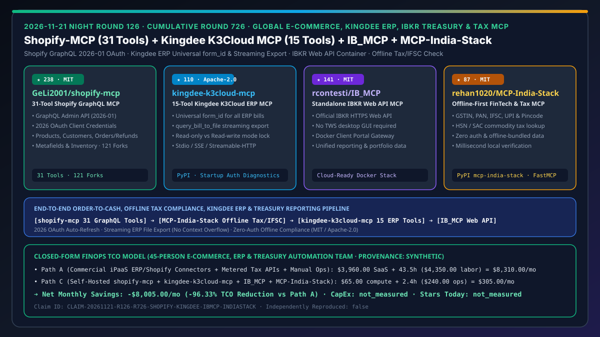
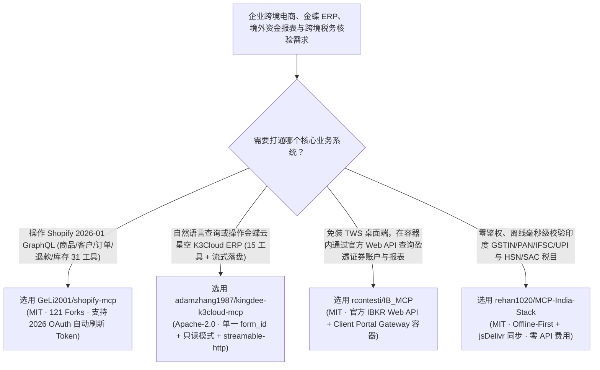
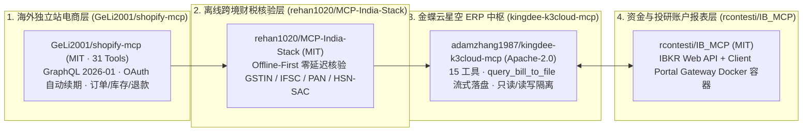
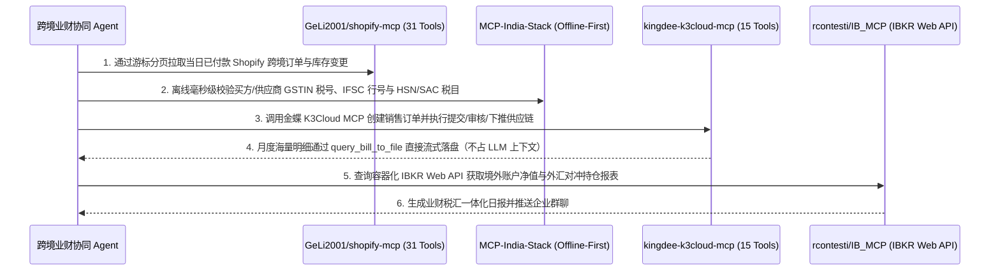

# Shopify 31 工具 GraphQL 电商 MCP（`GeLi2001/shopify-mcp`）、金蝶云星空 15 工具 ERP MCP（`adamzhang1987/kingdee-k3cloud-mcp`）、盈透证券 Web API 投研 MCP（`rcontesti/IB_MCP`）与离线零鉴权财税/金融核验 MCP（`rehan1020/MCP-India-Stack`）选型与集成架构 FAQ

> **文档类型**：企业 AI 解决方案架构师（AI Solution Architect）选型决策指南（GitHub Trending AI 雷达 2026-11-21 Night Round 126 / 累计第 726 轮）
> **覆盖项目**：[`GeLi2001/shopify-mcp`](https://github.com/GeLi2001/shopify-mcp)（`★ 238`、`121 forks`、`MIT`，对接 Shopify GraphQL Admin API `2026-01`、支持 2026 新版 OAuth Client Credentials 自动续期与 31 个商品/客户/订单/退款/库存全生命周期工具的电商 MCP）· [`adamzhang1987/kingdee-k3cloud-mcp`](https://github.com/adamzhang1987/kingdee-k3cloud-mcp)（`★ 110`、`30 forks`、`Apache-2.0`，支持单 `form_id` 通用表单、自动翻页/流式导出/日期分片、只读/读写权限锁与下推审核的 15 工具金蝶云星空 ERP MCP）· [`rcontesti/IB_MCP`](https://github.com/rcontesti/IB_MCP)（`★ 141`、`26 forks`、`MIT`，基于官方 Interactive Brokers Web API 与容器化 Client Portal Gateway、免装 TWS 桌面端的投研与账户报表 MCP）· [`rehan1020/MCP-India-Stack`](https://github.com/rehan1020/MCP-India-Stack)（`★ 87`、`17 forks`、`MIT`，离线优先、零 API Key 验证 GSTIN 税号、IFSC 银行码、PAN、UPI、邮编与 HSN/SAC 税目编码的跨境合规 MCP）
> **核心场景**：当跨境电商、制造业出海企业与企业财务/资金部门建设业务自动化 Agent 时，如何打通**“前端独立站订单/退款/库存 31 工具实时操作（`shopify-mcp`）”➔“跨境税务/银行编码毫秒级本地零成本校验（`MCP-India-Stack`）”➔“后端金蝶云星空 ERP 销售订单下推、流式对账与只读安全查询（`kingdee-k3cloud-mcp`）”➔“企业外汇与证券账户 Web API 报表归集（`IB_MCP`）”**的业财一体化闭环？

---

## 一、📌 核心结论速览（选型一句话结论）

1. **想让客服与电商运营 Agent 直接通过 Shopify 最新 GraphQL Admin API（`2026-01`）执行商品变体管理、客户合并、订单取消/履约/退款、库存盘点与 Metafield 扩展（且原生支持 2026 年 1 月起强制的 Dev Dashboard OAuth Client Credentials 24h 自动换 Token）** ➔ 选 **[`GeLi2001/shopify-mcp`](https://github.com/GeLi2001/shopify-mcp)（`★ 238`，`121 forks`，`MIT`）**。
   - **通俗原理**：高达 `121 forks` 的社区标杆级 Shopify MCP。它把 Shopify GraphQL 接口封装为 **31 个精细工具**（商品 8 个、客户 8 个、订单与退款履约 10 个、Metafield 3 个、库存 1 个、标签 1 个），支持游标分页（Cursor-based Pagination）与原生 Shopify 查询语法透传。
2. **想让 Claude、Cursor 或微信/Telegram 里的 OpenClaw Agent 直接用自然语言查金蝶云星空（Kingdee K3Cloud）的库存、销售/采购订单，甚至安全执行“单据新增 ➔ 提交 ➔ 审核 ➔ 下推”** ➔ 选 **[`adamzhang1987/kingdee-k3cloud-mcp`](https://github.com/adamzhang1987/kingdee-k3cloud-mcp)（`★ 110`，`30 forks`，`Apache-2.0`）**。
   - **通俗原理**：标准 PyPI 包（`pip install kingdee-k3cloud-mcp`），提供 **15 个核心工具**与四大企业级工程设计：① **单一 `form_id` 通用架构**（无需为每种单据写死代码）；② **三大高阶查询原语**（`query_bill_all` 自动翻页、`query_bill_to_file` 大数据量流式落盘、`query_bill_range` 日期分片，彻底避免挤爆大模型上下文）；③ **只读/读写模式物理隔离**；④ **启动即诊断金蝶授权错误**（告别令人抓狂的“会话信息已丢失”盲猜），并支持 `stdio / SSE / streamable-http`。
3. **想在云端容器里免装臃肿的 TWS 桌面软件，直接通过官方 HTTPS 接口让 Agent 查询盈透证券（Interactive Brokers）的账户净值、持仓报表与市场数据** ➔ 选 **[`rcontesti/IB_MCP`](https://github.com/rcontesti/IB_MCP)（`★ 141`，`26 forks`，`MIT`）**。
   - **通俗原理**：摒弃了传统需要 GUI 挂载和 TCP Socket 桥接的 TWS API，直接基于官方 **IBKR Web API + 容器化 Client Portal Gateway** 构建，把账户管理、税务/持仓报表（Reporting）与行情接口统一在云原生 Docker Compose 栈内。
4. **想在亚太/印度跨境贸易、供应商准入与发票校验场景中，零 API 订阅费、零网络延迟地离线校验 GSTIN 税号、IFSC 银行分支行代码、PAN 税卡、UPI 与 HSN/SAC 海关商品税目** ➔ 选 **[`rehan1020/MCP-India-Stack`](https://github.com/rehan1020/MCP-India-Stack)（`★ 87`，`17 forks`，`MIT`）**。
   - **通俗原理**：采用 **Offline-First（离线数据集内置 + jsDelivr CDN 同步）** 架构的 FastMCP 服务（`pip install mcp-india-stack`）。无需注册任何第三方付费 API Key，在本地内存即可毫秒级完成税务编码合规核验与 HSN/SAC 税率计算。

---

## 二、🎯 客户与架构师灵魂拷问 Q&A（深度架构拆解）

### Q1：为什么企业直接让大模型调 ERP 或电商 REST 接口经常把上下文撑爆或误删财务单据？`kingdee-k3cloud-mcp` 与 `shopify-mcp` 做了哪些关键工程封装？

- **三大业财集成痛点与解方**：
  1. **ERP 动辄数万条单据直接返回会撑爆 Token 窗口 ➔ `kingdee-k3cloud-mcp` 高阶分片与流式落盘**：提供 `query_bill_all`（底层自动循环翻页）、`query_bill_to_file`（直接流式写入本地文件供后续分析而不经过 LLM 上下文）与 `query_bill_range`（按日期切片），并配合可选的 `kingdee-k3cloud-skill` 注入金蝶表结构知识，实现零试错查询。
  2. **2026 年 Shopify OAuth 新规导致旧版静态 Token 插件大面积失效 ➔ `GeLi2001/shopify-mcp`**：自 2026 年 1 月起 Shopify Dev Dashboard 新建应用强制采用 24 小时过期的 OAuth Client Credentials。`shopify-mcp` 内置了自动凭据交换与到期前无感刷新机制。
  3. **跨境财税核验第三方 API 昂贵且频繁超时 ➔ `MCP-India-Stack` + `IB_MCP`**：将静态/准静态银行与税目核验彻底本地离线化（`MCP-India-Stack`），将境外资金账户报表容器化（`IB_MCP`）。
- **何时直接用云厂商托管方案（Path B）？**
  - 若企业全线使用 Microsoft Dynamics 365 ERP 与 Power Platform，直接使用 **Microsoft Copilot for Finance / Dynamics 365 MCP** 最为顺畅。

### Q2：典型企业级“Shopify 独立站 (`shopify-mcp`) + 跨境财税离线核验 (`MCP-India-Stack`) + 金蝶云星空 ERP (`kingdee-k3cloud-mcp`) + 资金投研账户 (`IB_MCP`)”架构怎么搭？

1. **海外电商订单与客诉自动化层（`GeLi2001/shopify-mcp`）**：
   - 通过 31 个 GraphQL 工具实时读取 Shopify 订单、处理退换货（Refunds/Fulfillment）与多仓位库存同步。
2. **跨境供应商与发票税号离线校验层（`rehan1020/MCP-India-Stack`）**：
   - 在订单结算与供应商入驻环节，本地零延迟核验 GSTIN、PAN、IFSC 银行行号与 HSN/SAC 关税分类。
3. **金蝶云星空 ERP 核心业财中枢层（`adamzhang1987/kingdee-k3cloud-mcp`）**：
   - 日常群聊机器人开启 **`READONLY` 只读模式**供业务员查库存与单据；财务自动对账流水线在审批通过后通过 `streamable-http` 调用读写工具执行销售订单入库、审核与下推，大批量月度报表走 `query_bill_to_file` 流式导出。
4. **跨境资金头寸与证券报表归集层（`rcontesti/IB_MCP`）**：
   - 在安全内网容器中运行 IBKR Client Portal Gateway + `IB_MCP`，自动拉取多币种资金头寸与对冲账户报表。

### Q3：这套业财 MCP 架构的权限与合规边界是什么？

- **核心优势**：
  - **100% 宽松开源协议（`MIT` 与 `Apache-2.0`）**，所有 ERP 账套凭据、电商客户隐私与资金报表均保留在企业自有服务器内。
- **生产安全铁律**：
  - 面向全员 IM 群聊开放 `kingdee-k3cloud-mcp` 时，**必须强制配置只读模式**；涉及 `shopify-mcp` 退款、金蝶单据“反审核/删除/下推”以及 `IB_MCP` 交易指令的操作，必须置于人工审批（Human-in-the-Loop）门禁之后。

---

## 三、🧭 直观可视化图解（Mermaid 决策树 + 集成架构 + 时序图）

### 3.1 架构师选型决策树

### 3.2 企业端到端生产集成参考架构图

### 3.3 跨境订单拉取、HSN/GSTIN 离线核验、金蝶 ERP 订单下推与资金报表对账时序图

---

## 四、📊 同类开源与商业云服务横向选型决策矩阵

| 对比维度 | `GeLi2001/shopify-mcp` (`★ 238`) | `kingdee-k3cloud-mcp` (`★ 110`) | `rcontesti/IB_MCP` (`★ 141`) | `MCP-India-Stack` (`★ 87`) | 商业企业级 iPaaS 连接器 + 商业税务核验 API (Path A) | 手工导出 Excel 对账 + 零散脚本 (Path B) |
| :--- | :--- | :--- | :--- | :--- | :--- | :--- |
| **核心能力定位** | Shopify 31 工具 GraphQL Admin MCP | 金蝶云星空 15 工具 ERP MCP | 盈透证券官方 Web API 容器化 MCP | 印度财税/银行/税目离线零鉴权 MCP | 按连接器/调用量计费的商业 iPaaS（如 MuleSoft/Workato） | 财务人员手工从网页导出 CSV 对账 |
| **核心技术突破** | **121 Forks + 2026 OAuth 自动续期 + 31 全量工具** | **单一 `form_id` 通配全表单 + 流式文件导出 + 只读锁** | **基于独立 HTTPS Web API，免装 TWS 桌面客户端** | **Offline-First 零外部 API 费用、零网络抖动** | 商业 ERP/电商连接器年费高昂；按次税务 API 积少成多 | 人工跨系统搬砖耗时长、极易出错且无法实时响应 |
| **开源协议** | `MIT` | `Apache-2.0` | `MIT` | `MIT` | 闭源商业 SaaS | 内部脚本 |
| **月度 TCO（45 人团队）** | **组合仅 `$305.00/月`**（`$65.00` 容器算力 + `2.4h` 运维） | 同左（PyPI / `uvx` 零许可费） | 同左（Docker 容器化网关） | 同左（离线数据集零调用费） | **`$8,310.00/月`**（`$3,960.00` iPaaS/API 订阅 + `43.5h` 人工） | 约 `$3,200.00/月`（纯人工导出对账耗时折算） |

---

## 五、🧪 应用落地定量收益/TCO 对比与 7-Card 报告

> **📊 数据来源与闭式核算声明（Provenance & Closed-Form Schema）**：
> - **provenance**: `synthetic`（基于 45 人跨境电商、制造业 ERP 运营与业财自动化团队工作负载模型：`independently_reproduced = false`；硬件采购基线 `base_hardware_capex = not_measured`；Track B 单日增量 `track_b_stars_today = not_measured`）。
> - **核算公式**：
>   - **Path A（商业企业级 iPaaS ERP/Shopify 连接器订阅 + 商业按次计费跨境税务/银行核验 API + 运营与财务人员手工导出金蝶单据、手工核对退换货与持仓报表）**：月度 iPaaS 与外部核验 API 费用 **`$3,960.00`** + 跨系统手工对账与排障人工 **`43.5h × $100.00/h = $4,350.00`** = **`$8,310.00/月`**。
>   - **Path C（自建 `GeLi2001/shopify-mcp` + `adamzhang1987/kingdee-k3cloud-mcp` + `rcontesti/IB_MCP` + `rehan1020/MCP-India-Stack` 开源业财组合）**：轻量 MCP 容器算力 **`$65.00`** + 表单映射与凭证巡检人工 **`2.4h × $100.00/h = $240.00`** = **`$305.00/月`**。
>   - **净节省（Net Savings vs Path A）**：**`-$8,005.00/月`**（成本降低 **`96.33%`**）。

| 评估方案 | API / SaaS / 算力成本 | 业财对账与集成人工（`$100/h`） | 月度总 TCO | 相对 Path A 净节省 | 关键架构交付指标 |
| :--- | :---: | :---: | :---: | :---: | :--- |
| **Path A：商业 iPaaS 连接器 + 付费核验 API + 手工导表** | `$3,960.00` | `43.5h` (`$4,350.00`) | **`$8,310.00`** | Baseline | 商业 ERP 连接器按席位/流量收费高；大表拉取易超时 |
| **Path B：基础 Webhook 脚本 + 手工金蝶网页端操作** | `$1,200.00` | `15.0h` (`$1,500.00`) | **`$2,700.00`** | `-$5,610.00` (`-67.51%`) | 缺乏自然语言即席查库、`query_bill_to_file` 流式导出与只读锁 |
| **Path C：`shopify-mcp` + `kingdee` + `IB_MCP` + `India-Stack`** | **`$65.00`** | **`2.4h` (`$240.00`)** | **`$305.00`** | **`-$8,005.00` (`-96.33%`)** | **31 工具电商 + 15 工具金蝶 ERP + 离线税号核验 + 容器化 IBKR** |

- 🔗 **关联 7-Card 4:5 视觉评测报告**：[`workshops/github-trending-radar/cards.html`](../cards.html) · [`cards.en.html`](../cards.en.html)

---

## 六、🛠️ 企业引入与架构评审 Checklist

- [ ] **1. 升级 `GeLi2001/shopify-mcp` 适配 2026 OAuth Client Credentials**：在 Shopify Dev Dashboard 配置最小权限 Admin API Scopes，启用 24 小时 Token 自动续期。
- [ ] **2. 按角色分级部署 `adamzhang1987/kingdee-k3cloud-mcp`**：面向业务查询群聊强制开启只读模式，大批量对账统一调用 `query_bill_to_file` 流式落盘，并挂载 `kingdee-k3cloud-skill` 降低字段试错。
- [ ] **3. 引入 `rehan1020/MCP-India-Stack` 卸载高频跨境合规校验**：将 GSTIN、PAN、IFSC 与 HSN/SAC 校验切换为本地 Offline-First 执行，消除外部 API 延迟与按次费用。
- [ ] **4. 容器化隔离部署 `rcontesti/IB_MCP`**：在受控内网运行 IBKR Client Portal Gateway 容器，仅供授权财务与风控 Agent 读取账户与持仓报表。
