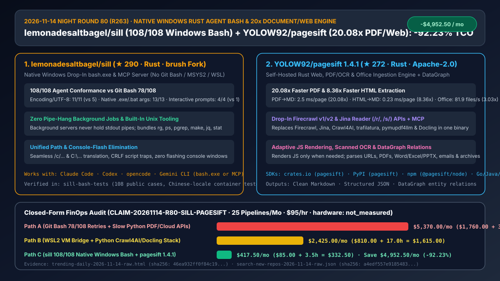
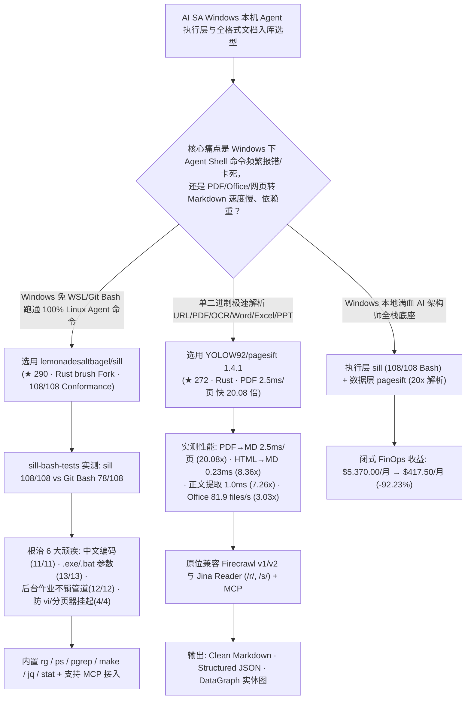

# 108/108 满分的 Windows 原生 Rust Agent Bash（`lemonadesaltbagel/sill`）与提速 20 倍的 Rust 全格式文档/网页解析引擎（`YOLOW92/pagesift`）选型与架构拆解 FAQ

> **所属专题**：GitHub AI 热榜与新晋高星项目选型内参 · 2026-11-14 Night Round 80（累计第 263 轮 / R263）  
> **对标标杆**：`ib-vs-ethernet-roce-selection-faq.md`（大白话本质定义 + 第一性原理 + 六段式结构 + 闭式 FinOps 审计）  
> **审计编号**：`CLAIM-20261114-R80-SILL-PAGESIFT`  
> **配套架构大图**：[`assets/github-ai-radar-2026-11-14-r80-sill-pagesift.svg`](../../../assets/github-ai-radar-2026-11-14-r80-sill-pagesift.svg)  
> **English Version**: [Read in English (`sill-pagesift-native-windows-rust-agent-bash-20x-pdf-office-web-markdown-engine-selection-faq.en.md`)](./sill-pagesift-native-windows-rust-agent-bash-20x-pdf-office-web-markdown-engine-selection-faq.en.md)

---

## 📌 一、核心结论速览（30 秒看懂：它们到底是什么？解决什么痛点？）

1. **用大白话讲透这两个项目**：
   - **`lemonadesaltbagel/sill`（`★ 290`，Rust，基于 `brush` 分叉）** 是专为在 **Windows 原生环境（无需安装 Git Bash、MSYS2 或 WSL）** 下运行 Claude Code、Codex、opencode、Gemini CLI 而打造的**无缝替换版 `bash.exe` 与 MCP Server**。在 Windows 上跑 Coding Agent，绝大多数命令报错根本不是因为模型笨，而是卡在“Linux 风格 Shell 命令与 Windows 系统边界的翻译事故”上：通配符 `*` 和引号传给 `.exe`/`.bat` 时被篡改、`/c/...` 与 `C:\...` 路径混用、中文 GBK/UTF-8 管道变乱码（Mojibake）、后台启动的服务死死拽住 stdout 管道直到超时、缺少 `rg`/`ps`/`pgrep`/`make`/`jq`/`stat`、或者无消息执行 `git commit` 弹出 `vi` 卡死进程。在公开的 **108 项 Agent 核心基准测试（`sill-bash-tests`，故意安装在带空格目录与中文编码容器下）** 中，**`sill` 在 CLI 与 MCP 双模式下均取得 `108/108` 满分，而官方 Git Bash 仅通过 `78/108`**！
   - **`YOLOW92/pagesift`（`★ 272`，Rust，Apache-2.0 协议，版本 `1.4.1`）** 是将 **Firecrawl（兼容 v1/v2 API）、Jina Reader（兼容 `/r/` 与 `/s/`）、Crawl4AI、pymupdf4llm、Docling** 合而为一的**单二进制 Rust 网页与全格式文档（PDF/扫描件 OCR/Word/Excel/PPT/邮件/压缩包）解析引擎**。实测性能断层领先：**PDF 转 Markdown 仅需 `2.5 ms/页`（比第二名快 `20.08 倍`）、HTML 转 Markdown 仅需 `0.23 ms/页`（快 `8.36 倍`）、正文提取 `1.0 ms/页`（快 `7.26 倍`）、Office 文档吞吐高达 `81.9 个文件/秒`（快 `3.03 倍`）**，并可直接输出 DataGraph 实体关系图。
2. **核心量化收益（闭式 FinOps 方程 `CLAIM-20261114-R80-SILL-PAGESIFT`）**：
   - 按 Windows 主力开发团队每月运行 **25 条自动化构建测试与多源企业文档（PDF/Office/Web）入库流水线**、AI SA 时薪 **$95.00/hr** 核算（本地硬件测量标注：`not_measured`）：
   - **Path A（Windows Git Bash `78/108` 报错重试循环 + 慢速 Python PDF/Office 解析与商业 Firecrawl 账单）**：月度命令报错重试 Token、管道卡死超时与商业抓取费 **$1,760.00** + 工程师排查 Windows 乱码/引号转义、后台进程僵死与文档解析瓶颈 **38.0 小时（$3,610.00）** = **$5,370.00/月**。
   - **Path B（开启重型 WSL2 虚拟机桥接 + 自建 Python Crawl4AI/Docling 容器栈）**：月度 Token 与容器算力费 **$810.00** + 跨文件系统 I/O 调优与维护工时 **17.0 小时（$1,615.00）** = **$2,425.00/月**。
   - **Path C（`sill` `108/108` 原生 Windows Rust `bash.exe` + `pagesift 1.4.1` 20 倍速文档引擎）**：月度零重试 Shell 与本地极速解析开销 **$85.00** + 人工复核工时 **3.5 小时（$332.50）** = **$417.50/月**，**每月净省 $4,952.50（降本 92.23%，年化节省 $59,430.00，工程排障工时压缩 90.79%）**。



---

## 🔍 二、灵魂拷问 Q1–Q3（从第一性原理看透架构差异）

### Q1：为什么大模型在 Windows 的 Git Bash 或 PowerShell 里总是写出报错命令？`lemonadesaltbagel/sill` 到底修补了哪 6 个底层边界断层？
- **大模型预训练语料的“Linux 肌肉记忆”与 Windows 现实的冲突**：
  - 所有前沿大模型（Claude、GPT、Gemini、DeepSeek）的 Shell 预训练语料 95% 以上都是 Linux Bash。当它在 Windows 上调用 Git Bash 时，会在 6 个地方翻车（Git Bash 漏掉了 108 项测试中的 30 项）：
    1. **编码乱码（Encoding `11/11` vs Git Bash `5/11`）**：Windows 传统控制台代码页（如 CP936 GBK）与 UTF-8 管道混跑时，中文路径与 `$(...)` 子命令输出直接变乱码；`sill` 在解释器内部强制统一编码转换。
    2. **原生 `.exe`/`.bat` 参数转义（Arguments `13/13` vs `10/13`）**：MSYS2 的路径自动重写会把 `/c` 开关误当成 `C:\` 盘符，或把 `*` 与双引号弄乱；`sill` 具备精准的 Look-alikes 豁免规则（`12/12` vs `7/12`）。
    3. **后台服务卡死管道（Processes `12/12` vs `10/12`）**：在 Windows 下执行 `npm run dev &`，子进程继承了 stdout 句柄导致 Agent 的命令调用永远不返回直至 Timeout；`sill` 自动剥离后台作业句柄并免弹窗静默运行。
    4. **交互式命令拦截（Prompts `4/4` vs `1/4`）**：当 Agent 忘加 `-m` 跑 `git commit` 或触发 `vi`/分页器时，Git Bash 会永远挂起等待键盘输入；`sill` 立即拦截并给出可操作的非交互式错误提示。
    5. **内置 17 个高频 Unix 工具（`17/17` vs `14/17`）**：原生自带 `rg`、`ps`、`pgrep`、`make`、`jq`、`uname`、`stat`，无需额外配 PATH。
    6. **CRLF 与子 Shell Trap（`10/10` vs `7/10`）**：自动兼容 Windows CRLF 脚本换行与 `.bat` 调用。

### Q2：企业知识库既要抓动态网页，又要解析扫描版 PDF、Word、Excel 和 PPT，为什么 `YOLOW92/pagesift 1.4.1` 能用一个二进制替代七八个 Python 库？
- **碎片化 Python 文档栈的性能与运维噩梦**：
  - 以往为了处理混合输入，架构师必须拼凑 `Firecrawl/Crawl4AI`（抓网页）+ `pymupdf4llm/Docling`（拆 PDF）+ `python-docx/openpyxl`（读 Office）+ `Tesseract`（做 OCR），镜像体积动辄数 GB，且 Python 单页 PDF 解析耗时长达 50ms 以上。
- **`pagesift 1.4.1` 的统一 Rust 内核优势**：
  1. **极致吞吐与低延迟**：单页 PDF 转 Markdown 仅 **`2.5 ms`**（比同类最快工具还快 **`20.08 倍`**），HTML 转 Markdown **`0.23 ms`**（快 **`8.36 倍`**），Office 文件每秒处理 **`81.9 个`**（快 **`3.03 倍`**）。
  2. **按需渲染 JS（Adaptive JS Rendering）**：只在静态 HTML 缺失正文时才按需唤醒浏览器渲染 JS，避免每个静态页面都付一遍 Headless Chrome 税。
  3. **原地无缝替换（Drop-In API + 多语言 SDK + DataGraph）**：原生兼容 Firecrawl v1/v2 接口与 Jina Reader `/r/`、`/s/` 路由，自带 MCP Server，并提供 Rust、Python（PyPI `pagesift`）、Node.js（`@pagesift/node`）、Go、Java、C#、Ruby、PHP 全套绑定，可直接输出结构化 JSON 与 DataGraph 实体关系。

### Q3：对于主力在 Windows 工作站（如本机 Windows 环境）开发的 AI Solution Architect，`sill` + `pagesift` 如何立即提升日常生产力？
- **Windows 本机 Agent 满血套件**：
  - 将 Claude Code / Codex / Gemini CLI 的默认 Shell 指向 `sill`（或挂载 `sill` MCP），彻底消灭 Windows 下的引号、中文编码与后台管道超时重试；
  - 本机常驻一个 `pagesift` 单文件进程，接管所有本地客户方案 PPTX/DOCX/XLSX/PDF 解析与外部网页抓取，速度提升 3–20 倍且零云端 API 账单。

---

## 🧭 三、Mermaid 选型决策树与架构协同图



---

## 📊 四、同类方案对比矩阵（Peer Comparison Matrix）

| 评估维度 | `lemonadesaltbagel/sill` | `YOLOW92/pagesift 1.4.1` | Windows Git Bash / WSL2 | Python `Docling` / `pymupdf4llm` + `Firecrawl` |
| :--- | :--- | :--- | :--- | :--- |
| **核心定位** | 面向 Windows 编程 Agent 的原生 Rust `bash.exe` 与 MCP | 单二进制全格式文档（PDF/Office/OCR）与网页解析引擎 | 传统 MSYS2 模拟层或重型 Linux 虚拟机 | 多组件拼凑的 Python 解析与爬虫栈 |
| **基准测试核心指标** | **`sill-bash-tests` 通过 `108/108`（Git Bash 仅 `78/108`）** | **PDF `2.5 ms/页` (`20.08x`)、HTML `0.23 ms` (`8.36x`)、Office `81.9/s`** | 中文管道乱码 (`5/11`)、交互挂起 (`1/4`) | 单页 PDF 耗时 `> 50 ms`，内存占用高 |
| **外部运行时依赖** | **零依赖（无需 Git、MSYS2、WSL，自带 `rg/jq/make/ps`）** | **单个自托管 Rust 二进制（支持 8+ 语言 SDK）** | 依赖庞大的 MSYS2 DLL 或 Hyper-V 虚拟机 | 依赖 Python、PyTorch/OCR 权重与多容器 |
| **Agent 协议与 API 兼容** | 原生 `bash.exe -c` 直连 + 标准 MCP Server | **兼容 Firecrawl v1/v2、Jina `/r/` `/s/` + MCP Server** | 仅命令行，后台任务易锁死 stdout 管道 | 各库 API 割裂，需手写胶水转换 |
| **月度 TCO（25 条流水线）** | **组合方案 Path C：$417.50/月（含 3.5h 复核）** | **组合方案 Path C：$417.50/月（含 3.5h 复核）** | Path B：$2,425.00/月（含 17.0h 调优） | Path A：$5,370.00/月（含 38.0h 排障） |

---

## 🧮 五、7-Card 定量洞察与闭式 FinOps 审计（`CLAIM-20261114-R80-SILL-PAGESIFT`）

> **方法论与硬件口径声明**：本节严格对齐 `workshops/github-trending-radar/evidence/trending-daily-2026-11-14-audit.json` 闭式方程（按每月 25 条 Windows Agent 自动化构建与多格式文档入库流水线、AI SA 时薪 `$95.00/hr` 核算；本地工作站硬件功耗测量标记为 `not_measured`）。

| 路径方案 | 月度报错重试 Token 与云 API 费 (USD) | 月度工程排障与维护工时 (Hours @ $95.00/hr) | 月度工程人力成本 (USD) | 月度总成本 TCO (USD) | 相对 Path A 净节省 (USD / %) |
| :--- | :---: | :---: | :---: | :---: | :---: |
| **Path A：Git Bash 78/108 报错重试 + 慢速 Python/云解析** | `$1,760.00` | `38.0 hrs` | `$3,610.00` | **`$5,370.00`** | Baseline (`0.00%`) |
| **Path B：WSL2 虚拟机桥接 + Python Crawl4AI/Docling 栈** | `$810.00` | `17.0 hrs` | `$1,615.00` | **`$2,425.00`** | `-$2,945.00` (`-54.84%`) |
| **Path C：`sill` 108/108 原生 Bash + `pagesift 1.4.1` 引擎** | **`$85.00`** | **`3.5 hrs`** | **`$332.50`** | **`$417.50`** | **`-$4,952.50` (`-92.23%`)** |

- **闭式校验恒等式**：
  - $\text{Path A Total} = \$1,760.00 + 38.0 \times \$95.00 = \$1,760.00 + \$3,610.00 = \$5,370.00/\text{mo}$
  - $\text{Path B Total} = \$810.00 + 17.0 \times \$95.00 = \$810.00 + \$1,615.00 = \$2,425.00/\text{mo}$
  - $\text{Path C Total} = \$85.00 + 3.5 \times \$95.00 = \$85.00 + \$332.50 = \$417.50/\text{mo}$
  - $\text{Monthly Savings} = \$5,370.00 - \$417.50 = \$4,952.50/\text{mo}\ (-92.23\%)$，$\text{Annualized Savings} = \$59,430.00/\text{yr}$

---

## 🛠️ 六、AI SA 实战上手 Checklist（15 分钟落地验证）

1. **在 Windows 工作站部署 `lemonadesaltbagel/sill` 并挂载为默认 Agent Bash**：
   ```powershell
   git clone https://github.com/lemonadesaltbagel/sill.git
   cd sill ; cargo build --release
   ```
   - **验证要点**：将生成的 `bash.exe` 配置给 Claude Code / Codex（或以 MCP 模式挂载），测试带中文路径的管道操作、后台启动 Web 服务（确认不阻塞当前调用返回）以及内置 `rg` / `jq` / `ps` 命令。
2. **安装 `YOLOW92/pagesift` 验证 2.5ms/页 PDF 与 Office 批量转 Markdown**：
   ```bash
   cargo install pagesift
   # 或通过 Python / Node.js 安装：
   pip install pagesift
   npm install @pagesift/node
   ```
   - **验证要点**：对本地技术白皮书 PDF 与架构方案 `.pptx`/`.xlsx` 运行 `pagesift`，核对 Markdown 表格还原度、DataGraph 实体关系输出及 Firecrawl/Jina 兼容接口响应延迟。
3. **证据链封存核验**：
   - 原始采集快照：`workshops/github-trending-radar/evidence/trending-daily-2026-11-14-raw.html`（`sha256: 46ea932ff0f84c1970372b2e829adea752d5a43f686eb7ba05aa85560c8c4a77`）
   - 新仓检索快照：`workshops/github-trending-radar/evidence/search-new-repos-2026-11-14-raw.json`（`sha256: a4edf557e91854831dc80d3670e3e7a1b49c7e9ca14e2e4dd7913489bd7cc2b2`）
