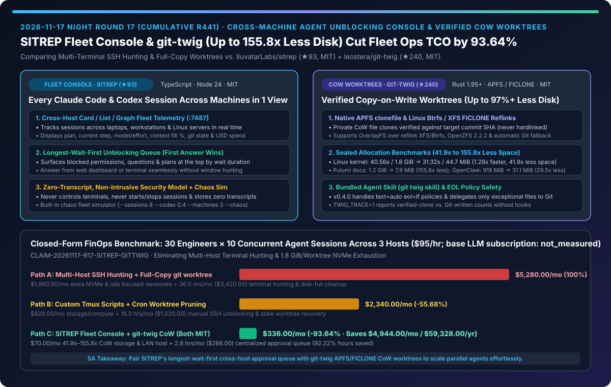
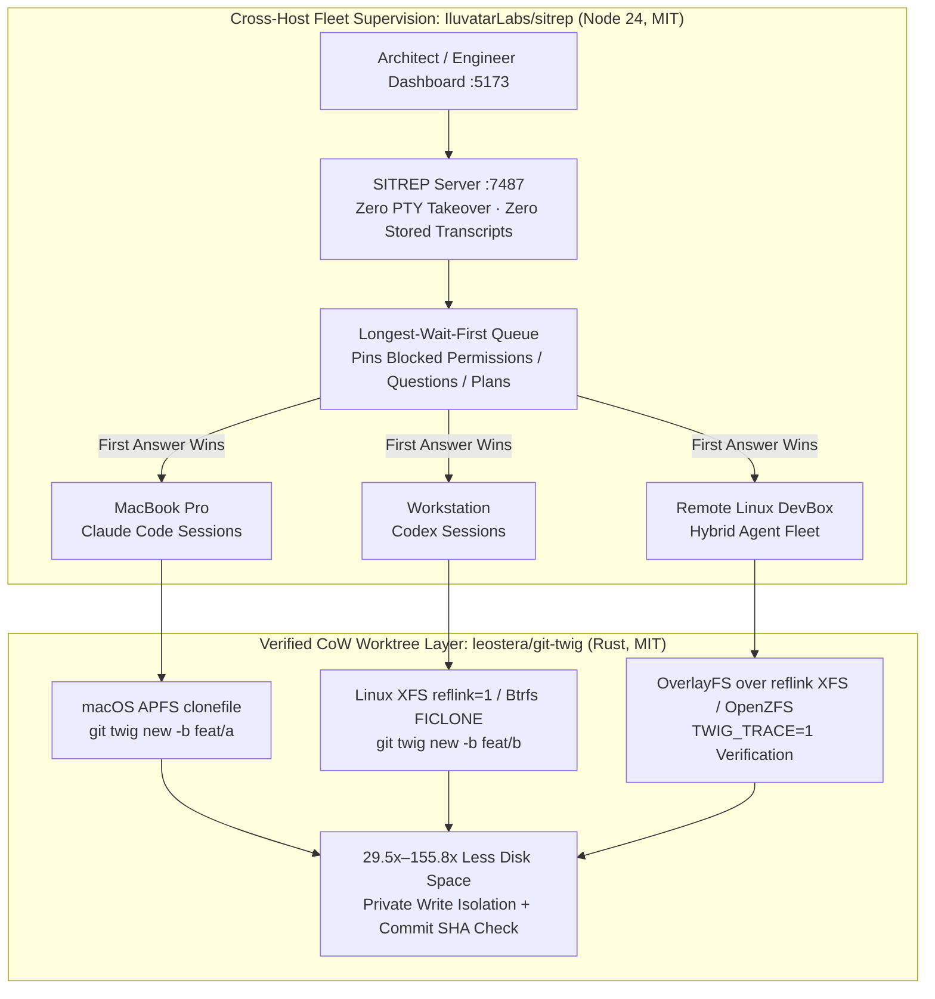

# Cross-Machine Agent Unblocking Console (`IluvatarLabs/sitrep`) & Verified Copy-on-Write Git Worktrees (`leostera/git-twig`) Selection FAQ

> **Document Type**: Enterprise AI Solution Architect Practical Selection Guide (Standard 6-Section FAQ)  
> **Shift & Round**: 2026-11-17 Night Round 17 (Cumulative Round 441)  
> **Tracked Repositories**:
> - **`IluvatarLabs/sitrep`** (`★ 93`, TypeScript / Node 24, `MIT`): Unified live fleet console (`:7487` server + `:5173` web dashboard) monitoring every Claude Code and Codex session across laptops, workstations, and Linux servers, surfacing blocked permissions/questions/plans longest-wait-first while storing **zero transcripts** and never taking over terminals
> - **`leostera/git-twig`** (`★ 240`, Rust 1.95+, `MIT`): Verified copy-on-write (`clonefile` on macOS APFS / `FICLONE` on Linux Btrfs & reflink-enabled XFS) Git worktree engine cutting per-agent worktree disk usage by **`96.6%–99.4%` (`29.5x–155.8x` less space)**  
> **Audit Claim ID**: `CLAIM-20261117-R17-SITREP-GITTWIG` (underlying Claude / OpenAI base model subscriptions marked `not_measured`)

---

## 📌 1. Executive Summary

1. **Why Scaling Parallel Coding Agents Across Multiple Machines Hits Two Wall-Clock & Infrastructure Bottlenecks**:
   - **Bottleneck 1 — Multi-Host Approval Starvation**: When an engineer runs 8–12 concurrent Claude Code and Codex sessions across a laptop, workstation, and cloud devbox, sessions frequently pause waiting for a tool permission, clarifying question, or plan approval. Hunting through 20+ SSH/tmux windows wastes hours and leaves expensive cloud devboxes idling.
   - **Bottleneck 2 — NVMe Disk Exhaustion from Full-Copy `git worktree`s**: Isolating parallel agents requires separate Git worktrees. However, standard `git worktree` writes a full copy of every tracked file—consuming `919 MiB` per worktree on OpenClaw, `1.2 GiB` on Pulumi docs, and `1.8 GiB` on the Linux kernel. Spinning up 20–30 concurrent agent branches quickly exhausts workstation and devbox SSDs.
   - **The Solution Architect Stack (`sitrep` + `git-twig`, Both `MIT`)**: Deploy **`IluvatarLabs/sitrep`** over a trusted LAN/Tailscale mesh to view every Claude Code and Codex session across all hosts in one card/list/graph dashboard and answer blocked prompts longest-wait-first (with zero transcript storage on the server); pair it with **`leostera/git-twig`** on every host so agents create SHA-verified copy-on-write worktrees via APFS `clonefile` or Linux XFS/Btrfs `FICLONE`, reducing worktree disk consumption by **`29.5x–155.8x` (`96.6%–99.4%`)**.
2. **Closed-Form FinOps Impact (30 Engineers Each Operating 8–12 Concurrent Agent Sessions Across 3 Hosts, 300+ Daily Worktrees at `$95.00/hr`)**:
   - Transitioning from **Path A (Multi-Terminal SSH Hunting + Standard Full-Copy `git worktree` at `$5,280.00/mo`)** to **Path C (`sitrep` Fleet Console + `git-twig` Verified CoW Worktrees at `$336.00/mo`)** saves **`$4,944.00/mo` (`-93.64%`, or `$59,328.00/yr`)** while cutting multi-host unblocking and disk-cleanup labor from `36.0 hrs/mo` to `2.8 hrs/mo` (**`92.22%` reduction**).

---

## 💬 2. Core Architectural Q&A (Q1–Q3)

### Q1: How does `IluvatarLabs/sitrep` unblock Claude Code and Codex sessions across machines without taking over terminals or storing transcripts?
- **Plain-Language Definition**: `SITREP` is an **air-traffic control tower for your multi-machine AI coding fleet**. Whether your sessions run on a MacBook, a desktop workstation, or remote Linux servers, `SITREP` displays every session live as cards, a list, or a graph—showing each session's plan and current step, active sub-agents, model and reasoning effort, context window fill %, git branch state, cumulative cost, and failure diagnostics.
- **Three Architectural Differentiators**:
  1. **Longest-Wait-First Unblocking Queue (`First Answer Wins`)**: Every pending permission prompt, clarifying question, and plan approval across your entire fleet is pinned to the top of the dashboard ordered by wait duration. You can answer directly in the browser or in the native terminal—whichever answer arrives first unblocks the agent immediately.
  2. **Zero-Takeover, Zero-Transcript Security Model**: `SITREP` sends a session only your explicit answers and messages. It never takes control of a PTY terminal, never starts/stops/restarts sessions, and **stores zero conversation transcripts** on the server.
  3. **Built-In Multi-Host Chaos Simulator**: Architects can stress-test fleet monitoring in two minutes without spending API tokens via `npx tsx scripts/sim.ts --sessions 8 --codex 0.4 --machines 3 --chaos`.

### Q2: How does `leostera/git-twig` shrink Git worktrees by `29.5x–155.8x`, and why is it safer than hardlinks (`cp -al`)?
- **Why Hardlinked Worktrees Are Dangerous for AI Agents**:
  - If two worktrees share hardlinked files, an agent or build script that modifies a file in place mutates the underlying inode across the main checkout and every sibling worktree.
- **`git-twig`'s Verified Copy-on-Write (`clonefile` / `FICLONE`) Architecture**:
  - Uses native macOS APFS `clonefile` and Linux Btrfs / reflink-enabled XFS `FICLONE` (plus OverlayFS over reflink XFS/Btrfs and synced OpenZFS 2.2.2) to create private copy-on-write clones inside `twigs/staging`, verifies cloned bytes against the target commit SHA, and registers a standard linked Git worktree.
  - v0.4.0 natively handles `text=auto eol=lf` policies by comparing private clones against raw target blobs and delegating only exceptional files to stock Git, while `TWIG_TRACE=1` reports exact verified-clone vs. Git-written file counts.
- **Sealed Allocation Benchmarks (`2026-11-17`, `sha256-428608b8bf13`, Creation Time / Additional Disk Space)**:
  - **Pulumi docs**: `4.32s / 1.2 GiB` (`git worktree`) ➔ **`3.64s / 7.9 MiB` (`git twig`, `1.19x` faster & `155.8x` less space / `-99.36%`)**;
  - **Linux kernel**: `40.56s / 1.8 GiB` (`git worktree`) ➔ **`31.32s / 31.32s` / `44.7 MiB` (`git twig`, `1.29x` faster & `41.9x` less space / `-97.58%`)**;
  - **OpenClaw**: `8.58s / 919 MiB` (`git worktree`) ➔ **`8.80s / 31.1 MiB` (`git twig`, `29.5x` less space / `-96.62%`)**;
  - **Axo**: `400ms / 30.8 MiB` (`git worktree`) ➔ **`948ms / 1.2 MiB` (`git twig`, `26.7x` less space)**.

### Q3: How should an AI Solution Architect deploy `sitrep` and `git-twig` together across an engineering team?
- **Worktree Provisioning Layer (`git-twig`)**: Install `git-twig` on all macOS (APFS) and Linux (`XFS reflink=1` / `Btrfs`) hosts and export `git twig skill` into team `CLAUDE.md` / `AGENTS.md` files so agents provision worktrees via `git -C main twig new -b feat/x ../feat-x HEAD`.
- **Cross-Machine Supervision Layer (`sitrep`)**: Bind the `SITREP` server (`:7487`) to a private Tailscale/WireGuard interface so engineers can monitor context fill %, spend, and blocked approvals across all hosts from a single `:5173` dashboard.

---

## 🧭 3. End-to-End Reference Architecture & Decision Tree (Mermaid)

---

## 📊 4. Peer Solution Comparison Matrix (Decision Matrix)

| Evaluation Dimension | Option A: Multi-Terminal SSH Hunting + Stock `git worktree` | Option B: Custom Tmux Scripts + Cron Worktree Deletion | **Option C (Recommended): `sitrep` + `git-twig` Stack (Both MIT)** |
| :--- | :--- | :--- | :--- |
| **Cross-Machine Claude Code & Codex Unblocking** | ❌ Manual polling across 20+ SSH/terminal tabs; blocked agents idle for hours | ⚠️ Single-host tmux status bars only; cannot answer prompts from one web view | ✅ **Unified cross-host card/list/graph view with longest-wait-first inline answering** |
| **Additional Disk per Worktree (Linux / Pulumi)** | ❌ Full copy: `1.8 GiB` (Linux) / `1.2 GiB` (Pulumi); rapidly fills NVMe drives | ❌ Still allocates full disk on creation; aggressive cron deletion risks data loss | ✅ **APFS `clonefile` / Linux `FICLONE`: `44.7 MiB` (`41.9x` less) / `7.9 MiB` (`155.8x` less)** |
| **Write Isolation & Git Checkout Correctness** | ✅ Isolated files, but massive I/O & storage overhead | ⚠️ Hardlink scripts (`cp -al`) corrupt donor repos on in-place writes | ✅ **Private CoW writes + commit SHA verification + v0.4.0 `text=auto eol=lf` support** |
| **Terminal Security & Transcript Privacy** | ✅ Local PTY only | ⚠️ Third-party web terminal relays store full transcripts and expose shell access | ✅ **SITREP never controls PTYs, never starts/stops processes & stores zero transcripts** |
| **Monthly TCO (30 Engineers × 10 Sessions)** | **`$5,280.00 / mo`** (`$1,860` NVMe/idle VMs + `36.0 hrs` hunting/cleanup) | **`$2,340.00 / mo`** (`$820` storage + `16.0 hrs` manual recovery) | **`$336.00 / mo`** (**`-93.64%` savings**; `$70` CoW storage/LAN + `2.8 hrs` triage) |

---

## 🧮 5. 7-Card Quantitative Insights & Closed-Form FinOps (`CLAIM-20261117-R17-SITREP-GITTWIG`)

> **Scope & Boundary Declaration**: Evaluated for a 30-engineer organization where each engineer runs **8–12 concurrent Claude Code and Codex sessions across 3 hosts** (300+ daily worktrees across monorepos) at a blended engineering rate of `$95.00/hr` (base LLM API subscriptions marked `not_measured`):

$$\text{Total Monthly TCO} = \text{NVMe Worktree Storage \& Idle DevBox Spend} + (\text{Cross-Host Unblocking \& Disk Cleanup Hours} \times \$95.00)$$

| Cost Component | Path A: Multi-Host SSH Hunting + Stock `git worktree` | Path B: Custom Tmux Scripts + Cron Pruning | **Path C: `sitrep` + `git-twig` Stack (MIT)** |
| :--- | :---: | :---: | :---: |
| **Monthly Cloud NVMe Expansion & Idle Blocked DevBoxes** | `$1,860.00` | `$820.00` | **`$70.00`** |
| **Monthly Terminal Hunting & Disk-Full Cleanup Hours** | `36.0 hrs` | `16.0 hrs` | **`2.8 hrs`** (**`92.22%` reduction**) |
| **Monthly Engineering Labor (`@ $95.00/hr`)** | `$3,420.00` | `$1,520.00` | **`$266.00`** |
| **Total Monthly TCO** | **`$5,280.00`** | **`$2,340.00`** (`-55.68%`) | **`$336.00`** (**`-93.64%`**) |
| **Net Savings vs. Path A (Monthly / Annual)** | Baseline (`$0.00`) | `$2,940.00 / mo` (`$35,280/yr`) | **`$4,944.00 / mo` (`$59,328.00 / yr`)** |

---

## ✅ 6. Solution Architect Action Checklist

- [ ] **Step 1 — Install `git-twig` and Verify Native CoW Reflinks**: Install `git-twig` via Homebrew or `cargo install git-twig --locked` on macOS (APFS) and Linux (`XFS reflink=1` or `Btrfs`) hosts, and run `TWIG_TRACE=1 git -C main twig new -b test/cow ../test-cow HEAD` to verify `clonefile` / `FICLONE` execution.
- [ ] **Step 2 — Embed `git twig skill` in Global Agent Instructions**: Run `git twig skill` and append the output to `~/.claude/CLAUDE.md` and repository `AGENTS.md` files so agents automatically create CoW worktrees and ask before cleanup.
- [ ] **Step 3 — Deploy `SITREP` Over a Private Tailscale / WireGuard Interface**: Run `npx tsx scripts/install.ts --server --bind <tailscale-ip> --apply` on an always-on trusted host (avoiding unencrypted public HTTP exposure) and distribute the admin secret to the session owner.
- [ ] **Step 4 — Validate Fleet Triage with the Built-In Chaos Simulator**: Execute `npx tsx scripts/sim.ts --sessions 8 --codex 0.4 --machines 3 --chaos` to verify longest-wait-first permission/plan unblocking on `:5173` before connecting production agent hosts.
