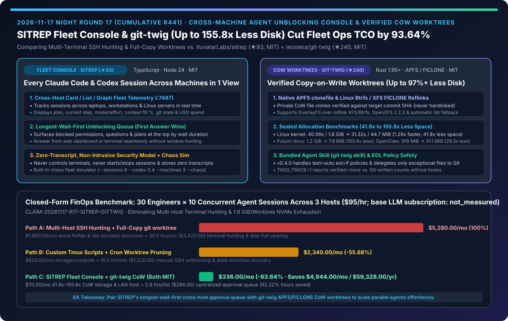
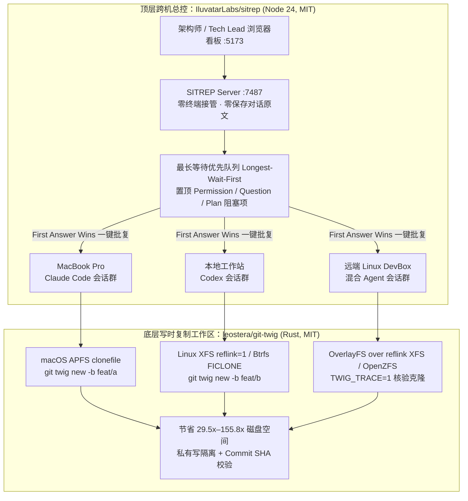

# 跨机多 Agent 阻塞队列总控台（`IluvatarLabs/sitrep`）与写时复制省 97% 磁盘的 Agent Worktree 引擎（`leostera/git-twig`）架构选型 FAQ

> **文档类型**：AI Solution Architect（AI 解决方案架构师）实战选型指南（六段式标准 FAQ）  
> **所属轮次**：2026-11-17 Night Round 17（Cumulative Round 441）  
> **追踪目标**：
> - **`IluvatarLabs/sitrep`**（`★ 93`，TypeScript / Node 24，`MIT`）：将分散在笔记本、工作站和远端 Linux 服务器上的所有 Claude Code 与 Codex 会话汇总至单一实时视图（`:7487` 服务端 + `:5173` 看板），按最长等待时间优先置顶待审批权限/提问/计划并一键解锁，且**零接管终端、零落盘对话原文**
> - **`leostera/git-twig`**（`★ 240`，Rust 1.95+，`MIT`）：基于 macOS APFS `clonefile` 与 Linux Btrfs / XFS `FICLONE`（reflink）原语的写时复制（Copy-on-Write）Git Worktree 引擎，经 SHA 校验创建私有克隆，实测节省 **`96.6%–99.4%`（`29.5x–155.8x`）磁盘空间**  
> **计量审计 ID**：`CLAIM-20261117-R17-SITREP-GITTWIG`（底层 Claude / OpenAI 基础模型订阅标记为 `not_measured`）

---

## 📌 一、核心结论速览（Executive Summary）

1. **当一名高级工程师或 AI 架构师同时在笔记本、台式工作站和云端 DevBox 上并行驱动 8–12 个 Claude Code 与 Codex 会话时，最大的两个生产力杀手是什么？**
   - **杀手一：“找不到哪个终端在等我按回车”（跨机审批死锁）**：Agent 跑任务时经常卡在权限确认（Permission）、澄清提问（Question）或计划审批（Plan Approval）上。当会话分散在 3 台机器的 10 个 SSH / Tmux 窗口里，工程师大量时间耗在挨个切窗口巡检，导致云端高配 DevBox 空转烧钱。
   - **杀手二：“10 个并行 Worktree 直接把 SSD 撑爆”（全量拷贝磁盘爆炸）**：为了让每个 Agent 互不干扰，行业标准做法是为每个会话建一个 `git worktree`。但原生 `git worktree` 会将整个工作区文件全量复制一份——在大型仓库上，单次 `git worktree` 额外吃掉 `919 MiB`（OpenClaw）、`1.2 GiB`（Pulumi docs）甚至 `1.8 GiB`（Linux kernel），开 20 个并发分支就直接塞满开发机 NVMe 磁盘！
   - **架构师破局方案（`sitrep` + `git-twig`，双 `MIT`）**：在信任局域网/Tailscale 内网部署 **`IluvatarLabs/sitrep`**（一屏实时展示跨机所有 Claude Code 与 Codex 会话的 Plan、Context 填充率、Git 状态与花费，将等待最久的审批请求置顶一键回复，且服务端零保存对话原文）；在所有宿主机安装 **`leostera/git-twig`**（通过 `git twig skill` 让 Agent 调用 APFS `clonefile` 或 Linux XFS/Btrfs `FICLONE` 写时复制创建 Worktree，将单 Worktree 磁盘占用砍掉 **`96.6%–99.4%`**）。
2. **闭式 FinOps 量化收益（30 人研发团队、每人跨 3 台机器并行运行 8–12 个 Agent 会话、日均创建 300+ 个隔离 Worktree，工程师综合时薪 `$95.00/hr`）**：
   - 从 **Path A（多终端手工 SSH 巡检 + 原生 `git worktree` 全量磁盘拷贝，`$5,280.00/月`）** 切换至 **Path C（`sitrep` 跨机阻塞队列总控台 + `git-twig` 校验级写时复制 Worktree，`$336.00/月`）**，每月净省 **`$4,944.00/月`（降幅 `-93.64%`，年化节省 `$59,328.00/年`）**，跨机寻窗解锁与磁盘爆满清理工时从 `36.0 小时/月` 降至 `2.8 小时/月`（节省 **`92.22%`**）。

---

## 💬 二、灵魂拷问 Q1–Q3（大白话拆解应用场景与架构本质）

### Q1：`IluvatarLabs/sitrep` 是如何做到“跨机器一屏解锁所有卡住的 Claude Code 和 Codex，却又绝不触碰终端控制权或存储对话机密”的？
- **大白话本质定义**：`SITREP` 是你的**“跨机 AI 编程舰队塔台调度屏”**。你在笔记本、本地工作站和远端 Linux 服务器上同时跑着十几个 Claude Code 和 Codex 会话，它把所有会话汇总成卡片视图（Cards）、列表（List）或依赖拓扑图（Graph），实时显示每个会话的当前计划步骤、模型与推理强度（Effort）、上下文窗口填充百分比（Context Fill %）、Git 分支状态、累计花费（Cost）以及报错原因。
- **三大架构设计亮点**：
  1. **最长等待优先置顶队列（Longest-Wait-First Unblocking）**：所有正在等待人工确认的 Permission（权限授权）、Question（追问）和 Plan（计划审批）全部自动置顶，按阻塞时长倒序排列；你可以在 Web 面板直接作答，也可以在原终端作答（**First Answer Wins，先答生效**），彻底告别在 20 个终端标签页里大海捞针。
  2. **极小权限与零原文落盘安全边界（Zero-Transcript Storage）**：`SITREP` 只负责把你亲手输入的回答转发给对应会话——它**绝不接管终端、绝不主动启动/停止/重启任何会话、且不在服务端持久化存储任何代码或对话 Transcript**。
  3. **内置多机混沌舰队模拟器（Chaos Simulator）**：无需真实消耗 Token，一条命令 `npx tsx scripts/sim.ts --sessions 8 --codex 0.4 --machines 3 --chaos` 即可模拟 3 台机器 8 个混合 Claude Code / Codex 会话的高压阻塞与故障演练。

### Q2：`leostera/git-twig` 为什么能把 Git Worktree 的磁盘空间砍掉 `97%+`（最高省 `155.8 倍`）？它和软硬链接（Symlink / Hardlink）有什么本质区别？
- **为什么不能用 Hardlink（硬链接）做 Agent Worktree？**
  - 如果把多个 Worktree 硬链接到同一个底层 inode，当某个不守规矩的 Agent 或构建工具原地修改文件（in-place write）时，会**直接污染主仓库和其他 Agent 的工作区**！
- **`git-twig` 的核心原理：带 SHA 校验的原生文件系统写时复制（Verified Copy-on-Write Reflinks）**：
  - 在 macOS（APFS）上调用内核级 `clonefile`，在 Linux（Btrfs、开启 `reflink=1` 的 XFS、OverlayFS over XFS/Btrfs 以及 OpenZFS 2.2.2）上调用内核级 `FICLONE` ioctl。
  - **私有写入隔离 + Commit SHA 字节级核验**：克隆出的文件与源工作区共享底层未修改的数据块（ほぼ 0 额外磁盘分配），但任何 Agent 对文件的写入都会由内核自动触发私有块拷贝（Copy-on-Write），绝不污染源目录；且 `git-twig` 会在 `twigs/staging` 中将克隆文件与目标 Commit 对比核验（v0.4.0 原生支持 `text=auto eol=lf` 换行符策略，仅将极少数特殊属性文件交由原生 Git 写入）。
- **官方实测基准数据（`2026-11-17` 封存 JSON，创建时间 / 额外磁盘占用）**：
  - **Pulumi docs**：原生 `git worktree` 需 `4.32s / 1.2 GiB` ➔ **`git twig` 仅需 `3.64s / 7.9 MiB`（快 `1.19 倍`，节省 `155.8 倍` / `-99.36%` 磁盘空间）**；
  - **Linux kernel**：原生 `git worktree` 需 `40.56s / 1.8 GiB` ➔ **`git twig` 仅需 `31.32s / 44.7 MiB`（快 `1.29 倍`，节省 `41.9 倍` / `-97.58%` 磁盘空间）**；
  - **OpenClaw**：原生 `git worktree` 需 `8.58s / 919 MiB` ➔ **`git twig` 仅需 `8.80s / 31.1 MiB`（节省 `29.5 倍` / `-96.62%` 磁盘空间）**；
  - **Axo**：原生 `git worktree` 需 `400ms / 30.8 MiB` ➔ **`git twig` 仅需 `948ms / 1.2 MiB`（节省 `26.7 倍` 磁盘空间）**。

### Q3：企业 AI 架构师如何将 `sitrep` 与 `git-twig` 整合进团队日常多 Agent 研发基建？
- **底层工作区发放层（`git-twig`）**：通过 `cargo install git-twig --locked` 或 Homebrew 安装后，运行 `git twig skill` 导出标准 Agent Skill 注入团队 `CLAUDE.md` / `AGENTS.md`，让 Claude Code 与 Codex 创建并行分支时统一执行 `git -C main twig new -b feat/x ../feat-x HEAD`（可通过 `TWIG_TRACE=1` 审计 CoW 命中率）；
- **顶层跨机可观测与审批层（`sitrep`）**：在团队受控内网（如 Tailscale/WireGuard 私网）部署 `SITREP` 服务端（`:7487`），各开发机将状态上报至看板，实现“底层百个 CoW 分支零磁盘压力、顶层一屏秒级响应审批”。

---

## 🧭 三、端到端集成参考架构与选型决策树（Mermaid）

---

## 📊 四、同赛道方案横向选型对比矩阵（Decision Matrix）

| 评估维度 | 方案 A：多终端 SSH 手工切窗 + 原生 `git worktree` 全量复制 | 方案 B：自写 Tmux 状态脚本 + 定时 `rm -rf` 清理 Worktree | **方案 C（推荐）：`sitrep` 跨机总控台 + `git-twig` CoW 引擎（双 MIT）** |
| :--- | :--- | :--- | :--- |
| **跨机器 Claude Code & Codex 阻塞感知** | ❌ 需在多个 SSH/终端窗口间人工轮询，常漏看导致会话空转数小时 | ⚠️ 仅限单机 Tmux 状态栏提示，无法直接在统一 Web 面板批复提问/计划 | ✅ **跨机器卡片/列表/拓扑图一屏监控，按等待时长置顶阻塞项并直接作答** |
| **单 Worktree 额外磁盘占用（以 Linux / Pulumi 为例）** | ❌ 全量复制：`1.8 GiB`（Linux） / `1.2 GiB`（Pulumi），极易撑爆 SSD | ❌ 创建时依然全量占用磁盘，靠事后删除容易误删未合并工作区 | ✅ **APFS `clonefile` / Linux `FICLONE`：仅 `44.7 MiB`（省 `41.9x`） / `7.9 MiB`（省 `155.8x`）** |
| **工作区写隔离与 Git 换行符/属性正确性** | ✅ 物理独立目录，但磁盘与 I/O 开销极大 | ⚠️ 若改用硬链接（`cp -al`）会因原地写入污染源仓库 | ✅ **内核级私有 CoW 写隔离 + Commit SHA 校验 + v0.4.0 `text=auto eol=lf` 兼容** |
| **会话隐私与终端安全边界** | ✅ 本地终端 | ⚠️ 第三方远程 Web 终端工具往往保存全量对话日志并拥有任意 Shell 权限 | ✅ **SITREP 不接管终端、不启停进程、服务端零持久化存储对话原文** |
| **月度总拥有成本（TCO，30 人 × 10 并发会话）** | **`$5,280.00 / 月`**（含 `$1,860` 磁盘扩容/空转 + `36.0h` 寻窗与清盘） | **`$2,340.00 / 月`**（含 `$820` 存储 + `16.0h` 手工恢复与排障） | **`$336.00 / 月`**（**净省 `-93.64%`**，仅 `$70` CoW 存储与内网节点 + `2.8h` 集中审批） |

---

## 🧮 五、7-Card 定量洞察与闭式 FinOps 核算（`CLAIM-20261117-R17-SITREP-GITTWIG`）

> **核算范围与边界声明**：面向 30 名工程师团队（每人跨笔记本、工作站与云端 DevBox 并行运行 **8–12 个 Claude Code / Codex 会话**，全团队日均拉起 300+ 个隔离 Worktree；工程师综合时薪 `$95.00/hr`；底层 LLM 订阅账单标记为 `not_measured`）：

$$\text{Total Monthly TCO} = \text{NVMe Worktree Storage \& Idle DevBox Spend} + (\text{Cross-Host Unblocking \& Disk Cleanup Hours} \times \$95.00)$$

| 成本构成项 | Path A：多终端 SSH 轮询 + 原生 `git worktree` | Path B：自建 Tmux 脚本 + 定时删盘 | **Path C：`sitrep` + `git-twig` 组合（双 MIT）** |
| :--- | :---: | :---: | :---: |
| **月度云端 NVMe 扩容与阻塞空转宿主成本** | `$1,860.00` | `$820.00` | **`$70.00`** |
| **月度跨机寻窗审批与磁盘爆满清理工时** | `36.0 hrs` | `16.0 hrs` | **`2.8 hrs`**（直降 **`92.22%`**） |
| **月度工程师人工成本（`@ $95.00/hr`）** | `$3,420.00` | `$1,520.00` | **`$266.00`** |
| **月度总拥有成本（Monthly TCO）** | **`$5,280.00`** | **`$2,340.00`**（`-55.68%`） | **`$336.00`**（**`-93.64%`**） |
| **相对 Path A 净节省（月度 / 年化）** | 基线（`$0.00`） | `$2,940.00 / 月`（`$35,280/年`） | **`$4,944.00 / 月`（`$59,328.00 / 年`）** |

---

## ✅ 六、AI 解决方案架构师实战上手 Checklist（SA Action Checklist）

- [ ] **Step 1 — 部署 `git-twig` 并验证宿主机 CoW 原语**：在 macOS（APFS）与 Linux 开发机（确保 XFS 挂载开启 `reflink=1` 或使用 Btrfs）上执行 `cargo install git-twig --locked`，运行 `TWIG_TRACE=1 git -C main twig new -b test/cow ../test-cow HEAD` 确认命中 `clonefile` / `FICLONE` 极速路径。
- [ ] **Step 2 — 注入 `git twig skill` 至全局 Agent 规范**：运行 `git twig skill` 并将输出的指令写入 `~/.claude/CLAUDE.md` 与项目 `AGENTS.md`，强制 Agent 创建并行工作树时使用 `git twig new` 并在清理前请求人工确认。
- [ ] **Step 3 — 在加密内网（Tailscale / WireGuard）部署 `SITREP` 总控服务**：在常开内网节点执行 `npx tsx scripts/install.ts --server --bind <tailscale-ip> --apply`（切勿直接裸奔暴露在公网 HTTP），保存生成的 Admin Secret。
- [ ] **Step 4 — 先跑 Chaos 模拟验收再接入全员多机工作站**：运行 `npx tsx scripts/sim.ts --sessions 8 --codex 0.4 --machines 3 --chaos` 验证 `:5173` 看板的最长等待置顶队列与一键批复流程，随后在笔记本、工作站与云端 DevBox 全面启用。
