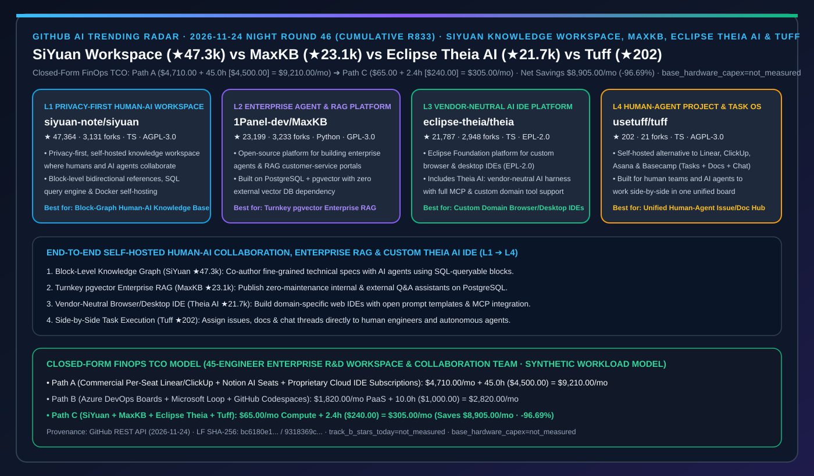
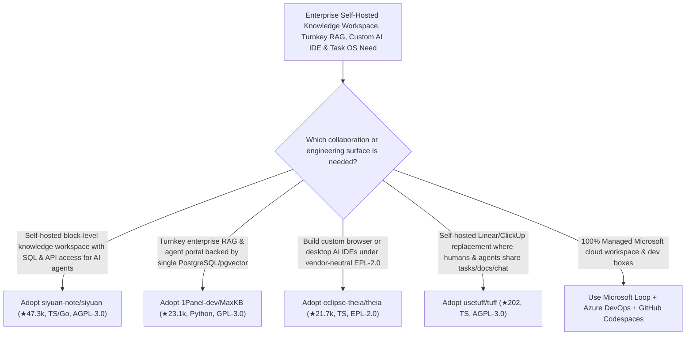
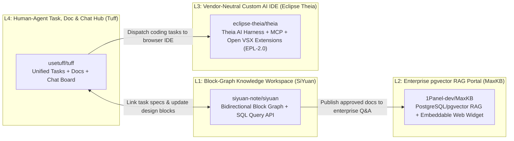
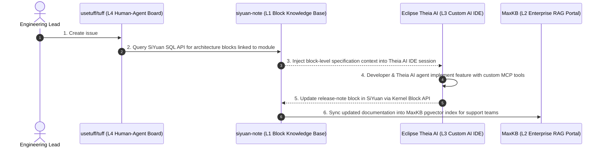

# Privacy-First Human-AI Knowledge Workspace (`siyuan-note/siyuan`), Turnkey Enterprise Agent Platform (`1Panel-dev/MaxKB`), Vendor-Neutral AI IDE Platform (`eclipse-theia/theia`) & Side-by-Side Human-Agent Project OS (`usetuff/tuff`) Selection & Architecture FAQ

> **Document Type**: AI Solution Architect Selection & Integration Guide (2026-11-24 Night Round 46 / Cumulative Round 833)  
> **Reading Time**: ~8 minutes  
> **Covered Repositories**: [`siyuan-note/siyuan`](https://github.com/siyuan-note/siyuan) (`★ 47,364` · `3,131 forks` · TypeScript · `AGPL-3.0`) · [`1Panel-dev/MaxKB`](https://github.com/1Panel-dev/MaxKB) (`★ 23,199` · `3,233 forks` · Python · `GPL-3.0`) · [`eclipse-theia/theia`](https://github.com/eclipse-theia/theia) (`★ 21,787` · `2,948 forks` · TypeScript · `EPL-2.0`) · [`usetuff/tuff`](https://github.com/usetuff/tuff) (`★ 202` · `21 forks` · TypeScript · `AGPL-3.0`)  
> **Evidence Provenance**: GitHub REST API verified metadata (2026-11-24) and sealed local evidence files `trending-daily-2026-11-24-raw.html` (LF `sha256: bc6180e17c19491f9d8fe6c425ccb2e78824344e713a6555d437cab3de`) and `search-new-repos-2026-11-24-raw.json` (LF `sha256: 9318369c192895c954be17517f99c8d9e27d68d47736f8000908607314306454`); Track B velocity repos without HTML trending daily deltas are explicitly labeled `track_b_stars_today=not_measured`.  
> **中文版本**: [`siyuan-maxkb-theia-tuff-selection-faq.md`](./siyuan-maxkb-theia-tuff-selection-faq.md)

---

## ① 📌 Executive Summary

**One-Sentence Selection Verdict**: When security-sensitive enterprises (finance, defense, semiconductor, automotive) need a **100% self-hosted human-AI workspace spanning block-level knowledge graphs, turnkey RAG portals, customizable browser/desktop AI IDEs, and unified human-agent task management**, combining **`siyuan-note/siyuan` (L1 47.3k-Star Privacy-First Block-Graph Knowledge Workspace), `1Panel-dev/MaxKB` (L2 23.1k-Star PostgreSQL/pgvector Enterprise Agent Platform), `eclipse-theia/theia` (L3 21.7k-Star `EPL-2.0` Custom IDE Platform with Theia AI), and `usetuff/tuff` (L4 Self-Hosted Tasks + Docs + Chat Alternative to Linear & ClickUp)** reduces monthly TCO for a 45-engineer team from **`$9,210.00/mo`** (Path A: Stacked Per-Seat Notion AI + Linear/ClickUp + Slack + Proprietary Cloud IDE Subscriptions) to **`$305.00/mo`** (Path C), saving **`$8,905.00/mo` (`-96.69%`)**.

| Dimension | `siyuan-note/siyuan` (L1 Block-Graph Knowledge Space) | `1Panel-dev/MaxKB` (L2 pgvector Enterprise RAG) | `eclipse-theia/theia` (L3 Vendor-Neutral AI IDE) | `usetuff/tuff` (L4 Human-Agent Project OS) |
|---|---|---|---|---|
| **Verified Stars & Forks** | `★ 47,364` · `3,131 forks` | `★ 23,199` · `3,233 forks` | `★ 21,787` · `2,948 forks` | `★ 202` · `21 forks` |
| **Language & License** | TypeScript / Go (`AGPL-3.0`) | Python / Vue (`GPL-3.0`) | TypeScript (`EPL-2.0`) | TypeScript (`AGPL-3.0`) |
| **Plain-English Positioning** | Open-source, privacy-first, self-hosted knowledge workspace where humans and AI agents work together on fine-grained blocks | Open-source platform for building enterprise-grade RAG & agents backed by PostgreSQL + pgvector | Eclipse Foundation platform for building custom browser & desktop IDEs powered by vendor-neutral Theia AI | Open-source, self-hosted alternative to Linear, ClickUp, Asana & Basecamp uniting tasks, docs, and chat |
| **Core Enterprise Pain Solved** | Replaces cloud-only Notion workspaces with a self-hosted, SQL-queryable block graph accessible to both humans and agents | Eliminates sprawling 8-container RAG deployments by running ingestion, pgvector search, and workflow orchestration in one stack | Enables enterprises and tool vendors to build custom domain AI IDEs without closed-source editor lock-in | Eliminates context switching between separate issue trackers, wikis, and chat apps by letting humans and agents collaborate in one place |
| **When to Choose vs Cloud PaaS** | Choose for air-gapped or self-hosted engineering knowledge bases requiring block-level SQL & API access | Choose for rapid on-prem deployment of internal/external enterprise Q&A portals | Mandatory when building custom browser or desktop AI IDEs under commercial-friendly `EPL-2.0` | Choose for self-hosted side-by-side human and AI agent task management; use Azure DevOps + Loop on pure Microsoft cloud |

---

## ② 🎯 Architect & Customer Q&A (1–2 Minute Read)

### Q1: Why do enterprise platform teams and industrial software vendors build on `eclipse-theia/theia` (`★ 21,787` · `EPL-2.0`) rather than relying on closed-source AI forks of VS Code?
- **The Pain**: Closed-source AI editors lock down prompt templates, telemetry, and custom tool integration, making it impossible to embed proprietary compilers, EDA/PLC hardware tools, or air-gapped LLMs.
- **Architect's Answer**: Governed by the Eclipse Foundation under **`EPL-2.0`**, **`eclipse-theia/theia`** and **Theia AI** give architects **full control over system prompts, MCP integrations, custom UI views, and LLM routing** across both browser-hosted and desktop IDEs.

### Q2: Why is `1Panel-dev/MaxKB` (`★ 23,199`) one of the fastest-deploying enterprise RAG platforms for on-premises IT teams?
- **Zero External Vector DB Sprawl (`PostgreSQL + pgvector`)**: Built by the creators of 1Panel and JumpServer, **`MaxKB`** consolidates document chunking, hybrid retrieval, workflow orchestration, and one-line web widget embedding on top of standard **PostgreSQL + `pgvector`**, cutting infrastructure maintenance to near zero.

### Q3: How do `siyuan-note/siyuan` (`★ 47,364`) and `usetuff/tuff` (`★ 202`) unify knowledge authoring and task execution between humans and AI agents?
- **SQL-Queryable Block Graph + Unified Task/Doc/Chat Board**:
  1. **`siyuan-note/siyuan` (`AGPL-3.0`)**: Stores every paragraph, heading, and table as a uniquely addressable block indexed in SQLite—allowing AI agents to run SQL queries against the knowledge graph and update specific blocks via API.
  2. **`usetuff/tuff` (`AGPL-3.0`)**: Combines tasks, docs, and real-time chat in one self-hosted workspace where AI agents sit alongside human teammates as first-class assignees.

---

## ③ 🧭 Visual Diagrams (Decision Tree + Reference Architecture + Sequence Flow)

### 3.1 Selection Decision Tree

### 3.2 End-to-End Enterprise Production Reference Architecture

### 3.3 End-to-End Execution Sequence Diagram

---

## ④ 📊 Comparative Selection Matrix: OSS Stack vs. Peer OSS vs. Cloud PaaS

| Dimension | This OSS Stack (`siyuan` + `MaxKB` + `theia` + `tuff`) | Stacked Commercial SaaS (`Notion AI` + `Linear` + `Slack` + `Proprietary Cloud IDE`) | Managed Microsoft Cloud (`Microsoft Loop` + `Azure DevOps` + `GitHub Codespaces`) |
|---|---|---|---|
| **Core Role** | Self-hosted block-graph workspace + pgvector RAG portal + `EPL-2.0` custom AI IDE + unified human-agent task board | Four separate per-seat cloud SaaS subscriptions with fragmented context | Managed cloud collaboration, ALM, and cloud developer environments |
| **Best-Fit Scenario** | Air-gapped or privacy-mandated R&D orgs, custom domain IDE builders, and unified human-agent teams | Cloud-first startups comfortable paying stacked per-seat SaaS bills | Enterprises standardized on Microsoft 365 E5 and GitHub Enterprise |
| **Integration Effort** | **Low** (Single-container Docker deployments for `siyuan`, `MaxKB`, and `tuff` + standard `theia` SDK) | Medium (Requires paid enterprise API tiers to bridge Notion, Linear, and Slack) | Low (Native Entra ID single sign-on) |
| **Operational Complexity** | **Very Low** (`MaxKB` runs on standard PostgreSQL and `siyuan` runs in a single container; ~`2.4h/mo` ops) | High (Manual context copying across 4 disconnected SaaS tools wastes ~`45.0h/mo`) | Low (Managed cloud PaaS, plus ~`10.0h/mo` workspace administration) |
| **License & Compliance** | `theia` (`EPL-2.0` commercial-friendly); `siyuan`, `tuff` (`AGPL-3.0`), `MaxKB` (`GPL-3.0`) for internal self-hosting | Proprietary per-seat SaaS contracts | Commercial cloud subscriptions |
| **45-Engineer Monthly TCO** | **`$305.00/mo`** (`$65.00` internal collaboration & RAG host + `2.4h` ops) | **`$9,210.00/mo`** (`$4,710.00` stacked per-seat SaaS bills + `45.0h` cross-tool context-switching loss) | **`$2,820.00/mo`** (Path B managed cloud stack) |

---

## ⑤ 🧪 Quantitative ROI & Closed-Form FinOps TCO Comparison

> **Provenance Disclosure**: The TCO table below is a closed-form synthetic architectural model (`provenance: synthetic`, `independently_reproduced: false`) for a **45-engineer enterprise R&D and knowledge management team** self-hosting its block-graph documentation, internal RAG portal, custom browser AI IDE, and unified task board (`$100.00/hr` loaded engineering rate). Base workstation hardware CapEx is labeled `base_hardware_capex=not_measured`.

| Cost Component | Path A: Stacked Notion AI + Linear/ClickUp + Slack + Proprietary Cloud IDE Seats | Path B: Azure DevOps + Microsoft Loop + GitHub Codespaces | Path C: `siyuan` + `MaxKB` + `theia` + `tuff` |
|---|---|---|---|
| **Monthly API / SaaS / Cloud Spend** | **`$4,710.00`** (45 seats across 4 commercial wiki, issue-tracking, chat & AI IDE SaaS tools) | **`$1,820.00`** (Cloud ALM seats + Codespaces compute hours) | **`$65.00`** (`$0` per-seat license fees; `$65` internal collaboration & pgvector host) |
| **Monthly Cross-Tool Context Copying & Connector Maintenance Labor** | `45.0h` (1h/engineer/mo copying specs between chat, tickets, and wikis) | `10.0h` (Cloud dev-container & board administration) | **`2.4h`** (Unified tasks/docs/chat in `tuff` + SQL block API in `siyuan` + single-DB `MaxKB`) |
| **Monthly Labor Cost (`$100.00/hr`)** | **`$4,500.00`** (`45.0 * 100.00`) | **`$1,000.00`** (`10.0 * 100.00`) | **`$240.00`** (`2.4 * 100.00`) |
| **Total Monthly TCO** | **`$9,210.00 / mo`** | **`$2,820.00 / mo`** | **`$305.00 / mo`** |
| **Net Monthly Savings vs. Path A** | Baseline (`$0.00`) | Saves `$6,390.00 / mo` (`-69.38%`) | **Saves `$8,905.00 / mo` (`-96.69%`)** |

---

## ⑥ 🛠️ Enterprise Architecture Review & Adoption Checklist

- [ ] **Query SiYuan's SQL Engine for Block-Level Context (`siyuan-note/siyuan`)**: Use SiYuan's `/api/query/sql` endpoint to retrieve exact specification blocks and bidirectional references rather than re-chunking exported PDF files.
- [ ] **Enable HNSW Indexing on PostgreSQL `pgvector` (`1Panel-dev/MaxKB`)**: Configure HNSW vector indexes and automated WAL backups on the PostgreSQL instance backing `MaxKB`.
- [ ] **Package Domain-Specific MCP Tools Inside Theia AI (`eclipse-theia/theia`)**: Leverage `EPL-2.0` to bundle internal linters, hardware debuggers, and private LLM gateway endpoints directly into your custom `Theia` browser/desktop IDE distribution.
- [ ] **Distinct Bot Identities & Audit Trails in Tuff (`usetuff/tuff`)**: Provision dedicated `[AI Agent]` service accounts in `tuff` so every automated task transition, doc edit, and chat reply is clearly attributed.
