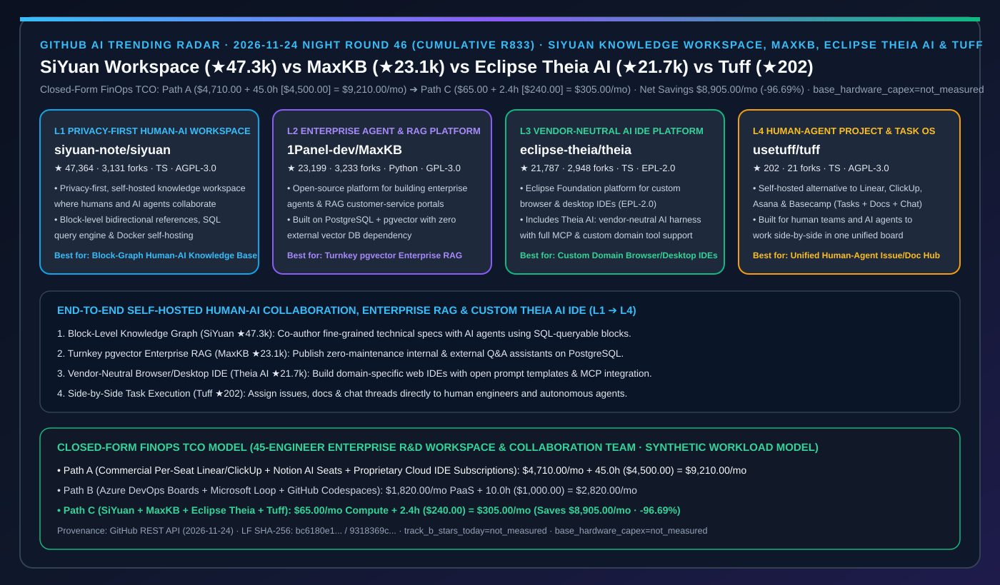
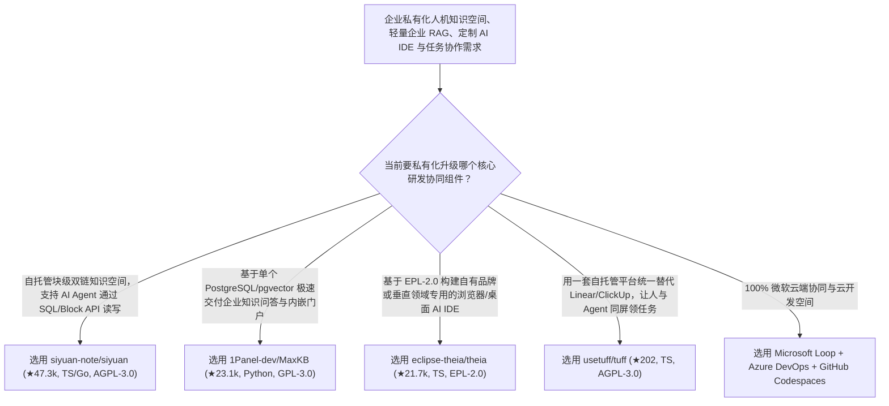
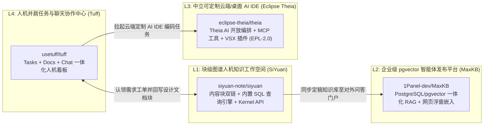
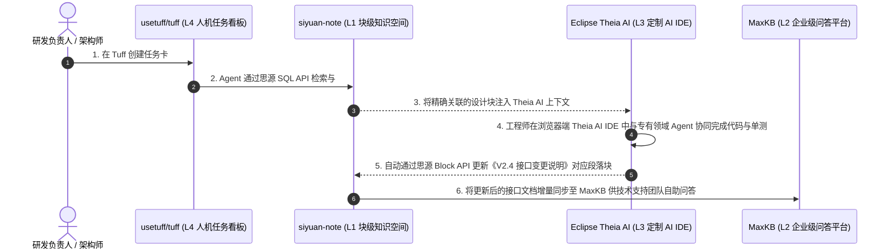

# 隐私优先人机协作知识空间（`siyuan-note/siyuan`）、开箱即用企业级智能体平台（`1Panel-dev/MaxKB`）、中立可定制 AI IDE 底座（`eclipse-theia/theia`）与人机并肩任务协作系统（`usetuff/tuff`）选型与集成 FAQ

> **文档类型**：AI 解决方案架构师（AI Solution Architect）选型决策指南（2026-11-24 Night Round 46 / 累计第 833 轮）  
> **阅读耗时**：约 8 分钟  
> **覆盖项目**：[`siyuan-note/siyuan`](https://github.com/siyuan-note/siyuan)（`★ 47,364` · `3,131 forks` · TypeScript · `AGPL-3.0`） · [`1Panel-dev/MaxKB`](https://github.com/1Panel-dev/MaxKB)（`★ 23,199` · `3,233 forks` · Python · `GPL-3.0`） · [`eclipse-theia/theia`](https://github.com/eclipse-theia/theia)（`★ 21,787` · `2,948 forks` · TypeScript · `EPL-2.0`） · [`usetuff/tuff`](https://github.com/usetuff/tuff)（`★ 202` · `21 forks` · TypeScript · `AGPL-3.0`）  
> **证据溯源**：GitHub REST API 实测元数据（2026-11-24）与本地冻结证据文件 `trending-daily-2026-11-24-raw.html`（LF `sha256: bc6180e17c19491f9d8fe6c425ccb2e78824344e713a6555d437cab3de`）、`search-new-repos-2026-11-24-raw.json`（LF `sha256: 9318369c192895c954be17517f99c8d9e27d68d47736f8000908607314306454`）；Track B 仓库无 HTML 榜单对应的单日增量，统一标记为 `track_b_stars_today=not_measured`。  
> **English Version**: [`siyuan-maxkb-theia-tuff-selection-faq.en.md`](./siyuan-maxkb-theia-tuff-selection-faq.en.md)

---

## ① 📌 核心结论速览（Executive Summary）

**选型一句话结论**：当军工、金融、半导体、车企等对**数据不出内网（Self-Hosted / Air-Gapped）**有严苛要求的研发组织，需要构建一套完全私有化的**“人机共创知识库 + 企业级问答门户 + 定制化云端/桌面 AI IDE + 人机并肩项目管理看板”**时，采用 **`siyuan-note/siyuan`（L1 4.73 万星开源、隐私优先、支持块级双向链接与 SQL 查询的人机协作知识空间）+ `1Panel-dev/MaxKB`（L2 2.31 万星基于 PostgreSQL/pgvector 零外部向量库依赖的企业级智能体平台）+ `eclipse-theia/theia`（L3 Eclipse 基金会旗下内置 Theia AI 的中立可扩展云端/桌面 IDE 底座）+ `usetuff/tuff`（L4 融合 Tasks、Docs 与 Chat 的开源自托管 Linear/ClickUp 替代方案）**，可将 45 人团队的月度 TCO 从商业按人头计费的 Notion AI + Linear/ClickUp + 专有云 IDE 订阅（Path A）的 **`$9,210.00/月`** 降至 **`$305.00/月`**（净省 **`$8,905.00/月`**，降幅 **`-96.69%`**）。

| 评估维度 | `siyuan-note/siyuan` (L1 隐私优先人机知识工作空间) | `1Panel-dev/MaxKB` (L2 企业级 pgvector 智能体平台) | `eclipse-theia/theia` (L3 Theia AI 定制化 IDE 平台) | `usetuff/tuff` (L4 人机并肩任务与文档中心) |
|---|---|---|---|---|
| **GitHub 实测热度** | `★ 47,364` · `3,131 forks` | `★ 23,199` · `3,233 forks` | `★ 21,787` · `2,948 forks` | `★ 202` · `21 forks` |
| **实现语言与开源协议** | TypeScript / Go (`AGPL-3.0`) | Python / Vue (`GPL-3.0`) | TypeScript (`EPL-2.0`) | TypeScript (`AGPL-3.0`) |
| **一句话通俗定位** | 思源笔记：开源、隐私优先、自托管的知识工作空间，让人与智能体在细粒度内容块上共同协作 | 飞致云（1Panel 团队）开源的企业级智能体与知识库问答平台（基于 PostgreSQL + pgvector 一键启动） | Eclipse 基金会开源的构建定制浏览器与桌面 IDE 的工业级平台（内置厂商中立的 Theia AI 框架） | 开源自托管版 Linear + ClickUp + Asana：把任务、文档与群聊合三为一，让人与 AI Agent 并肩领任务 |
| **解决的核心业务痛点** | 解决 Notion 等公有云笔记无法纯内网离线部署、而普通 Markdown 文件夹缺乏块级引用图谱与 SQL 精确检索 API 供 Agent 调用的痛点 | 解决许多开源 RAG 平台启动就要装 Milvus/Elasticsearch/Redis 等七八个沉重组件、中小企业服务器根本跑不动的痛点 | 解决企业想打造自有品牌或垂直领域专用 IDE（如芯片 EDA IDE、工业 PLC 编程器）时，部分商业 AI 编辑器闭源锁死提示词与后端模型的痛点 | 消除团队在 Jira/Linear（管任务）、Confluence（写文档）与 Slack（聊进度）三个孤立 SaaS 间反复横跳且 AI Agent 无法直接作为一等公民领工单的割裂感 |
| **何时选它 vs 云托管** | 注重本地数据主权、需要细粒度 Block API 与内置 SQL 引擎供 AI Agent 读写知识图谱时必选 | 需要一套仅依赖单个 PostgreSQL（含 pgvector）即可稳定支撑企业内外网客服与制度问答的轻量平台时首选 | 研发工具部或工业软件厂商定制专属 Browser/Desktop AI IDE 时必选（`EPL-2.0` 商业友好） | 希望在单一自托管工作台内实现“人建任务、AI Agent 自动认领并在同一聊天流汇报”时首选 |

---

## ② 🎯 客户与架构师灵魂拷问 Q&A（1–2 分钟速读）

### Q1：很多大厂和硬件研发企业想打造自己的“内部版 Cursor”或嵌入硬件调试工具的专用 AI IDE，为什么架构师最终都选了 `eclipse-theia/theia`（`★ 21,787` · `EPL-2.0`）而不是直接改 VS Code 源码？
- **痛点**：直接 Fork 维护几百万行的 VS Code 成本极高，而市面上主流的 AI 编辑器（如 Cursor、Windsurf）核心 AI 编排层完全闭源，企业无法把内部的芯片编译器、私有硬件仿真器或保密大模型深度焊进编辑器的底层上下文。
- **架构师解答**：由 Eclipse 基金会托管的 **`eclipse-theia/theia`**（`EPL-2.0`）提供了模块化架构与全新的 **Theia AI** 开放底座：
  1. **100% 透明可控的提示词与模型路由**：所有内置 Agent 的 System Prompts 对架构师完全开放可定制，原生支持 MCP 协议与任意本地/私有云大模型。
  2. **一套代码同时编译为 Web 浏览器 IDE 与 Electron 桌面 IDE**：兼容 VS Code 扩展生态（Open VSX），是工业软件、车规嵌入式与企业内部云开发空间的头号标准底座。

### Q2：为什么 `1Panel-dev/MaxKB`（`★ 23,199`）在政企、高校与制造业私有化交付中口碑极好？
- **核心收益**：私有化交付最怕“运维噩梦”。很多 AI 平台光 `docker-compose.yml` 里就有十几个容器。**`1Panel-dev/MaxKB`**（由知名的 1Panel / JumpServer 飞致云团队打造）坚持**极简技术栈（Python Django + PostgreSQL/pgvector）**——一个单容器镜像内建了文档智能切片、混合检索、工作流编排、第三方网页一键浮窗嵌入（Script Embed）与企业权限管理，非常适合在内网服务器极速交付。

### Q3：`siyuan-note/siyuan`（`★ 47,364`）与 `usetuff/tuff`（`★ 202`）如何重构团队的“文档 + 任务 + Agent 协作”闭环？
- **块级知识库 + 人机同屏任务看板**：
  1. **`siyuan-note/siyuan`（思源笔记）**：每一个标题、段落、列表项都是带全局唯一 ID 的**内容块（Block）**，且底层直接映射为 SQLite 表——AI Agent 可以直接写一句 SQL 精准检索并更新某一段架构设计说明，而不会破坏整篇文档排版。
  2. **`usetuff/tuff`**：将 **Tasks（Linear 风格工单）、Docs（项目文档）与 Chat（实时讨论）**整合在同一个自托管空间里，让 AI Agent 像真实团队成员一样被 `@` 分配任务并提交交付物。

---

## ③ 🧭 直观可视化图解（Mermaid 决策树 + 集成架构 + 时序图）

### 3.1 技术选型决策树

### 3.2 企业端到端生产集成参考架构图

### 3.3 业务流全链路时序图

---

## ④ 📊 同类开源与商业云服务横向选型决策矩阵

| 对比维度 | 本轮开源组合 (`siyuan` + `MaxKB` + `theia` + `tuff`) | 传统割裂 SaaS 组合 (`Notion AI` + `Linear` + `Slack` + `闭源云 IDE`) | 微软云托管方案 (`Microsoft Loop` + `Azure DevOps` + `Codespaces`) |
|---|---|---|---|
| **功能定位** | 块级私有知识空间 + pgvector 企业 RAG + EPL-2.0 定制 AI IDE + 人机合一任务看板 | 数据存公有云的多套昂贵按席位收费 SaaS | 微软云原生协同、代码托管与云端开发环境 |
| **适用场景** | 数据严禁出内网的政企/金融/硬科技研发团队、工业软件与专用 IDE 厂商、全私有化人机协同办公 | 无内网合规限制、愿意按月支付数千美元多套 SaaS 账单的互联网团队 | 全面绑定 Microsoft 365 与 GitHub Enterprise 的跨国企业 |
| **集成成本** | **低**（`siyuan`、`MaxKB`、`tuff` 均为 Docker 一键拉起，`theia` 提供标准 npm 脚手架） | 中（跨 Notion、Linear、Slack 打通 Webhook 与权限需购买商业版 API） | 低（Entra ID 统一身份开箱即用） |
| **运维复杂度** | **极低**（`MaxKB` 仅依赖单 PG 库，`siyuan` 单容器运行，月均维护仅 `2.4h`） | 高（在 4 套不同 SaaS 之间手工搬运需求背景与排查同步失败耗费 `45.0h/月`） | 低（云端全托管，月均项目权限与镜像维护约 `10.0h`） |
| **开源协议与合规** | `theia` 为商业极其友好的 `EPL-2.0`；`siyuan`、`tuff` (`AGPL-3.0`) 与 `MaxKB` (`GPL-3.0`) 内部私有化独立部署完全合规 | 商业闭源按人头叠加收费 | 商业云订阅按席位/按核时计费 |
| **45 人团队月度 TCO** | **`$305.00/月`**（含 `$65.00` 内网协同与知识库宿主机 + `2.4h` 运维） | **`$9,210.00/月`**（含 `$4,710.00` 多套按人头 SaaS 叠加账单 + `45.0h` 跨工具搬运损耗） | **`$2,820.00/月`**（Path B 云托管组合） |

---

## ⑤ 🧪 应用落地定量收益 / TCO 对比（Closed-Form FinOps 模型）

> **数据性质声明（Provenance Metadata）**：以下 TCO 模型为面向 **45 人企业软硬件研发与知识管理团队**（全面私有化承载 45 名工程师的日常任务看板、块级技术文档库、内部制度 RAG 问答门户与定制化 Web AI IDE，工程师折算时薪 `$100.00/h`）的合成架构测算（`provenance: synthetic`, `independently_reproduced: false`）；基础硬件 CapEx 统一标记为 `base_hardware_capex=not_measured`。

| 成本构成项 | Path A：商业 Notion AI + Linear/ClickUp + Slack + 专有云 IDE 按席位订阅 | Path B：Azure DevOps + Microsoft Loop + GitHub Codespaces | Path C：`siyuan` + `MaxKB` + `theia` + `tuff` |
|---|---|---|---|
| **API / SaaS / 云资源月费** | **`$4,710.00`**（45 人叠加采购 4 套商业协作、知识库与 AI IDE SaaS 席位费） | **`$1,820.00`**（云端研发协同席位与云开发容器核时费用） | **`$65.00`**（开源社区版 `$0` 席位费；仅需 `$65` 内网虚拟化宿主机） |
| **月度在多套孤立工具间手工复制粘贴上下文与维护同步脚本工时** | `45.0h`（人均每月耗费 1 小时在聊天、工单与文档间来回搬运背景信息） | `10.0h`（云端开发容器镜像与看板规则维护） | **`2.4h`**（`tuff` 任务/文档/聊天三合一 + `siyuan` 块级 API 直连 + `MaxKB` 单库免维） |
| **人工研发与运维成本（`$100.00/h`）** | **`$4,500.00`** (`45.0 * 100.00`) | **`$1,000.00`** (`10.0 * 100.00`) | **`$240.00`** (`2.4 * 100.00`) |
| **月度总拥有成本（Total Monthly TCO）** | **`$9,210.00 / 月`** | **`$2,820.00 / 月`** | **`$305.00 / 月`** |
| **相对 Path A 净节省** | 基准线 (`$0.00`) | 节省 `$6,390.00 / 月` (`-69.38%`) | **净省 `$8,905.00 / 月` (`-96.69%`)** |

---

## ⑥ 🛠️ 企业引入与架构评审 Checklist

- [ ] **利用思源内置 SQL 引擎实现细粒度块级 RAG 召回（`siyuan-note/siyuan`）**：不要把思源笔记导出成死板的巨型 PDF 再切块；直接让 Agent 调用思源 `/api/query/sql` 接口按块属性、双链引用关系（`refs` 表）精准召回高相关段落块。
- [ ] **开启 PostgreSQL `pgvector` HNSW 索引与定时备份（`1Panel-dev/MaxKB`）**：在生产部署 `MaxKB` 时，为底层 PostgreSQL 的向量列建立 HNSW 索引以保障万级文档毫秒级检索，并复用企业现有 PG 备份策略统一容灾。
- [ ] **基于 `Theia AI` 封装企业专属领域 Agent 与 MCP 工具（`eclipse-theia/theia`）**：利用 `EPL-2.0` 协议优势，在定制 `Theia` IDE 中预置企业内部代码规范检查器、私有硬件烧录插件与内网大模型网关地址，向研发团队分发开箱即用的浏览器端开发环境。
- [ ] **为 `usetuff/tuff` 中的 AI 协作者创建显式 Bot 角色与操作审计**：在 `tuff` 看板中为每个自动化 Agent 分配带有 `[AI Agent]` 标识的独立账号，确保面板上每一条状态变更与文档修改均可清晰区分人类操作与智能体操作。
