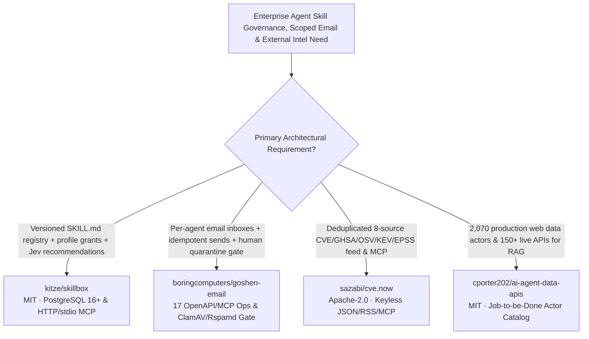
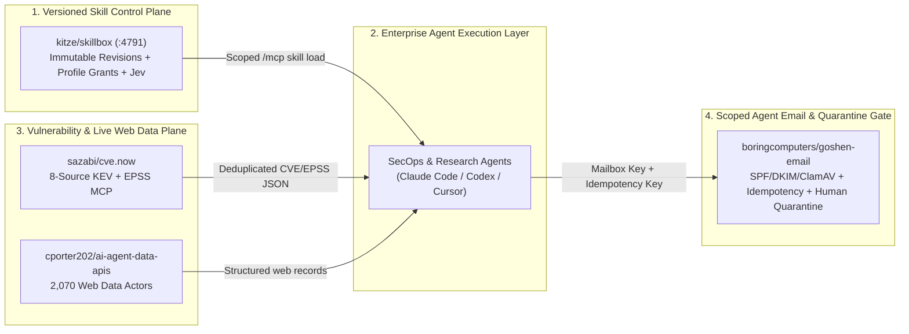
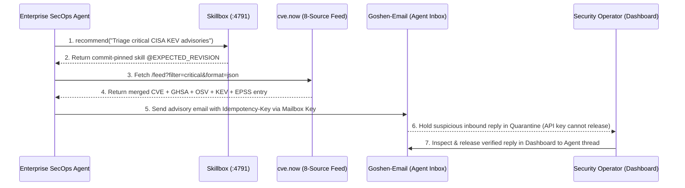

# Enterprise Versioned Agent Skills Registry, Scoped Agent Email, 8-Source Vulnerability Feed & 2,070 Web Data Actors Selection Guide: Skillbox vs Goshen-Email vs CVE.now vs AI-Agent-Data-APIs

> **2026-11-23 Night Round 34 (Cumulative Round 821)** · Enterprise AI Solution Architect Practical Selection, End-to-End Integration Architecture & FinOps TCO Guide
> **Companion Architecture Diagram**: [`assets/github-ai-radar-2026-11-23-r34-r821-skillbox-goshenemail-cvenow-agentdataapis.svg`](../../../assets/github-ai-radar-2026-11-23-r34-r821-skillbox-goshenemail-cvenow-agentdataapis.svg)

---

## 1. 📌 Executive Summary

For enterprise teams governing shared AI agent skills across repositories, provisioning isolated email inboxes for autonomous agents, ingesting deduplicated multi-source vulnerability intelligence, and connecting live external web data into MCP and RAG pipelines, **`kitze/skillbox`**, **`boringcomputers/goshen-email`**, **`sazabi/cve.now`**, and **`cporter202/ai-agent-data-apis`** provide a cohesive production stack:

1. **Self-Hosted Versioned Skills Registry & Jev Recommender (`kitze/skillbox`)**: (`★ 283`, `28 forks`, TypeScript, `MIT`). Built on React, Bun, Hono, and PostgreSQL 16+, it provides immutable skill revisions, profile-scoped skill/bundle grants, revocable client keys, HTTP `/mcp` + Node/Bun stdio bridge, commit-pinned GitHub imports, and optional task-aware `Jev` recommendations (with provider keys encrypted server-side via AES-256-GCM) while never executing uploaded skill code.
2. **Scoped Email Inboxes for AI Agents with Quarantine Gate (`boringcomputers/goshen-email`)**: (`★ 188`, `18 forks`, TypeScript). Exposes 17 operations identically across OpenAPI REST, JSON CLI, and MCP server to create inboxes, send, receive, and thread replies. Enforces single-inbox `Mailbox Keys`, mandatory send idempotency keys, SPF/DKIM/DMARC + Rspamd + ClamAV scanning, and a hard security boundary where **no API key can release quarantined messages or mint new keys**.
3. **8-Source Unified Vulnerability Feed & Keyless Security MCP (`sazabi/cve.now`)**: (`★ 167`, `10 forks`, `Apache-2.0`). Merges the CVE List, GitHub Advisory Database (GHSA), OSV, NVD, ENISA EUVD, CISA KEV, FIRST EPSS scores, and Exploit-DB into one deduplicated entry per vulnerability, published keylessly over RSS, Atom, JSON Feed, JSON API, and MCP.
4. **2,070 Production Web Data Actors & 150+ Live APIs (`cporter202/ai-agent-data-apis`)**: (`★ 51`, `13 forks`, `MIT`). Organizes 2,070 Apify actors and 150+ APIMesa APIs by Job-to-be-Done for MCP servers, LLM tools, RAG pipelines, browser automation, vision, and voice.
5. **FinOps Quantitative Takeaway**: Replacing commercial prompt/skill registries, enterprise per-seat agent email SaaS, paid threat-intel feeds, and custom scraper maintenance (Path A: `$9,410.00/mo`) with this self-hosted/open stack (Path C: `$305.00/mo`) saves **`$9,105.00/mo`** (**`-96.76%`**).

---

## 2. 🎯 Architect & Customer Key Q&A

### Q1: When should an enterprise use managed cloud PaaS vs. this 4-project stack?
- **Use managed cloud PaaS when**:
  - All agents live inside a single M365 tenant and only need internal Outlook mailboxes and Microsoft Defender vulnerability dashboards (**Microsoft Copilot Studio + Microsoft Graph + Defender Vulnerability Management**).
- **Deploy this 4-project stack when**:
  - **Cross-Harness Versioned Skill Governance**: Use **`skillbox`** to centralize `SKILL.md` bundles in PostgreSQL 16+ with immutable revisions, per-profile read/propose permissions, and `Jev` task-aware skill ranking across Claude Code, Codex, and Cursor;
  - **Prompt-Injection-Safe Agent Email**: Use **`goshen-email`** so each agent gets a single-inbox `Mailbox Key` and idempotent send protection while Rspamd/ClamAV quarantine suspicious inbound emails for human-only release;
  - **Zero-Key Multi-Source CVE/KEV/EPSS Triage**: Use **`cve.now`** (`?filter=critical`) via MCP to feed deduplicated CISA KEV and `EPSS >= 0.1` alerts directly into SecOps agents;
  - **Turnkey External Web Data for RAG**: Use **`ai-agent-data-apis`** to select from 2,070 production actors instead of maintaining brittle custom scrapers.

### Q2: How do these four components integrate into an enterprise agent architecture?
1. **Skill Registry & Recommendation Plane (`skillbox`)**: Agents connect to `/mcp` with a scoped `client-key` and call `recommend` to load commit-pinned, owner-reviewed skills for the current task;
2. **External Vulnerability & Web Data Plane (`cve.now` + `ai-agent-data-apis`)**: SecOps and research agents query `cve.now` for deduplicated 8-source CVE/EPSS records and invoke actors from `ai-agent-data-apis` for live market/web telemetry;
3. **Scoped Outbound/Inbound Email Plane (`goshen-email`)**: Agents send notifications with idempotency keys and read threaded replies from their dedicated inbox while quarantined messages wait for human approval in the dashboard.

### Q3: What are the key operational boundaries and security guardrails?
- **`skillbox`**: `SKILLBOX_ADMIN_TOKEN` derives the AES-256-GCM key protecting stored provider credentials; keep `.env` (`0600`) private, issue hashed per-client keys, and follow rotation guidance before changing the admin token.
- **`goshen-email`**: Enforce `Mailbox Keys` (1 inbox scope) for agents; neither `Account Keys` nor `Mailbox Keys` can release quarantined mail.
- **`cve.now`**: Public feeds and MCP require no API key (`Apache-2.0` repo); air-gapped environments can mirror `https://cve.now/feed?format=json` on a scheduled cron.
- **`ai-agent-data-apis`**: `MIT`-licensed catalog; enforce per-run compute budgets and target-site compliance policies when executing upstream actors.

---

## 3. 🧭 Visual Architecture & Decision Diagrams (Mermaid)

### 3.1 Selection Decision Tree

### 3.2 End-to-End Enterprise Reference Architecture

### 3.3 Runtime Execution Sequence

---

## 4. 📊 Comparative Selection Matrix

| Dimension | `kitze/skillbox` | `boringcomputers/goshen-email` | `sazabi/cve.now` | `cporter202/ai-agent-data-apis` | Commercial SaaS & Custom Scrapers (Path A) |
| :--- | :--- | :--- | :--- | :--- | :--- |
| **Primary Role** | Self-hosted versioned skills registry & Jev recommender | Scoped email inboxes for AI agents with human quarantine | 8-source deduplicated vulnerability feed & MCP | 2,070 Apify actors & 150+ live web APIs catalog | Commercial prompt SaaS + M365 seats + paid threat feed + custom scrapers |
| **Security & Governance** | Hashed client keys, AES-256-GCM key storage, never executes skill code | 1-inbox `Mailbox Key`, API cannot release quarantine, SPF/DKIM/ClamAV | Keyless read-only feed with CISA KEV & `EPSS >= 0.1` filters | Standardized actor schemas & managed anti-bot execution | Shared admin keys, manual 8-feed CVE deduplication & scraper breakage |
| **Interfaces** | HTTP `/mcp`, Node/Bun stdio CLI, Web UI (`:4791`) | 17 OpenAPI REST ops, JSON CLI, MCP server, signed webhooks | RSS, Atom, JSON Feed, JSON API, MCP server | MCP servers, LLM tools, RAG pipelines | Fragmented proprietary REST APIs |
| **License** | `MIT` | `NOASSERTION` (Public repo + OpenAPI spec) | `Apache-2.0` | `MIT` | Proprietary per-seat / per-call SaaS |
| **Monthly TCO (45-Eng Team)** | **Combined `$305.00/mo`** (`$65.00` compute/DB + `$240.00` ops labor) | Included in combined stack | Included in combined stack | Included in combined stack | **`$9,410.00/mo`** (`$4,910.00` SaaS/API + `$4,500.00` labor) |

---

## 5. 🧪 Quantitative FinOps TCO Comparison (Closed-Form Audit)

> **Audit Note**: Modeled for a 45-engineer enterprise team governing 300+ versioned skills, operating 40 isolated agent email inboxes, monitoring 8 vulnerability feeds, and maintaining 120 external web data ingestion pipelines. Repository metadata is verified via the GitHub REST API; live runtime p99 latency is marked `not_measured`.

| Cost Component | Path A: Commercial Skill Registry + Agent Email SaaS + Paid Threat Feed + Custom Scrapers | Path C: Self-Hosted `skillbox` + `goshen-email` + `cve.now` + `ai-agent-data-apis` | Net Savings / Delta |
| :--- | :--- | :--- | :--- |
| **API / SaaS Subscriptions & Compute** | `$4,910.00 / mo` | `$65.00 / mo` | `-$4,845.00 / mo` |
| **Skill Sync, Mail Triage, CVE Dedup & Scraper Labor** | `$4,500.00 / mo` (`45.0 hrs × $100/hr`) | `$240.00 / mo` (`2.4 hrs × $100/hr`) | `-$4,260.00 / mo` |
| **Total Monthly TCO** | **`$9,410.00 / mo`** | **`$305.00 / mo`** | **`$9,105.00 / mo` (`-96.76%`)** |

---

## 6. 🛠️ Enterprise Architecture Review Checklist

- [ ] **Immutable Skill Revisions & Scoped Keys (`skillbox`)**: Provision `skillbox` with PostgreSQL 16+, enforce per-profile skill bundle grants, issue separate hashed `client-key` tokens per agent, and run `node cli/skillbox.mjs audit` in CI.
- [ ] **Single-Inbox Mailbox Keys & Quarantine Workflow (`goshen-email`)**: Restrict agents to single-inbox `Mailbox Keys`, require `Idempotency-Key` on all outbound sends, and route Rspamd/ClamAV quarantine alerts to human operators.
- [ ] **Automated KEV + EPSS Vulnerability Triage (`cve.now`)**: Connect SecOps agents to `https://cve.now/feed?filter=critical&format=json` (or the `cve.now` MCP server) to correlate CISA KEV and `EPSS >= 0.1` advisories against internal SBOMs.
- [ ] **External Data Pipeline Standardization (`ai-agent-data-apis`)**: Replace brittle custom Playwright scrapers with cataloged actors and enforce schema validation before RAG indexing.
