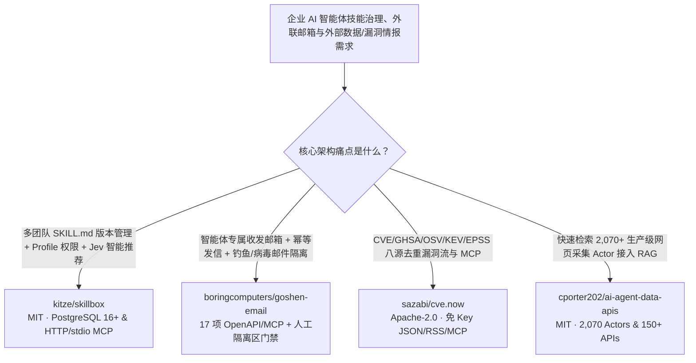
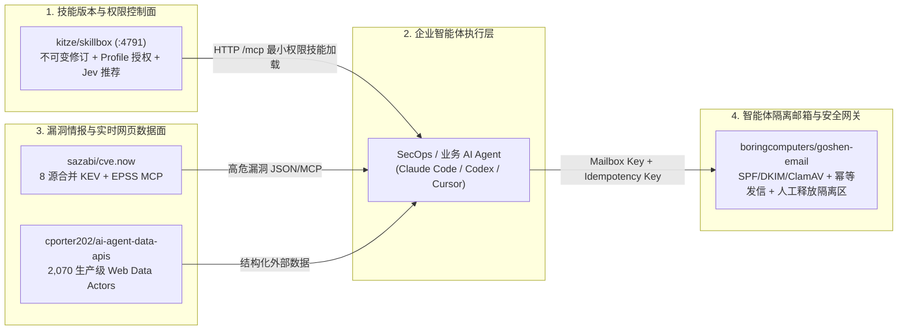
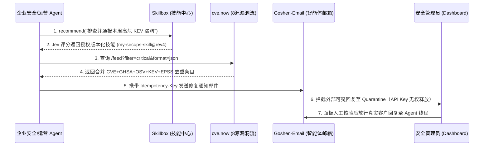

# 企业级版本化技能仓库、隔离智能体邮箱、八合一漏洞情报流与 2,070 外部数据连接器选型指南：Skillbox vs Goshen-Email vs CVE.now vs AI-Agent-Data-APIs

> **2026-11-23 Night Round 34（Cumulative Round 821）** · 面向企业 AI 解决方案架构师（AI Solution Architect）的实战选型、端到端集成架构与 FinOps TCO 决策指南
> **关联架构图**：[`assets/github-ai-radar-2026-11-23-r34-r821-skillbox-goshenemail-cvenow-agentdataapis.svg`](../../../assets/github-ai-radar-2026-11-23-r34-r821-skillbox-goshenemail-cvenow-agentdataapis.svg)

---

## 1. 📌 核心结论速览（Executive Summary）

在企业多团队共享与版本化管控 AI 技能库、为智能体分配受隔离策略保护的独立收发件箱、实时追踪全球 8 大安全漏洞情报库，以及按业务场景接入 2,070+ 外部实时数据连接器四大痛点上，**`kitze/skillbox`**、**`boringcomputers/goshen-email`**、**`sazabi/cve.now`** 与 **`cporter202/ai-agent-data-apis`** 构成了完整的企业级 Agent 赋能与安全治理底座：

1. **自托管版本化 AI 技能注册中心与权限分发（Self-Hosted Versioned Skills Registry）**：优先选择 **`kitze/skillbox`**（`★ 283`，`28 forks`，TypeScript，`MIT`）。基于 React + Bun + Hono + PostgreSQL 16+，提供不可变修订历史（Immutable Revisions）、按角色 Profile 授权技能包、可吊销客户端密钥、HTTP `/mcp` 与 stdio 桥接、固定 Commit 的 GitHub 导入，以及基于 AES-256-GCM 服务端加密密钥的 `Jev` 任务感知技能推荐（且绝不执行上传的技能代码）。
2. **智能体专属受控邮箱与人工隔离区门禁（Scoped Agent Email & Quarantine Gate）**：优先选择 **`boringcomputers/goshen-email`**（`★ 188`，`18 forks`，TypeScript）。单次 API 调用即可为每个 Agent 创建独立邮箱，通过 17 个 OpenAPI / JSON CLI / MCP 接口完成收发与会话串联；提供单邮箱作用域密钥（Mailbox Key）、强制发信幂等键（Idempotency Key）、SPF/DKIM/DMARC + Rspamd + ClamAV 扫描，且**没有任何 API 密钥可以越权释放隔离区邮件（必须由人工在面板放行）**。
3. **八源合一免密钥漏洞情报流与 MCP（8-Source Unified Vulnerability Feed & MCP）**：优先选择 **`sazabi/cve.now`**（`★ 167`，`10 forks`，`Apache-2.0`）。将 CVE List、GitHub Advisory Database (GHSA)、OSV、NVD、欧盟 ENISA EUVD、CISA KEV、FIRST EPSS 评分与 Exploit-DB 合并去重为单条标准漏洞记录，免注册/免 API Key 同时输出 RSS、Atom、JSON Feed、JSON API 与 MCP 服务。
4. **2,070 个生产级智能体外部数据 Actor 与 API 索引（Live Web Data Catalog for MCP/RAG）**：优先选择 **`cporter202/ai-agent-data-apis`**（`★ 51`，`13 forks`，`MIT`）。按“待办任务（Job-to-be-Done）”系统梳理了 2,070 个 Apify 生产级 Actor 与 150+ 实时数据 API，覆盖电商比价、社媒监听、SEO、线索挖掘、视觉与语音管线。
5. **FinOps 定量结论**：将商业技能管理平台、商业智能体邮件网关、付费威胁情报订阅与自建爬虫维护团队（Path A：`$9,410.00/月`）迁移至上述四款开源/免密钥自托管组合（Path C：`$305.00/月`），每月净省 **`$9,105.00`**（降幅 **`-96.76%`**）。

---

## 2. 🎯 客户与架构师灵魂拷问 Q&A（Pain Points & Architecture Decisions）

### Q1：何时直接采用云厂商托管 PaaS，何时引入这 4 款开源/开放工具？
- **直接采用云厂商托管方案的场景**：
  - 企业全部智能体均运行在单一云生态内且仅需连接内部 Microsoft 365 邮箱与 Defender 漏洞看板，可直接使用 **Microsoft Copilot Studio + Microsoft Graph Mail API + Microsoft Defender Vulnerability Management**。
- **优先引入本轮 4 大项目的场景**：
  - **跨 Claude Code / Codex / Cursor 统一管控企业技能版本与权限**：用 **`skillbox`** 将分散在个人电脑的 `SKILL.md` 收拢至 PostgreSQL 16+，通过 Profile 精确控制哪些客户端 key 能读取或提议修改哪些技能，并用 `Jev`（TypeSafe / OpenRouter / Vercel AI Gateway）在 8 秒上限内按任务精准推荐技能；
  - **防止智能体被垃圾/钓鱼邮件注入或超时重复发信**：用 **`goshen-email`** 为每个 Agent 绑定仅限本邮箱的 `Mailbox Key` 与发信 `Idempotency Key`，可疑邮件经 Rspamd/ClamAV 自动进隔离区，API Key 物理无权释放；
  - **零成本接入 CISA KEV + EPSS 高危漏洞情报**：用 **`cve.now`** 的 `?filter=critical`（在 CISA KEV 中、CVSS 9+ 或 CVSS 7+ 且 `EPSS >= 0.1`）通过 MCP 实时喂给安全运维 Agent；
  - **快速补齐 2,000+ 外部网站结构化采集能力**：用 **`ai-agent-data-apis`** 直接检索现成 Actor 接入 MCP 与 RAG。

### Q2：如何将这四套组件集成到企业智能体生产架构中？
1. **技能管控与智能推荐层（`skillbox`）**：Agent 启动时挂载 `bootstrap/SKILL.md` 并连接 `https://skills.internal/mcp`，按当前任务调用 `recommend` 获取最小必要技能集；
2. **外部情报与实时数据接入层（`cve.now` + `ai-agent-data-apis`）**：SecOps Agent 通过 `cve.now` MCP 拉取去重后的 KEV/EPSS 漏洞情报，业务 Agent 按目录调用 `ai-agent-data-apis` 中的采集器获取实时网页结构化数据；
3. **受控外联与人机协同邮件层（`goshen-email`）**：Agent 通过幂等键发送安全通报或客户回复，所有入站外部邮件先过 SPF/DKIM/DMARC 与 ClamAV，隔离邮件由安全员在 Web 面板人工复核。

### Q3：核心技术边界与安全合规注意事项是什么？
- **`skillbox`**：`SKILLBOX_ADMIN_TOKEN` 用于派生 AES-256-GCM 密钥加密数据库中的第三方 API Key，切勿直接分发给普通客户端（应签发独立的哈希存储 `client-key`）；同时 `skillbox` 保证绝不在服务端执行上传的技能代码。
- **`goshen-email`**：严格区分 `Account Key`、`Mailbox Key` 与人工控制台权限——任何 API Key 均不可释放隔离区邮件或创建新 Key。
- **`cve.now`**：文档与接口规范采用 `Apache-2.0` 开源，提供零密钥公共 JSON/MCP 订阅；企业高敏内网可通过定时拉取 JSON Feed 至本地缓存库实现离线比对。
- **`ai-agent-data-apis`**：目录本身为 `MIT` 协议，调用具体云端 Actor 时需按各目标站点的 robots/ToS 合规策略配置速率与预算上限。

---

## 3. 🧭 直观可视化图解（Mermaid 决策树 + 集成架构 + 时序流）

### 3.1 技术选型决策树

### 3.2 企业端到端集成参考架构图

### 3.3 业务执行时序图

---

## 4. 📊 同类开源与商业云服务横向选型决策矩阵

| 对比维度 | `kitze/skillbox` | `boringcomputers/goshen-email` | `sazabi/cve.now` | `cporter202/ai-agent-data-apis` | 商业 SaaS / 自研爬虫组合 (Path A) |
| :--- | :--- | :--- | :--- | :--- | :--- |
| **核心功能定位** | 自托管版本化 Agent 技能库与 Jev 推荐 MCP | 智能体专属收发邮箱、反垃圾隔离与 17 工具 MCP | 8 源合一去重安全漏洞订阅流与 MCP | 2,070 个生产级网页数据 Actor 与 API 目录 | 商业 Prompt 平台 + 企业邮箱席位 + 付费威胁情报 + 自维护爬虫 |
| **权限与安全机制** | 独立哈希 `client-key`、AES-256-GCM 密钥加密、零代码执行 | 单邮箱 `Mailbox Key`、API 禁放行隔离区、SPF/DKIM/ClamAV | 免账号零密钥只读公共流，含 CISA KEV 与 EPSS 阈值过滤 | 标准化 Actor 输入输出契约，隔离目标站点反爬复杂性 | 共享高权限 API Key 易越权，多源漏洞手工去重耗时长 |
| **接入协议** | HTTP `/mcp`、Node/Bun stdio CLI、Web UI (`:4791`) | 17 项 OpenAPI REST、JSON CLI、MCP Server、签名 Webhook | RSS、Atom、JSON Feed、JSON API、MCP Server | MCP Servers、LLM Tools、RAG Pipelines | 异构私有 REST 接口 |
| **开源协议** | `MIT` | `NOASSERTION`（公开仓库 + OpenAPI 规范） | `Apache-2.0` | `MIT` | 闭源商业按席位 / 按量计费 |
| **月度 TCO（45 人团队）** | **组合总计 `$305.00/月`**（`$65.00` 容器与数据库算力 + `$240.00` 运维人工） | 同左 | 同左 | 同左 | **`$9,410.00/月`**（`$4,910.00` SaaS/API + `$4,500.00` 人工） |

---

## 5. 🧪 应用落地定量收益 / FinOps TCO 对比（Closed-Form Audit）

> **审计声明**：以下 FinOps 模型基于 45 人研发与安全运营团队管理 300+ 版本化内部 Agent 技能、运行 40 个独立外联智能体邮箱、持续监控 8 大漏洞源并维护 120 条外部数据源采集管线的月度开销核算；仓库元数据经 GitHub REST API 实测验证，运行时线上 p99 延迟标记为 `not_measured`。

| 成本项 | Path A：商业技能平台 + 商业智能体邮箱 + 付费漏洞情报 + 手工维护爬虫 | Path C：`skillbox` + `goshen-email` + `cve.now` + `ai-agent-data-apis` | 净节省 / 变化幅度 |
| :--- | :--- | :--- | :--- |
| **API / SaaS 订阅与算力成本** | `$4,910.00 / mo` | `$65.00 / mo` | `-$4,845.00 / mo` |
| **技能同步、邮件风控、漏洞去重与爬虫维护工时** | `$4,500.00 / mo`（`45.0 hrs × $100/hr`） | `$240.00 / mo`（`2.4 hrs × $100/hr`） | `-$4,260.00 / mo` |
| **月度总拥有成本（Total Monthly TCO）** | **`$9,410.00 / mo`** | **`$305.00 / mo`** | **`$9,105.00 / mo`（`-96.76%`）** |

---

## 6. 🛠️ 企业引入与架构评审 Checklist

- [ ] **技能库最小权限与修订门禁（`skillbox`）**：使用 `bash scripts/skillbox.sh setup` 生成 `0600` 权限 `.env`，为不同项目组配置独立 Profile 与只读 `client-key`，在 CI 中运行 `node cli/skillbox.mjs audit` 校验技能包兼容性。
- [ ] **智能体邮件幂等与隔离区人工复核（`goshen-email`）**：为每个外联 Agent 仅注入单邮箱作用域的 `Mailbox Key`，强制所有发信调用传入 `Idempotency-Key`，并指定安全值班人员通过 Dashboard 审核 Rspamd/ClamAV 隔离邮件。
- [ ] **高危漏洞自动化分诊（`cve.now`）**：在安全巡检 Agent 中挂载 `cve.now` MCP 或轮询 `https://cve.now/feed?filter=critical&format=json`，自动关联内部 SBOM 组件与 `EPSS >= 0.1` / `CISA KEV` 状态。
- [ ] **外部数据采集契约治理（`ai-agent-data-apis`）**：优先复用目录中已验证的 Actor 替换脆弱的自研 Playwright 脚本，并在网关层设置单次调用预算上限与字段级 Schema 校验。
