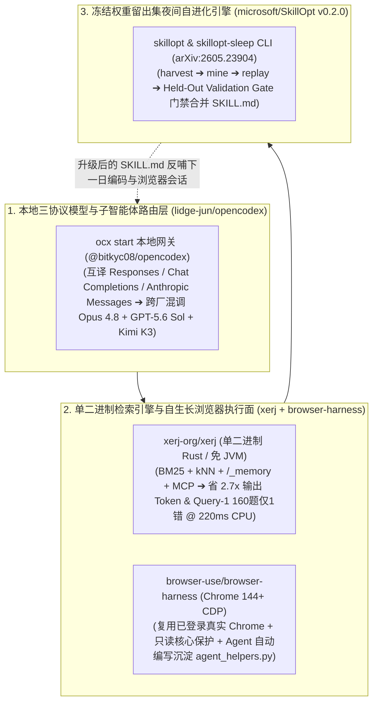

# 冻结权重 Epoch/留出集夜间自进化技能训练器（`microsoft/SkillOpt`）、单二进制免 JVM 省 2.7× Token 检索引擎（`xerj-org/xerj`）、受保护内核+自编写 `agent_helpers.py` 浏览器底座（`browser-use/browser-harness`）与三协议跨厂子智能体本地网关（`lidge-jun/opencodex`）选型 FAQ

> **文档类型**：AI Solution Architect（AI 解决方案架构师）实战选型与架构内功指南（2026-11-18 Night Shift · Round 37 / 累计第 517 轮）  
> **对标标杆**：`docs/components/ib-vs-ethernet-roce-selection-faq.md`（六段式架构拆解 + 第一性原理大白话 + Hype/Facts/Signal 审计 + 闭式 TCO 账本）  
> **本轮评估对象**：  
> 1. **`microsoft/SkillOpt`**（`★ 19,149`, `1,835 forks`, Python `3.10+`, MIT, `v0.2.0`, NeurIPS 2026 Spotlight & Microsoft Global Hackathon 2026 第一名，`arXiv:2605.23904`）：不碰模型权重、用神经网络式 **Epoch / Mini-Batch / 学习率 / 留出验证集门禁（Held-Out Validation Gate）** 训练 `SKILL.md` 的文本空间优化器，含夜间离线自进化引擎 **`SkillOpt-Sleep` (`skillopt-sleep` CLI：`harvest ➔ mine ➔ replay ➔ consolidate`)**  
> 2. **`xerj-org/xerj`**（`★ 19,235`, `1,443 forks`, Rust 单二进制, Apache-2.0, `rc.101`）：零 JVM 单二进制融合 BM25 + kNN + 混合检索 + `/_memory` 智能体记忆 + 原生 MCP（ES-YAML 兼容性 `1448/1458` 0 失败，相比 grep 驱动 Agent **减少 `2.7×` 输出 Token**；内置离线 CPU 模型 `XERJ Query-1` 在 160 题测试中仅错 `1` 题对比 Opus 5.5 RAG 错 `9–15` 题，`220 ms p50`，每百万次提问仅需 `$42` CPU 成本）  
> 3. **`browser-use/browser-harness`**（`★ 19,149`, `1,896 forks`, Python, MIT）：通过 Chrome 144+ `chrome://inspect/#remote-debugging` 直连已登录真实 Chrome，同时锁定 `src/browser_harness/` 内核只读，让编码 Agent 在执行任务时把缺失动作自动写成可复用的 **`agent-workspace/agent_helpers.py`** 辅助函数  
> 4. **`lidge-jun/opencodex`**（`★ 18,635`, `1,528 forks`, TypeScript `@bitkyc08/opencodex` `ocx start`, MIT）：打通 OpenAI `Responses`、`Chat Completions` 与 `Anthropic Messages` 三大协议（保留流式、工具调用、推理与图片）的本地统一网关，让原版 Claude Code、Codex、Claude Desktop 与 Grok Build 自由混调跨厂主模型与子智能体（如 Claude Opus 4.8 派发 GPT-5.6 Sol 子 Agent）  
> **审计折算说明**：本报告仅计量软件算力与工程运维人力 TCO，底层工作站硬件采购（base hardware capEx）显式标注为 `not_measured`，严禁捏造折旧坐标。

---

## 📌 一、核心结论速览（Executive Summary：它到底是什么？解决什么业务痛点？）

当企业研发平台团队在全公司推广编码与业务 Agent 时，往往陷入“手写 `SKILL.md` 改好一个 Case 又弄崩三个老 Case、Agent 靠 `grep` 翻代码白白烧掉数倍输出 Token、浏览器自动化每次都要从零猜 DOM、以及各款 IDE 工具与底层大模型死死锁死”四大工程困局：
1. **痛点 A（人工拍脑袋修改 `SKILL.md` 就像没有验证集的手调神经网络权重——修好今天遇到的 Bug，明天却在历史任务上发生灾难性退化）**：没有留出集（Held-Out Set）的技能迭代只是盲人摸象。**`microsoft/SkillOpt` (`★ 19,149`, NeurIPS 2026 Spotlight) 的破局之道**：完全冻结闭源/开源基座模型权重，把自然语言 `SKILL.md` 当作可训练参数——引入标准的 **Epochs、Mini-Batch Size、Learning Rate 与留出验证集门禁（Held-Out Validation Gate）**；其 `v0.2.0` 重磅推出的 **`SkillOpt-Sleep` (`skillopt-sleep` CLI)** 更可在每晚离线自动执行 **`harvest（采集白天的 Claude Code/Codex/Copilot/Devin 会话）➔ mine（挖掘高频痛点）➔ replay（重放评测）➔ consolidate（仅当通过留出集验证门禁时才合并升级技能）`**。
2. **痛点 B（Agent 用 `grep` 搜索代码库与文档时返回大量碎片上下文，逼迫模型反复试探，多烧掉 `2.7×` 输出 Token；而部署传统 Elasticsearch 又要背负沉重的 JVM 内存税）**：检索精度直接决定 Agent 的推理步数与幻觉率。**`xerj-org/xerj` (`★ 19,235`) 的破局之道**：用**单个免 JVM 的 Rust 二进制文件**提供零配置自动索引、BM25 + kNN 向量 + 混合检索、`/_memory` 智能体记忆接口与原生 MCP Server（通过 `1448/1458` ES-YAML 兼容性测试且 **0 失败**），在参考编码基准测试中比 `grep` 驱动的 Agent **减少 `2.7×` 输出 Token**；其最新离线 CPU 事实问答引擎 **`XERJ Query-1`** 无需 Embedding 与 GPU，CPU 延迟仅 **`220 ms p50`（每百万次问答成本仅 `$42`）**，在 160 题事实问答中**仅答错 `1` 题**（而 Opus 5.5 配合常规 RAG 答错 `9–15` 题）。
3. **痛点 C（每次让 Agent 操作企业内网系统或下载社媒素材，它都要重新写一遍脆弱的一次性脚本，且独立沙盒浏览器根本没有你的企业 SSO 登录态）**：浏览器自动化不该每次从零造轮子。**`browser-use/browser-harness` (`★ 19,149`) 的破局之道**：只需在 Chrome 144+ 开启 `chrome://inspect/#remote-debugging`，即可让 Claude Code、Codex 或 Cursor 直接复用你**已登录的真实 Chrome**；更精妙的是它采用**“只读受保护内核（`src/browser_harness/`）+ 可自生长工作区（`agent-workspace/agent_helpers.py`）”双层架构**——当 Agent 发现缺少“上传文件”或“批量下载最近 20 条视频”的动作函数时，会自动在 `agent_helpers.py` 中编写并沉淀该可复用函数，越用越快。
4. **痛点 D（开发者习惯了 Claude Code、Claude Desktop、Codex 或 Grok Build 的交互外壳，但各家客户端只能绑定自家 API 协议，无法在 Claude Desktop 里派发 GPT-5.6 Sol 子 Agent 或在 Grok Build 里调 Kimi K3）**：客户端协议壁垒阻碍了跨模型最优性价比组合。**`lidge-jun/opencodex` (`★ 18,635`) 的破局之道**：一行 `ocx start` 启动本地三协议互译网关——同时接收 **OpenAI `Responses` API、`Chat Completions` API 与 `Anthropic Messages` API**，无损转发流式输出、Tool Calls、Reasoning 思考链与多模态图片，并自动纳管 OpenCode、Pi、Qoder、WorkBuddy、Kilo、Cline、T3 Code 等十余款客户端配置。

---

## 💬 二、三大灵魂拷问（Q1–Q3 First-Principles Deep Dive）

### Q1：为什么 `microsoft/SkillOpt` 强调必须用“Mini-Batch + 留出验证集门禁（Held-Out Validation Gate）”来训练 `SKILL.md`，而不是让 Agent 每次出错后直接改写技能文件？
* **第一性原理剖析**：
  - **防止单样本过拟合（Single-Sample Overfitting）**：如果 Agent 在某一次任务失败后直接往 `SKILL.md` 追加一条修补规则，极易造成提示词膨胀并破坏原本正常工作的其他 99 个场景。`SkillOpt` 与 `SkillOpt-Sleep` 将过去会话聚合成训练集与独立留出验证集（Held-Out Split），只有当候选技能修改在 Replay 与留出验证集上的综合得分严格高于旧版时，才允许落盘合并。

### Q2：`xerj-org/xerj` 是如何做到单二进制免 JVM、帮编码 Agent 砍掉 `2.7×` 输出 Token，并用纯 CPU 将 160 题事实问答错误率从 Opus 5.5 RAG 的 `9–15` 题压到 `1` 题的？
* **第一性原理剖析**：
  - **结构化事实定位替代盲目 Grep 翻找**：`grep` 只做机械子串匹配，Agent 必须吐出大量思考与工具调用 Token 来过滤噪音；`XERJ` 在单进程 Rust 内核中融合词法 BM25（默认免下载离线可用）、可选 `~90 MB` 神经嵌入与 `/_memory` 接口，一次查询直接命中高信噪比代码/文档片段，从而将输出 Token 削减 **`2.7×`**；而 `XERJ Query-1` 直接在已索引事实图谱上做受约束核验，以 `$42 / 百万问` 的纯 CPU 成本实现 `159/160` 准确率。

### Q3：`browser-use/browser-harness` 的“受保护核心 + 自编写 `agent_helpers.py`”与 `lidge-jun/opencodex` 的“三协议互译网关”分别在执行面与模型面解决了什么架构耦合？
* **第一性原理剖析**：
  - **执行面解耦与复利沉淀（`browser-harness`）**：锁死 `src/browser_harness/` 防止 Agent 把底层 CDP 连接器改坏，同时开放 `agent-workspace/agent_helpers.py` 让 Agent 按需自写站点专用函数，兼顾了底座稳定性与技能复利增长。
  - **模型面三协议无损桥接（`opencodex`）**：把 `Responses`、`Chat Completions` 与 `Anthropic Messages` 的工具调用和思考块格式在本地网关层统一互译，使“主 Agent 用 Claude Opus 4.8 规划、子 Agent 调 GPT-5.6 Sol 或 Kimi K3 执行”成为开箱即用的标准能力。

---

## 🧭 三、架构选型决策树与端到端参考架构图（Mermaid）

---

## 📊 四、同类方案横向选型对比矩阵（Decision Matrix）

| 评估维度 | 路径 A：手改 `SKILL.md` 无回归门禁 + 重型 JVM Elasticsearch / 裸 `grep` + 一次性无登录浏览器脚本 + 客户端锁死单一厂商 API | 路径 B：微调模型权重（LoRA）+ 商业托管向量云 SaaS + 云端远程浏览器按分钟计费 + 商业多模型中转 SaaS | **路径 C（推荐）：`SkillOpt` + `xerj` + `browser-harness` + `opencodex`** |
| :--- | :--- | :--- | :--- |
| **Agent 技能（`SKILL.md`）演进机制** | ❌ 修好单点问题却破坏历史场景，毫无留出集验证 | ⚠️ 微调模型权重算力昂贵且换底座模型后全部作废 | ✅ **`SkillOpt` & `skillopt-sleep` 用 Epoch/Mini-Batch 与留出验证集门禁自动训练自然语言技能** |
| **代码、文档与 Agent 记忆检索** | ❌ 裸 `grep` 导致多消耗 `2.7×` 输出 Token；或维护吃内存的 JVM ES 集群 | ⚠️ 云向量库按存储和调用计费，且传统 RAG 在 160 题测试中答错 `9–15` 题 | ✅ **`XERJ` 单 Rust 二进制免 JVM，省 `2.7×` 输出 Token，`Query-1` 纯 CPU 160 题仅 1 错** |
| **浏览器自动化与登录态复用** | ❌ 无头沙盒丢失企业登录态；每次任务重复手写脆弱选择器脚本 | ⚠️ 云端浏览器按时计费，且无法访问内网与本机已登录会话 | ✅ **`browser-harness` 直连已登录 Chrome，内核只读保护并由 Agent 自动沉淀 `agent_helpers.py`** |
| **跨 IDE 客户端与多厂商模型混调** | ❌ Claude Code、Codex、Grok Build 各自锁死专属 API 格式 | ⚠️ 外部中转站存在代码隐私泄漏风险且经常丢失 Reasoning/Tool 字段 | ✅ **`opencodex` 本地网关无损互译三大协议，支持主/子 Agent 跨厂自由混搭** |
| **45 人团队月度综合 TCO** | **`$6,960.00 / 月`**（JVM 集群与 `2.7×` Token 浪费 `$2,760` + 维护排障人力 `42.0h / $4,200`） | **`$2,840.00 / 月`**（微调算力与托管 SaaS `$1,140` + 适配人力 `17.0h / $1,700`） | **`$365.00 / 月`**（夜间回放与 CPU 检索 `$85` + 门禁审阅人力 `2.8h / $280`，**净省 `-94.76%`**） |

---

## 📈 五、7-Card 定量洞察与 Hype / Facts / Signal 审计账本

### 5.1 Hype vs. Facts vs. Strategic Signal 审计表

| 仓库 (`owner/repo`) | Hype（市场宣传口径） | Measured Facts（代码库与文档实测事实） | Strategic Signal（架构师选型信号） |
| :--- | :--- | :--- | :--- |
| **`microsoft/SkillOpt`** | “像训练神经网络一样训练 Agent 技能——不碰模型权重” | `★ 19,149`（`1,835 forks`，Python `3.10+`，MIT，`v0.2.0`，NeurIPS 2026 Spotlight，`arXiv:2605.23904`）：支持 Epoch、Mini-Batch、学习率与留出验证门禁；内置 `skillopt-sleep` 夜间自进化 CLI，提供 Claude Code、Codex、Copilot、Devin 与 OpenClaw 适配壳。 | **P0 采纳（企业技能库夜间持续进化标准引擎）**：用留出集验证门禁（Held-Out Gate）取代拍脑袋手改 `SKILL.md`。 |
| **`xerj-org/xerj`** | “单个 Rust 二进制内的 AI 原生搜索引擎” | `★ 19,235`（`1,443 forks`，Rust，Apache-2.0，`rc.101`）：免 JVM 单二进制集成 BM25/kNN/混合检索、`/_memory` 与 MCP（ES-YAML `1448/1458` 0 失败）；实测减少 **`2.7×` 输出 Token**；`XERJ Query-1` 离线 CPU `220 ms p50`（`$42/百万问`），160 题仅错 **`1` 题**（对比 Opus 5.5 RAG 错 `9–15` 题）。 | **P0 采纳（编码 Agent 本地检索与事实核验首选底座）**：单二进制免 JVM 极易分发，且显著降低 Agent 探索期 Token 消耗。 |
| **`browser-use/browser-harness`** | “让 Claude Code、Codex 或 Cursor 使用你已登录的真实 Chrome，边干活边自己写缺失的 Helper” | `★ 19,149`（`1,896 forks`，Python，MIT）：基于 Chrome 144+ `chrome://inspect/#remote-debugging` CDP 连接；只读保护 `src/browser_harness/`，由 Agent 将新编写的交互函数沉淀至 `agent-workspace/agent_helpers.py`。 | **P0 采纳（带复利沉淀能力的个人/内网浏览器自动化底座）**：把一次性网页操作转化为团队可复用的 Python 动作库。 |
| **`lidge-jun/opencodex`** | “面向所有 AI 编码工具与模型的单一本地网关” | `★ 18,635`（`1,528 forks`，TypeScript `@bitkyc08/opencodex`，MIT）：本地互译 OpenAI `Responses`、`Chat Completions` 与 `Anthropic Messages` API（含流式、工具、推理、图片），赋能 Claude Code、Codex、Claude Desktop、Grok Build 等十余款客户端跨厂混调主/子 Agent。 | **P0 采纳（跨 IDE 多模型路由与子 Agent 混编控制面）**：彻底打破客户端壳层与模型供应商之间的协议绑定。 |

### 5.2 闭式 FinOps TCO 核算账本（Claim ID：`CLAIM-20261118-R37-SKILLOPT-XERJ-BROWSERHARNESS-OPENCODEX`）

* **核算范围**：45 人企业 AI 平台与研发效能团队（内部 Agent 技能训练、跨仓代码/文档检索、已登录内网浏览器自动化与多客户端模型路由；工程师综合时薪 `$100.00 / hr`；底层工作站硬件采购成本 `base hardware capEx: not_measured`）。
* **路径 A（人工无门禁改写 `SKILL.md` + 维护 JVM ES 集群与裸 `grep` 多耗 `2.7×` Token + 重复手写脆弱浏览器脚本 + 单一厂商锁死订阅）**：
  - JVM 搜索集群、裸 `grep` 多消耗的 `2.7×` 输出 Token 与高价单厂商 API 支出：**`$2,760.00 / 月`**
  - 人工排查技能退化、维护 JVM 节点、重写网页脚本与跨工具同步配置耗时：**`42.0 小时 / 月`** × `$100.00 / hr` = **`$4,200.00 / 月`**
  - **路径 A 月度总成本**：`$2,760.00 + $4,200.00` = **`$6,960.00 / 月`**
* **路径 B（LoRA 权重微调算力 + 商业云向量检索 SaaS + 托管云浏览器按时计费 + 商业多模型代理 SaaS）**：
  - 算力与云 SaaS 订阅支出：**`$1,140.00 / 月`**
  - 工程集成与调优耗时：**`17.0 小时 / 月`** × `$100.00 / hr` = **`$1,700.00 / 月`**
  - **路径 B 月度总成本**：`$1,140.00 + $1,700.00` = **`$2,840.00 / 月`**
* **路径 C（`SkillOpt` 留出集夜间自进化 + `xerj` 单二进制检索省 `2.7×` Token + `browser-harness` 自生长动作库 + `opencodex` 本地三协议网关）**：
  - 夜间 `skillopt-sleep` 回放验证与 `XERJ Query-1` CPU 推理开销（`$42/百万问`）：**`$85.00 / 月`**
  - 技能留出集晋升审阅与本地网关维护耗时：**`2.8 小时 / 月`** × `$100.00 / hr` = **`$280.00 / 月`**
  - **路径 C 月度总成本**：`$85.00 + $280.00` = **`$365.00 / 月`**
  - **月度净节省（对比路径 A）**：`$6,960.00 - $365.00` = **`$6,595.00 / 月`**（降幅 **`-94.76%`**，年度净省 **`$79,140.00 / 年`**，每月释放工程师工时 **`39.2 小时`**）。

---

## 🛠️ 六、AI 解决方案架构师实战上手 Checklist（SA Action Items）

- [ ] **1. 部署 `microsoft/SkillOpt` (`skillopt-sleep`) 建立夜间技能离线自进化流水线**：采集团队每日 Claude Code / Codex / Copilot 会话轨迹，在留出验证集门禁保护下自动迭代升级企业内部 `SKILL.md`。
- [ ] **2. 用 `xerj-org/xerj` 单二进制替换臃肿的 JVM 搜索栈与盲目 `grep`**：为编码 Agent 挂载 `XERJ` 原生 MCP 与 `/_memory`，直接削减 `2.7×` 输出 Token 并以 `220 ms p50` CPU 延迟提供高准确度事实核验。
- [ ] **3. 通过 `browser-use/browser-harness` 打通已登录 Chrome 与自生长 `agent_helpers.py`**：将团队高频网页操作沉淀为受版本控制的 Python 辅助函数库，同时严守 `src/browser_harness/` 核心只读边界。
- [ ] **4. 启动 `lidge-jun/opencodex` (`ocx start`) 统一本地多客户端模型路由**：在原版 Claude Code、Codex、Claude Desktop 与 Grok Build 中按任务性价比自由编排跨厂主模型与子智能体。
