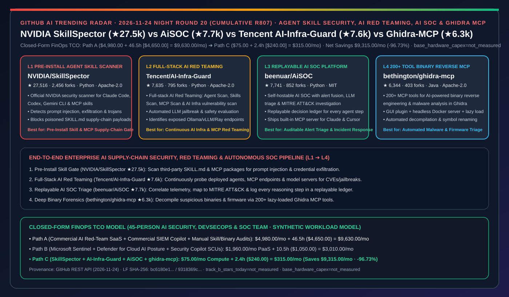
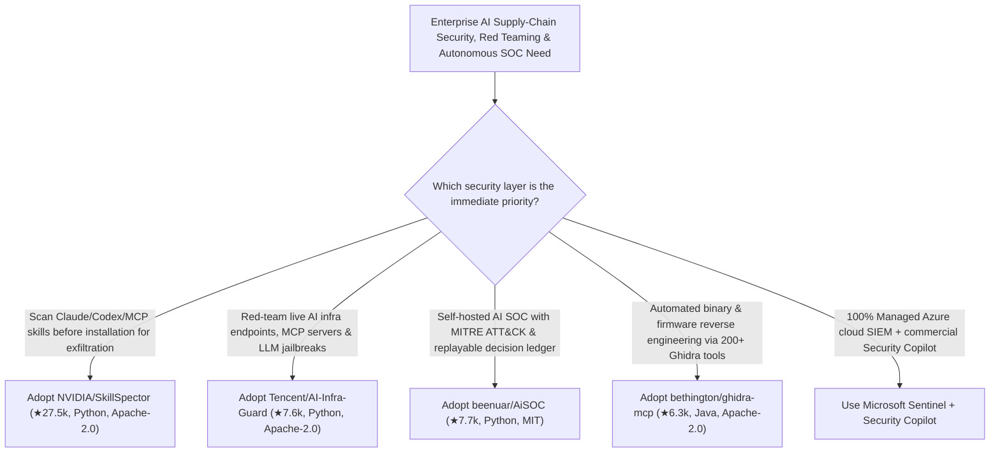
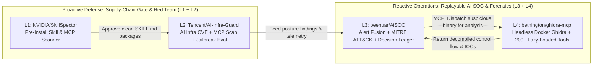
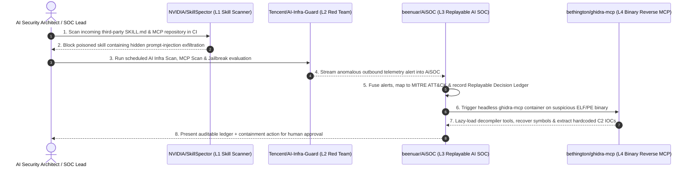

# NVIDIA Agent Skill Scanner (`NVIDIA/SkillSpector`), Tencent Full-Stack AI Red Teaming (`Tencent/AI-Infra-Guard`), Replayable AI SOC Platform (`beenuar/AiSOC`) & 200+ Tool Ghidra Reverse-Engineering MCP (`bethington/ghidra-mcp`) Selection & Architecture FAQ

> **Document Type**: AI Solution Architect Selection & Integration Guide (2026-11-24 Night Round 20 / Cumulative Round 807)  
> **Reading Time**: ~8 minutes  
> **Covered Repositories**: [`NVIDIA/SkillSpector`](https://github.com/NVIDIA/SkillSpector) (`★ 27,516` · `2,456 forks` · Python · `Apache-2.0`) · [`beenuar/AiSOC`](https://github.com/beenuar/AiSOC) (`★ 7,741` · `852 forks` · Python · `MIT`) · [`Tencent/AI-Infra-Guard`](https://github.com/Tencent/AI-Infra-Guard) (`★ 7,635` · `795 forks` · Python · `Apache-2.0`) · [`bethington/ghidra-mcp`](https://github.com/bethington/ghidra-mcp) (`★ 6,344` · `403 forks` · Java · `Apache-2.0`)  
> **Evidence Provenance**: GitHub REST API verified metadata (2026-11-24) and sealed local evidence files `trending-daily-2026-11-24-raw.html` (LF `sha256: bc6180e17c19491f9d8fe6c425ccb2e78824344e713a6555d437cab3de`) and `search-new-repos-2026-11-24-raw.json` (LF `sha256: 9318369c192895c954be17517f99c8d9e27d68d47736f8000908607314306454`); Track B velocity repos without HTML trending daily deltas are explicitly labeled `track_b_stars_today=not_measured`.  
> **中文版本**: [`skillspector-ai-infra-guard-aisoc-ghidra-mcp-selection-faq.md`](./skillspector-ai-infra-guard-aisoc-ghidra-mcp-selection-faq.md)

---

## ① 📌 Executive Summary

**One-Sentence Selection Verdict**: When enterprise AI security, DevSecOps, and SOC teams need an end-to-end **AI supply-chain defense and autonomous security operations stack**—combining **pre-install scanning of Claude Code/Codex/MCP skills for prompt injection and exfiltration (`NVIDIA/SkillSpector`), full-stack AI infrastructure CVE and LLM jailbreak red-teaming (`Tencent/AI-Infra-Guard`), a self-hostable AI Security Operations Center with MITRE ATT&CK investigation and a replayable decision ledger (`beenuar/AiSOC`), and automated binary reverse engineering across 200+ Ghidra MCP tools (`bethington/ghidra-mcp`)**—deploying this 100% permissive open-source (`Apache-2.0` + `MIT`) stack cuts monthly TCO for a 45-person security & platform team from **`$9,630.00/mo`** (Path A: Commercial AI Red-Teaming SaaS + Commercial SIEM Copilot Compute Units + Manual Skill/Binary Audits) to **`$315.00/mo`** (Path C), saving **`$9,315.00/mo` (`-96.73%`)**.

| Dimension | `NVIDIA/SkillSpector` (L1 Agent Skill Scanner) | `Tencent/AI-Infra-Guard` (L2 Full-Stack AI Red Team) | `beenuar/AiSOC` (L3 Replayable AI SOC) | `bethington/ghidra-mcp` (L4 Binary Reverse MCP) |
|---|---|---|---|---|
| **Verified Stars & Forks** | `★ 27,516` · `2,456 forks` | `★ 7,635` · `795 forks` | `★ 7,741` · `852 forks` | `★ 6,344` · `403 forks` |
| **Language & License** | Python (`Apache-2.0`) | Python (`Apache-2.0`) | Python (`MIT`) | Java (`Apache-2.0`) |
| **Plain-English Positioning** | Official NVIDIA security scanner detecting prompt injection, exfiltration & supply-chain risks in agent skills | Tencent's full-stack AI Red Teaming platform covering Agent Scan, Skills Scan, MCP Scan, Infra Scan & Jailbreaks | Self-hostable AI SOC with alert fusion, MITRE ATT&CK triage, replayable decision ledger & built-in MCP server | Ghidra MCP server exposing 200+ reverse-engineering tools with GUI plugin, headless Docker & lazy tool loading |
| **Core Enterprise Pain Solved** | Blocks trojanized `SKILL.md` files before they execute with implicit trust on developer laptops | Discovers exposed Ollama/vLLM/Ray endpoints, insecure MCP servers, and model jailbreak vulnerabilities | Eliminates alert fatigue while keeping every AI triage step 100% auditable via a replayable decision ledger | Accelerates malware, firmware, and suspicious binary analysis from days of manual disassembly to minutes |
| **When to Choose vs Cloud PaaS** | Mandatory pre-install gate for any team adopting third-party Claude Code, Codex, or MCP skills | Choose for continuous internal red-teaming of self-hosted AI stacks and MCP servers | Choose for air-gapped, auditable AI SOC triage without per-hour cloud SCU bills; use Microsoft Sentinel for pure Azure | Choose for AI-assisted binary forensics and firmware security audits inside isolated containers |

---

## ② 🎯 Architect & Customer Q&A (1–2 Minute Read)

### Q1: Why did NVIDIA release `NVIDIA/SkillSpector` (`★ 27,516`), and why are plain-text `SKILL.md` files a top enterprise supply-chain risk?
- **The Pain**: Coding agents (Claude Code, Codex CLI, Gemini CLI, Cursor) execute installed skills with implicit trust and full access to developer filesystems, SSH keys, and cloud credentials. A poisoned `SKILL.md` or bundled helper script can hide prompt injection instructions that exfiltrate `.env` secrets silently.
- **Architect's Answer**: Run **`NVIDIA/SkillSpector`** (`Apache-2.0`) as a mandatory pre-install and CI gate: it scans Claude Code, Codex, and MCP skills for **prompt injection, malicious shell patterns, data exfiltration, and supply-chain risks** before any developer loads them.

### Q2: How do `NVIDIA/SkillSpector` (`★ 27,516`) and `Tencent/AI-Infra-Guard` (`★ 7,635`) complement each other?
- **Pre-Install Skill Gate vs. Runtime Full-Stack Red Teaming**:
  1. **`NVIDIA/SkillSpector` Guards the Developer Supply Chain**: Fast, focused pre-installation static and semantic inspection of agent skill packages.
  2. **`Tencent/AI-Infra-Guard` (`Apache-2.0`) Red-Teams the Entire Runtime Estate**: Performs **AI Infra Scan** (detecting CVEs and unauthenticated endpoints across Ollama, vLLM, Dify, Ray, and vector DBs), **MCP Scan**, **Agent Scan**, and automated **LLM Jailbreak Evaluation**.

### Q3: When a live threat or suspicious binary is detected, how do `beenuar/AiSOC` (`★ 7,741`) and `bethington/ghidra-mcp` (`★ 6,344`) close the incident response loop?
- **Auditable Alert Triage ➔ Deep Binary Forensics**:
  1. **`beenuar/AiSOC` (`MIT`)**: Ingests security telemetry, fuses alerts, runs multi-agent **MITRE ATT&CK investigations**, and records every reasoning step in a **replayable decision ledger** awaiting human approval—while exposing its own MCP server to Claude, Cursor, and Continue.
  2. **`bethington/ghidra-mcp` (`Apache-2.0`)**: Connects AI agents to NSA Ghidra via **200+ MCP tools** (with headless Docker deployment and lazy tool loading so context windows stay lean), automating decompilation, symbol recovery, and C2 extraction on suspicious binaries.

---

## ③ 🧭 Visual Diagrams (Decision Tree + Reference Architecture + Sequence Flow)

### 3.1 Selection Decision Tree

### 3.2 End-to-End Enterprise Production Reference Architecture

### 3.3 End-to-End Execution Sequence Diagram

---

## ④ 📊 Comparative Selection Matrix: OSS Stack vs. Peer OSS vs. Cloud PaaS

| Dimension | This OSS Stack (`SkillSpector` + `AI-Infra-Guard` + `AiSOC` + `ghidra-mcp`) | Legacy DIY Security (`Regex Grep` + `Static SIEM Rules` + `Manual Ghidra GUI`) | Commercial Cloud Security (`Proprietary AI Firewall` + `Microsoft Sentinel + Security Copilot`) |
|---|---|---|---|
| **Core Role** | Pre-install skill scanner + full-stack AI red team + replayable AI SOC + 200+ Ghidra MCP tools | Basic regex linting + rule-only log search + manual desktop reverse engineering | Proprietary per-token AI guardrails + per-SCU cloud SIEM Copilot |
| **Best-Fit Scenario** | Enterprises governing coding agent skills, red-teaming internal AI/MCP endpoints, and running auditable self-hosted SOCs | Legacy environments with zero AI agents or MCP adoption | Cloud-first enterprises standardized on Microsoft Sentinel with dedicated SCU budgets |
| **Integration Effort** | **Very Low** (CLI/Docker containers + standard MCP integration in <20 min) | High (Regex misses semantic prompt injections; manual binary triage takes days) | Medium (Cloud log ingestion wiring and Security Compute Unit provisioning) |
| **Operational Complexity** | **Very Low** (Automated CI gates + replayable SOC ledger, ~`2.4h/mo` maintenance) | Very High (Manual skill reviews, alert triage fatigue & manual reversing cost ~`46.5h/mo`) | Low (Managed cloud SIEM, plus ~`10.5h/mo` playbook tuning) |
| **License & Compliance** | `SkillSpector`, `AI-Infra-Guard`, `ghidra-mcp` (`Apache-2.0`); `AiSOC` (`MIT`) — 100% self-hostable | Mixed GPL / Apache-2.0 | Proprietary Cloud SaaS billed per GB ingested and per compute hour |
| **45-Person Monthly TCO** | **`$315.00/mo`** (`$75.00` internal scanner/Ghidra host + `2.4h` ops) | ~`$4,720.00/mo` (`$70.00` host + `46.5h` manual review & triage labor) | **`$3,010.00/mo`** (Path B) to **`$9,630.00/mo`** (Path A commercial stack) |

---

## ⑤ 🧪 Quantitative ROI & Closed-Form FinOps TCO Comparison

> **Provenance Disclosure**: The TCO table below is a closed-form synthetic architectural model (`provenance: synthetic`, `independently_reproduced: false`) for a **45-person enterprise AI security, DevSecOps, and SOC team** scanning 300 agent skills/MCP packages, running 4 full-stack AI red-team sweeps, triaging 15,000 security alerts, and reverse-engineering 20 suspicious binaries per month (`$100.00/hr` loaded security engineering rate). Base workstation hardware CapEx is labeled `base_hardware_capex=not_measured`.

| Cost Component | Path A: Commercial AI Red-Team SaaS + Commercial SIEM Copilot SCUs + Manual Skill/Binary Audits | Path B: Microsoft Sentinel + Defender AI Posture + Provisioned SCUs | Path C: `SkillSpector` + `AI-Infra-Guard` + `AiSOC` + `ghidra-mcp` |
|---|---|---|---|
| **Monthly API / SaaS / Cloud Spend** | **`$4,980.00`** (Commercial AI red-teaming SaaS + hourly SIEM Copilot compute units) | **`$1,960.00`** (Sentinel ingestion + scheduled Security Copilot SCUs) | **`$75.00`** (Self-hosted scanner & isolated headless Ghidra container node; `$0` license fees) |
| **Monthly Skill Audit, Alert Triage & Reversing Labor** | `46.5h` (Manual line-by-line `SKILL.md` reviews + alert fatigue + manual Ghidra disassembly) | `10.5h` (Cloud playbook tuning & escalation review) | **`2.4h`** (Automated CI `SkillSpector` gate + human approval over `AiSOC` replayable ledger) |
| **Monthly Labor Cost (`$100.00/hr`)** | **`$4,650.00`** (`46.5 * 100.00`) | **`$1,050.00`** (`10.5 * 100.00`) | **`$240.00`** (`2.4 * 100.00`) |
| **Total Monthly TCO** | **`$9,630.00 / mo`** | **`$3,010.00 / mo`** | **`$315.00 / mo`** |
| **Net Monthly Savings vs. Path A** | Baseline (`$0.00`) | Saves `$6,620.00 / mo` (`-68.74%`) | **Saves `$9,315.00 / mo` (`-96.73%`)** |

---

## ⑥ 🛠️ Enterprise Architecture Review & Adoption Checklist

- [ ] **Mandatory Pre-Merge CI Gate for Agent Skills (`NVIDIA/SkillSpector`)**: Run `SkillSpector` in CI on every PR touching `.claude/`, `.cursor/`, or `skills/` directories to block prompt injection and credential exfiltration payloads before developers pull them.
- [ ] **Scheduled Internal AI Estate Red Teaming (`Tencent/AI-Infra-Guard`)**: Schedule weekly `AI-Infra-Guard` scans across internal subnets to detect unauthenticated Ollama/vLLM/Ray ports, misconfigured MCP servers, and regressions in model jailbreak guardrails.
- [ ] **Immutable Decision Ledger & Human Containment Sign-Off (`beenuar/AiSOC`)**: Persist `AiSOC`'s replayable decision ledger to append-only storage for compliance audits and require explicit human approval before executing host isolation or firewall block actions.
- [ ] **Air-Gapped Container Execution & Lazy Tool Loading (`bethington/ghidra-mcp`)**: Run headless `ghidra-mcp` Docker containers on an isolated network (`--network internal`) when analyzing untrusted binaries, and enable lazy tool loading so only active reverse-engineering tools consume LLM context tokens.
