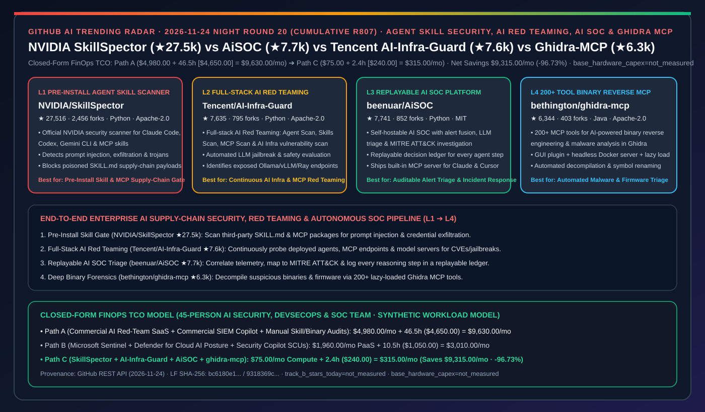
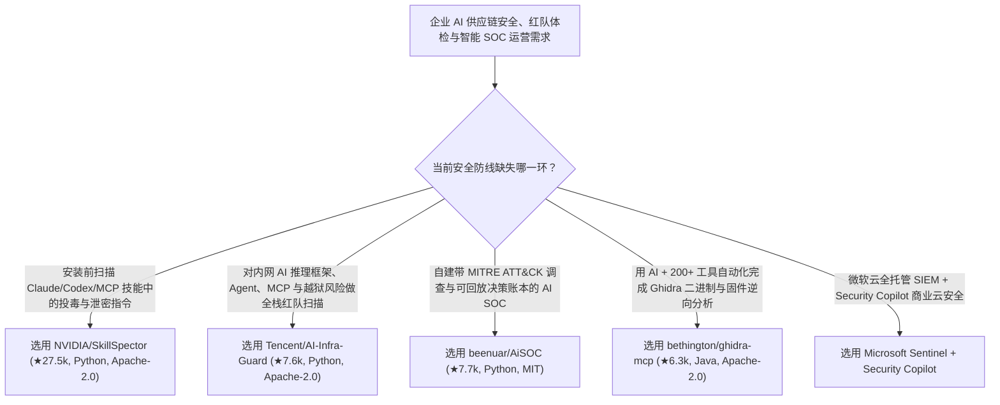
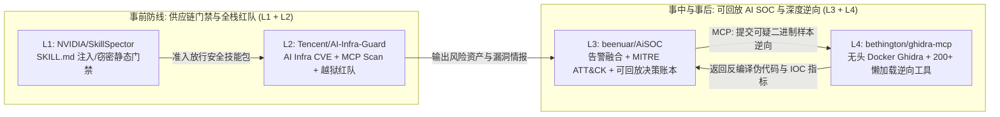
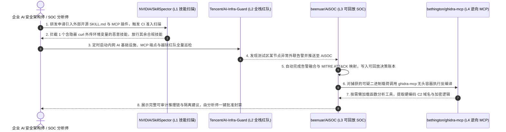

# NVIDIA 智能体技能安全扫描器（`NVIDIA/SkillSpector`）、腾讯全栈 AI 红队与基础设施卫士（`Tencent/AI-Infra-Guard`）、可回放决策账本开源 AI 安全运营中心（`beenuar/AiSOC`）与 200+ 工具 Ghidra 逆向工程 MCP（`bethington/ghidra-mcp`）选型与集成 FAQ

> **文档类型**：AI 解决方案架构师（AI Solution Architect）选型决策指南（2026-11-24 Night Round 20 / 累计第 807 轮）  
> **阅读耗时**：约 8 分钟  
> **覆盖项目**：[`NVIDIA/SkillSpector`](https://github.com/NVIDIA/SkillSpector)（`★ 27,516` · `2,456 forks` · Python · `Apache-2.0`） · [`beenuar/AiSOC`](https://github.com/beenuar/AiSOC)（`★ 7,741` · `852 forks` · Python · `MIT`） · [`Tencent/AI-Infra-Guard`](https://github.com/Tencent/AI-Infra-Guard)（`★ 7,635` · `795 forks` · Python · `Apache-2.0`） · [`bethington/ghidra-mcp`](https://github.com/bethington/ghidra-mcp)（`★ 6,344` · `403 forks` · Java · `Apache-2.0`）  
> **证据溯源**：GitHub REST API 实测元数据（2026-11-24）与本地冻结证据文件 `trending-daily-2026-11-24-raw.html`（LF `sha256: bc6180e17c19491f9d8fe6c425ccb2e78824344e713a6555d437cab3de`）、`search-new-repos-2026-11-24-raw.json`（LF `sha256: 9318369c192895c954be17517f99c8d9e27d68d47736f8000908607314306454`）；Track B 仓库无 HTML 榜单对应的单日增量，统一标记为 `track_b_stars_today=not_measured`。  
> **English Version**: [`skillspector-ai-infra-guard-aisoc-ghidra-mcp-selection-faq.en.md`](./skillspector-ai-infra-guard-aisoc-ghidra-mcp-selection-faq.en.md)

---

## ① 📌 核心结论速览（Executive Summary）

**选型一句话结论**：当企业安全与 AI 架构团队面临**“员工随意安装第三方 `SKILL.md` / MCP 导致密钥外泄与提示词注入 + 内网推理服务与 Agent 框架缺乏红队漏洞扫描 + 安全运营中心（SOC）每天上万条告警疲于应付 + 可疑二进制样本/固件逆向分析门槛极高”**四大安全痛点时，采用 **`NVIDIA/SkillSpector`（L1 安装前 Agent 技能供应链扫描）+ `Tencent/AI-Infra-Guard`（L2 全栈 AI 基础设施与 MCP/越狱红队平台）+ `beenuar/AiSOC`（L3 带可回放决策账本的开源 AI SOC）+ `bethington/ghidra-mcp`（L4 200+ 工具的 Ghidra 二进制逆向分析 MCP）** 组成的 100% 商业友好开源安全防线（`Apache-2.0` + `MIT`），可将 45 人安全与 DevSecOps 团队的月度 TCO 从商业 AI 安全 SaaS + 商业 SIEM Copilot 算力单元 + 人工逐行审计（Path A）的 **`$9,630.00/月`** 降至 **`$315.00/月`**（净省 **`$9,315.00/月`**，降幅 **`-96.73%`**）。

| 评估维度 | `NVIDIA/SkillSpector` (L1 技能供应链安检) | `Tencent/AI-Infra-Guard` (L2 全栈 AI 红队平台) | `beenuar/AiSOC` (L3 可回放 AI SOC) | `bethington/ghidra-mcp` (L4 二进制逆向 MCP) |
|---|---|---|---|---|
| **GitHub 实测热度** | `★ 27,516` · `2,456 forks` | `★ 7,635` · `795 forks` | `★ 7,741` · `852 forks` | `★ 6,344` · `403 forks` |
| **实现语言与开源协议** | Python (`Apache-2.0`) | Python (`Apache-2.0`) | Python (`MIT`) | Java (`Apache-2.0`) |
| **一句话通俗定位** | NVIDIA 官方开源的 Claude Code/Codex/MCP 技能安装前安全漏洞、注入与数据外泄扫描器 | 腾讯开源的覆盖 Agent 扫描、Skills 扫描、MCP 扫描、AI 基础设施漏洞与越狱评测的全栈红队平台 | 支持告警融合、MITRE ATT&CK 调查、每步可回放决策账本且自带 MCP 的自托管 AI 安全运营中心 | 为 NSA Ghidra 提供 200+ 逆向工程工具（支持懒加载、无头 Docker 与批量反编译）的 MCP 服务 |
| **解决的核心业务痛点** | 拦截伪装成普通开发技能的恶意 `SKILL.md`（如暗藏把 `.env` 和 SSH 私钥发往外部服务器的隐藏指令） | 一站式发现企业内网裸奔的 Ollama/vLLM/Ray 端口、高危 MCP Server 权限配置及大模型越狱漏洞 | 解决传统告警风暴下安全分析师疲劳漏报，以及黑盒 AI 分诊缺乏可审计推理证据链的合规难题 | 让安全分析师用自然语言驱动 Ghidra 自动完成恶意软件反编译、函数重命名与固件后门排查 |
| **何时选它 vs 云托管** | 任何引入外部 Agent Skills 的研发团队必选准入门禁 | 需要对自建大模型底座、Agent 与 MCP 生态做常态化红队体检时选它 | 需要自托管、零外部 API 强制绑定且推理全链路可回放的 AI SOC 时选它；纯微软云选 Microsoft Sentinel | 需要对可疑二进制、物联网固件或闭源组件做自动化安全逆向时选它 |

---

## ② 🎯 客户与架构师灵魂拷问 Q&A（1–2 分钟速读）

### Q1：为什么 NVIDIA 安全团队专门开源了 `NVIDIA/SkillSpector`（`★ 27,516`）？一个纯文本的 `SKILL.md` 怎么会造成严重的企业数据泄露？
- **痛点**：Claude Code、Codex CLI、Gemini CLI 等编码 Agent 在加载 `SKILL.md` 时赋予了其极高的隐式信任（Implicit Trust）。攻击者只需在开源技能文档或附带脚本里藏入一段白字提示词注入或隐蔽的 `curl` 命令，就能在开发者不知情时把 `~/.aws/credentials`、`.env` 密钥静默外传。
- **架构师解答**：在企业把任何开源技能（比如上一轮提到的 3,137+ 技能库）同步到内部仓库之前，先过一遍 **`NVIDIA/SkillSpector`**（`Apache-2.0`）：它能静态与语义双重扫描 `SKILL.md` 及关联 MCP 脚本中的**提示词注入（Prompt Injection）、凭证窃取（Data Exfiltration）、隐蔽远控与供应链投毒模式**，是企业 AI 工具链的第一道准入防火墙。

### Q2：`NVIDIA/SkillSpector` 和腾讯开源的 `Tencent/AI-Infra-Guard`（`★ 7,635`）有什么区别？企业需要同时部署吗？
- **事前准入 vs 事中全栈红队（Pre-Install Gate vs Full-Stack Runtime Red Teaming）**：
  1. **`NVIDIA/SkillSpector` 专注“安装前的开发者端技能文件深度静态体检”**：轻量、极速，适合嵌在 Git Pre-commit 或内部技能镜像源同步流水线里。
  2. **`Tencent/AI-Infra-Guard`（A.I.G）专注“运行态全栈 AI 基础设施与红队攻防”**：它不仅有 Skills Scan，还涵盖 **AI Infra Scan（扫描 vLLM、Ollama、Dify、FastGPT、Ray 等数十种 AI 组件的已知 CVE 与未授权访问）、MCP Server 动态安全扫描、Agent 越狱评估（Jailbreak Evaluation）**，适合企业安全团队每周对内网 AI 资产做全盘红队巡检。

### Q3：当发现真实安全告警或可疑木马样本时，`beenuar/AiSOC`（`★ 7,741`）与 `bethington/ghidra-mcp`（`★ 6,344`）如何组成自动化研判与逆向闭环？
- **L1 告警自动研判 ➔ L3 二进制深度取证**：
  1. **告警聚合与可回放分诊（`beenuar/AiSOC` · `MIT`）**：摄取企业安全遥测日志，利用多 Agent 自动完成告警关联与 **MITRE ATT&CK 战术映射**，最关键的是它把 Agent 的每一步推理和工具调用写入**可回放决策账本（Replayable Decision Ledger）**，最后交由安全工程师一键审批响应动作；同时它自带 MCP Server，可直接从 Claude 或 Cursor 查询安全事件。
  2. **可疑样本自动化逆向（`bethington/ghidra-mcp` · `Apache-2.0`）**：当告警定位到某个可疑二进制文件或第三方闭源动态库时，安全 Agent 通过 `ghidra-mcp` 暴露的 **200+ 个逆向工具（支持无头 Docker 部署与工具懒加载 Lazy Tool Loading）** 自动反编译控制流、分析导入表与加密常量，将原本耗时数天的手工逆向缩短至几分钟。

---

## ③ 🧭 直观可视化图解（Mermaid 决策树 + 集成架构 + 时序图）

### 3.1 技术选型决策树

### 3.2 企业端到端生产集成参考架构图

### 3.3 业务流全链路时序图

---

## ④ 📊 同类开源与商业云服务横向选型决策矩阵

| 对比维度 | 本轮开源组合 (`SkillSpector` + `AI-Infra-Guard` + `AiSOC` + `ghidra-mcp`) | 传统开源安全方案 (`通用正则 Grep` + `Wazuh/ELK` + `手工 Ghidra GUI`) | 商业云安全套件 (`商业 AI 防火墙 SaaS` + `Microsoft Sentinel + Security Copilot`) |
|---|---|---|---|
| **功能定位** | Agent 技能供应链扫描 + 全栈 AI 红队平台 + 可回放 AI SOC + 200+ 工具自动化逆向 MCP | 传统源码字符串匹配 + 传统规则 SIEM + 纯人工桌面反编译 | 闭源按 Token 计费 AI 安全网关 + 按 SCU（安全算力单元）计费的商业云 SOC |
| **适用场景** | 规模化使用 Claude Code/Codex/MCP 的研发组织、自建 AI 基础设施红队巡检、自托管可审计 SOC | 尚未使用任何 AI Agent/MCP 的传统 IT 环境 | 100% 运行在公有云且安全预算充裕的超大型跨国企业 |
| **集成成本** | **极低**（Python CLI / Docker 一键启动，标准 MCP 接口即插即用） | 高（传统规则无法识别自然语言提示词注入，手工逆向极慢） | 中（需配置云端日志汇聚管道并购买高额专有 SCU 配额） |
| **运维复杂度** | **极低**（自动化流水线门禁与自托管容器，月均维护仅 `2.4h`） | 极高（人工排查误报与逐个审阅外部技能耗费 `46.5h/月`） | 低（云端托管，月均规则调优约 `10.5h`） |
| **开源协议与合规** | `SkillSpector`、`AI-Infra-Guard`、`ghidra-mcp` 为 `Apache-2.0`；`AiSOC` 为 `MIT`（100% 商业友好，遥测日志不出内网） | GPL / Apache-2.0 混杂 | 商业闭源 SaaS（安全日志与样本需上传云端） |
| **45 人团队月度 TCO** | **`$315.00/月`**（含 `$75.00` 内网安全扫描与无头 Ghidra 节点 + `2.4h` 运维） | 约 `$4,720.00/月`（含 `$70.00` 主机 + `46.5h` 人工审计与逆向工时） | **`$3,010.00/月`**（Path B）至 **`$9,630.00/月`**（Path A 商业全栈） |

---

## ⑤ 🧪 应用落地定量收益 / TCO 对比（Closed-Form FinOps 模型）

> **数据性质声明（Provenance Metadata）**：以下 TCO 模型为面向 **45 人企业 AI 安全、DevSecOps 与 SOC 运营团队**（每月准入扫描 300 个外部 Agent Skills/MCP 包、执行 4 次全网 AI 基础设施红队演练、分诊 15,000 条安全告警并逆向分析 20 个可疑二进制样本，工程师折算时薪 `$100.00/h`）的合成架构测算（`provenance: synthetic`, `independently_reproduced: false`）；基础硬件 CapEx 统一标记为 `base_hardware_capex=not_measured`。

| 成本构成项 | Path A：商业 AI 红队 SaaS + 商业 SIEM Copilot 算力包 + 人工技能/样本逆向审计 | Path B：Microsoft Sentinel + Defender AI 态势管理 + 按量 SCU | Path C：`SkillSpector` + `AI-Infra-Guard` + `AiSOC` + `ghidra-mcp` |
|---|---|---|---|
| **API / SaaS / 云资源月费** | **`$4,980.00`**（商业 AI 安全扫描订阅 + 商业 SOC Copilot 按小时算力单元） | **`$1,960.00`**（Sentinel 日志摄取费 + 按需启停的 Security Copilot SCU） | **`$75.00`**（内网自建安全扫描容器与无头 Ghidra Docker 节点，`$0` 许可证费） |
| **月度人工审阅 `SKILL.md`、告警分诊与手工逆向工时** | `46.5h`（人工逐行审阅外部技能 + 手工关联告警 + 人工分析反汇编伪代码） | `10.5h`（云端剧本微调与高危样本复核） | **`2.4h`**（CI 自动拦截风险技能，分析师仅需在 `AiSOC` 账本中复核批准） |
| **人工安全运营成本（`$100.00/h`）** | **`$4,650.00`** (`46.5 * 100.00`) | **`$1,050.00`** (`10.5 * 100.00`) | **`$240.00`** (`2.4 * 100.00`) |
| **月度总拥有成本（Total Monthly TCO）** | **`$9,630.00 / 月`** | **`$3,010.00 / 月`** | **`$315.00 / 月`** |
| **相对 Path A 净节省** | 基准线 (`$0.00`) | 节省 `$6,620.00 / 月` (`-68.74%`) | **净省 `$9,315.00 / 月` (`-96.73%`)** |

---

## ⑥ 🛠️ 企业引入与架构评审 Checklist

- [ ] **CI/CD 强制技能准入门禁（`NVIDIA/SkillSpector`）**：在企业 Git 仓库的 GitHub Actions / GitLab CI 中配置 `SkillSpector` 阻断式检查，任何新增或修改 `.claude/`、`.cursor/`、`skills/` 目录的 PR 若检出高危提示词注入或数据外传风险立即拒绝合并。
- [ ] **内网 AI 资产与 MCP 端点周度红队巡检（`Tencent/AI-Infra-Guard`）**：利用 `AI-Infra-Guard` 建立每周定时任务，自动扫描研发网段中私自暴露的 Ollama（`11434`）、vLLM（`8000`）与未鉴权 SSE MCP 端口，并运行标准越狱测试集验证护栏有效性。
- [ ] **SOC 决策账本不可篡改归档与人工审批门（`beenuar/AiSOC`）**：启用 `AiSOC` 的 Replayable Decision Ledger，强制规定所有主机隔离、账号封禁等响应动作必须保留完整 Agent 推理快照并经值班安全工程师点击确认后执行。
- [ ] **无头 Ghidra 容器网络物理断网与懒加载（`bethington/ghidra-mcp`）**：在分析未知恶意二进制样本时，将 `ghidra-mcp` 的 Docker 容器运行在禁止访问公网与生产内网的隔离 VLAN 中（`--network internal`），并开启 `Lazy Tool Loading` 避免 200+ 个工具定义一次性占满上下文窗口。
