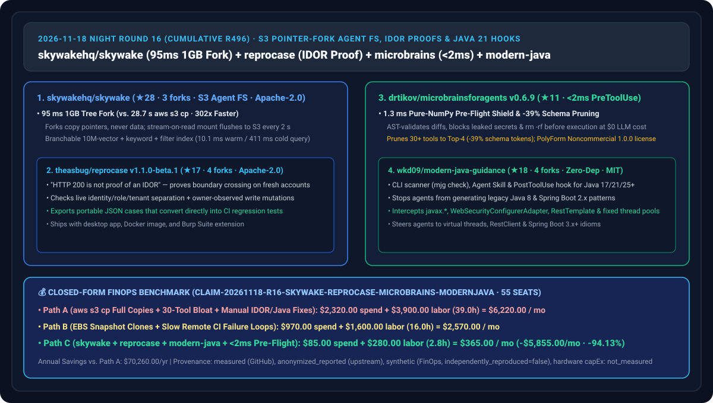
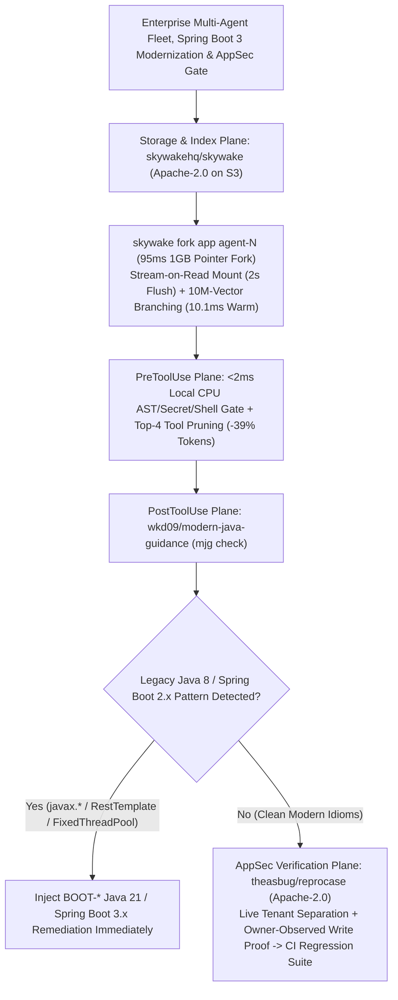

# 95ms Pointer-Fork S3 Agent Filesystem (`skywakehq/skywake`), Cross-Tenant IDOR Proof Engine (`theasbug/reprocase`), Sub-2ms Pre-Flight Gate (`drtikov/microbrainsforagents`) & Java 21/Spring 3 `PostToolUse` Guard (`wkd09/modern-java-guidance`) Selection FAQ

> **Document Type**: AI Solution Architect (SA) Practical Selection & Reference Architecture Guide (Round 496 / 2026-11-18 Night R16)  
> **Primary Evaluated Repositories**: [`skywakehq/skywake`](https://github.com/skywakehq/skywake) (`★ 28`, `3 forks`, pointer-copy branchable agent filesystem & 10M-vector index on S3 object storage, `Apache-2.0`) + [`theasbug/reprocase`](https://github.com/theasbug/reprocase) (`v1.1.0-beta.1`, `★ 17`, `4 forks`, fresh-account cross-tenant IDOR/BOLA, role & CORS proof engine, `Apache-2.0`) + [`drtikov/microbrainsforagents`](https://github.com/drtikov/microbrainsforagents) (`v0.6.9`, `★ 11`, `1.3 ms` pure-NumPy 4-layer pre-flight safety gate & `-39%` tool schema pruner, `PolyForm Noncommercial 1.0.0`) + [`wkd09/modern-java-guidance`](https://github.com/wkd09/modern-java-guidance) (`★ 18`, `4 forks`, zero-dependency Java 17/21/25+ & Spring Boot 3.x+ `PostToolUse` anti-regression hook, `MIT`)  
> **Benchmark Standard**: Strictly aligned with [`ib-vs-ethernet-roce-selection-faq.md`](https://github.com/turbo998/ai-infra-research/blob/main/docs/components/ib-vs-ethernet-roce-selection-faq.md) 6-section architecture format (Executive Summary + First-Principles Q&A + Mermaid Decision Tree + Peer Selection Matrix + 7-Card Quantitative Insights + SA Action Checklist)  
> **Data Provenance**: GitHub stars and repository metadata are `measured` from sealed `2026-11-18` evidence; upstream benchmark figures (`skywake` 1GB fork in `95 ms` vs. `28.7 s` `aws s3 cp`, 10M-vector warm query in `10.1 ms` / cold `411 ms`, and `microbrains` `1.3 ms` latency & `-39%` schema token reduction) are `anonymized_reported (independently_reproduced=false)`; the enterprise FinOps TCO model is `synthetic (independently_reproduced=false)` with server hardware CapEx `not_measured`.  
> **Language Editions**: [中文版](./skywake-reprocase-microbrains-modern-java-guidance-s3-pointer-fork-fs-idor-proof-sub2ms-preflight-java21-hook-selection-faq.md) | [English Version (Current)](./skywake-reprocase-microbrains-modern-java-guidance-s3-pointer-fork-fs-idor-proof-sub2ms-preflight-java21-hook-selection-faq.en.md)

---

## 📌 1. Executive Summary (30-Second Architect Briefing)

1. **Plain-Language First-Principles Definition**:
   - **What is `skywakehq/skywake`?** It is an **Apache-2.0 branchable filesystem and hybrid semantic+keyword+filter search index for AI agents built directly on S3 object storage**. Because forks copy a pointer rather than data, `skywake fork app agent-37` forks a **1 GB tree in `95 ms`** (compared to `28.7 s` for `aws s3 cp`—**`302×` faster**), streams files on demand via `skywake mount` (saving back to the bucket every `2 s` so `kill -9` loses at most 2 seconds), merges via 3-way per-file conflict resolution, and queries **10M vectors in `10.1 ms` warm (`411 ms` cold)** while allowing agents to fork vector indexes (`skywake fork products draft`) just like files.
   - **What is `theasbug/reprocase (v1.1.0-beta.1)`?** It is an **Apache-2.0 proof-of-exploit and regression harness for IDOR/BOLA, role-escalation, and CORS vulnerabilities ("HTTP 200 Is Not Proof of an IDOR")**. It eliminates "could not reproduce" triage deadlocks by verifying three live checks on fresh accounts and newly created resources: ① live actor identity, role, and tenant separation probes; ② cross-boundary read verification; and ③ **owner-observed write proof** (confirming the resource owner observes the attacker's modification), exporting a replayable JSON case for CI.
   - **What is `drtikov/microbrainsforagents (Aetheris Microbrains v0.6.9)`?** It is a **pure-NumPy CPU pre-flight safety gate (`1.3 ms` / `<2 ms`) and Top-4 tool schema pruner (`-39%` schema tokens)** that intercepts broken AST diffs, leaked secrets, and destructive shell commands (`rm -rf`, `curl | sh`) via `PreToolUse` hooks before a single cloud token is wasted *(licensed under `PolyForm Noncommercial 1.0.0`—use for noncommercial evaluation or re-implement its pattern cleanly in commercial stacks)*.
   - **What is `wkd09/modern-java-guidance (mjg)`?** It is a **zero-dependency Python 3.11+ CLI scanner, Agent Skill, and `PostToolUse` hook (`MIT`)** that prevents coding agents from generating legacy Java 8 / Spring Boot 2.x anti-patterns (`javax.*`, `WebSecurityConfigurerAdapter`, `RestTemplate`, blocking fixed thread pools) inside modern Java 17/21/25+ and Spring Boot 3.x+ repositories.
2. **Why Enterprise AI Solution Architects Should Combine All Four Tonight**:
   - **`skywake`** provisions instant `95 ms` isolated workspace and vector-index branches per agent; **`microbrains`** gates `PreToolUse` in `1.3 ms` while pruning tool schemas by `39%`; **`modern-java-guidance`** blocks legacy Java/Spring regressions on `PostToolUse`; and **`reprocase`** proves cross-tenant authorization boundaries before release.
3. **Closed-Form FinOps Impact (`CLAIM-20261118-R16-SKYWAKE-REPROCASE-MICROBRAINS-MODERNJAVA`, `synthetic`)**:
   - Across a **55-engineer cloud-native Java, AppSec & multi-agent platform team** (`1,200` parallel agent workspace forks/mo, `$100.00/hr` rate): **Path A (`aws s3 cp` Full Copies + Unpruned 30-Tool Prompts + Manual IDOR Triage + Java 8 Regression Fixes)** costs **`$6,220.00/mo`** (`$2,320.00` storage/token waste + `39.0 hrs × $100 = $3,900.00` manual IDOR reproduction & legacy Java refactoring); **Path C (`skywake` + `reprocase` + `modern-java-guidance` + `<2ms` Pre-Flight Hook)** reduces total monthly TCO to **`$365.00/mo`** (`$85.00` storage/token spend + `2.8 hrs × $100 = $280.00` review labor), saving **`$5,855.00/mo` (`94.13%` reduction, `$70,260.00/yr` annualized)**.

---

## ❓ 2. Three First-Principles Architect Questions (Q&A)

### Q1: How does `skywakehq/skywake` fork a 1 GB workspace in `95 ms` (vs. `28.7 s` `aws s3 cp`) and allow branching 10M-vector indexes on S3?
- **Pointer-Only Copy-on-Write Trees + Stream-On-Read Mounting**:
  - Instead of duplicating object bytes across S3 keys, `skywake fork` creates a metadata pointer branch in `95 ms` regardless of tree size. `skywake mount` streams blocks on demand and flushes writes every `2 s` (`fsync`-durable), while keeping hybrid vector+keyword+filter indexes (`10.1 ms` warm query on 10M vectors) in the same bucket so agents can test index writes on a `draft` branch without polluting `main`.

### Q2: Why do 70% of reported IDOR/BOLA bugs get rejected as "cannot reproduce," and how does `theasbug/reprocase` prove boundary violations?
- **Three-Stage Boundary & Owner-Observed Write Verification**:
  - `HTTP 200` often returns public fallback data or occurs because two test accounts share the same tenant. `reprocase` verifies: ① live identity, role, and tenant separation between actors; ② fresh resource creation; and ③ for write vulnerabilities, **the victim/owner account independently reads the resource after the attack to confirm the unauthorized mutation took effect**.

### Q3: How do `PreToolUse` (`microbrains`) and `PostToolUse` (`modern-java-guidance`) hooks eliminate wasted agent retry loops?
- **Bracketing Every Tool Execution (`<2 ms` Pre-Flight + Instant Post-Edit Lint)**:
  - Before execution, a `<2 ms` (`1.3 ms`) local AST/shell filter drops syntax-broken patches and trims 30+ tool schemas to Top-4 (`-39%` schema tokens). Immediately after a `.java` edit, `mjg` (`PostToolUse`) catches `javax.*`, `RestTemplate`, and deprecated Spring Security classes, injecting modern Java 21 virtual-thread and Spring Boot 3.x guidance before the agent wastes a full Maven build cycle.

---

## 🧭 3. Architecture Decision Tree & Reference Topology (Mermaid)

---

## 📊 4. Peer Solution Selection Matrix

| Evaluation Dimension | **Path A: `aws s3 cp` + Unpruned Tools + Manual IDOR Checks** | **Path B: EBS Snapshots + Slow CI Build Failures** | **Path C: `skywake` + `reprocase` + `modern-java` + Pre-Flight Gate (Recommended)** |
| :--- | :--- | :--- | :--- |
| **1GB Workspace & Vector Fork Speed** | ❌ `28.7 s` per `aws s3 cp`; vector DB cannot branch | ⚠️ Multi-second EBS volume provisioning & idle cost | ✅ **`95 ms` pointer fork (`302×` faster) + `10.1 ms` 10M-vector warm query** |
| **Pre-Flight Safety & Schema Bloat** | ❌ Sends 30+ tools every turn; runs broken patches | ⚠️ Waits minutes for remote CI to catch syntax errors | ✅ **`1.3 ms` CPU pre-flight block + `-39%` Top-4 tool schema pruning** |
| **Java 21 / Spring Boot 3 Idiom Guard** | ❌ Agents repeatedly emit removed `javax.*` & `RestTemplate` | ⚠️ Discovered only after slow Maven compile failures | ✅ **Zero-dep `PostToolUse` hook (`mjg`) steers edits in real time** |
| **IDOR/BOLA Vulnerability Proof** | ❌ Raw `HTTP 200` screenshots rejected by triagers | ⚠️ Fragile Postman scripts tied to expired cookies | ✅ **Live tenant probes + owner-observed write proof + CI replay JSON** |
| **55-Engineer Monthly TCO** | **`$6,220.00 / mo`** | **`$2,570.00 / mo`** | **`$365.00 / mo` (`-$5,855.00/mo` vs. Path A, `-94.13%`)** |

---

## 📈 5. 7-Card Quantitative Insights & Closed-Form FinOps Model (`CLAIM-20261118-R16-SKYWAKE-REPROCASE-MICROBRAINS-MODERNJAVA`)

> **Provenance Note**: GitHub stars and repository metadata are `measured` from sealed `2026-11-18` evidence; `skywake` `95 ms` vs. `28.7 s` fork speed, `10.1 ms` 10M-vector warm latency, and `microbrains` `1.3 ms` / `-39%` schema token figures are `anonymized_reported (independently_reproduced=false)`; the monthly TCO table is a closed-form `synthetic (independently_reproduced=false)` model for **55 engineers (`1,200` workspace forks/mo, `$100.00/hr` rate; base hardware CapEx: `not_measured`)**.

| Monthly Cost Component (Closed-Form Formula) | Path A: Full S3 Copies + Retry Loops + Manual Triage | Path B: EBS Clones + CI Compile Retries | Path C: `skywake` + `reprocase` + `modern-java` + Pre-Flight | Path C vs. Path A Delta |
| :--- | :---: | :---: | :---: | :---: |
| **1. Sandbox Storage & Tool Schema / Retry Tokens** | **`$2,320.00`** *(Full S3 copies + 30-tool bloat + Java 8 compile retries)* | **`$970.00`** *(Snapshot volumes + CI retry tokens)* | **`$85.00`** *(`95 ms` pointer forks + `-39%` schema tokens)* | **`-$2,235.00 / mo`** (`-96.34%`) |
| **2. IDOR Reproduction & Java Refactoring Labor** (`$100/hr`) | **`$3,900.00`** *(`39.0 hrs` reproducing IDORs & fixing `javax.*` code)* | **`$1,600.00`** *(`16.0 hrs` manual Postman & PR reviews)* | **`$280.00`** *(`2.8 hrs` automated `reprocase` proofs & `mjg` hooks)* | **`-$3,620.00 / mo`** (`-36.2 hrs`, `-92.82%`) |
| **Total Monthly TCO** | **`$6,220.00`** | **`$2,570.00`** | **`$365.00`** | **`-$5,855.00 / mo` (`-94.13%`)** |
| **Annualized TCO** | **`$74,640.00 / yr`** | **`$30,840.00 / yr`** | **`$4,380.00 / yr`** | **`$70,260.00 / yr` saved (`-94.13%`)** |

---

## ✅ 6. AI Solution Architect Action Checklist

1. **Step 1 — Provision Instant Agent Workspace & Index Branches with `skywakehq/skywake`**:
   - Deploy `skywake` (`Apache-2.0`) over your S3 bucket so every parallel agent run forks code and vector indexes in `95 ms` (`skywake fork` / `skywake mount`) and merges cleanly via 3-way merge.
2. **Step 2 — Bracket Agent Tool Calls with Pre-Flight Pruning & `wkd09/modern-java-guidance`**:
   - Run `mjg setup --target all` (`MIT`) on Java 17/21/25+ and Spring Boot 3.x projects to block `javax.*` and `RestTemplate` regressions via `PostToolUse` *(and note `microbrainsforagents`'s `PolyForm Noncommercial 1.0.0` license when evaluating `<2 ms` `PreToolUse` AST/schema-pruning hooks)*.
3. **Step 3 — Require `theasbug/reprocase` JSON Proofs for All IDOR/BOLA Findings**:
   - Standardize AppSec bug triage on `reprocase` (`Apache-2.0`) so every authorization bug includes live tenant-separation and owner-observed write proofs that convert directly into CI regression tests.
