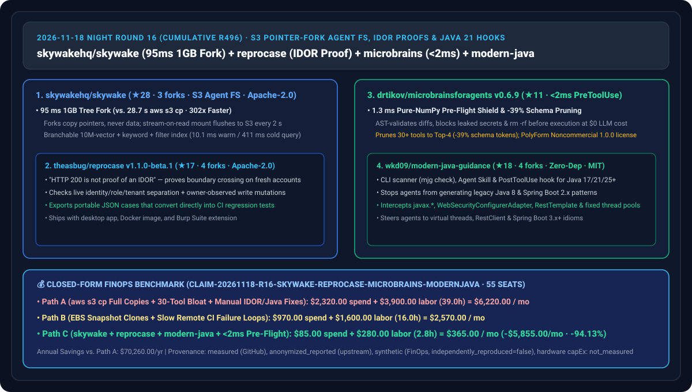
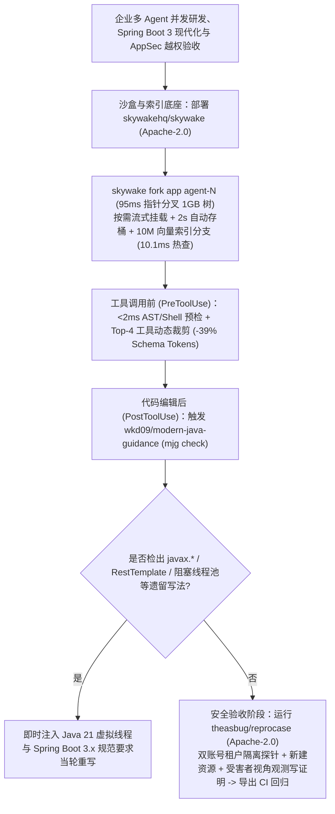

# 对象存储 95ms 指针分叉文件系统与千万向量索引（`skywakehq/skywake`）、跨租户越权写实证引擎（`theasbug/reprocase`）、1.3ms 纯 NumPy 预检门禁（`drtikov/microbrainsforagents`）与 Java 21/Spring Boot 3 防退化钩子（`wkd09/modern-java-guidance`）选型 FAQ

> **文档类型**：AI Solution Architect (SA) 实战选型与参考架构指南（Round 496 / 2026-11-18 Night R16）  
> **核心评估对象**：[`skywakehq/skywake`](https://github.com/skywakehq/skywake)（`★ 28`，`3 forks`，S3 对象存储上 `95 ms` 分叉 1GB 目录与 `10.1 ms` 查询千万向量的 Agent 文件系统，`Apache-2.0`） + [`theasbug/reprocase`](https://github.com/theasbug/reprocase)（`v1.1.0-beta.1`，`★ 17`，`4 forks`，双账号跨租户与受害者观测写证明 IDOR/BOLA 复现引擎，`Apache-2.0`） + [`drtikov/microbrainsforagents`](https://github.com/drtikov/microbrainsforagents)（`v0.6.9`，`★ 11`，`1.3 ms` 纯 NumPy 四层预检与省 `39%` 工具 Schema 的协处理器，`PolyForm Noncommercial 1.0.0`） + [`wkd09/modern-java-guidance`](https://github.com/wkd09/modern-java-guidance)（`★ 18`，`4 forks`，拦截 `javax.*` 与 `RestTemplate` 遗留代码的 Java 17/21/25+ `PostToolUse` 门禁，`MIT`）  
> **对标范式**：严格遵循 [`ib-vs-ethernet-roce-selection-faq.md`](https://github.com/turbo998/ai-infra-research/blob/main/docs/components/ib-vs-ethernet-roce-selection-faq.md) 六段式结构（核心结论速览 + 三大灵魂拷问 + Mermaid 决策树 + 选型对比矩阵 + 7-Card 定量洞察 + SA 落地 Checklist）  
> **数据溯源分级（Provenance）**：GitHub 星标与目录元数据为 `measured`；上游基准实测（如 `skywake` 分叉 1GB 树 `95 ms` 对比 `aws s3 cp` `28.7 s`、1,000 万向量热查询 `10.1 ms` / 冷查询 `411 ms`，以及 `microbrains` `1.3 ms` 拦截延迟与 `-39%` Schema Token）标注为 `anonymized_reported (independently_reproduced=false)`；企业 FinOps 成本算例为 `synthetic (independently_reproduced=false)`，硬件折旧 `not_measured`。  
> **语言版本**：[中文版 (当前)](./skywake-reprocase-microbrains-modern-java-guidance-s3-pointer-fork-fs-idor-proof-sub2ms-preflight-java21-hook-selection-faq.md) | [English Version](./skywake-reprocase-microbrains-modern-java-guidance-s3-pointer-fork-fs-idor-proof-sub2ms-preflight-java21-hook-selection-faq.en.md)

---

## 📌 一、核心结论速览（Executive Summary — 30 秒看懂）

1. **大白话本质定义**：
   - **`skywakehq/skywake` 是什么？** 它是 **架在 S3 对象存储之上的“可像 Git 一样毫秒级分叉（Fork）与三路合并（3-Way Merge）的 Agent 文件系统 + 千万级混合检索索引”**。它分叉环境时**只复制指针、绝不复制数据**：在 AWS 同区域实测中，分叉一棵 **1 GB 代码/数据树仅需 `95 ms`**（而 `aws s3 cp` 全量拷贝要 `28.7 s`，**提速 `302×`**）；执行 `skywake mount app@agent-37 /work` 无需预先下载即可按需流式读取，后台每 2 秒自动落盘 S3（遭遇 `kill -9` 最多丢 2 秒），且同一个存储桶内的 **1,000 万向量索引热查询仅需 `10.1 ms`（冷查询 `411 ms`）**，连向量索引也能 `skywake fork products draft` 先在草稿分支试写！
   - **`theasbug/reprocase (v1.1.0-beta.1)` 是什么？** 它是 **终结安全漏洞提单后被研发以“无法复现（Cookie 过期 / 两个测试号其实在同一个租户 / HTTP 200 只是返回了空壳公开页）”打回的 IDOR/BOLA、角色越权与 CORS 实证复现引擎（含 Burp 插件）**。它要求用两个真实独立账号现场新建资源，依次验证 **① 角色与租户物理隔离探针 ➔ ② 跨边界读取证明 ➔ ③ 拥有者视角观测写证明（攻击者改完后，由受害者账号亲眼查询确认自身资源已被篡改）**，并导出为任何人可一键重跑的 JSON Case。
   - **`drtikov/microbrainsforagents (v0.6.9)` 是什么？** 它是跑在本地 CPU 纯 NumPy 上、耗时仅 **`1.3 ms`（`<2 ms`）的 `PreToolUse` 工具预检与 Top-4 工具动态裁剪协处理器**，在零大模型成本下拦截语法错误补丁、明文密钥与 `rm -rf`，并将 30+ 个工具定义动态精简至当前步最相关的 Top-4（**节省高达 `39%` 的工具 Schema Token**；注：采用 `PolyForm Noncommercial 1.0.0` 协议，仅限非商业研究/内测借鉴）。
   - **`wkd09/modern-java-guidance (mjg)` 是什么？** 它是零第三方依赖的 **Java 17/21/25+ 与 Spring Boot 3.x+ `PostToolUse` 防退化钩子与离线扫描器（`MIT`）**，实时阻止大模型在现代 Java 工程里写出早已废弃的 `javax.*`、`WebSecurityConfigurerAdapter`、`RestTemplate` 或阻塞式固定线程池。
2. **为什么企业 AI 解决方案架构师（SA）今晚要把这四款工具组合进“高并发 Agent 沙盒与代码质量防线”？**
   - **`skywake` 管沙盒底座（`95 ms` 指针分叉文件与向量索引） ➔ `microbrains` 管工具执行前（`1.3 ms` AST/Shell 预检与 Schema 瘦身） ➔ `modern-java-guidance` 管编辑落盘后（拦截 Java 8 / Spring Boot 2 时代陈旧 API） ➔ `reprocase` 管上线前越权复现（受害者视角写证明）**！
3. **闭式 FinOps 量化收益（`CLAIM-20261118-R16-SKYWAKE-REPROCASE-MICROBRAINS-MODERNJAVA`，`synthetic`）**：
   - 以 **55 人企业云原生 Java、应用安全（AppSec）与多智能体平台团队**（月均拉起 1,200 个并行 Agent 沙盒分支 + 越权漏洞复现 + Spring Boot 3.x 迭代，时薪 `$100.00/hr`）计：**Path A（`aws s3 cp` 全量复制沙盒 + 坏补丁重跑 + 手工拼凑 IDOR 截图 + 人工改 `javax.*` 退化代码）** 月均总成本 **`$6,220.00`**（存储拷贝与重试 Token `$2,320.00` + 复现扯皮与重构旧 Java API 人工 `39.0h × $100 = $3,900.00`）；**Path C（`skywake` + `reprocase` + `modern-java-guidance` + 自研 MIT 版预检钩子）** 月均总成本降至 **`$365.00`**（指针分叉存储与精简 Token `$85.00` + 审查人工 `2.8h × $100 = $280.00`），**净省 `$5,855.00/月`（降幅 `94.13%`，年化节省 `$70,260.00`）**。

---

## ❓ 二、三大灵魂拷问（First-Principles Q&A）

### Q1：为什么并发跑 50 个 Agent 时，传统的 Docker Volume 或 `aws s3 cp` 会把磁盘和网络打满？`skywakehq/skywake` 是怎么做到 1GB 目录 `95 ms` 分叉且连向量索引也能分叉的？
- **第一性原理：对象存储上的写时复制（Copy-on-Write）指针树 + 按需流式挂载**：
  1. **只拷指针不拷字节（`95 ms` vs `28.7 s`）**：`skywake fork app agent-37` 仅在元数据层创建一个指向基线块的分支指针，无论目录是 100 MB 还是 100 GB 都是毫秒级完成；`skywake mount app@agent-37 /work` 通过 Linux 挂载点按需拉取实际读取到的文件块，改动每 2 秒增量刷回对象存储，完工后一行 `skywake merge app@agent-37` 执行三路合并。
  2. **向量与关键词索引同构分支化（`10.1 ms` 千万向量热查）**：传统架构里代码能开 Git 分支，但向量库只有一份全局主表，Agent 测试写入脏数据就会污染全局检索。`skywake` 把向量+关键词+Filter 索引同样存在对象存储桶里，支持 `skywake fork products draft` 零成本分叉索引，1,000 万向量热查询仅 **`10.1 ms`**。

### Q2：为什么渗透测试和 AI 安全扫描器报出的 IDOR（越权访问）有 70% 被研发当成误报？`theasbug/reprocase` 的“三步实证法”高明在哪？
- **“返回 HTTP 200” $\neq$ “真正越过了权限边界”**：
  - 很多接口对任何请求都返回 `HTTP 200`（内容其实是脱敏公开字段或当前用户自己的兜底数据），或者测试用的两个账号根本同属一个企业租户。`reprocase` 强制执行三道铁证：① 先跑实时身份/角色/租户探针证明 Actor A 与 Actor B 确实分属不同边界；② 现场新建资源验证跨边界读取差异；③ 对于写越权，**必须由资源拥有者（Actor A）再次发起读取，亲眼观测到 Actor B 写入的变更已生效**，并可将整套证明直接转为 CI 回归测试！

### Q3：为什么大模型写 Java 21 + Spring Boot 3.x 代码时总是习惯性写出 `javax.persistence.*` 和 `RestTemplate`？`modern-java-guidance` 与 `microbrains` 如何一前一后夹击？
- **训练语料历史惯性必须靠工具链 Hook 物理纠偏**：
  1. **事前 `PreToolUse`（`microbrains` 架构范式，`<2 ms`）**：在工具执行前用 1.3ms 本地 AST 与命令解析拦截语法破损补丁与高危 Shell，并将每轮 30+ 工具裁剪至 Top-4（省 `39%` Schema Token；**合规提示**：因 `microbrainsforagents` 采用 `PolyForm Noncommercial 1.0.0` 非商业协议，商业企业生产环境应仅参考其纯 NumPy PreToolUse 裁剪架构并用 MIT 代码自研实现）。
  2. **事后 `PostToolUse`（`wkd09/modern-java-guidance`，`MIT` 商用友好）**：当 Agent 编辑 `.java` 或 `pom.xml`/`build.gradle` 后，`mjg` 钩子立即扫描是否混入了 `javax.*`、`WebSecurityConfigurerAdapter`、`RestTemplate` 或传统阻塞线程池，当场注入 `BOOT-002` 等现代 Java 21 虚拟线程（Virtual Threads）与 `RestClient` 修正指南逼迫 Agent 当轮改对。

---

## 🧭 三、架构师选型决策树与端到端参考架构（Mermaid）

---

## 📊 四、同类方案横向选型对比矩阵（Peer Selection Matrix）

| 评估维度 | **Path A：`s3 cp` 全量拷贝 + 30 工具全塞 + 手工测越权** | **Path B：EBS 快照克隆 + 事后 CI 编译报错** | **Path C：`skywake` + `reprocase` + `modern-java` + 预检钩子（推荐）** |
| :--- | :--- | :--- | :--- |
| **1GB 工作区与千万向量分叉速度** | ❌ `aws s3 cp` 耗时 `28.7 s`，向量库无法按分支隔离 | ⚠️ EBS 快照挂载需数秒至数十秒，且按卷计费 | ✅ **`95 ms` 指针分叉（快 `302×`）+ 按需流式挂载 + `10.1 ms` 千万向量热查** |
| **工具 Schema 膨胀与坏补丁拦截** | ❌ 每轮全塞 30+ 工具，语法错误补丁跑完测试才发现 | ⚠️ 靠云端 CI 排队几分钟才报语法错 | ✅ **`1.3 ms` 本地 CPU 拦截坏补丁 + Top-4 工具裁剪省 `39%` Schema Token** |
| **Java 21 / Spring Boot 3 防退化** | ❌ 频繁写出已删除的 `javax.*` 与 `RestTemplate` | ⚠️ 等到 Maven 编译失败才多轮重试 | ✅ **`PostToolUse` 毫秒级拦截并精准喂入 `BOOT-*` 现代替代写法** |
| **IDOR/BOLA 越权漏洞复现可信度** | ❌ 仅凭 `HTTP 200` 截图，常因 Cookie 过期或同租户被拒 | ⚠️ 手写 Postman 脚本难以跨环境复用 | ✅ **双账号租户探针 + 受害者观测写证明 + 一键转 CI 回归 JSON** |
| **55 人团队月均总拥有成本 (TCO)** | **`$6,220.00 / 月`** | **`$2,570.00 / 月`** | **`$365.00 / 月`（较 Path A 净省 `$5,855.00/月`，`-94.13%`）** |

---

## 📈 五、7-Card 定量洞察与闭式 FinOps 算例（`CLAIM-20261118-R16-SKYWAKE-REPROCASE-MICROBRAINS-MODERNJAVA`）

> **Provenance 声明**：GitHub 星标与目录元数据源自 `2026-11-18` 封存证据（`measured`）；`skywake` `95 ms` vs `28.7 s` 分叉、`10.1 ms` 千万向量查询与 `microbrains` `1.3 ms` / `-39%` Schema Token 源自上游基准（`anonymized_reported`, `independently_reproduced=false`）；月度 TCO 为面向 **55 人研发与安全团队（月均 1,200 次沙盒分叉）** 的闭式合成模型（`synthetic`, `independently_reproduced=false`；底层硬件折旧 CapEx：`not_measured`）。

| 成本构成项（月度闭式公式） | Path A：全量拷贝 + 坏补丁重跑 + 越权扯皮 | Path B：云盘快照 + 事后 CI 报错重跑 | Path C：`skywake` + `reprocase` + `modern-java` + 预检 | Path C 对比 Path A 净变化 |
| :--- | :---: | :---: | :---: | :---: |
| **1. 沙盒存储传输与工具 Schema / 重试 Token** | **`$2,320.00`** *(全量 S3 拷贝 + 30 工具膨胀 + Java 8 编译失败重试)* | **`$970.00`** *(快照存储费 + CI 失败重跑 Token)* | **`$85.00`** *(`95 ms` 指针分叉零冗余拷贝 + `-39%` Schema Token)* | **`-$2,235.00 / 月`** (`-96.34%`) |
| **2. 越权漏洞复现扯皮与重构旧 Java API 人工** (`$100/hr`) | **`$3,900.00`** *(`39.0 hrs`：重搭复现环境与清理 `javax.*`/`RestTemplate`)* | **`$1,600.00`** *(`16.0 hrs`：手工维护 Postman 与 Code Review)* | **`$280.00`** *(`2.8 hrs`：一键重跑 `reprocase` JSON 与自动钩子纠偏)* | **`-$3,620.00 / 月`** (`-36.2 hrs`, `-92.82%`) |
| **月度总拥有成本 (Monthly Total TCO)** | **`$6,220.00`** | **`$2,570.00`** | **`$365.00`** | **`-$5,855.00 / 月` (`-94.13%`)** |
| **年化总拥有成本 (Annualized TCO)** | **`$74,640.00 / 年`** | **`$30,840.00 / 年`** | **`$4,380.00 / 年`** | **年省 `$70,260.00` (`-94.13%`)** |

---

## ✅ 六、AI 解决方案架构师（SA）实战落地 Checklist

1. **Step 1 — 部署 `skywakehq/skywake` 作为多 Agent 并发沙盒与分支化向量库底座**：
   - 运行 `scripts/start.sh` 启动 `:3100` 控制台，使用 `skywake fork` 与 `skywake mount` 为每个并发 Agent 分配毫秒级独立文件与向量索引分支，完工后三路合并回主分支。
2. **Step 2 — 在 Java 工程启用 `wkd09/modern-java-guidance` 并配置 `<2ms` `PreToolUse` 钩子**：
   - 执行 `mjg setup --target all --dir /path/to/spring-boot-project` 拦截 Java 8 / Spring Boot 2 遗留模式（商业环境请基于 MIT 协议实现 `<2ms` AST/Shell 预检与工具裁剪钩子，注意 `microbrainsforagents` 为 `PolyForm Noncommercial` 协议）。
3. **Step 3 — 用 `theasbug/reprocase` 标准化企业 AppSec 越权漏洞提单与 CI 回归**：
   - 要求所有 IDOR/BOLA 与角色越权报告必须附带通过三步校验（含受害者视角写证明）的 `reprocase` JSON 文件，修复后直接将该 JSON 挂入 CI 永久防回归。
