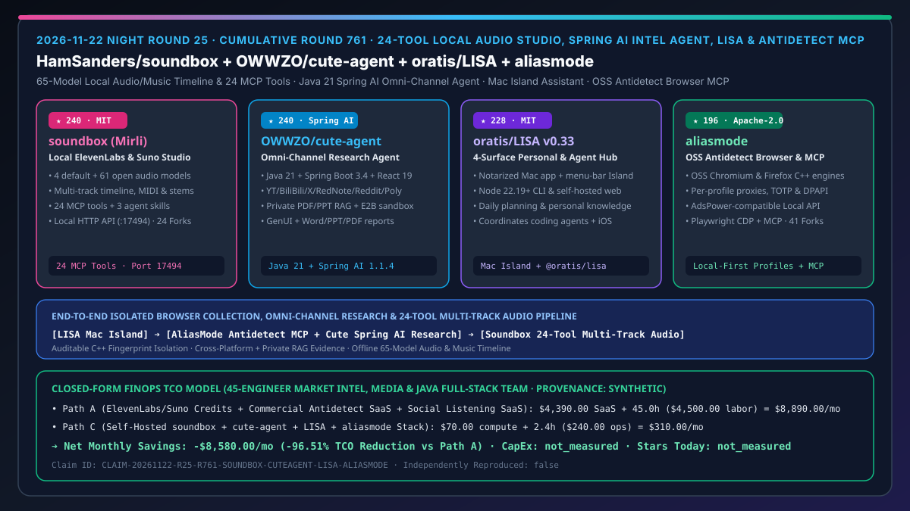
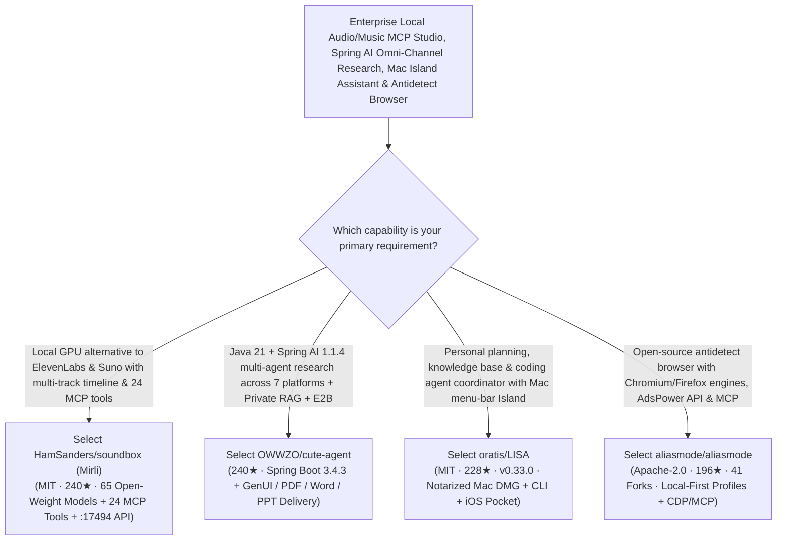
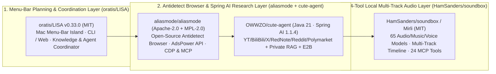
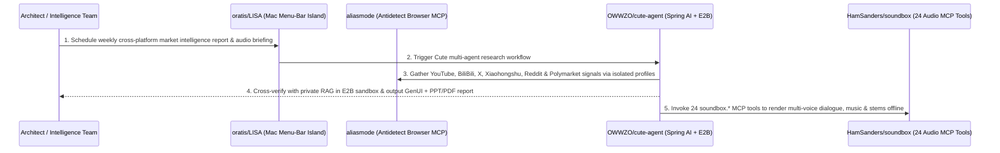

# 24-Tool Local Multi-Track Audio & Voice Studio MCP (`HamSanders/soundbox`), Spring AI Omni-Channel Intelligence Agent (`OWWZO/cute-agent`), 4-Surface Mac Menu-Bar Island Assistant (`oratis/LISA`) & Open-Source Antidetect Browser MCP (`aliasmode/aliasmode`) Selection & Architecture FAQ

> **Document Type**: Enterprise AI Solution Architect Selection & Integration Guide (GitHub Trending AI Radar — 2026-11-22 Night Round 25 / Cumulative Round 761)
> **Covered Repositories**: [`HamSanders/soundbox`](https://github.com/HamSanders/soundbox) (`★ 240`, `24 forks`, `MIT`, **Mirli / Soundbox**: free, open-source local alternative to ElevenLabs and Suno with a multi-track timeline, 65 open-weight audio/music/voice models, port `17494` HTTP API, and a **24-tool MCP server**) · [`OWWZO/cute-agent`](https://github.com/OWWZO/cute-agent) (`★ 240`, `16 forks`: Java 21 + Spring Boot 3.4.3 + Spring AI 1.1.4 + React 19 multi-agent intelligence platform across YouTube, BiliBili, X, Xiaohongshu, Reddit, Hacker News, and Polymarket with private multimodal RAG, E2B code sandbox, and GenUI/PDF/Word/PPT delivery) · [`oratis/LISA`](https://github.com/oratis/LISA) (`★ 228`, `MIT`, `v0.33.0`: AI personal assistant for planning, writing, personal knowledge, and coding agent coordination across Mac menu-bar Island, CLI/self-hosted web, LISA Cloud, and iOS Lisa Pocket) · [`aliasmode/aliasmode`](https://github.com/aliasmode/aliasmode) (`★ 196`, `41 forks`, `Apache-2.0` app + `MPL-2.0` engines: open-source antidetect browser and local-first profile manager with custom Chromium/Firefox C++ fingerprint engines, AdsPower-compatible Local API, Playwright-over-CDP, and built-in MCP server)
> **Core Scenario**: When enterprise market intelligence, multimodal media production, and Java platform teams struggle with **expensive credit limits on ElevenLabs and Suno without MCP multi-track timeline control, siloed search engines that cannot cross-verify YouTube/Reddit/X/Xiaohongshu/BiliBili/Polymarket against private PDFs, closed-source commercial antidetect browsers charging per profile, and fragmented desktop/mobile personal planning**, how do you combine **`soundbox` + `cute-agent` + `LISA` + `aliasmode`** into a self-hosted intelligence and media production architecture?

---

## 1. 📌 Executive Summary (One-Line Selection Verdict)

1. **Need an `MIT`-licensed local alternative to ElevenLabs and Suno that runs 65 open-weight sound-effect, music, lyric-song, speech, and voice-cloning models on your own GPU—complete with a multi-track timeline, stem splitting, port `17494` HTTP API, and a **24-tool MCP server** (`soundbox.*`) for Claude Code and Cursor?** ➔ Choose **[`HamSanders/soundbox`](https://github.com/HamSanders/soundbox) (`★ 240`, `24 forks`, `MIT`, Mirli)**.
   - **Plain-English Mechanism**: Ships with 4 end-to-end verified models on by default (Stable Audio 3.0 Small Music, MiniMax Music 3, ACE-Step 1.5 Turbo, etc.) and 61 optional models, letting agents cast voices onto script lines and mix multi-track audio offline with zero credit fees.
2. **Standardized on Java 21 & Spring Boot 3.4.3 (`Spring AI 1.1.4`) and need a multi-agent research workbench that ingests YouTube, BiliBili, X, Xiaohongshu, Reddit, Hacker News, and Polymarket alongside private PDF/Word/PPT RAG and E2B code execution to deliver GenUI canvases and Word/PPT/PDF reports?** ➔ Choose **[`OWWZO/cute-agent`](https://github.com/OWWZO/cute-agent) (`★ 240`, `16 forks`, Java 21 + Spring AI 1.1.4)**.
   - **Plain-English Mechanism**: Uses a clean DDD multi-module architecture (`Cute-agent-domain`, `Cute-BrowserStack`, `cute-tool`) to cross-score public social/market signals against internal enterprise documents.
3. **Need a fully open-source antidetect browser (`Apache-2.0` desktop app + `MPL-2.0` `aliasmode-firefox` & `aliasmode-chromium` C++ fingerprint engines) with per-profile proxies, DPAPI/TOTP autofill, an AdsPower-compatible Local API, Playwright-over-CDP, and a built-in MCP server?** ➔ Choose **[`aliasmode/aliasmode`](https://github.com/aliasmode/aliasmode) (`★ 196`, `41 forks`, `Apache-2.0`)**.
   - **Plain-English Mechanism**: Keeps all browser profiles 100% local in Local mode (no account or cloud traffic required) while letting AI agents drive isolated multi-account sessions via MCP or CDP.
4. **Need an `MIT`-licensed personal AI assistant (`v0.33.0`) for daily planning, writing, personal knowledge, and coding agent coordination across a signed macOS app (with a menu-bar Island), Node 22.19+ CLI/web, and iOS (`Lisa Pocket`)?** ➔ Choose **[`oratis/LISA`](https://github.com/oratis/LISA) (`★ 228`, `MIT`)**.
   - **Plain-English Mechanism**: Provides a notarized `Lisa-Suite.dmg` macOS bundle and `@oratis/lisa` npm package that unifies personal knowledge and agent task management.

---

## 2. 🎯 Architect & Customer Deep-Dive Q&A

### Q1: How do `aliasmode`, `cute-agent`, `soundbox`, and `LISA` work together as an end-to-end enterprise intelligence and multimodal media factory?

- **Four Synergistic Layers**:
  1. **Isolated Multi-Profile Browser Execution ➔ `aliasmode/aliasmode`**: Provides C++-spoofed Chromium/Firefox profiles with per-profile proxies and MCP/CDP hooks so research agents can access platform-specific feeds without session cross-contamination.
  2. **Omni-Channel Research + Private Document Evidence Chains ➔ `OWWZO/cute-agent`**: Synthesizes YouTube, BiliBili, X, Xiaohongshu, Reddit, Hacker News, and Polymarket data with internal PDFs/PPTs and E2B sandbox analytics in a Java 21 Spring AI stack.
  3. **24-Tool Local Multi-Track Audio & Voice Production ➔ `HamSanders/soundbox`**: Turns generated scripts and reports into multi-voice podcasts, soundtracks, and sound-designed demos on a local GPU.
  4. **Cross-Device Planning & Agent Coordination ➔ `oratis/LISA`**: Coordinates daily research schedules and coding agents from the macOS menu-bar Island or iOS.
- **When to Choose Commercial Cloud SaaS (Path B)?**
  - Teams without local GPUs producing occasional voiceovers can subscribe to **ElevenLabs + Suno**; teams requiring high-volume local audio/music synthesis via MCP, a Java 21 Spring AI cross-platform research engine, and auditable open-source antidetect browser profiles should deploy this stack (Path C).

### Q2: How do we wire these four projects into an automated production pipeline?

1. **Planning & Task Dispatch Layer (`oratis/LISA`)**:
   - Analysts schedule research topics and content deliverables from the LISA macOS menu-bar Island or CLI.
2. **Isolated Browser Collection & Spring AI Synthesis Layer (`aliasmode` + `cute-agent`)**:
   - `cute-agent` drives isolated `aliasmode` browser profiles to gather cross-platform signals, runs E2B Python analysis, and outputs GenUI/PDF/PPT reports.
3. **Multi-Track Audio & Podcast Rendering Layer (`HamSanders/soundbox`)**:
   - Agents invoke `soundbox.*` (24 MCP tools or `:17494` HTTP API) to cast cloned voices, generate background music, and mix stems on the timeline.

### Q3: Why is `aliasmode`'s open-source engine architecture important for enterprise security teams?

- **Auditable `Apache-2.0` / `MPL-2.0` Stack & Local-First Storage**:
  - Unlike closed-source antidetect browsers that force cloud profile sync, `aliasmode` open-sources both the desktop manager (`Apache-2.0`) and the browser fingerprint engines (`MPL-2.0`), storing credentials locally with OS-level encryption (`dpapi.ts`).

---

## 3. 🧭 Visual Architecture & Workflow Diagrams (Mermaid)

### 3.1 Solution Architect Selection Decision Tree

### 3.2 End-to-End Enterprise Reference Architecture

### 3.3 End-to-End Task Planning, Cross-Platform Intelligence Synthesis & Multi-Track Audio Production Sequence Diagram

---

## 4. 📊 Peer Open-Source vs. Commercial Cloud Selection Matrix

| Dimension | `HamSanders/soundbox` (`★ 240`) | `OWWZO/cute-agent` (`★ 240`) | `oratis/LISA` (`★ 228`) | `aliasmode/aliasmode` (`★ 196`) | ElevenLabs + Suno Credits + Commercial Antidetect SaaS + Social Listening SaaS (Path A) | Single-Track TTS Scripts + Unisolated Playwright + Manual Audio Editing (Path B) |
| :--- | :--- | :--- | :--- | :--- | :--- | :--- |
| **Primary Role** | 24-tool local multi-track audio/music/voice studio | Java 21 + Spring AI omni-channel research agent | Mac menu-bar Island planning & knowledge assistant | Open-source antidetect browser & MCP profile manager | Pay-per-credit cloud audio/music SaaS, per-profile antidetect browsers & listening suites | Raw single-clip TTS scripts, easily blocked scrapers & manual DAW editing |
| **Key Differentiator** | **65 open-weight models + timeline stems + 24 MCP tools** | **7 public platforms + private RAG + E2B + GenUI/PPT** | **Signed Mac DMG menu-bar Island + CLI/Web/iOS** | **Open-source C++ engines + AdsPower API + MCP** | Rapidly exhausted audio credits; closed-source browser profile cloud sync risks | No multi-track timeline MCP; shared cookies/fingerprints trigger account bans |
| **License** | `MIT` | Open Source (Java/Spring AI) | `MIT` | `Apache-2.0` / `MPL-2.0` | Proprietary SaaS | Internal glue scripts |
| **Monthly TCO (45-Eng Team)** | **`$310.00/mo` combined** (`$70.00` shared inference/proxy container + `2.4h` ops) | Included (self-hosted Spring Boot + MySQL) | Included (`MIT` desktop/CLI app) | Included (`$0` unlimited local profiles) | **`$8,890.00/mo`** (`$4,390.00` audio credits, antidetect profile tiers & listening SaaS + `45.0h` manual editing/research) | ~`$3,110.00/mo` (manual multi-track audio mixing, account unblocking & manual report formatting) |

---

## 5. 🧪 Quantitative Enterprise ROI / FinOps TCO Model & 7-Card Report

> **📊 Provenance & Closed-Form Declaration**:
> - **provenance**: `synthetic` (45-engineer enterprise market intelligence, multimodal media production, and Java full-stack engineering team workload model: `independently_reproduced = false`; `base_hardware_capex = not_measured`; `track_b_stars_today = not_measured`).
> - **Closed-Form Equations**:
>   - **Path A (Commercial Voice/Music Generation Credits + Commercial Antidetect Browser Per-Profile Subscriptions + Cross-Platform Social Listening SaaS + Manual Multi-Track Audio Mixing & Report Compilation Labor)**: Monthly cloud audio credit, antidetect browser, and social listening bills **`$4,390.00`** + manual timeline mixing, cross-platform data cleaning, and report formatting labor **`45.0h × $100.00/h = $4,500.00`** = **`$8,890.00/mo`**.
>   - **Path C (Self-Hosted `soundbox` + `cute-agent` + `LISA` + `aliasmode` Stack)**: Shared container and proxy relay compute **`$70.00`** + model & profile maintenance labor **`2.4h × $100.00/h = $240.00`** = **`$310.00/mo`**.
>   - **Net Monthly Savings vs. Path A**: **`-$8,580.00/mo`** (**`96.51%`** TCO reduction).

| Evaluation Path | Audio / Browser / Listening SaaS & Compute | Audio Mixing & Research Formatting Labor (`$100/h`) | Total Monthly TCO | Net Savings vs. Path A | Architectural Delivery Impact |
| :--- | :---: | :---: | :---: | :---: | :--- |
| **Path A: ElevenLabs/Suno + Commercial Antidetect + Listening SaaS** | `$4,390.00` | `45.0h` (`$4,500.00`) | **`$8,890.00`** | Baseline | High per-credit & per-profile SaaS bills; closed-source profile storage |
| **Path B: Single-Clip TTS + Raw Playwright + Manual DAW Mixing** | `$1,410.00` | `17.0h` (`$1,700.00`) | **`$3,110.00`** | `-$5,780.00` (`-65.02%`) | Lacks 24-tool multi-track MCP timeline & C++ antidetect isolation |
| **Path C: `soundbox` + `cute-agent` + `LISA` + `aliasmode`** | **`$70.00`** | **`2.4h` (`$240.00`)** | **`$310.00`** | **`-$8,580.00` (`-96.51%`)** | **24-tool local audio studio + Spring AI research + OSS antidetect MCP** |

- 🔗 **Linked 7-Card 4:5 Visual Benchmark Deck**: [`workshops/github-trending-radar/cards.en.html`](../cards.en.html) · [`cards.html`](../cards.html)

---

## 6. 🛠️ Enterprise Adoption & Architecture Review Checklist

- [ ] **1. Automate Multi-Track Audio & Voice Production with `HamSanders/soundbox` (Mirli)**: Connect coding and media agents to its 24 `soundbox.*` MCP tools or local port `17494` HTTP API.
- [ ] **2. Deploy `OWWZO/cute-agent` for Cross-Platform Market Intelligence**: Combine Java 21 Spring AI 1.1.4 multi-agent scraping with private multimodal RAG and E2B sandbox verification.
- [ ] **3. Isolate Multi-Account Browser Workflows with `aliasmode/aliasmode`**: Run local-first Chromium/Firefox antidetect profiles controlled via MCP or AdsPower-compatible Local APIs.
- [ ] **4. Coordinate Daily Planning & Agents with `oratis/LISA`**: Use the notarized macOS menu-bar Island app or Node 22.19+ self-hosted web interface.
