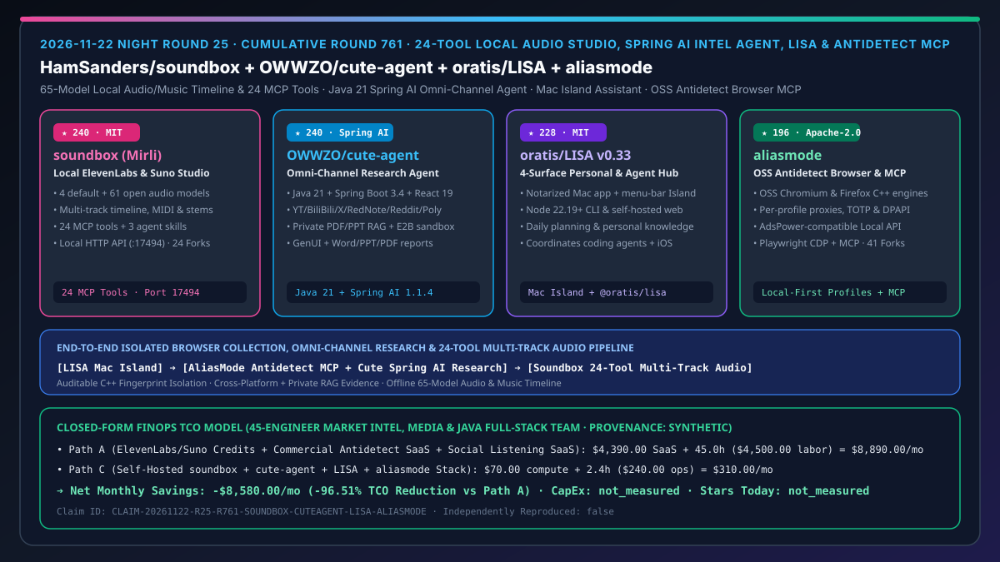
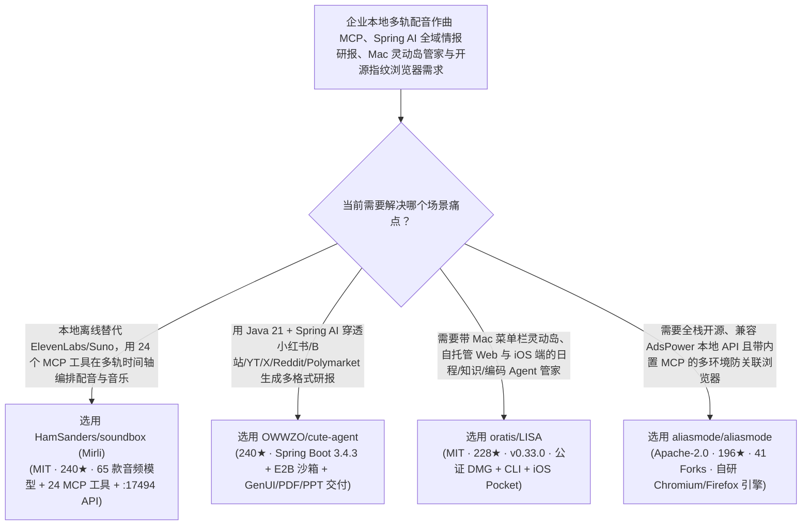
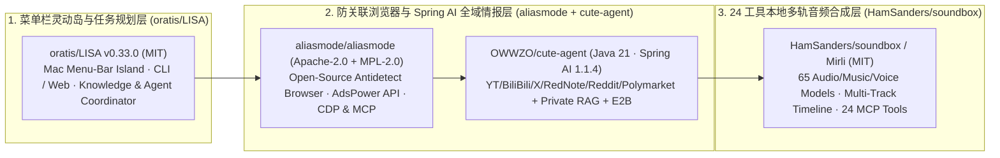
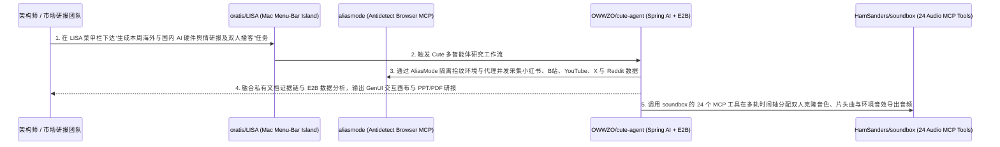

# 24 工具本地多轨音频与配音工作站 MCP（`HamSanders/soundbox`）、Spring AI 全域多平台情报与 GenUI 研报智能体（`OWWZO/cute-agent`）、带 macOS 菜单栏灵动岛的四端知识与编码管家（`oratis/LISA`）与内置 MCP 的开源多环境指纹隔离浏览器（`aliasmode/aliasmode`）选型与集成架构 FAQ

> **文档类型**：企业 AI 解决方案架构师（AI Solution Architect）选型决策指南（GitHub Trending AI 雷达 2026-11-22 Night Round 25 / 累计第 761 轮）
> **覆盖项目**：[`HamSanders/soundbox`](https://github.com/HamSanders/soundbox)（`★ 240`、`24 forks`、`MIT`，“Mirli / Soundbox”，开源本地版 ElevenLabs + Suno，内置多轨时间轴、65 款开源音频/音乐/语音克隆模型、`:17494` 本地 API 与 **24 个 MCP 工具**）· [`OWWZO/cute-agent`](https://github.com/OWWZO/cute-agent)（`★ 240`、`16 forks`，基于 Java 21 + Spring Boot 3.4.3 + Spring AI 1.1.4 + React 19 构建的全域情报研究智能体，打通 YouTube/B站/X/小红书/Reddit/HN/Polymarket 与私有文档 RAG、E2B 代码沙箱及 GenUI/PDF/PPT 自动交付）· [`oratis/LISA`](https://github.com/oratis/LISA)（`★ 228`、`MIT`，`v0.33.0`，支持 Mac 原生菜单栏灵动岛、CLI/自托管 Web、LISA Cloud 与 iOS Pocket 四端入口的日程规划、个人知识库与编码 Agent 协调管家）· [`aliasmode/aliasmode`](https://github.com/aliasmode/aliasmode)（`★ 196`、`41 forks`、`Apache-2.0` 应用 + `MPL-2.0` 自研 Chromium/Firefox 防关联引擎，兼容 AdsPower 本地 API 并内置 Playwright-over-CDP 与 MCP Server 的本地优先多会话隔离浏览器）
> **核心场景**：当企业出海增长、全域市场研究、多媒体内容生产与 Java 架构团队面临**“使用 ElevenLabs/Suno 生成配音与配乐按积分计费昂贵且无法让 Claude Code 通过 MCP 直接编排多轨音轨、单一搜索引擎或大模型无法同时穿透小红书/B站/YouTube/Reddit/X/Polymarket 形成带私有文档证据链的研报、多账号跨区运营与自动化测试购买商业指纹浏览器月租高昂且闭源不安全、以及苹果生态架构师缺乏带菜单栏灵动岛的日程与编码 Agent 协调台”**四大痛点时，如何组合**`soundbox` + `cute-agent` + `LISA` + `aliasmode`** 构建全渠道情报采集、多模态音视频合成与多会话隔离执行体系？

---

## 一、📌 核心结论速览（选型一句话结论）

1. **想用自己机器上的 GPU 免费离线替代 ElevenLabs（配音/语音克隆）和 Suno（作曲/带歌词歌曲/音效），既能在可视化多轨时间轴（Multi-Track Timeline）上混音分轨，又能让 Claude Code 或 Cursor 通过 24 个 `soundbox.*` MCP 工具自动为产品视频配齐人声、BGM 与音效** ➔ 选 **[`HamSanders/soundbox`](https://github.com/HamSanders/soundbox)（`★ 240`，`24 forks`，`MIT`，现名 Mirli）**。
   - **通俗原理**：默认预置 4 款端到端验证的开源音频大模型（Stable Audio 3.0 Small Music、MiniMax Music 3、ACE-Step 1.5 Turbo 等）并可一键开启另外 61 款模型，暴露本地端口 `17494` 与 24 个 MCP 工具。
2. **企业技术栈以 Java 21 / Spring Boot 为主，想构建一套打破平台围墙的全域商业情报与深度研究智能体——同时采集 YouTube、BiliBili、X、小红书、Reddit、Hacker News 与 Polymarket 预测市场，结合私有 PDF/Word/PPT 多模态 RAG 与 E2B 沙箱清洗数据，最终自动输出 GenUI 交互画布与 Word/PPT/PDF 报告** ➔ 选 **[`OWWZO/cute-agent`](https://github.com/OWWZO/cute-agent)（`★ 240`，`16 forks`，Java 21 + Spring AI 1.1.4）**。
   - **通俗原理**：采用标准 DDD 分层（`Cute-agent-api/app/domain/infrastructure/trigger/types` + `Cute-BrowserStack`），支持导入用户会话凭证穿透各平台信息孤岛并进行多源交叉权重评分。
3. **跨国电商、社媒矩阵运营或自动化 QA 团队需要管理数十个独立指纹、独立代理 IP 与独立 Cookie/TOTP 的浏览器环境，想找一款从底层浏览器内核（`aliasmode-chromium` / `aliasmode-firefox`）到桌面端全部开源、兼容 AdsPower 本地 API 且原生内置 MCP Server 的商业防关联浏览器替代品** ➔ 选 **[`aliasmode/aliasmode`](https://github.com/aliasmode/aliasmode)（`★ 196`，`41 forks`，`Apache-2.0` / `MPL-2.0`）**。
   - **通俗原理**：每个环境（Profile）可独立指定自研 C++ 指纹伪装引擎、代理与 Windows DPAPI 加密凭证，原生暴露 CDP 与 `mcp-tunnel` 供 AI Agent 安全驱动。
4. **想在 Mac 菜单栏常驻一个类似灵动岛（Menu-Bar Island）的 `MIT` 开源个人 AI 助理，随时规划每日日程、沉淀个人知识库、并在桌面端与 iOS 手机端（Lisa Pocket）协调多个编码智能体** ➔ 选 **[`oratis/LISA`](https://github.com/oratis/LISA)（`★ 228`，`MIT`，`v0.33.0`）**。
   - **通俗原理**：提供 Apple 公证签名的 `Lisa-Suite.dmg` 一键安装包与 `@oratis/lisa` npm CLI。

---

## 二、🎯 客户与架构师灵魂拷问 Q&A（深度架构拆解）

### Q1：这套“多环境防关联浏览器 (`aliasmode`) + 全域多平台情报 Agent (`cute-agent`) + 24 工具多轨音频工作站 (`soundbox`) + 四端个人管家 (`LISA`)”如何赋能企业市场研究与内容工厂？

- **四大业务价值闭环**：
  1. **安全稳定的多平台会话底座 ➔ `aliasmode/aliasmode`**：全域情报采集与跨区社媒运营最怕账号关联封禁；`aliasmode` 用开源 `MPL-2.0` C++ 指纹引擎与每环境独立代理/TOTP 保护登录态，并通过内置 MCP 接口交给上层 Agent 调度。
  2. **公域七大内容平台 + 私有文档证据链合流 ➔ `OWWZO/cute-agent`**：用 Java 21 + Spring AI 1.1.4 并发抓取小红书、B站、YouTube、Reddit、X 与 Polymarket，结合 E2B 代码沙箱交叉核验后生成 GenUI 与 PPT/PDF 研报。
  3. **多轨配音、配乐与音效自动化生产 ➔ `HamSanders/soundbox`**：研报或产品演示转视频时，直接调用 `soundbox` 的 24 个 MCP 工具在本地 GPU 合成多角色台词配音、歌词歌曲与环境音效。
  4. **日常日程与跨端任务统筹 ➔ `oratis/LISA`**：在 Mac 菜单栏 Island 与 iOS 端统一管理研究排期与编码任务。
- **何时直接用商业云 SaaS 方案（Path B）？**
  - 若团队无本地 GPU 且仅偶发制作单条短音频，可按月订阅 **ElevenLabs + Suno**；若企业需要高频批量生产多语种配音配乐、构建 Java Spring AI 全域情报台、且要求多账号浏览器指纹与 Cookie 100% 留在本地，则采用本轮开源栈（Path C）。

### Q2：典型企业级“菜单栏统筹 (`LISA`) ➔ 隔离浏览器采集 (`aliasmode`) ➔ 全域情报分析 (`cute-agent`) ➔ 本地多轨音视频配音 (`soundbox`)”架构怎么搭？

1. **个人与团队任务入口层（`oratis/LISA`）**：
   - 分析师在 Mac 菜单栏 Island 或 CLI 设定今日竞品追踪与内容产出计划。
2. **多环境指纹隔离与采集执行层（`aliasmode/aliasmode` + `OWWZO/cute-agent`）**：
   - `cute-agent` 通过 `aliasmode` 的隔离浏览器环境安全抓取小红书、B站、YouTube、X、Reddit 舆情，结合内部文档 RAG 与 E2B 沙箱输出深度报告。
3. **本地多轨音频与播客自动合成层（`HamSanders/soundbox`）**：
   - 通过 `soundbox` 的 `:17494` API 或 24 个 MCP 工具将报告脚本转化为带分轨 BGM 与多角色克隆音色的音频成品。

### Q3：`aliasmode` 与市面上闭源的商业防关联浏览器（如 AdsPower / Multilogin）相比有什么核心优势？

- **全栈开源可审计 + 100% 本地模式 + 兼容 AdsPower API**：
  - 商业指纹浏览器曾发生过云端同步插件供应链安全事件；`aliasmode` 不仅桌面端与 MCP 服务遵循 `Apache-2.0`，连底层指纹修改引擎也完全开源（`MPL-2.0`），支持纯本地无账号离线运行，且本地 API 兼容现有 AdsPower 自动化脚本无缝迁移。

---

## 三、🧭 直观可视化图解（Mermaid 决策树 + 集成架构 + 时序图）

### 3.1 架构师选型决策树

### 3.2 企业端到端生产集成参考架构图

### 3.3 `LISA` 排期、`AliasMode` + `Cute` 全域情报合成与 `Soundbox` 多轨播客生成时序图

---

## 四、📊 同类开源与商业云服务横向选型决策矩阵

| 对比维度 | `HamSanders/soundbox` (`★ 240`) | `OWWZO/cute-agent` (`★ 240`) | `oratis/LISA` (`★ 228`) | `aliasmode/aliasmode` (`★ 196`) | ElevenLabs + Suno 商业订阅 + 商业舆情 SaaS + AdsPower 企业版 (Path A) | 单轨 TTS 脚本 + 单平台爬虫脚本 + 普通无隔离 Chrome (Path B) |
| :--- | :--- | :--- | :--- | :--- | :--- | :--- |
| **核心能力定位** | 24 工具本地多轨配音/作曲/音效工作站 | Java 21 + Spring AI 全域情报与研报 Agent | 带 Mac 菜单栏灵动岛的四端知识与编码管家 | 全栈开源防关联指纹浏览器与 MCP 服务 | 按积分/席位/环境数叠加收费的多种商业云工具组合 | 缺乏时间轴混音的简陋脚本、易封号的裸连爬虫与零散笔记 |
| **核心技术突破** | **预置 4+61 款音频模型 + 多轨 MIDI/干声分离 + 24 MCP 工具** | **穿透七大社媒/预测平台 + 私有文档证据链 + E2B 沙箱** | **签名公证 Mac DMG 灵动岛 + CLI/Web/iOS 四端同步** | **自研 C++ 指纹引擎开源 + 兼容 AdsPower API + 内置 MCP** | 商业音频积分消耗极快；商业指纹浏览器按环境数收高额月费 | 缺少多轨时间轴自动混音；普通 Chrome 多账号登录极易关联封禁 |
| **开源协议** | `MIT` | 源码开放（Java/Spring AI） | `MIT` | `Apache-2.0` / `MPL-2.0` | 闭源商业 SaaS | 内部零散脚本 |
| **月度 TCO（45 人团队）** | **组合仅 `$310.00/月`**（`$70.00` 共享推理与采集容器 + `2.4h` 维护） | 同左（自托管 Spring Boot + MySQL） | 同左（`MIT` 免费桌面/CLI） | 同左（Local 模式完全免费无限制） | **`$8,890.00/月`**（`$4,390.00` 商业音频积分、防关联环境费与舆情席位 + `45.0h` 人工剪辑与搬运） | 约 `$3,110.00/月`（大量人工音频剪辑对齐、处理账号封禁与跨平台抄数据工时） |

---

## 五、🧪 应用落地定量收益/TCO 对比与 7-Card 报告

> **📊 数据来源与闭式核算声明（Provenance & Closed-Form Schema）**：
> - **provenance**: `synthetic`（基于 45 人企业全域市场情报、多模态音视频生产与 Java 全栈工程团队月度工作负载模型：`independently_reproduced = false`；硬件采购基线 `base_hardware_capex = not_measured`；Track B 单日增量 `track_b_stars_today = not_measured`）。
> - **核算公式**：
>   - **Path A（采购商业配音与 AI 音乐按量积分套餐 + 商业多环境防关联浏览器企业版席位 + 商业跨平台舆情监测 SaaS + 工程师手工对齐多轨音频与手动跨平台汇总研报人工）**：月度商业音频积分、指纹浏览器与舆情 SaaS 账单 **`$4,390.00`** + 人工多轨剪辑混音、跨平台采集清洗与排版报告人工 **`45.0h × $100.00/h = $4,500.00`** = **`$8,890.00/月`**。
>   - **Path C（自建 `soundbox` + `cute-agent` + `LISA` + `aliasmode` 开源多模态与全域情报栈）**：共享容器与代理中继开销 **`$70.00`** + 采集策略与音频模型配置维护人工 **`2.4h × $100.00/h = $240.00`** = **`$310.00/月`**。
>   - **净节省（Net Savings vs Path A）**：**`-$8,580.00/月`**（成本降低 **`96.51%`**）。

| 评估方案 | 商业音频/指纹浏览器/舆情 SaaS 与算力 | 音频混音与跨平台研报整理人工（`$100/h`） | 月度总 TCO | 相对 Path A 净节省 | 关键架构交付指标 |
| :--- | :---: | :---: | :---: | :---: | :--- |
| **Path A：ElevenLabs/Suno 商业订阅 + 商业指纹浏览器 + 舆情 SaaS** | `$4,390.00` | `45.0h` (`$4,500.00`) | **`$8,890.00`** | Baseline | 按积分与环境数收费高昂；闭源浏览器存在凭证外泄顾虑 |
| **Path B：单轨 TTS 脚本 + 普通 Playwright 裸爬 + 手工剪辑** | `$1,410.00` | `17.0h` (`$1,700.00`) | **`$3,110.00`** | `-$5,780.00` (`-65.02%`) | 缺少 24 工具多轨时间轴自动混音与 C++ 级防关联指纹隔离 |
| **Path C：`soundbox` + `cute-agent` + `LISA` + `aliasmode`** | **`$70.00`** | **`2.4h` (`$240.00`)** | **`$310.00`** | **`-$8,580.00` (`-96.51%`)** | **24 工具本地多轨音频 + Spring AI 全域研报 + 开源指纹浏览器** |

- 🔗 **关联 7-Card 4:5 视觉评测报告**：[`workshops/github-trending-radar/cards.html`](../cards.html) · [`cards.en.html`](../cards.en.html)

---

## 六、🛠️ 企业引入与架构评审 Checklist

- [ ] **1. 部署 `HamSanders/soundbox` (Mirli) 实现本地零成本音频与配乐工业化**：连接其 24 个 MCP 工具或 `:17494` HTTP API，自动完成多角色台词配音、音乐生成与分轨混音。
- [ ] **2. Java 技术栈团队引入 `OWWZO/cute-agent` 构建全域情报中心**：基于 Spring Boot 3.4.3 + Spring AI 1.1.4 + E2B 沙箱打通公域多平台与私有文档证据链。
- [ ] **3. 使用 `aliasmode/aliasmode` 保护多账号浏览器自动化会话**：开启 Local 模式与自研开源防关联内核，通过内置 MCP 或 AdsPower 兼容接口安全驱动网页任务。
- [ ] **4. 配置 `oratis/LISA` 统一桌面与移动端工作流**：利用 Mac 菜单栏灵动岛与自托管服务协调每日研究与编码任务。
