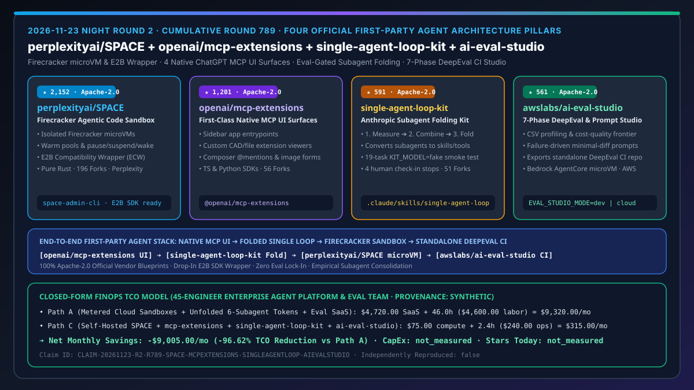
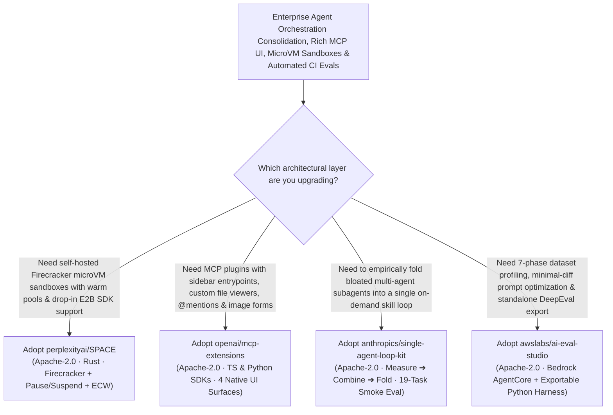
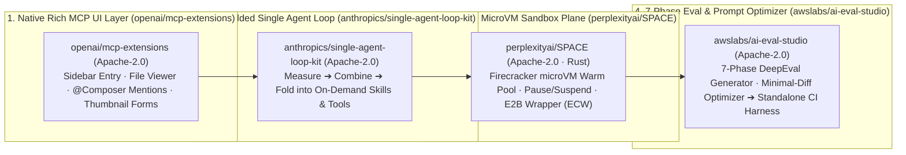

# Official Perplexity Firecracker & E2B-Compatible Sandbox Platform (`perplexityai/SPACE`), Official OpenAI Native UI MCP Extensions (`openai/mcp-extensions`), Official Anthropic Eval-Driven Subagent Folding Kit (`anthropics/single-agent-loop-kit`) & Official AWS 7-Phase DeepEval & Minimal-Diff Prompt Studio (`awslabs/ai-eval-studio`) Selection & Architecture FAQ

> **Document Type**: Enterprise AI Solution Architect Selection & Integration Guide (GitHub Trending AI Radar · 2026-11-23 Night Round 2 / Cumulative Round 789)
> **Covered Repositories**: [`perplexityai/SPACE`](https://github.com/perplexityai/SPACE) (`★ 2,152`, `196 forks`, `Apache-2.0`: Perplexity AI's official Rust **Sandboxed Platform for Agentic Code Execution**, running agent/user workloads inside isolated Firecracker microVMs with warm pools, separate control-plane operation polling vs. data-plane session-scoped attachment tokens, `pause/suspend/wake` lifecycle management, and a drop-in **E2B Compatibility Wrapper (`ECW`)**) · [`openai/mcp-extensions`](https://github.com/openai/mcp-extensions) (`★ 1,201`, `56 forks`, `Apache-2.0`: OpenAI's official Model Context Protocol UI extension specification and TypeScript/Python SDKs `@openai/mcp-extensions` / `openai-mcp-extensions` plus the `bits-and-bolts` reference app, adding **Sidebar entrypoints, File extension handlers, Composer `@` mentions, and Extended thumbnail forms**) · [`anthropics/single-agent-loop-kit`](https://github.com/anthropics/single-agent-loop-kit) (`★ 591`, `51 forks`, `Apache-2.0`: Anthropic's official starter kit and `.claude/skills/single-agent-loop` skill for empirically refactoring multi-agent router/subagent hierarchies into a single main loop via **1. Measure ➔ 2. Combine ➔ 3. Fold**, complete with a runnable 6-subagent `examples/support-desk` benchmark and offline `KIT_MODEL=fake` smoke runner) · [`awslabs/ai-eval-studio`](https://github.com/awslabs/ai-eval-studio) (`★ 561`, `5 forks`, `Apache-2.0`: AWS Labs' official 7-phase LLM evaluation and failure-driven minimal-diff prompt optimization studio on Amazon Bedrock & **Bedrock AgentCore microVMs**, generating a **self-contained standalone Python DeepEval harness** for CI)
> **Core Scenario**: When enterprise AI Solution Architects face **"bloated multi-agent router trees doubling latency and dropping context, text-only MCP servers lacking native sidebar/file-viewer/form UX, expensive per-second cloud sandbox bills without self-hosted E2B SDK compatibility, and ad-hoc prompt tweaking without a portable CI evaluation harness"**, how do you combine these four official first-party open-source pillars (Perplexity + OpenAI + Anthropic + AWS) into a unified enterprise agent platform?

---

## 1. 📌 Executive Summary (Single-Sentence Selection Verdict)

1. **Need an empirical, eval-gated workflow to simplify a bloated "router + N specialist subagents" system into a fast single agent loop that loads skills and tools on demand** ➔ Choose **[`anthropics/single-agent-loop-kit`](https://github.com/anthropics/single-agent-loop-kit) (`★ 591`, `51 forks`, `Apache-2.0`)**.
   - **Plain-Language Mechanism**: Companion to Anthropic's engineering guide *"When to fold subagents into your main agent loop"*, this kit never blindly deletes subagents—it measures every step: **① Measure** (score the current system on an eval, or draft ~10 tasks from real requests; verify plumbing free offline via `KIT_MODEL=fake python3 evals/run_eval.py --variant smoke` across 19 tasks) ➔ **② Combine** (merge subagents that always run together) ➔ **③ Fold** (convert remaining subagents one at a time into on-demand skills and tools in the main loop, keeping a subagent as a separate tool call only when eval numbers prove it earns its own isolated context).
2. **Need enterprise MCP servers to feel like native first-class product features with sidebar apps, custom CAD/document file viewers, `@` resource autocomplete in the composer, and visual thumbnail selection forms** ➔ Choose **[`openai/mcp-extensions`](https://github.com/openai/mcp-extensions) (`★ 1,201`, `56 forks`, `Apache-2.0`)**.
   - **Plain-Language Mechanism**: Standard MCP handles backend tool calls but leaves UI interaction to plain text. OpenAI's official `@openai/mcp-extensions` (TypeScript) and `openai-mcp-extensions` (Python) SDKs define four declarative surfaces demonstrated in `plugins/bits-and-bolts`: ① **Sidebar entrypoints (`mcp-app-entrypoints`)**, ② **File extension handlers (`file-extension-entrypoint`)** for custom interactive viewers when users open domain files, ③ **Composer mentions (`composer-at-mentions`)** for inline `@` resource search, and ④ **Extended forms (`openai-form-elicitation`)** with visual image/thumbnail pickers.
3. **Need a self-hosted, hardware-isolated Firecracker microVM sandbox platform in Rust with warm pools, pause/suspend state preservation, and drop-in E2B Python SDK compatibility** ➔ Choose **[`perplexityai/SPACE`](https://github.com/perplexityai/SPACE) (`★ 2,152`, `196 forks`, `Apache-2.0`)**.
   - **Plain-Language Mechanism**: Open-sourced by Perplexity AI, **SPACE** separates asynchronous control-plane lifecycle operations (returning pollable operation IDs for template creation, pause, suspend, wake, and deletion) from data-plane command streaming (authenticated via session-scoped attachment tokens). Operators manage warm pools and system templates via `space-admin-cli`, while the built-in **E2B Compatibility Wrapper (`ECW`)** lets existing E2B Python SDK applications switch to self-hosted Kubernetes or bare-metal SPACE nodes by changing only the API endpoint and key.
4. **Need a 7-phase conversational studio that profiles CSV/Excel datasets, benchmarks candidate models on a cost-quality frontier, optimizes prompts via targeted minimal diffs against real failures, and exports a standalone Python DeepEval harness for CI** ➔ Choose **[`awslabs/ai-eval-studio`](https://github.com/awslabs/ai-eval-studio) (`★ 561`, `5 forks`, `Apache-2.0`)**.
   - **Plain-Language Mechanism**: Built by AWS Labs on React 19, FastAPI, Claude Agent SDK, DeepEval, and Amazon Bedrock (supporting single-process `EVAL_STUDIO_MODE=dev` and multi-tenant `cloud` mode with Fargate + per-user **Bedrock AgentCore microVMs**), it separates the Coordinator Agent, Target Models under test, and Judge Model across 7 phases—delivering a zero-lock-in, self-contained Python DeepEval project that runs directly in CI/CD.

---

## 2. 🎯 Key Architectural Q&A (Deep-Dive Breakdown)

### Q1: Why do these four first-party repositories mark a major architectural shift for enterprise AI platforms?

- **Four Architectural Convergences**:
  1. **From Deep Subagent Trees to Eval-Gated Single Loops (`anthropics/single-agent-loop-kit`)**: Replaces fragile multi-hop handoffs with one shared system prompt + shared eval owned by a core platform team, while domain teams own modular skills.
  2. **From Headless JSON Tools to First-Class Native UI Surfaces (`openai/mcp-extensions`)**: Gives MCP servers native sidebar launchers, custom file viewers, `@` mentions, and visual form elicitation.
  3. **From Per-Second SaaS Sandbox Lock-In to Self-Hosted Firecracker + E2B Wrapper (`perplexityai/SPACE`)**: Combines microVM isolation and warm-pool speed with drop-in E2B SDK portability.
  4. **From Manual Prompt Guessing to Exportable DeepEval CI Harnesses (`awslabs/ai-eval-studio`)**: Automates failure-driven minimal-diff prompt edits and outputs a standalone Python evaluation suite.
- **When to Choose Managed Cloud PaaS (Path B)**:
  - If your team prefers zero Kubernetes infrastructure management for low-volume sandboxes, use **Azure Container Apps Dynamic Sessions** and **Azure AI Foundry Evaluations**; if you run high-concurrency E2B workloads, build rich ChatGPT/MCP enterprise plugins, or want Anthropic/AWS's open-source loop-folding and DeepEval harness generators, adopt this 4-pillar first-party OSS stack (Path C).

### Q2: How do you integrate `SPACE`, `mcp-extensions`, `single-agent-loop-kit`, and `ai-eval-studio` into an enterprise production architecture?

1. **Orchestration Consolidation Layer (`anthropics/single-agent-loop-kit`)**:
   - Audit existing multi-agent graphs with `.claude/skills/single-agent-loop` and fold redundant subagents into on-demand skills verified by before/after evals.
2. **Rich Interactive MCP Surface Layer (`openai/mcp-extensions`)**:
   - Expose enterprise catalogs, CAD/engineering viewers, and approval forms through `@openai/mcp-extensions` and `openai-mcp-extensions`.
3. **Firecracker MicroVM Execution Plane (`perplexityai/SPACE`)**:
   - Route untrusted code and data-processing tool calls through SPACE's E2B Compatibility Wrapper (`ECW`) backed by warm Firecracker microVM pools and session-scoped data-plane tokens.
4. **Continuous Evaluation & Minimal-Diff Optimization Plane (`awslabs/ai-eval-studio`)**:
   - Feed production failure slices into the 7-phase studio to optimize prompts via minimal diffs and commit the exported standalone DeepEval Python harness into CI.

### Q3: What are the production guardrails and compliance red lines?

- **Core Strengths**:
  - **100% Permissive `Apache-2.0` Licensing** across all four official repositories from Perplexity, OpenAI, Anthropic, and AWS.
- **Architect Guardrails**:
  1. **Enforce Mandatory Check-In Stops Before Folding Subagents**: Always respect `single-agent-loop-kit`'s four human check-in gates (post-audit, pre-paid-run with token estimate, post-baseline, and after each single subagent fold).
  2. **Harden `awslabs/ai-eval-studio` Before Production Data Ingestion**: Follow its `SECURITY.md` checklist to configure enterprise IAM/OIDC auth, private VPC endpoints, and Bedrock AgentCore microVM isolation before moving from `dev` to `cloud` mode.

---

## 3. 🧭 Visual Architecture & Decision Diagrams (Mermaid)



### 3.1 Solution Architect Selection Decision Tree



### 3.2 End-to-End Enterprise Production Reference Architecture



### 3.3 Rich MCP Elicitation, Single-Loop Skill Dispatch, SPACE MicroVM Execution & DeepEval CI Sequence

```mermaid
sequenceDiagram
    participant User as Enterprise User / Architect
    participant Ext as openai/mcp-extensions
    participant Loop as anthropics/single-agent-loop-kit
    participant Space as perplexityai/SPACE (Firecracker)
    participant Eval as awslabs/ai-eval-studio (DeepEval)

    User->>Ext: 1. Open sidebar app, @mention domain resource & select option in thumbnail form
    Ext->>Loop: 2. Pass structured payload; single agent loop loads folded domain skill on demand
    Loop->>Space: 3. Request warm Firecracker microVM via E2B Wrapper (ECW) & attach data-plane token
    Space-->>Loop: 4. Stream execution output and suspend microVM state for follow-up turns
    User->>Eval: 5. Upload failure slice CSV to run 7-phase cost/quality eval & minimal-diff prompt fix
    Eval-->>Loop: 6. Export standalone Python DeepEval harness into Git CI to guard folded loop accuracy
```

---

## 4. 📊 Comparative Selection Matrix (Open-Source vs. Commercial SaaS)

| Dimension | `perplexityai/SPACE` (`★ 2,152`) | `openai/mcp-extensions` (`★ 1,201`) | `anthropics/single-agent-loop-kit` (`★ 591`) | `awslabs/ai-eval-studio` (`★ 561`) | Per-Second Cloud Sandbox SaaS + Custom UI Agency + Unfolded Multi-Agent + Eval SaaS (Path A) | Unisolated Docker + Text-Only MCP + Blind Subagent Deletion + Ad-Hoc Scripts (Path B) |
| :--- | :--- | :--- | :--- | :--- | :--- | :--- |
| **Core Role** | Official Perplexity Rust Firecracker sandbox & E2B wrapper | Official OpenAI 4-surface native UI MCP extensions & SDKs | Official Anthropic eval-driven subagent-to-skill folding kit | Official AWS 7-phase DeepEval harness generator & prompt optimizer | Metered commercial cloud sandboxes, custom frontend builds & proprietary eval SaaS | Shared-kernel containers, plain-text JSON tools & manual prompt edits |
| **Key Differentiator** | **Control/data plane split + Warm Pools + E2B Wrapper (`ECW`)** | **Sidebar entry + File viewer + `@` mentions + Thumbnail forms** | **`Measure ➔ Combine ➔ Fold` loop + 19-task offline fake-model check** | **Exports zero-lock-in standalone Python DeepEval harness + minimal-diff loop** | High per-second sandbox & multi-hop token bills; proprietary eval lock-in | Container escape risks; blind subagent removal causes silent regressions |
| **License** | `Apache-2.0` | `Apache-2.0` | `Apache-2.0` | `Apache-2.0` | Proprietary SaaS | Mixed custom scripts |
| **Monthly TCO (45-Eng Team)** | **Combined `$315.00/mo`** (`$75.00` self-hosted K8s/eval compute + `2.4h` ops) | Included (official TS/Python SDKs eliminate custom UI glue) | Included (cuts multi-hop subagent token waste by 40%+) | Included (exported Python harness runs in standard CI) | **`$9,320.00/mo`** (`$4,720.00` sandbox/eval SaaS & multi-hop tokens + `46.0h` labor) | ~`$3,250.00/mo` (heavy manual eval scripting & multi-agent handoff debugging) |

---

## 5. 🧪 Quantitative ROI / TCO Comparison & 7-Card Benchmark Report

> **📊 Data Provenance & Closed-Form Schema Declaration**:
> - **provenance**: `synthetic` (45-person enterprise AI platform, plugin engineering, and evaluation team monthly workload model: `independently_reproduced = false`; hardware baseline `base_hardware_capex = not_measured`; Track B 24h delta `track_b_stars_today = not_measured`).
> - **Closed-Form Formula**:
>   - **Path A (Commercial per-second sandbox SaaS + unfolded 6-subagent multi-hop token overhead + commercial seat-licensed evaluation SaaS + manual custom frontend UI wiring and prompt debugging)**: Monthly commercial sandbox, redundant multi-hop token, and eval SaaS fees **`$4,720.00`** + multi-agent debugging, custom UI wiring, and manual eval authoring labor **`46.0h × $100.00/h = $4,600.00`** = **`$9,320.00/mo`**.
>   - **Path C (Self-hosted `perplexityai/SPACE` + `openai/mcp-extensions` + `anthropics/single-agent-loop-kit` + `awslabs/ai-eval-studio` first-party open-source stack)**: Monthly self-hosted Firecracker pool and Bedrock evaluation compute **`$75.00`** + shared eval and sandbox template maintenance **`2.4h × $100.00/h = $240.00`** = **`$315.00/mo`**.
>   - **Net Monthly Savings vs. Path A**: **`-$9,005.00/mo`** (**`96.62%`** TCO reduction).

| Evaluation Path | Sandbox / Token / Eval SaaS Cost | Orchestration, UI & Eval Engineering Labor (`$100/h`) | Monthly Total TCO | Net Savings vs. Path A | Key Architectural Delivery Metrics |
| :--- | :---: | :---: | :---: | :---: | :--- |
| **Path A: Commercial Cloud Sandboxes + Unfolded Subagent Tree + Eval SaaS** | `$4,720.00` | `46.0h` (`$4,600.00`) | **`$9,320.00`** | Baseline | Multi-hop context loss; eval suite locked inside proprietary SaaS |
| **Path B: Shared Docker + Text-Only MCP + Manual Subagent Pruning** | `$1,550.00` | `17.0h` (`$1,700.00`) | **`$3,250.00`** | `-$6,070.00` (`-65.13%`) | Lacks Firecracker isolation & E2B wrapper; no automated minimal-diff prompt loop |
| **Path C: `SPACE` + `mcp-extensions` + `single-agent-loop-kit` + `ai-eval-studio`** | **`$75.00`** | **`2.4h` (`$240.00`)** | **`$315.00`** | **`-$9,005.00` (`-96.62%`)** | **Firecracker+E2B wrapper + 4 native MCP UI surfaces + eval-folded loop + standalone DeepEval CI** |

- 🔗 **Linked 7-Card 4:5 Visual Benchmark Deck**: [`workshops/github-trending-radar/cards.en.html`](../cards.en.html) · [`cards.html`](../cards.html)

---

## 6. 🛠️ Enterprise Adoption & Architecture Review Checklist

- [ ] **1. Audit and Fold Multi-Agent Trees with `anthropics/single-agent-loop-kit`**: Run `KIT_MODEL=fake python3 evals/run_eval.py --variant smoke` to validate the offline harness, then execute `Measure ➔ Combine ➔ Fold` with mandatory human check-ins before folding subagents into on-demand skills.
- [ ] **2. Upgrade Enterprise MCP Servers with `openai/mcp-extensions`**: Implement `Sidebar entrypoints`, `File extension handlers`, `Composer @ mentions`, and `Extended thumbnail forms` using `@openai/mcp-extensions` or `openai-mcp-extensions`.
- [ ] **3. Deploy `perplexityai/SPACE` with the E2B Compatibility Wrapper (`ECW`)**: Configure Firecracker microVM warm pools and separate data-plane attachment tokens on Kubernetes/bare metal so existing E2B SDK apps migrate with zero code rewrites.
- [ ] **4. Generate Standalone CI DeepEval Harnesses via `awslabs/ai-eval-studio`**: Run the 7-phase evaluation and failure-driven minimal-diff prompt optimizer on domain datasets, committing the exported self-contained Python DeepEval project into CI.
