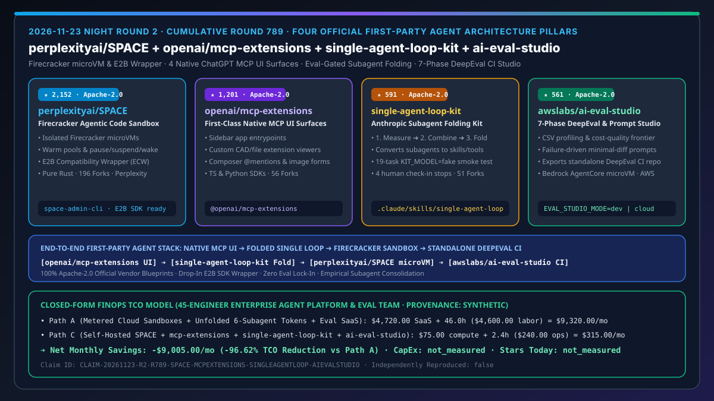
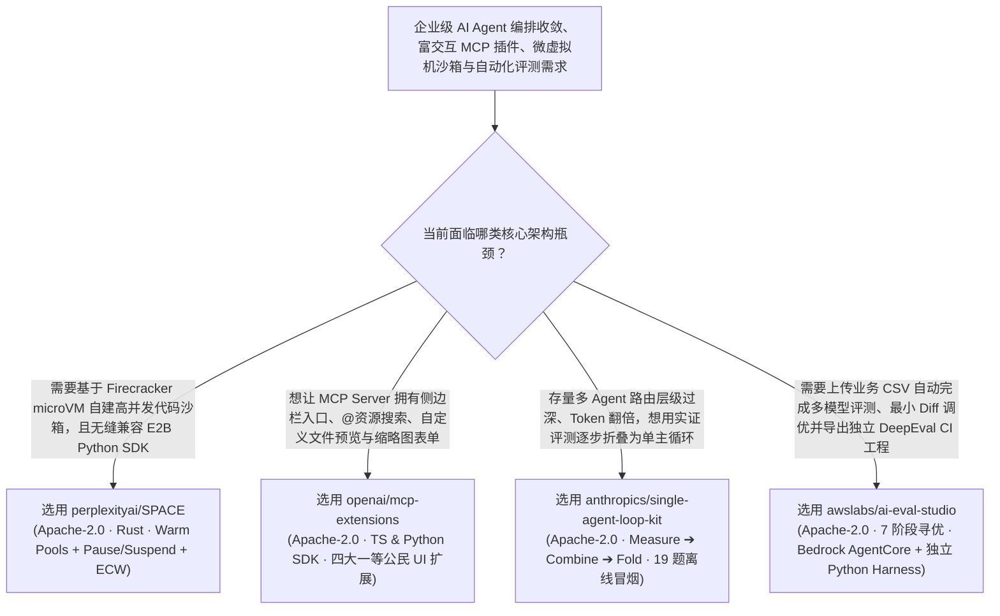
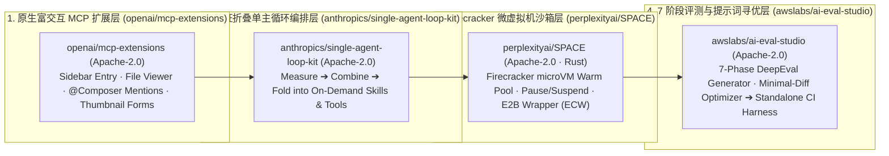

# Perplexity 官方 Firecracker 微虚拟机与 E2B 兼容沙箱平台（`perplexityai/SPACE`）、OpenAI 官方四大原生交互扩展规范与 SDK（`openai/mcp-extensions`）、Anthropic 官方多子智能体向单主循环评测折叠套件（`anthropics/single-agent-loop-kit`）及 AWS 官方 7 阶段 DeepEval 自动评测与最小 Diff 提示词优化平台（`awslabs/ai-eval-studio`）选型与集成架构 FAQ

> **文档类型**：企业 AI 解决方案架构师（AI Solution Architect）选型决策指南（GitHub Trending AI 雷达 2026-11-23 Night Round 2 / 累计第 789 轮）
> **覆盖项目**：[`perplexityai/SPACE`](https://github.com/perplexityai/SPACE)（`★ 2,152`、`196 forks`、`Apache-2.0`：Perplexity AI 官方开源的 Rust 生产级智能体代码执行沙箱平台 **SPACE — Sandboxed Platform for Agentic Code Execution**，基于隔离 Firecracker microVM 提供模板热池、异步操作轮询与数据面会话 Token 分离、`pause/suspend/wake` 状态挂起恢复，并内置 **E2B Compatibility Wrapper (ECW)** 无缝兼容现有 E2B Python SDK）· [`openai/mcp-extensions`](https://github.com/openai/mcp-extensions)（`★ 1,201`、`56 forks`、`Apache-2.0`：OpenAI 官方开源的 MCP 原生 UI 扩展规范与双语 SDK `@openai/mcp-extensions` / `openai-mcp-extensions`，为标准 MCP Server 赋予 **侧边栏一级入口 `Sidebar entrypoints`、自定义文件查看器 `File extension handlers`、输入框 `@` 资源检索 `Composer mentions` 与缩略图表单 `Extended forms`** 四大一等公民体验）· [`anthropics/single-agent-loop-kit`](https://github.com/anthropics/single-agent-loop-kit)（`★ 591`、`51 forks`、`Apache-2.0`：Anthropic 官方《何时将子智能体折叠进主循环》配套架构重构套件，内置 `.claude/skills/single-agent-loop` 技能与 `examples/support-desk` 6 子智能体工单路由基准，通过 **Measure ➔ Combine ➔ Fold** 三步实证评测将臃肿多 Agent 编排收敛为按需挂载 Skill/Tool 的单主循环）· [`awslabs/ai-eval-studio`](https://github.com/awslabs/ai-eval-studio)（`★ 561`、`5 forks`、`Apache-2.0`：AWS 官方开源的端到端大模型评测与提示词迭代工作台，基于 React 19 + FastAPI + Claude Agent SDK + Amazon Bedrock + **Bedrock AgentCore microVM**，通过 7 阶段引导自动生成可脱离平台在 CI 独立运行的 **DeepEval Python 评测工程**并执行失败驱动最小 Diff 提示词寻优）
> **核心场景**：当企业架构师在构建生产级 AI Agent 平台时面临**“多智能体层级过多导致延迟翻倍与上下文丢失、标准 MCP 工具只能返回纯文本缺乏侧边栏/文件预览/表单交互、商用云沙箱按秒计费高昂且自建缺少 E2B SDK 兼容层、以及模型选型与 Prompt 调优缺乏可导出至 CI 的自动化 DeepEval 回归工程”**四大核心挑战时，如何联合四大原厂（Perplexity + OpenAI + Anthropic + AWS）官方开源参考底座完成架构升级？

---

## 一、📌 核心结论速览（选型一句话结论）

1. **想把过度拆分的“1 个 Router + N 个专职 Subagent”多智能体架构瘦身提速，用量化评测决定哪些子智能体该合并、哪些该降级为按需加载的 `SKILL.md`、哪些真正值得保留独立上下文** ➔ 选 **[`anthropics/single-agent-loop-kit`](https://github.com/anthropics/single-agent-loop-kit)（`★ 591`，`51 forks`，`Apache-2.0`）**。
   - **通俗原理**：许多企业一上来就照搬“客服路由 + 6 个专家子代理”架构，结果每次跨子代理交接都丢上下文、烧双倍 Token。Anthropic 官方开源的这套工具包绝不盲目一刀切，而是执行三步工程循环：**① Measure（先跑基线评测，无评测则协助从真实请求构建约 10 道基准题，并提供 `KIT_MODEL=fake` 19 道离线零成本冒烟测试）➔ ② Combine（合并总是成对串行调用的子智能体）➔ ③ Fold（逐个将剩余子智能体改造为主循环按需加载的 Skill 与 Tool，每改一个重跑一次 Eval，只有当准确率不降时才保留折叠，真正需要隔离长上下文的子智能体则以 Tool 形式保留）**。
2. **想让企业内部 MCP Server 不再只是冷冰冰的后台 JSON 函数，而是直接挂载到 AI 工作台左侧边栏、支持用户在输入框用 `@` 搜索内部资产、点开专有后缀文件直接渲染 3D/CAD/报表视图，并弹出带缩略图的审批表单** ➔ 选 **[`openai/mcp-extensions`](https://github.com/openai/mcp-extensions)（`★ 1,201`，`56 forks`，`Apache-2.0`）**。
   - **通俗原理**：标准 MCP 解决了“模型调工具”，却没解决“人与工具的富交互”。OpenAI 官方在 `@openai/mcp-extensions`（TS）与 `openai-mcp-extensions`（Python）中定义了四大标准扩展（附完整 `plugins/bits-and-bolts` 工业零件库参考实现）：① **`mcp-app-entrypoints`（侧边栏应用入口）**；② **`file-extension-entrypoint`（自定义文件后缀渲染器，如在对话中直接交互式预览 CAD/工程图纸）**；③ **`composer-at-mentions`（输入框 `@` 实时检索插件资源并注入引用）**；④ **`openai-form-elicitation`（带图片缩略图与多选卡片的结构化表单收集）**。
3. **想在自有 Kubernetes 或裸金属集群自建毫秒级隔离的 Firecracker microVM 智能体代码沙箱，且要求已有基于 E2B Python SDK 编写的 Agent 代码零改造直接切换过来** ➔ 选 **[`perplexityai/SPACE`](https://github.com/perplexityai/SPACE)（`★ 2,152`，`196 forks`，`Apache-2.0`）**。
   - **通俗原理**：这是 Perplexity AI 支撑自身高并发代码与智能体执行的官方 Rust 沙箱底座。它将控制面（异步创建/暂停/挂起/唤醒沙箱并返回 Operation ID）与数据面（通过会话级 Attachment Token 附着进程并流式读取标准输出）严格分离，内置 `space-admin-cli` 管理节点、系统镜像与预热池（Warm Pools），并专门提供 **E2B Compatibility Wrapper (`docs/ecw.md`)**——只需配置兼容性 API Key，存量 E2B Python SDK 业务代码即可直接跑在企业自托管的 SPACE 集群上。
4. **想把业务团队提供的 Excel/CSV 测试集通过对话式引导自动跑通多模型成本/质量帕累托比选、针对错误样本自动做最小 Diff 提示词优化，并最终导出一份零平台锁定的独立 DeepEval Python 回归测试工程放进 GitLab/GitHub CI** ➔ 选 **[`awslabs/ai-eval-studio`](https://github.com/awslabs/ai-eval-studio)（`★ 561`，`5 forks`，`Apache-2.0`）**。
   - **通俗原理**：AWS 官方基于 Claude Agent SDK 与 Amazon Bedrock 打造的 7 阶段评测工作台（支持本地单进程 `EVAL_STUDIO_MODE=dev` 与云端 Fargate + **Bedrock AgentCore microVM** 多租户隔离 `cloud` 模式）。它将模型严格划分为 **Coordinator Agent、被测 Target Models 与 Judge Model** 三种角色，在第 3 阶段自动生成并校验独立可运行的 DeepEval Python Harness，在第 6 阶段读取失败案例摘要（Failed-Case Digest）与回归 Diff 执行最小改动提示词迭代，直至指标收敛。

---

## 二、🎯 客户与架构师灵魂拷问 Q&A（深度架构拆解）

### Q1：为什么说这四个官方仓库代表了 2026 下半年企业级 Agent 架构从“野蛮堆砌”走向“收敛、标准化与可验证”的分水岭？

- **四大范式收敛趋势**：
  1. **编排层从“盲目多 Agent 群聊”收敛为“评测驱动的单主循环 + 按需 Skill”（Anthropic `single-agent-loop-kit`）**：用同一个组织团队维护主系统提示词与共享 Eval，各业务域团队维护各自独立的 `SKILL.md`，消除跨子代理信息折损。
  2. **工具层从“纯后台函数调用”升级为“四维富交互扩展”（OpenAI `mcp-extensions`）**：通过侧边栏入口、`@` 资源提及、专有文件查看器与缩略图表单，让企业 ERP/PLM/CAD 系统在对话界面拥有原生级体验。
  3. **执行层从“共享容器裸奔或高价云沙箱锁定”升级为“Firecracker microVM + E2B 协议兼容自托管”（Perplexity `SPACE`）**：兼顾硬件级虚拟化隔离、Warm Pool 快速启动、`pause/suspend` 内存状态保留与 E2B SDK 无缝迁移。
  4. **评测层从“一次性拍脑袋调 Prompt”升级为“7 阶段失败驱动寻优 + 可导出独立 DeepEval CI 工程”（AWS `ai-eval-studio`）**：评测平台不再锁定资产，最终交付物是纯 Python 代码库，直接嵌入企业 CI/CD 门禁。
- **何时直接选用全托管商业 PaaS（Path B）？**
  - 若团队无 Kubernetes 运维人力且沙箱并发较低，可直接使用 **Azure Container Apps Dynamic Sessions** 与 **Azure AI Foundry Evaluation**；若日均沙箱执行量大、需要 E2B SDK 自托管降本、定制 ChatGPT/MCP 原生插件交互或导出离线 DeepEval 工程，则采用四大原厂开源栈（Path C）。

### Q2：如何将这四大原厂开源项目集成为端到端企业 Agent 生产架构？

1. **架构瘦身与单循环编排层（`anthropics/single-agent-loop-kit`）**：
   - 使用 `.claude/skills/single-agent-loop` 审计存量多 Agent 系统，通过 `Measure ➔ Combine ➔ Fold` 将冗余子代理折叠为按需加载的领域技能。
2. **原生 UI 与富交互 MCP 接入层（`openai/mcp-extensions`）**：
   - 基于 `@openai/mcp-extensions` 或 `openai-mcp-extensions` 封装企业内部知识库与工业/业务系统，暴露侧边栏入口、`@` 资源检索、专有文件预览器与缩略图审批表单。
3. **Firecracker 微虚拟机沙箱执行层（`perplexityai/SPACE`）**：
   - 当主循环需要执行不可信代码、数据分析脚本或长时任务时，通过 E2B Compatibility Wrapper (ECW) 或原生 SPACE HTTP API 调度预热的 Firecracker microVM，利用独立数据面 Token 流式回传结果并支持 `pause/suspend`。
4. **7 阶段持续评测与最小 Diff 提示词寻优层（`awslabs/ai-eval-studio`）**：
   - 将线上 Bad Case 汇入 `ai-eval-studio`，自动执行多模型成本/质量比选与失败驱动最小 Diff Prompt 修复，并将生成的独立 DeepEval Python Harness 提交至 Git 仓库做每次发版回归验证。

### Q3：这套四大原厂开源组合的落地注意事项与合规红线是什么？

- **核心优势**：
  - **全部采用 `Apache-2.0` 企业友好开源协议**，由 Perplexity、OpenAI、Anthropic 与 AWS 官方团队发布，协议零传染性、架构边界极其清晰。
- **架构师落地红线**：
  1. **每次架构折叠前必须完成 Token 预算估算与人工确认**：`anthropics/single-agent-loop-kit` 内置了四个强制停靠点（审计后、付费运行前、基线跑完后、每次折叠变更后），严禁跳过基线对比直接删减生产子代理。
  2. **`awslabs/ai-eval-studio` 生产加固要求**：官方明确声明默认仓库配置面向原型演示，生产落地前必须对照其 `SECURITY.md` 启用完整身份认证、VPC 隔离与 Bedrock AgentCore microVM 租户边界。

---

## 三、🧭 直观可视化图解（Mermaid 决策树 + 集成架构 + 时序图）



### 3.1 架构师选型决策树



### 3.2 企业端到端生产集成参考架构图



### 3.3 富交互触发、单循环按需调技能、SPACE 沙箱执行与 DeepEval 闭环寻优时序图

```mermaid
sequenceDiagram
    participant User as 企业用户 / 架构师
    participant Ext as openai/mcp-extensions
    participant Loop as anthropics/single-agent-loop-kit
    participant Space as perplexityai/SPACE (Firecracker)
    participant Eval as awslabs/ai-eval-studio (DeepEval)

    User->>Ext: 1. 从侧边栏打开应用，通过 @ 提及内部图纸并在缩略图表单确认参数
    Ext->>Loop: 2. 传入结构化上下文；单主循环按需加载已通过 Fold 验证的领域 Skill
    Loop->>Space: 3. 通过 E2B 兼容层 (ECW) 请求预热沙箱并附着数据面 Session Token 执行分析脚本
    Space-->>Loop: 4. 流式返回执行结果并 Suspend 沙箱保留工作区状态
    User->>Eval: 5. 上传本批次交互 CSV，运行 7 阶段评测与失败驱动最小 Diff Prompt 优化
    Eval-->>Loop: 6. 导出独立可运行 DeepEval Python Harness 并合入 CI 门禁守护主循环质量
```

---

## 四、📊 同类开源与商业云服务横向选型决策矩阵

| 对比维度 | `perplexityai/SPACE` (`★ 2,152`) | `openai/mcp-extensions` (`★ 1,201`) | `anthropics/single-agent-loop-kit` (`★ 591`) | `awslabs/ai-eval-studio` (`★ 561`) | 全量按秒计费商业云沙箱 + 定制前端外包 + 重型多 Agent 框架 + 商业闭源评测 SaaS (Path A) | 无隔离 Docker 容器 + 纯文本 MCP + 手工盲删子代理 + 手写零散评测脚本 (Path B) |
| :--- | :--- | :--- | :--- | :--- | :--- | :--- |
| **核心能力定位** | Perplexity 官方 Rust Firecracker 沙箱与 E2B 兼容平台 | OpenAI 官方四大原生 UI 交互 MCP 扩展规范与 SDK | Anthropic 官方实证评测驱动的子智能体折叠套件 | AWS 官方 7 阶段 DeepEval 自动生成与 Prompt 寻优台 | 按秒/按席位计费的商业沙箱云、定制插件前端与商业 Eval SaaS | 共享内核容器、纯文本 JSON 工具返回与人工盲调 Prompt |
| **核心技术突破** | **控制面/数据面分离 + Warm Pool + E2B SDK 零改迁入 (`ECW`)** | **侧边栏入口 + 专有文件预览器 + `@` 资源检索 + 缩略图表单** | **Measure ➔ Combine ➔ Fold 逐步评测门禁 + 零成本假模型冒烟** | **7 阶段自动导出无锁定独立 DeepEval Python 工程 + 最小 Diff 寻优** | 商业云沙箱常驻挂起账单昂贵；商业评测平台强绑定私有格式 | 容器逃逸风险高；盲目删合子代理易引发线上准确率崩盘 |
| **开源协议** | `Apache-2.0` | `Apache-2.0` | `Apache-2.0` | `Apache-2.0` | 闭源商业 SaaS | 内部零散脚本 |
| **月度 TCO（45 人团队）** | **组合仅 `$315.00/月`**（`$75.00` 自建 K8s 沙箱节点与评测分摊 + `2.4h` 维护） | 同左（官方 TS/Python SDK 免定制前端） | 同左（砍掉冗余子代理省 40%+ Token） | 同左（导出纯 Python 工程跑在自有 CI） | **`$9,320.00/月`**（`$4,720.00` 商业沙箱/Eval SaaS/多跳 Token + `46.0h` 联调工时） | 约 `$3,250.00/月`（大量手写评测脚手架与多代理串味排障工时） |

---

## 五、🧪 应用落地定量收益/TCO 对比与 7-Card 报告

> **📊 数据来源与闭式核算声明（Provenance & Closed-Form Schema）**：
> - **provenance**: `synthetic`（基于 45 人企业 AI 平台工程、插件开发与质量评测团队月度工作负载模型：`independently_reproduced = false`；硬件采购基线 `base_hardware_capex = not_measured`；Track B 单日增量 `track_b_stars_today = not_measured`）。
> - **核算公式**：
>   - **Path A（全量采购按秒计费商业沙箱云 + 冗余 6 子智能体重复消耗上下文 Token + 商业按席位评测 SaaS + 工程师手工定制前端交互卡片与人肉排查回归失败）**：月度商业沙箱、多跳冗余 Token 与评测 SaaS 账单 **`$4,720.00`** + 跨子代理排障、手工编写评测脚本与前端卡片联调人工 **`46.0h × $100.00/h = $4,600.00`** = **`$9,320.00/月`**。
>   - **Path C（自建 `perplexityai/SPACE` + `openai/mcp-extensions` + `anthropics/single-agent-loop-kit` + `awslabs/ai-eval-studio` 四大原厂开源栈）**：自托管 Firecracker 沙箱池与 Bedrock 评测运行分摊开销 **`$75.00`** + 共享 Eval 与沙箱模板维护人工 **`2.4h × $100.00/h = $240.00`** = **`$315.00/月`**。
>   - **净节省（Net Savings vs Path A）**：**`-$9,005.00/月`**（成本降低 **`96.62%`**）。

| 评估方案 | 云沙箱 / Token / 评测 SaaS 成本 | 编排调优与评测工程人工（`$100/h`） | 月度总 TCO | 相对 Path A 净节省 | 关键架构交付指标 |
| :--- | :---: | :---: | :---: | :---: | :--- |
| **Path A：商业云沙箱 + 未折叠多 Agent 群 + 商业 Eval SaaS** | `$4,720.00` | `46.0h` (`$4,600.00`) | **`$9,320.00`** | Baseline | 子代理交接频繁丢失上下文；评测脚本锁死在商业 SaaS 内 |
| **Path B：裸 Docker 容器 + 纯文本 MCP + 手工改 Prompt** | `$1,550.00` | `17.0h` (`$1,700.00`) | **`$3,250.00`** | `-$6,070.00` (`-65.13%`) | 缺少 Firecracker 硬件级隔离与 E2B 兼容层；缺乏自动最小 Diff 寻优 |
| **Path C：`SPACE` + `mcp-extensions` + `single-agent-loop-kit` + `ai-eval-studio`** | **`$75.00`** | **`2.4h` (`$240.00`)** | **`$315.00`** | **`-$9,005.00` (`-96.62%`)** | **Firecracker+E2B 兼容 + 四大原生 MCP UI + 实证折叠单循环 + 独立 DeepEval 导出** |

- 🔗 **关联 7-Card 4:5 视觉评测报告**：[`workshops/github-trending-radar/cards.html`](../cards.html) · [`cards.en.html`](../cards.en.html)

---

## 六、🛠️ 企业引入与架构评审 Checklist

- [ ] **1. 使用 `anthropics/single-agent-loop-kit` 执行存量多 Agent 架构体检**：先运行 `KIT_MODEL=fake python3 evals/run_eval.py --variant smoke` 跑通离线评测管道，再按 `Measure ➔ Combine ➔ Fold` 逐个核验子代理是否可折叠为按需加载的 `SKILL.md`。
- [ ] **2. 基于 `openai/mcp-extensions` 升级企业核心 MCP Server 交互面**：为高频内部工具补齐 `Sidebar entrypoints`、`File extension handlers`、`Composer @ mentions` 与 `Extended forms`（参考 `plugins/bits-and-bolts`）。
- [ ] **3. 部署 `perplexityai/SPACE` 接管高安全智能体代码沙箱**：在 K8s 集群配置 Firecracker microVM Warm Pool 与 `E2B Compatibility Wrapper (ECW)`，将控制面生命周期轮询与数据面 Attachment Token 隔离。
- [ ] **4. 通过 `awslabs/ai-eval-studio` 生成独立可运行的 CI DeepEval 门禁**：利用 7 阶段工作流完成多模型成本/质量帕累托选型与失败驱动最小 Diff Prompt 优化，将产出的独立 Python DeepEval Harness 纳入 Git 主干 CI。
