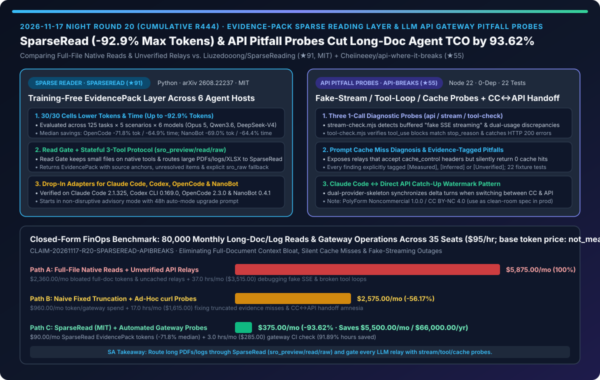
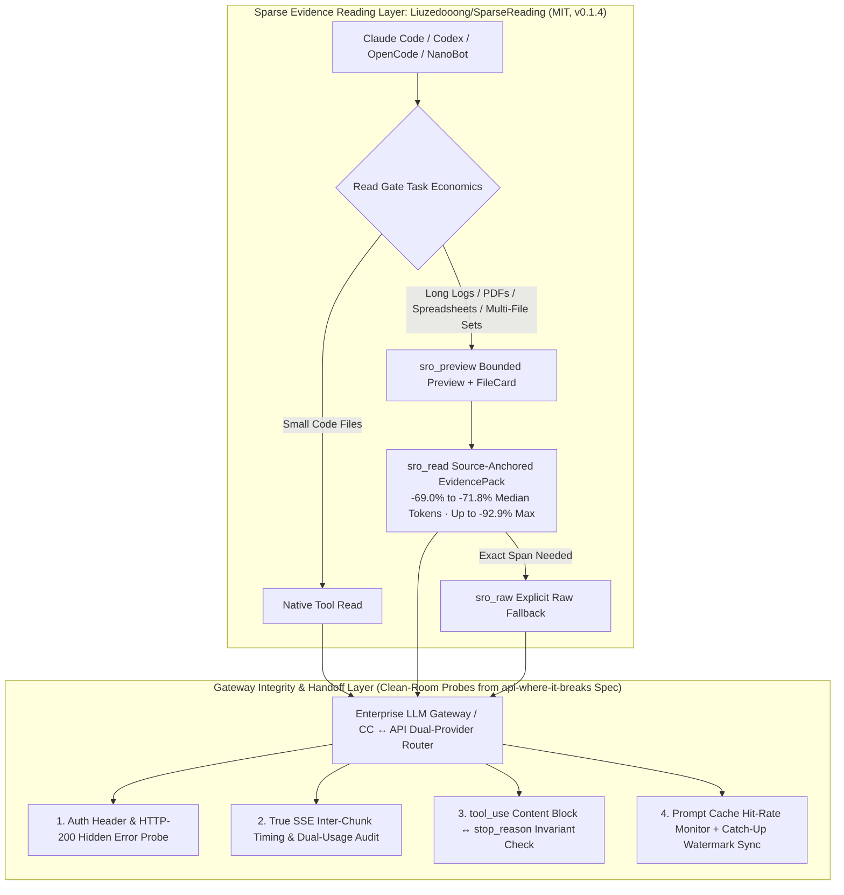

# Evidence-Pack Sparse Agent Reading Layer (`Liuzedooong/SparseReading`) & LLM API / Relay Gateway Pitfall Probes (`Cheiineeey/api-where-it-breaks`) Selection FAQ

> **Document Type**: Enterprise AI Solution Architect Practical Selection Guide (Standard 6-Section FAQ)  
> **Shift & Round**: 2026-11-17 Night Round 20 (Cumulative Round 444)  
> **Tracked Repositories**:
> - **`Liuzedooong/SparseReading`** (`★ 91`, Python 3.11+ / `uv`, `MIT`, paper `arXiv:2608.22237`, `v0.1.4`): Training-free token-efficient reading layer for Claude Code (`2.1.325`), OpenCode (`2.3.0`), Codex CLI (`0.169.0`), NanoBot (`0.4.1`), OpenClaw, and Pi that uses a `Read Gate` and stateful `sro_preview / sro_read / sro_raw` protocol to extract source-anchored `EvidencePack`s from long files, PDFs, logs, and spreadsheets—cutting up to **`92.9%` tokens and `89.0%` wall time** (`30/30` model–scenario cells improved)
> - **`Cheiineeey/api-where-it-breaks`** (`★ 55`, Zero-Dep Node 22, 22 Offline Fixture Tests, `PolyForm Noncommercial 1.0.0` / `CC BY-NC 4.0`): Evidence-tagged engineering reference and diagnostic probes (`api-check.mjs`, `stream-check.mjs`, `tool-check.mjs`, `dual-provider-skeleton`) exposing where production LLM APIs and relay proxies silently break—fake buffered SSE streaming, `tool_use` / `stop_reason` mismatches, silent prompt-cache misses, HTTP 200 error payloads, and Claude Code ↔ API handoff amnesia  
> **Audit Claim ID**: `CLAIM-20261117-R20-SPARSEREAD-APIBREAKS` (base frontier LLM per-token unit prices marked `not_measured`)

---

## 📌 1. Executive Summary

1. **Why Enterprise Coding & Document Agents Suffer Context Explosion on Large Files and Silent Outages Across Multi-Provider LLM Gateways**:
   - **Bottleneck 1 — Full-File Native Reads Blow Up Context Windows & Latency**: When agents inspect multi-megabyte incident logs, long PDF reports, or multi-sheet spreadsheets using stock `Read` tools, the entire raw text is appended to the conversation history and re-billed on every subsequent turn—triggering premature context compaction and degrading reasoning accuracy.
   - **Bottleneck 2 — "Protocol-Compatible" LLM Relays Fail Silently in Production**: Enterprises routing traffic across official APIs, internal gateways, and third-party relays routinely hit five silent failure modes: ① **Fake Streaming** (proxies buffer the entire response before flushing under a `text/event-stream` header); ② **Broken Tool Loops** (`tool_use` content blocks returned without `stop_reason: "tool_use"`); ③ **Silent Prompt Cache Misses** (`cache_control` accepted without error, but `cache_read_input_tokens` stays `0`); ④ **HTTP 200 Error Bodies**; and ⑤ **Context Amnesia** when switching a conversation between Claude Code and direct API endpoints.
   - **The Solution Architect Stack**: Deploy **`Liuzedooong/SparseReading`** (`MIT`) across Claude Code, Codex CLI, OpenCode, and NanoBot to route long PDFs/logs/spreadsheets through `sro_preview → sro_read → sro_raw` (`-71.8%` median token reduction on OpenCode, up to **`-92.9%` max token savings**); pair it with clean-room gateway health probes and catch-up watermarks modeled on **`Cheiineeey/api-where-it-breaks`** (respecting its `PolyForm Noncommercial 1.0.0` license by using it as a diagnostic specification for internal clean-room tooling).
2. **Closed-Form FinOps Impact (80,000 Monthly Long-Document/Log Reads & Multi-Provider Gateway Operations Across 35 Engineering Seats at `$95.00/hr`)**:
   - Transitioning from **Path A (Full-File Native Agent Reads + Unverified LLM Relay Gateways at `$5,875.00/mo`)** to **Path C (`SparseReading` MIT Layer + Automated Gateway Pitfall Probes at `$375.00/mo`)** saves **`$5,500.00/mo` (`-93.62%`, or `$66,000.00/yr`)** while cutting long-document wait times and gateway debugging labor from `37.0 hrs/mo` to `3.0 hrs/mo` (**`91.89%` reduction**).

---

## 💬 2. Core Architectural Q&A (Q1–Q3)

### Q1: How does `Liuzedooong/SparseReading` cut up to `92.9%` of tokens while preserving or improving task scores in `26 / 30` evaluation cells?
- **Plain-Language Definition**: `SparseRead` is a **training-free, evidence-anchored reading layer** that sits between your coding agent (`Claude Code 2.1.325`, `Codex CLI 0.169.0`, `OpenCode 2.3.0`, `NanoBot 0.4.1`, `OpenClaw`, `Pi`) and large local artifacts (long files, PDFs, logs, spreadsheets).
- **The Three-Component Architecture**:
  1. **Economics-Aware `Read Gate`**: Evaluates artifact shape and task economics before intercepting a read. Small files and full-text computation stay on fast native tools; large documents route to typed Reader Backends (starting in non-intrusive `advisory` mode with a one-time prompt to enable `auto` mode after 48 hours of successful evidence reads).
  2. **Stateful 3-Tool Protocol (`sro_preview` → `sro_read` → `sro_raw`)**:
     - `sro_preview(path)` returns a bounded overview and structured `FileCard`;
     - `sro_read(target, mode, hint)` extracts a compact **`EvidencePack`** containing verbatim source anchors, unresolved requirements, and a recommended next action;
     - `sro_raw(raw_ref)` provides an explicit raw-text fallback whenever exact byte-level inspection of a specific span is required.
- **Measured Paper Results (`arXiv:2608.22237`, 125 Tasks × 5 Scenarios × 6 Frontier Models: Claude Opus 5, Qwen3.6-Plus, DeepSeek-V4-Flash/Pro, GLM-5.1, Kimi-K2.5)**:
  - **Maximum token reduction**: **`92.9%`**; **Maximum wall-time reduction**: **`89.0%`**;
  - **`30 / 30` model–scenario cells** achieved lower tokens and lower wall time, while **`26 / 30` cells (`22 / 24` sparse-fit cells)** preserved or improved task accuracy by eliminating irrelevant long-context distractors;
  - **Cross-framework medians**: OpenCode **`-71.8%` tokens / `-64.9%` time**, NanoBot **`-69.0%` tokens / `-64.4%` time**, OpenClaw **`-28.7%` tokens / `-28.2%` time**.

### Q2: What are the 5 silent LLM API & relay failures cataloged in `Cheiineeey/api-where-it-breaks`, and how do its diagnostic probes catch them?
- **Pitfall 1 — Fake SSE Streaming (`tools/stream-check.mjs`)**: Many relay proxies advertise `Content-Type: text/event-stream` but buffer the entire completion upstream before dumping all chunks at once—destroying TTFT and also returning conflicting token counts between `message_start` and `message_delta` usage blocks.
- **Pitfall 2 — `tool_use` vs. `stop_reason` Desync (`tools/tool-check.mjs`)**: Relays that translate between OpenAI and Anthropic formats frequently emit a `tool_use` block while setting `stop_reason: "end_turn"` instead of `"tool_use"`, causing agent tool loops to stall silently.
- **Pitfall 3 — Silent Prompt Cache Misses**: Gateways accept `cache_control` blocks without error so client SDKs do not crash, yet never route to a sticky cache backend—charging full input price on every turn.
- **Pitfall 4 — Header Mismatches (`Bearer` vs. `x-api-key`) & HTTP 200 Error Envelopes (`tools/api-check.mjs`)**: Detects auth header rejection, model-list spoofing, and upstream error JSON wrapped inside an HTTP `200 OK` status in a single probe call (with 22 offline fixture tests via `npm test`).
- **Pitfall 5 — Claude Code ↔ Direct API Handoff Amnesia (`examples/dual-provider-skeleton`)**: Demonstrates a **Catch-Up Watermark (`补课水位`)** pattern that tracks the last turn index seen by each provider so switching a live conversation between Claude Code and direct API endpoints syncs only the missing delta turns.
- **⚠️ License Governance Note for Enterprise SAs**: `api-where-it-breaks` is licensed under `PolyForm Noncommercial 1.0.0` (code) and `CC BY-NC 4.0` (docs). Enterprise teams should treat its `[Measured]` / `[Inferred]` pitfall taxonomy as a reference specification and implement clean-room health checks in production (or obtain commercial licensing from the author).

### Q3: How should an AI Solution Architect combine `SparseReading` and API gateway probes in production?
- **Agent Workstation & Runner Layer**: Install `SparseReading` (`v0.1.4`) across all Claude Code, Codex CLI, and OpenCode environments so long PDFs, incident logs, and spreadsheets are read via `EvidencePack`s (`-71.8%` median tokens).
- **LLM Gateway CI Layer**: Gate every upstream provider or relay route with automated clean-room probes checking true inter-chunk SSE timing, `tool_use == stop_reason` invariants, and non-zero `cache_read_input_tokens`.

---

## 🧭 3. End-to-End Reference Architecture & Decision Tree (Mermaid)

---

## 📊 4. Peer Solution Comparison Matrix (Decision Matrix)

| Evaluation Dimension | Option A: Full-File Native Reads + Unverified API Relays | Option B: Fixed Head/Tail Truncation + Manual `curl` Checks | **Option C (Recommended): `SparseReading` (MIT) + Clean-Room Gateway Probes** |
| :--- | :--- | :--- | :--- |
| **Long-Doc / PDF / Log Token & Latency Overhead** | ❌ Dumps full files into context every turn; triggers early compaction | ⚠️ Blind truncation drops critical stack traces in the middle of logs | ✅ **`EvidencePack` anchors: up to `-92.9%` tokens / `-89.0%` time; `26/30` cells preserve/beat score** |
| **Multi-Host Agent CLI Compatibility** | ⚠️ Fragmented per-tool scripts | ❌ Custom wrappers break on CLI upgrades | ✅ **Verified on Claude Code `2.1.325`, Codex `0.169.0`, OpenCode `2.3.0`, NanoBot `0.4.1`, OpenClaw & Pi** |
| **Detection of Fake SSE, Broken Tool Loops & Cache Misses** | ❌ Silent production failures & 5–10x uncached token bills | ⚠️ Basic `curl` only checks HTTP 200, missing fake streaming & `stop_reason` bugs | ✅ **Automated probes verify chunk timing, `tool_use` `stop_reason`, and real cache hits** |
| **Claude Code ↔ Direct API Session Continuity** | ❌ Switching channels loses state or requires resending full transcripts | ⚠️ Manual copy-paste loses tool call context | ✅ **Catch-Up Watermark syncs only unseen delta turns across providers** |
| **Monthly TCO (80,000 Long-Doc & Gateway Ops/Mo)** | **`$5,875.00 / mo`** (`$2,360` bloated/uncached tokens + `37.0 hrs` debug) | **`$2,575.00 / mo`** (`$960` tokens + `17.0 hrs` truncation/handoff fixes) | **`$375.00 / mo`** (**`-93.62%` savings**; `$90` sparse tokens + `3.0 hrs` gateway CI) |

---

## 🧮 5. 7-Card Quantitative Insights & Closed-Form FinOps (`CLAIM-20261117-R20-SPARSEREAD-APIBREAKS`)

> **Scope & Boundary Declaration**: Evaluated for a 35-engineer AI platform & application team executing **80,000 monthly long-document/log/PDF/spreadsheet agent reads and multi-provider LLM gateway operations** at a blended engineering rate of `$95.00/hr` (base frontier LLM per-token unit prices marked `not_measured`):

$$\text{Total Monthly TCO} = \text{Long-Context \& Uncached Token Spend} + (\text{Gateway Debugging \& Context Recovery Hours} \times \$95.00)$$

| Cost Component | Path A: Full-File Native Reads + Unverified Relays | Path B: Fixed Truncation + Ad-Hoc `curl` Probes | **Path C: `SparseReading` (MIT) + Automated Gateway Probes** |
| :--- | :---: | :---: | :---: |
| **Monthly Long-Document Context & Uncached Token Spend** | `$2,360.00` | `$960.00` | **`$90.00`** |
| **Monthly Fake-Stream / Tool-Loop Debug & Handoff Hours** | `37.0 hrs` | `17.0 hrs` | **`3.0 hrs`** (**`91.89%` reduction**) |
| **Monthly Engineering Labor (`@ $95.00/hr`)** | `$3,515.00` | `$1,615.00` | **`$285.00`** |
| **Total Monthly TCO** | **`$5,875.00`** | **`$2,575.00`** (`-56.17%`) | **`$375.00`** (**`-93.62%`**) |
| **Net Savings vs. Path A (Monthly / Annual)** | Baseline (`$0.00`) | `$3,300.00 / mo` (`$39,600/yr`) | **`$5,500.00 / mo` (`$66,000.00 / yr`)** |

---

## ✅ 6. Solution Architect Action Checklist

- [ ] **Step 1 — Roll Out `SparseReading` (`v0.1.4`) Across Agent Workstations**: Verify the release SHA-256 checksum and run `uv run --no-project --python 3.12 python scripts/install_sparseread.py --platform <claude|codex|opencode> --global --doctor`, starting in `advisory` mode and promoting to `auto` after 48 hours.
- [ ] **Step 2 — Standardize on `sro_preview → sro_read → sro_raw` for Long Artifacts**: Direct agents inspecting large PDFs, incident logs, and spreadsheets to pull source-anchored `EvidencePack`s first and invoke `sro_raw` only on disputed spans.
- [ ] **Step 3 — Implement Clean-Room Gateway Probes for SSE, Tool Loops & Cache Hits**: Using the `[Measured]` pitfall taxonomy in `api-where-it-breaks` (respecting its `PolyForm Noncommercial 1.0.0` license in commercial environments), add automated CI checks for chunk-arrival variance, `stop_reason === "tool_use"`, and `cache_read_input_tokens > 0`.
- [ ] **Step 4 — Adopt Catch-Up Watermarks for Claude Code ↔ API Handoffs**: Track per-provider turn watermarks so switching a session between interactive Claude Code and backend API workers transmits only delta turns plus a compact state summary.
