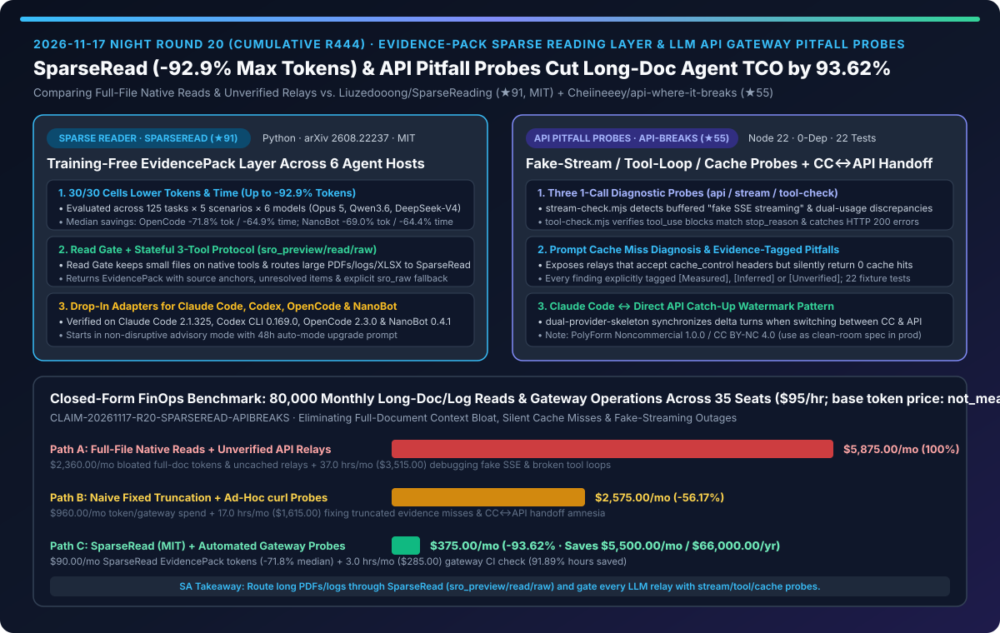
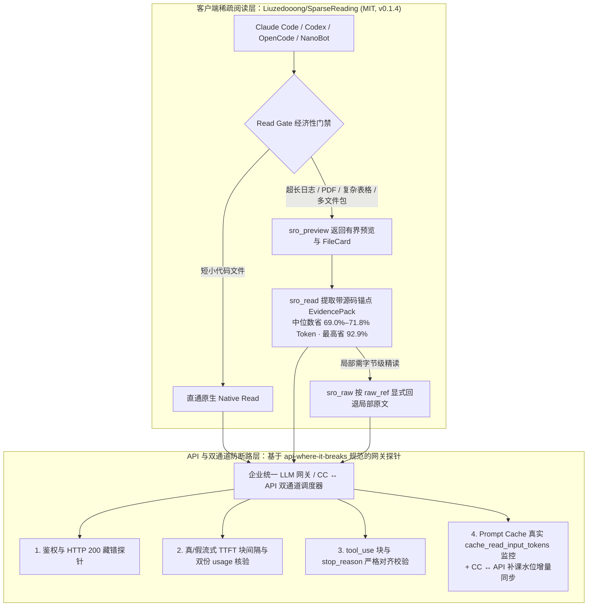

# 跨框架稀疏证据阅读层（`Liuzedooong/SparseReading`）与大模型 API / 中转网关断路体检工程（`Cheiineeey/api-where-it-breaks`）架构选型 FAQ

> **文档类型**：AI Solution Architect（AI 解决方案架构师）实战选型指南（六段式标准 FAQ）  
> **所属轮次**：2026-11-17 Night Round 20（Cumulative Round 444）  
> **追踪目标**：
> - **`Liuzedooong/SparseReading`**（`★ 91`，Python 3.11+ / `uv`，`MIT`，论文 `arXiv:2608.22237`，`v0.1.4`）：面向 Claude Code、OpenCode、Codex CLI、NanoBot、OpenClaw 与 Pi 的免训练稀疏证据阅读层，通过 `Read Gate` 与 `sro_preview / sro_read / sro_raw` 三阶段协议从超长日志、PDF、表格中精准提取带锚点的 `EvidencePack`，实测最高削减 **`92.9%` Token 与 `89.0%` 耗时**（30/30 模型场景矩阵双降）
> - **`Cheiineeey/api-where-it-breaks`**（`★ 55`，Node 22 零依赖，22 项离线 Fixture 测试，`PolyForm Noncommercial 1.0.0` / `CC BY-NC 4.0`）：系统拆解大模型 API 与兼容中转网关从首次请求到生产长连接中每一个隐性断点的证据级工程规范（假流式缓冲、HTTP 200 藏错、`tool_use` 与 `stop_reason` 错位、Prompt Cache 假命中，以及 Claude Code ↔ API 双通道“补课水位”无缝切换）  
> **计量审计 ID**：`CLAIM-20261117-R20-SPARSEREAD-APIBREAKS`（底层大模型基础单价标记为 `not_measured`）

---

## 📌 一、核心结论速览（Executive Summary）

1. **为什么企业将 Coding Agent 与大模型应用推向生产时，经常遭遇“读几个大 PDF/日志就把上下文撑爆”与“接了 API 中转站后流式卡顿、工具死循环、缓存账单翻倍”的双重暴击？**
   - **暴击一（全量文件原生读取导致上下文与延迟失控）**：当 Claude Code、Codex 或 OpenCode 排查线上数万行日志、大型财报 PDF 或多 Sheet 表格时，原生 `Read` 工具往往把大段原文直接塞进对话历史，每多聊一轮就重复计费一次，不仅触发过早的 Context Compaction（上下文压缩丢细节），还让单次任务耗时飙升。
   - **暴击二（API 网关/中转站的“表面兼容、暗地挖坑”）**：企业在混合使用官方 API、内部 LiteLLM/中转站与 Claude Code CLI 时，常遇到 5 类隐蔽故障——① 开着 `stream: true` 却整段攒齐才一次性吐出（假流式）；② 返回了 `tool_use` 块但 `stop_reason` 却不是 `tool_use` 导致工具循环中断；③ 接受了 `cache_control` 标记却永远 0 命中（白交双倍 Token 费）；④ HTTP 状态码返回 `200 OK` 但响应体里藏着上游报错；⑤ 从 Claude Code 切回 API 通道时发生上下文“失忆”。
   - **架构师黄金组合**：在所有 Agent 宿主机部署 **`Liuzedooong/SparseReading`**（`MIT`，通过 `Read Gate` 自动判断文件形态，用 `sro_preview → sro_read → sro_raw` 按需拉取带源码锚点的 `EvidencePack`，在 OpenCode / NanoBot 上实测中位数节省 **`71.8% / 69.0%` Token 与 `64.9% / 64.4%` 时间**）；同时参考 **`Cheiineeey/api-where-it-breaks`** 的三合一断路探针（`api-check` / `stream-check` / `tool-check`）与双通道“补课水位（Catch-Up Watermark）”模式建立网关准入 CI（注：该仓为非商业协议，企业生产环境应基于其公开诊断契约自研 Clean-Room 探针脚本）。
2. **闭式 FinOps 量化收益（35 人研发与 AI 平台团队、每月执行 80,000 次长文档/日志/PDF 分析与多通道 API 网关调用，工程师综合时薪 `$95.00/hr`）**：
   - 从 **Path A（原生全量文件读取 + 未经断路体检的 API 中转网关，`$5,875.00/月`）** 切换至 **Path C（`SparseReading` MIT 稀疏证据层 + 自研网关断路体检与双通道补课水位架构，`$375.00/月`）**，每月净省 **`$5,500.00/月`（降幅 `-93.62%`，年化节省 `$66,000.00/年`）**，长文档慢查询、假流式与假缓存排障工时从 `37.0 小时/月` 降至 `3.0 小时/月`（节省 **`91.89%`**）。

---

## 💬 二、灵魂拷问 Q1–Q3（大白话拆解应用场景与架构本质）

### Q1：`Liuzedooong/SparseReading` 是怎么做到“既让 Agent 少读 `71.8%–92.9%` 的 Token，又保证 `26/30` 的测试矩阵任务得分不降反升”的？
- **大白话本质定义**：`SparseRead` 是装在 Claude Code（`2.1.325`）、Codex CLI（`0.169.0`）、OpenCode（`2.3.0`）和 NanoBot（`0.4.1`）前面的**“智能文献速读秘书”**。它不需要重新训练模型（Training-Free），而是把粗暴的“全文塞进上下文”改造成有状态的三步按需取证协议：
  1. **`Read Gate`（经济性门禁）**：先根据文件大小、类型（长文本/PDF/结构化 CSV-XLSX/多文件目录）和任务经济性自动分流——小文件或需要逐字计算的任务直接走原生 `native` 工具，绝不画蛇添足；长文档则进入稀疏读取通道（新装默认开启温和的 `advisory` 顾问模式，首次成功取证满 48 小时后提示一键升级 `auto` 模式）。
  2. **三步有状态协议（`sro_preview` → `sro_read` → `sro_raw`）**：
     - `sro_preview(path)`：返回有界预览与结构化 `FileCard`（目录大纲、表格 Schema、关键锚点）；
     - `sro_read(target, mode, hint)`：通过专用 Reader Backend 精准抽取紧凑的 **`EvidencePack`**（自带原文行号/页码锚点 `source anchors`、未解决的疑点列表 `unresolved requirements` 以及下一步行动建议）；
     - `sro_raw(raw_ref)`：当 Agent 确实需要核对某一段精确原始字节时，通过 `raw_ref` 显式回退读取原文局部切片。
- **论文级实测硬指标（`arXiv:2608.22237`，125 个任务 × 5 大场景 × 6 大前沿模型：Claude Opus 5、Qwen3.6-Plus、DeepSeek-V4-Flash/Pro、GLM-5.1、Kimi-K2.5）**：
  - 最高节省 **`92.9%` Token**、最高缩短 **`89.0%` 端到端耗时**；
  - 在全部 **`30 / 30` 个“模型×场景”单元格**中实现 Token 与耗时双降，且 **`26 / 30` 个单元格（稀疏适配场景下 `22 / 24`）**保持甚至提升了任务准确率（因为剔除了长文无关噪音对模型注意力的干扰）！

### Q2：企业在接入第三方兼容 API 网关或把 Claude Code 与 API 混用时，最容易踩哪 5 个隐蔽大坑？`Cheiineeey/api-where-it-breaks` 是如何逐一验出来的？
- **大坑 1：假流式（Fake Streaming）** ➔ `tools/stream-check.mjs` 通过测量首字到达时间（TTFT）与块间隔分布，一眼揪出那些虽然返回 `text/event-stream` Header、实则在网关层攒够全文才一次性下发的“假流式”中转站，并核对流式事件中两份 `usage` 账单是否一致。
- **大坑 2：`tool_use` 块与 `stop_reason` 撕裂 + HTTP 200 藏错** ➔ `tools/tool-check.mjs` 验证网关返回工具调用块时 `stop_reason` 是否严格对齐为 `"tool_use"`，防止 Agent 收到工具参数却不触发本地函数执行。
- **大坑 3：Prompt Cache 静默失效（接受标记但 0 命中）** ➔ 许多非官方中转站为了兼容不报错，原样吞下 `cache_control: {"type": "ephemeral"}`，但底层根本不走缓存路由，导致企业长对话账单暴涨 5–10 倍。
- **大坑 4：鉴权 Header 混用（`Authorization: Bearer` vs `x-api-key`）与模型名映射黑盒** ➔ `tools/api-check.mjs` 仅需 1 次最小请求即可完成鉴权头、真实可用模型列表与截断/拒答体检（支持 `--fixture` 零成本离线回放 22 条测试）。
- **大坑 5：Claude Code（CC）与直接 API 双线切换时的“失忆”** ➔ `examples/dual-provider-skeleton` 提出**“补课水位（Catch-Up Watermark）”**架构：当同一段长会话在 CC 与 API 之间切换时，自动计算双方未同步的增量轮次并注入轻量前情摘要，避免重复发送整本历史记录。
- **⚠️ 架构师合规提醒**：`api-where-it-breaks` 的代码采用 `PolyForm Noncommercial 1.0.0`、文档采用 `CC BY-NC 4.0`（非商业许可）。企业架构师应将其作为**内部培训教材与诊断规范参考**，在生产网关中使用自研 Clean-Room 探针实现同等校验，或联系作者获取商业授权。

### Q3：企业 AI 架构师如何把 `SparseReading` 与 API 网关断路探针组合成高可靠 Agent 基础设施？
- **客户端阅读减负层**：在所有研发人员的 Claude Code、Codex CLI 与 OpenCode 环境统一安装 `SparseReading`（`scripts/install_sparseread.py --doctor`），从源头砍掉 `70%+` 的长文档输入 Token；
- **网关侧持续拨测层**：在内部 AI 网关（如 LiteLLM / Magpie）上线任何新供应商通道前，自动运行流式分块间隔校验、`tool_use` `stop_reason` 对齐校验与 Prompt Cache 命中率告警。

---

## 🧭 三、端到端集成参考架构与选型决策树（Mermaid）

---

## 📊 四、同赛道方案横向选型对比矩阵（Decision Matrix）

| 评估维度 | 方案 A：原生全量文件读取 + 未校验第三方 API 中转站 | 方案 B：粗暴定长截断（Head/Tail）+ 手工 `curl` 测接口 | **方案 C（推荐）：`SparseReading` (MIT) + 自动化网关断路探针与补课水位** |
| :--- | :--- | :--- | :--- |
| **长文档/PDF/大日志 Token 消耗与耗时** | ❌ 全文塞入每轮上下文，Token 暴涨且触发频繁 Compaction | ⚠️ 粗暴截断常漏掉日志中间的关键报错堆栈 | ✅ **`EvidencePack` 锚点抽取：最高省 `92.9%` Token / `89.0%` 时间，`26/30` 场景得分不降反升** |
| **跨 Agent 框架兼容性** | ⚠️ 各 CLI 各自为战 | ❌ 需为每个工具单独写解析脚本 | ✅ **一套 `sparseread-core` 原生适配 Claude Code、Codex、OpenCode、NanoBot、OpenClaw 与 Pi** |
| **假流式、工具死循环与假缓存拦截** | ❌ 线上经常出现流式卡死、工具不执行、缓存 0 命中却不知情 | ⚠️ `curl` 只能看连通性，测不出假流式与 `stop_reason` 错位 | ✅ **自动化检测 TTFT 流式块分布、`tool_use` 停机原因对齐与真实缓存命中率** |
| **Claude Code ↔ API 双通道切换连续性** | ❌ 切换通道即丢失上下文或需全量重发历史 | ⚠️ 手工复制粘贴摘要极易遗漏工具状态 | ✅ **基于“补课水位（Catch-Up Watermark）”仅同步未见过的增量对话轮次** |
| **月度总拥有成本（TCO，8 万次长文与网关调用/月）** | **`$5,875.00 / 月`**（含 `$2,360` 冗余 Token/假缓存 + `37.0h` 排障） | **`$2,575.00 / 月`**（含 `$960` Token + `17.0h` 漏检与断连修复） | **`$375.00 / 月`**（**净省 `-93.62%`**，仅 `$90` 稀疏 Token + `3.0h` 网关巡检） |

---

## 🧮 五、7-Card 定量洞察与闭式 FinOps 核算（`CLAIM-20261117-R20-SPARSEREAD-APIBREAKS`）

> **核算范围与边界声明**：面向 35 名研发与平台工程师团队，每月执行 **80,000 次长文档/日志/PDF/表格 Agent 分析任务与多通道 LLM API 网关调用**（工程师综合时薪 `$95.00/hr`；底层官方大模型基础单价标记为 `not_measured`）：

$$\text{Total Monthly TCO} = \text{Long-Context \& Uncached Token Spend} + (\text{Gateway Debugging \& Context Recovery Hours} \times \$95.00)$$

| 成本构成项 | Path A：原生全量读取 + 无体检 API 中转 | Path B：粗暴定长截断 + 手工 `curl` | **Path C：`SparseReading` (MIT) + 自动化网关断路探针** |
| :--- | :---: | :---: | :---: |
| **月度长文档输入 Token 与未命中缓存溢价成本** | `$2,360.00` | `$960.00` | **`$90.00`** |
| **月度假流式/工具死循环排障与跨通道补课工时** | `37.0 hrs` | `17.0 hrs` | **`3.0 hrs`**（直降 **`91.89%`**） |
| **月度工程师人工成本（`@ $95.00/hr`）** | `$3,515.00` | `$1,615.00` | **`$285.00`** |
| **月度总拥有成本（Monthly TCO）** | **`$5,875.00`** | **`$2,575.00`**（`-56.17%`） | **`$375.00`**（**`-93.62%`**） |
| **相对 Path A 净节省（月度 / 年化）** | 基线（`$0.00`） | `$3,300.00 / 月`（`$39,600/年`） | **`$5,500.00 / 月`（`$66,000.00 / 年`）** |

---

## ✅ 六、AI 解决方案架构师实战上手 Checklist（SA Action Checklist）

- [ ] **Step 1 — 全局安装 `SparseReading` 并完成宿主机 `--doctor` 校验**：下载校验 SHA-256 后的 `sparseread-v0.1.4`，执行 `uv run --no-project --python 3.12 python scripts/install_sparseread.py --platform opencode --global --doctor`（或对应 `claude` / `codex` 适配器），先以 `advisory` 模式平稳运行 48 小时后切换至 `auto` 模式。
- [ ] **Step 2 — 规范长文档取证口令（`sro_preview → sro_read → sro_raw`）**：在团队 Agent 提示词模板中引导处理超长故障报告、PDF 与表格时优先提取带锚点的 `EvidencePack`，仅对核心争议段落调用 `sro_raw` 读取原文。
- [ ] **Step 3 — 建立企业 LLM 网关四项准入拨测（Clean-Room 实现）**：参照 `api-where-it-breaks` 披露的故障模式（注意遵守其 `PolyForm Noncommercial 1.0.0` 协议边界，商业环境使用自研代码实现），对所有上游通道强制执行鉴权头校验、TTFT 真流式分块校验、`tool_use == stop_reason` 校验及 `cache_read_input_tokens > 0` 缓存命中率校验。
- [ ] **Step 4 — 为 Claude Code ↔ API 混合工作流引入“补课水位（Catch-Up Watermark）”**：在内部 Agent 编排器中记录每个通道最后消费的消息游标，跨通道接力时仅注入增量对话与结构化前情摘要。
