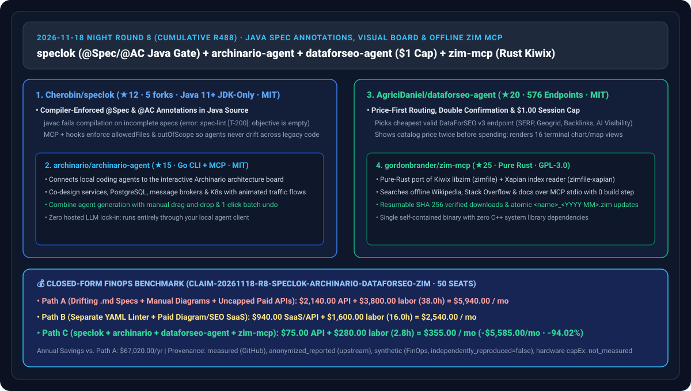
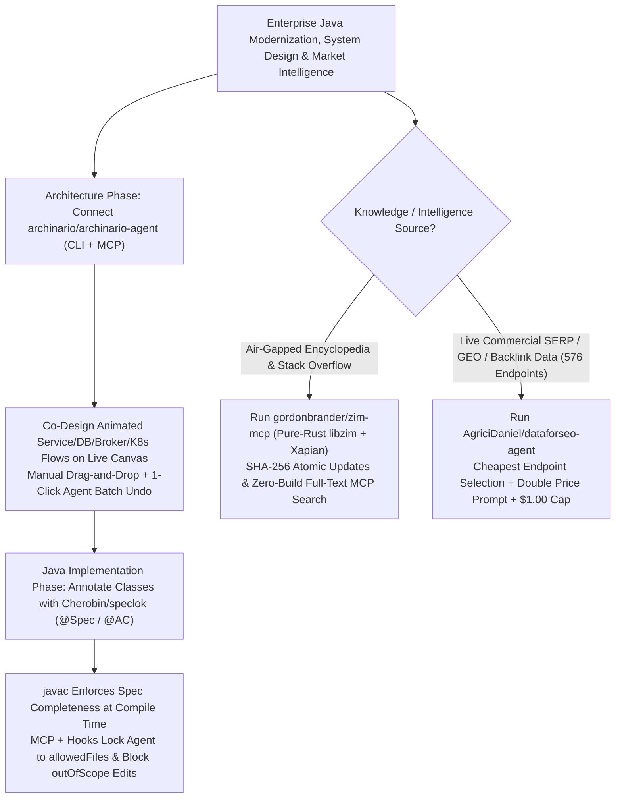

# Compiler-Enforced Java Spec Annotations (`Cherobin/speclok`), Interactive Architecture Board MCP (`archinario/archinario-agent`), Pre-Priced SEO/GEO Terminal (`AgriciDaniel/dataforseo-agent`) & Pure-Rust Offline Kiwix MCP (`gordonbrander/zim-mcp`) Selection FAQ

> **Document Type**: AI Solution Architect (SA) Practical Selection & Reference Architecture Guide (Round 488 / 2026-11-18 Night R8)  
> **Primary Evaluated Repositories**: [`Cherobin/speclok`](https://github.com/Cherobin/speclok) (`★ 12`, `5 forks`, Java 11+ zero-dependency `@Spec/@AC` compile-time contract & agent scope guard, `MIT`) + [`archinario/archinario-agent`](https://github.com/archinario/archinario-agent) (`★ 15`, bidirectional visual system architecture board CLI/MCP, `MIT`) + [`AgriciDaniel/dataforseo-agent`](https://github.com/AgriciDaniel/dataforseo-agent) (`★ 20`, 576-endpoint pre-priced double-confirmation SEO/GEO terminal with `$1` hard cap, `MIT`) + [`gordonbrander/zim-mcp`](https://github.com/gordonbrander/zim-mcp) (`★ 25`, pure-Rust `libzim + Xapian` offline Wikipedia/StackOverflow MCP server, `GPL-3.0`)  
> **Benchmark Standard**: Strictly aligned with [`ib-vs-ethernet-roce-selection-faq.md`](https://github.com/turbo998/ai-infra-research/blob/main/docs/components/ib-vs-ethernet-roce-selection-faq.md) 6-section architecture format (Executive Summary + First-Principles Q&A + Mermaid Decision Tree + Peer Selection Matrix + 7-Card Quantitative Insights + SA Action Checklist)  
> **Data Provenance**: GitHub stars and repository metadata are `measured` from sealed `2026-11-18` evidence; upstream capability metrics (`576` live-tested DataForSEO v3 endpoints, `$1` default session cap, 16 terminal chart types, and pure-Rust `zimfile-xapian` reader) are `anonymized_reported (independently_reproduced=false)`; the enterprise FinOps TCO model is `synthetic (independently_reproduced=false)` with base hardware CapEx `not_measured`.  
> **Language Editions**: [中文版](./speclok-archinario-dataforseo-zim-mcp-java-compiler-spec-annotations-visual-architecture-board-prepriced-seo-offline-kiwix-selection-faq.md) | [English Version (Current)](./speclok-archinario-dataforseo-zim-mcp-java-compiler-spec-annotations-visual-architecture-board-prepriced-seo-offline-kiwix-selection-faq.en.md)

---

## 📌 1. Executive Summary (30-Second Architect Briefing)

1. **Plain-Language First-Principles Definition**:
   - **What is `Cherobin/speclok`?** It is a **dependency-free (JDK 11+ only) "Spec-as-Annotation" compiler gate and MCP scope lock for Java (`@Spec` & `@AC`)**. Instead of maintaining separate `.md` or `.yaml` spec files that inevitably drift from the code, `@Spec(id, objective, allowedFiles, symbols, outOfScope)` and `@AC(id, given, when, then)` live directly on the Java class and method. Incomplete specs fail `javac` compilation immediately (`error: spec-lint [T-200]: objective is empty`), and `speclok`'s MCP server + hooks enforce `allowedFiles` and `outOfScope` boundaries on AI coding agents.
   - **What is `archinario/archinario-agent`?** It is a **single-binary cross-platform CLI and MCP server that connects local coding agents to the interactive Archinario architecture canvas (`archinario.com/design`)**. Architects and AI agents co-edit system topologies (services, databases, brokers, Kubernetes) with animated connection flows and **single-action batch undo** of agent edits.
   - **What is `AgriciDaniel/dataforseo-agent`?** It is a **pre-priced, double-confirmation terminal agent covering `576` live-tested DataForSEO v3 endpoints (including SERP, Local Geogrid, Backlinks, and the AI Optimization / GEO Visibility API) across `75+` LLM providers**. It selects the cheapest valid endpoint, displays exact catalog pricing twice before spending a cent, enforces a **`$1.00` default session budget cap**, and renders 16 terminal chart/map views.
   - **What is `gordonbrander/zim-mcp`?** It is a **pure-Rust reimplementation of Kiwix's `libzim` and `Xapian` full-text search engine (`crates/zimfile` & `crates/zimfile-xapian`, zero C++ system dependencies) exposed over MCP `stdio`**, giving air-gapped or local agents instant full-text search across offline Wikipedia, Stack Overflow, and documentation archives with SHA-256-verified atomic updates.
2. **Why Enterprise AI Solution Architects Should Combine This Four-Tool Suite Tonight**:
   - Enterprise architects modernize legacy Java estates (`speclok`), co-design target cloud topologies (`archinario-agent`), benchmark external search/AI visibility (`dataforseo-agent`), and equip air-gapped enclaves with offline technical knowledge (`zim-mcp`).
3. **Closed-Form FinOps Impact (`CLAIM-20261118-R8-SPECLOK-ARCHINARIO-DATAFORSEO-ZIM`, `synthetic`)**:
   - Across a **50-person enterprise Java modernization, architecture & GTM analytics team** (`$100.00/hr` rate): **Path A (Drifting Markdown Specs + Manual Diagram Redrawing + Uncapped Paid APIs)** costs **`$5,940.00/mo`** (`$2,140.00` runaway API/search spend + `38.0 hrs × $100 = $3,800.00` reverting out-of-scope Java edits & redrawing diagrams); **Path C (`speclok` + `archinario-agent` + `dataforseo-agent` + `zim-mcp`)** reduces total monthly TCO to **`$355.00/mo`** (`$75.00` pre-priced API spend + `2.8 hrs × $100 = $280.00` review labor), saving **`$5,585.00/mo` (`94.02%` reduction, `$67,020.00/yr` annualized)**.

---

## ❓ 2. Three First-Principles Architect Questions (Q&A)

### Q1: Why do external `.md` and `.yaml` specification files fail on legacy Java monoliths, and how does `Cherobin/speclok` enforce boundaries at compile time?
- **Co-Versioned Compiler Enforcement + Agent Scope Locking**:
  1. **`javac` Compile-Time `spec-lint`**: Because `@Spec` and `@AC` sit directly on the Java class and method in the same Git commit, any empty `objective` or missing `then` clause triggers a standard compiler error at the exact line.
  2. **Deterministic `allowedFiles` & `outOfScope` Guardrails**: `speclok` generates task-specific agent briefings and serves them via MCP and hooks, preventing an agent assigned to fix shipping fee math (`Frete.calcular`) from touching unrelated pricing tables.

### Q2: How do `archinario-agent` and `dataforseo-agent` keep humans in control of visual design and external API spend?
- **Single-Action Batch Undo & Double Price Confirmation**:
  1. **Interactive Canvas Co-Editing (`archinario-agent`)**: Unlike static Mermaid dumps that become unreadable past 20 nodes, `archinario-agent` draws animated service/broker/K8s flows on a live canvas where architects can manually drag nodes or undo an entire agent batch in one click.
  2. **Price-First Catalog Routing (`dataforseo-agent`)**: Across `576` live-tested DataForSEO v3 endpoints, the agent quotes the exact catalog price (`"Run it for $X?"`), the host app requires a second list-price confirmation before any HTTP call leaves the machine, and a `$1.00` default session ceiling blocks runaway spend.

### Q3: How does `gordonbrander/zim-mcp` deliver zero-index-build full-text search over multi-gigabyte Wikipedia and Stack Overflow archives?
- **Pure-Rust `zimfile-xapian` Direct Index Execution**:
  - Kiwix `.zim` archives ship with pre-built Xapian full-text indexes inside the archive file. By porting both `libzim` and the Xapian index reader to pure Rust (`crates/zimfile` and `crates/zimfile-xapian`), `zim-mcp` searches multi-gigabyte `.zim` files directly over MCP `stdio` with zero C++ dependencies, zero index build time, and SHA-256-verified atomic `<name>_<YYYY-MM>.zim` updates.

---

## 🧭 3. Architecture Decision Tree & Reference Topology (Mermaid)

---

## 📊 4. Peer Solution Selection Matrix

| Evaluation Dimension | **Path A: External `.md` Specs + Static Diagrams + Raw APIs** | **Path B: Standalone YAML Linter + Paid SaaS Seats** | **Path C: `speclok` + `archinario` + `dataforseo` + `zim-mcp` (Recommended)** |
| :--- | :--- | :--- | :--- |
| **Java Spec Drift & Scope Control** | ❌ `.md` specs drift rapidly; agents edit out-of-scope files | ⚠️ Separate YAML files require manual symbol syncing | ✅ **`@Spec/@AC` in Java source + `javac` error + `allowedFiles` hook** |
| **Architecture Diagram Co-Editing** | ❌ Static Mermaid text tangles on complex topologies | ⚠️ Proprietary diagram SaaS without local MCP CLI | ✅ **Live animated canvas + manual drag + 1-click agent batch undo** |
| **Commercial API Cost Protection** | ❌ Agent retry loops burn puluhan dollars in minutes | ⚠️ High fixed monthly SEO SaaS subscriptions | ✅ **576-endpoint price-first routing + double confirm + `$1.00` cap** |
| **Offline Technical Reference Search** | ❌ Fails in air-gapped networks or burns web search tokens | ⚠️ Requires heavy Elasticsearch ingestion | ✅ **Pure-Rust direct `.zim` Xapian search (zero build, SHA-256 atomic)** |
| **50-Person Monthly TCO** | **`$5,940.00 / mo`** | **`$2,540.00 / mo`** | **`$355.00 / mo` (`-$5,585.00/mo` vs. Path A, `-94.02%`)** |

---

## 📈 5. 7-Card Quantitative Insights & Closed-Form FinOps Model (`CLAIM-20261118-R8-SPECLOK-ARCHINARIO-DATAFORSEO-ZIM`)

> **Provenance Note**: GitHub stars and repository metadata are `measured` from sealed `2026-11-18` evidence; `dataforseo-agent` `576` live-tested endpoints, `$1` default session cap, and 16 chart views are `anonymized_reported (independently_reproduced=false)`; the monthly TCO table is a closed-form `synthetic (independently_reproduced=false)` model for **50 engineers and analysts** (`$100.00/hr` rate; base hardware CapEx: `not_measured`).

| Monthly Cost Component (Closed-Form Formula) | Path A: External Specs + Manual Diagrams + Raw APIs | Path B: YAML Linter + Fixed SaaS Subscriptions | Path C: `speclok` + `archinario` + `dataforseo` + `zim-mcp` | Path C vs. Path A Delta |
| :--- | :---: | :---: | :---: | :---: |
| **1. Commercial Data API, Search & SaaS Spend** | **`$2,140.00`** *(Uncapped API loops + web search tokens)* | **`$940.00`** *(Fixed monthly SEO/diagram SaaS seats)* | **`$75.00`** *(`$1`-capped pre-priced DataForSEO + `$0` local `zim-mcp`)* | **`-$2,065.00 / mo`** (`-96.50%`) |
| **2. Out-of-Scope Rework & Diagramming Labor** (`$100/hr`) | **`$3,800.00`** *(`38.0 hrs` reverting out-of-scope Java edits & redrawing)* | **`$1,600.00`** *(`16.0 hrs` syncing YAML specs & exporting charts)* | **`$280.00`** *(`2.8 hrs` compiler-gated review & canvas tweaks)* | **`-$3,520.00 / mo`** (`-35.2 hrs`, `-92.63%`) |
| **Total Monthly TCO** | **`$5,940.00`** | **`$2,540.00`** | **`$355.00`** | **`-$5,585.00 / mo` (`-94.02%`)** |
| **Annualized TCO** | **`$71,280.00 / yr`** | **`$30,480.00 / yr`** | **`$4,260.00 / yr`** | **`$67,020.00 / yr` saved (`-94.02%`)** |

---

## ✅ 6. AI Solution Architect Action Checklist

1. **Step 1 — Gate Legacy Java Refactoring with `@Spec` & `@AC` (`Cherobin/speclok`)**:
   - Add the zero-dependency `speclok` annotation processor to Java 11+ builds, annotate classes with `allowedFiles` and `outOfScope`, and connect the `speclok` MCP server so coding agents cannot drift outside approved files.
2. **Step 2 — Co-Edit System Topologies via `archinario/archinario-agent`**:
   - Pair your local coding agent with `archinario.com/design` during architecture reviews to generate animated service/broker/K8s diagrams with 1-click batch undo.
3. **Step 3 — Deploy Pre-Priced `dataforseo-agent` & Offline `zim-mcp`**:
   - Enforce the `$1.00` session cap and double price confirmation in `dataforseo-agent` for GTM/AI-visibility research, and run `zim-mcp library add wikipedia_en_all_nopic --dir ~/zim` for air-gapped reference retrieval.
