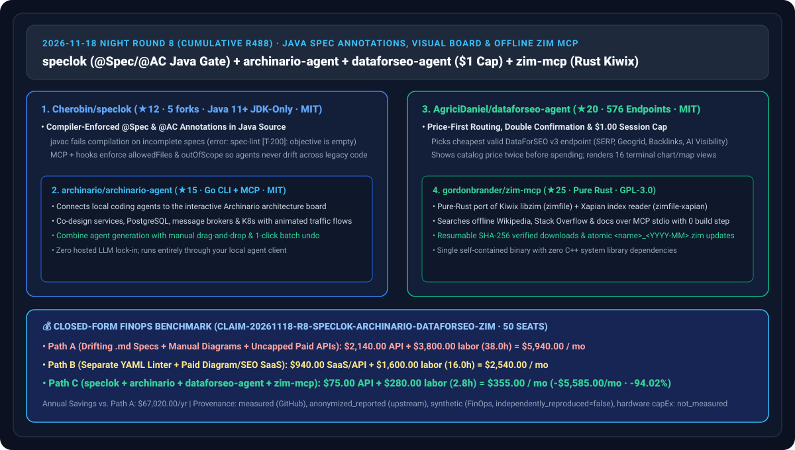
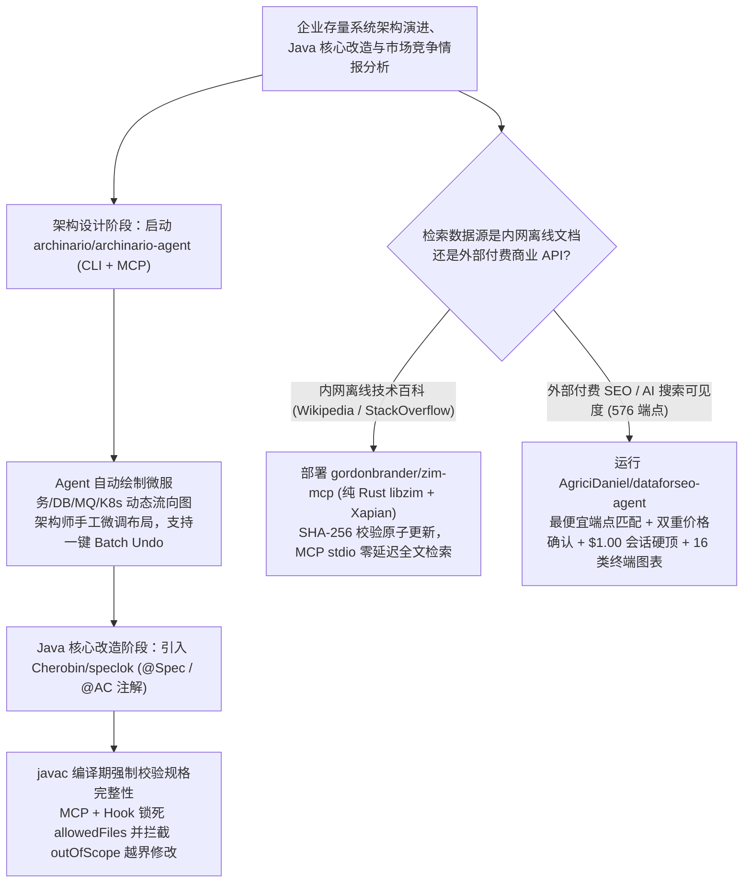

# Java 编译期规格注解锁（`Cherobin/speclok`）、人机双向动态架构画板（`archinario/archinario-agent`）、预报价双确认 SEO/GEO 终端（`AgriciDaniel/dataforseo-agent`）与纯 Rust 离线 Kiwix 百科 MCP（`gordonbrander/zim-mcp`）选型 FAQ

> **文档类型**：AI Solution Architect (SA) 实战选型与参考架构指南（Round 488 / 2026-11-18 Night R8）  
> **核心评估对象**：[`Cherobin/speclok`](https://github.com/Cherobin/speclok)（`★ 12`，`5 forks`，Java 11+ 零依赖 `@Spec/@AC` 编译期规格校验与 Agent 范围锁，`MIT`） + [`archinario/archinario-agent`](https://github.com/archinario/archinario-agent)（`★ 15`，人机共绘动态系统架构白板 CLI/MCP，`MIT`） + [`AgriciDaniel/dataforseo-agent`](https://github.com/AgriciDaniel/dataforseo-agent)（`★ 20`，576 端点预报价双确认与 `$1` 硬顶的 SEO/AI 可见度终端，`MIT`） + [`gordonbrander/zim-mcp`](https://github.com/gordonbrander/zim-mcp)（`★ 25`，纯 Rust 重写 `libzim + Xapian` 的离线维基/StackOverflow 检索 MCP，`GPL-3.0`）  
> **对标范式**：严格遵循 [`ib-vs-ethernet-roce-selection-faq.md`](https://github.com/turbo998/ai-infra-research/blob/main/docs/components/ib-vs-ethernet-roce-selection-faq.md) 六段式结构（核心结论速览 + 三大灵魂拷问 + Mermaid 决策树 + 选型对比矩阵 + 7-Card 定量洞察 + SA 落地 Checklist）  
> **数据溯源分级（Provenance）**：GitHub 星标与目录元数据为 `measured`；上游特性参数（如 `dataforseo-agent` `576` 个实测 v3 端点、`$1` 会话硬预算与 16 类终端图表）标注为 `anonymized_reported (independently_reproduced=false)`；企业 FinOps 成本算例为 `synthetic (independently_reproduced=false)`，硬件折旧 `not_measured`。  
> **语言版本**：[中文版 (当前)](./speclok-archinario-dataforseo-zim-mcp-java-compiler-spec-annotations-visual-architecture-board-prepriced-seo-offline-kiwix-selection-faq.md) | [English Version](./speclok-archinario-dataforseo-zim-mcp-java-compiler-spec-annotations-visual-architecture-board-prepriced-seo-offline-kiwix-selection-faq.en.md)

---

## 📌 一、核心结论速览（Executive Summary — 30 秒看懂）

1. **大白话本质定义**：
   - **`Cherobin/speclok` 是什么？** 它是 **专为大型老旧 Java 工程打造的“规格即代码注解（Spec-as-Annotation）”编译器门禁与 Agent 边界锁**。它不写容易腐烂过期的外部 `.md`/`.yaml`，而是直接把业务目标、允许修改的文件白名单（`allowedFiles`）、禁区（`outOfScope`）和 Given/When/Then 验收标准（`@AC`）写成 Java 类与方法头上的 `@Spec` 注解；一旦规格没写全，`javac` 编译当场报错（`error: spec-lint [T-200]: objective is empty`），并通过 Hook 与 MCP 锁死 AI Agent 的修改范围。
   - **`archinario/archinario-agent` 是什么？** 它是 **连接本地 Coding Agent 与在线交互式系统架构画板（`archinario.com/design`）的单二进制 CLI + MCP 桥接器**。架构师用一句话让 Agent 画出微服务、PostgreSQL、消息队列与 K8s 拓扑（带动态流向动画），既能亲手拖拽微调，又能对 Agent 的整批修改执行**一键原子撤销（Single-Action Batch Undo）**。
   - **`AgriciDaniel/dataforseo-agent` 是什么？** 它是 **覆盖 `576` 个实测 DataForSEO v3 端点与 `75+` 模型提供商的“先报价、双确认、默认 `$1` 会话硬封顶”自然语言 SEO/GEO 终端**。每次调用付费 API 前先从目录算出精确美元价格并弹窗二次确认，将返回结果渲染为 16 种终端图表与地理网格（Geogrid）。
   - **`gordonbrander/zim-mcp` 是什么？** 它是 **用纯 Rust 从头重写 `libzim` 与 `Xapian` 全文检索引擎（`crates/zimfile` & `crates/zimfile-xapian`，零 C++ 系统库依赖）的离线 Kiwix `.zim` 档案库 MCP 服务器**，让气隙内网或移动办公 Agent 直接秒级检索离线 Wikipedia、Stack Overflow 与全套技术文档。
2. **为什么企业 AI 解决方案架构师（SA）今晚要把这四款工具组合进架构师工具箱？**
   - 它们分别解决了企业存量系统改造与方案设计中的四大痛点：**存量 Java 改代码防越界（`speclok`）**、**系统架构图人机共绘防重画（`archinario-agent`）**、**外部商业数据 API 按分计价防刷爆账单（`dataforseo-agent`）**、**断网环境技术百科零成本检索（`zim-mcp`）**。
3. **闭式 FinOps 量化收益（`CLAIM-20261118-R8-SPECLOK-ARCHINARIO-DATAFORSEO-ZIM`，`synthetic`）**：
   - 以 **50 人企业存量 Java 现代化、架构设计与市场增长分析团队**（时薪 `$100.00/hr`）计：**Path A（外置 Markdown 规格漂移 + 手工重画架构图 + 裸跑未设上限的商业数据 API）** 月均总成本 **`$5,940.00`**（API 误调与外网检索账单 `$2,140.00` + 回滚 Java 越界改动与手工改图人工 `38.0h × $100 = $3,800.00`）；**Path C（`speclok` + `archinario-agent` + `dataforseo-agent` + `zim-mcp`）** 月均总成本降至 **`$355.00`**（受 `$1` 硬顶保护的精准 API 支出 `$75.00` + 架构复核人工 `2.8h × $100 = $280.00`），**净省 `$5,585.00/月`（降幅 `94.02%`，年化节省 `$67,020.00`）**。

---

## ❓ 二、三大灵魂拷问（First-Principles Q&A）

### Q1：为什么给老旧 Java 核心系统写 `.md` 或 `.yaml` 规格文档总是在两周后沦为废纸？`Cherobin/speclok` 的 `@Spec` 注解为什么不会漂移？
- **第一性原理：只有跟代码活在同一个 Git Commit 且受编译器强制检查的契约才不会过期**：
  1. **编译器级 `spec-lint` 强约束（零第三方依赖，纯 JDK 11+）**：就像 `javac` 会拒绝错误的 `@Override` 一样，只要类或方法上的 `@Spec(id = "T-200", objective = "...", allowedFiles = {...}, outOfScope = {...})` 缺少 `objective` 或 `@AC` 缺少 `then` 断言，IDE 和编译器直接在对应行划红线报错。
  2. **AI 编码 Agent 的硬护栏（AllowedFiles & OutOfScope）**：`speclok` 通过内置 MCP 与 Hook 将当前任务允许触碰的文件列表（如仅限 `Frete.java` 与 `FreteSpecTest.java`）和明确禁止事项（如 `"禁止修改价格表"`）直接注入并拦截越界写入，彻底终结“让 AI 修运费计算 Bug，结果它顺手把全站免邮门槛改了”的生产事故。

### Q2：用 Mermaid 生成静态图和用 `archinario/archinario-agent` 连画板有什么区别？`AgriciDaniel/dataforseo-agent` 又是怎么防止 Agent 把按次计费 API 刷爆的？
- **交互式协作与事前精确计价（Price-First Execution）**：
  1. **`archinario-agent` 的人机共编与单步批次撤销**：静态 Mermaid 一旦到了几十个节点就会排布崩坏且难以局部微调；`archinario-agent` 通过本地 MCP 驱动画板生成带动态流量动画的架构图，架构师可手工拖拽调整节点，若对 Agent 的某次修改不满意，一键 `Undo` 即可整批回退 Agent 的本轮操作。
  2. **`dataforseo-agent` 的三重成本锁**：面对 DataForSEO 的 `576` 个 v3 端点（涵盖 SERP、关键词、外链、本地 Geogrid 与 AI 搜索引擎可见度 `AI Optimization API`），Agent 先选出最便宜且正确的端点并报出目录价（`"Run it for $X?"`），随后客户端应用再弹一次官方目录价确认框，且内置默认 **`$1.00` 会话硬预算上限**（耗尽即物理熔断请求）。

### Q3：为什么 `gordonbrander/zim-mcp` 要用纯 Rust 重写 `libzim` 和 `Xapian`？它在企业内网有什么妙用？
- **告别 C++ 动态库地狱 + 零构建即插即用**：
  - 传统读取 Kiwix `.zim` 离线包必须编译庞大的 C++ `libzim` 与 `xapian-core`。`zim-mcp` 在仓库内用纯 Rust 实现了 `crates/zimfile` 与 `crates/zimfile-xapian`，编译出单个免依赖可执行文件；而且因为 Kiwix 官方 `.zim` 包内部自带预构建好的 Xapian 全文索引，下载校验 SHA-256 后（自动以 `<name>_<YYYY-MM>.zim` 原子替换旧包）**0 秒建索引即可通过 MCP `stdio` 全文检索整座 Wikipedia 与 Stack Overflow**！

---

## 🧭 三、架构师选型决策树与端到端参考架构（Mermaid）

---

## 📊 四、同类方案横向选型对比矩阵（Peer Selection Matrix）

| 评估维度 | **Path A：外置 Markdown 规格 + 静态图 + 裸跑付费 API** | **Path B：独立 YAML 校验器 + 商业绘图/SEO SaaS** | **Path C：`speclok` + `archinario` + `dataforseo` + `zim-mcp`（推荐）** |
| :--- | :--- | :--- | :--- |
| **Java 规格与代码同步性** | ❌ `.md` 与代码分离，两周即漂移；AI 常越界乱改文件 | ⚠️ 独立 YAML 仍需人工维护路径映射 | ✅ **`@Spec/@AC` 编译期报错 + `allowedFiles`/`outOfScope` 硬门禁** |
| **系统架构图人机协同体验** | ❌ 纯文本 Mermaid 节点多时连线混乱，无法手工微调 | ⚠️ 商业白板无本地开放 MCP 接口 | ✅ **Agent 自动生成动态流向图 + 手工拖拽 + 一键整批撤销** |
| **按次计费商业 API 成本控制** | ❌ Agent 循环重试瞬间刷爆几十美元 API 账单 | ⚠️ 商业 SEO SaaS 月费高昂（`$100–$500/月`） | ✅ **576 端点选最便宜调用 + 双重报价确认 + `$1.00` 会话硬封顶** |
| **离线权威百科与技术问答检索** | ❌ 断网即抓瞎，或持续消耗外网搜索 API | ⚠️ 需自建 Elasticsearch 导入数百万词条 | ✅ **纯 Rust 直读 `.zim` 内置 Xapian 索引（零构建、SHA-256 原子更新）** |
| **50 人团队月均总拥有成本 (TCO)** | **`$5,940.00 / 月`** | **`$2,540.00 / 月`** | **`$355.00 / 月`（较 Path A 净省 `$5,585.00/月`，`-94.02%`）** |

---

## 📈 五、7-Card 定量洞察与闭式 FinOps 算例（`CLAIM-20261118-R8-SPECLOK-ARCHINARIO-DATAFORSEO-ZIM`）

> **Provenance 声明**：GitHub 星标与目录元数据源自 `2026-11-18` 封存证据（`measured`）；`dataforseo-agent` `576` 个实测端点、`$1` 默认预算上限与 16 类终端图表参数源自上游文档（`anonymized_reported`, `independently_reproduced=false`）；月度 TCO 为面向 **50 人企业研发、架构与市场分析团队** 的闭式合成模型（`synthetic`, `independently_reproduced=false`；宿主机硬件折旧 CapEx：`not_measured`）。

| 成本构成项（月度闭式公式） | Path A：外置规格 + 手工重画图 + 无护栏 API | Path B：独立 YAML + 商业 SaaS 订阅 | Path C：`speclok` + `archinario` + `dataforseo` + `zim-mcp` | Path C 对比 Path A 净变化 |
| :--- | :---: | :---: | :---: | :---: |
| **1. 商业数据 API、搜索 Token 与 SaaS 支出** | **`$2,140.00`** *(API 误调超支 + 外网搜索 Token + 越界重跑)* | **`$940.00`** *(固定 SEO SaaS 席位费 + 云端检索)* | **`$75.00`** *(`$1` 硬顶按需 DataForSEO + `$0` 本地 `zim-mcp`)* | **`-$2,065.00 / 月`** (`-96.50%`) |
| **2. Java 越界返工与架构图重绘人工成本** (`$100/hr`) | **`$3,800.00`** *(`38.0 hrs`：回滚 AI 越界改动与手工调架构图)* | **`$1,600.00`** *(`16.0 hrs`：同步 YAML 规格与导出报表)* | **`$280.00`** *(`2.8 hrs`：编译器自动拦截，仅做最终评审)* | **`-$3,520.00 / 月`** (`-35.2 hrs`, `-92.63%`) |
| **月度总拥有成本 (Monthly Total TCO)** | **`$5,940.00`** | **`$2,540.00`** | **`$355.00`** | **`-$5,585.00 / 月` (`-94.02%`)** |
| **年化总拥有成本 (Annualized TCO)** | **`$71,280.00 / 年`** | **`$30,480.00 / 年`** | **`$4,260.00 / 年`** | **年省 `$67,020.00` (`-94.02%`)** |

---

## ✅ 六、AI 解决方案架构师（SA）实战落地 Checklist

1. **Step 1 — 在存量 Java 工程接入 `Cherobin/speclok` 编译期规格锁**：
   - 将零依赖 `speclok` 引入 Maven/Gradle，为核心业务类补齐 `@Spec(id, objective, allowedFiles, symbols, outOfScope)` 与 `@AC(given, when, then)`，挂载 `speclok` MCP 与 Hook 阻止 AI 触碰 `allowedFiles` 之外的任何代码。
2. **Step 2 — 用 `archinario/archinario-agent` 开展人机共绘架构评审**：
   - 在架构评审会上打开 `archinario.com/design` 授权本地 `archinario-agent` MCP，由 Agent 生成初始微服务/K8s 动态拓扑，架构师现场拖拽定稿。
3. **Step 3 — 部署 `AgriciDaniel/dataforseo-agent` 与 `gordonbrander/zim-mcp` 内外检索双擎**：
   - 为增长团队配置带 `$1.00` 默认硬顶的 `dataforseo-agent` 查询 AI 搜索可见度（AI Optimization API）与关键词地理网格；在内网环境执行 `cargo install zim-mcp && zim-mcp library add wikipedia_en_all_nopic --dir ~/zim` 提供零成本离线权威检索。
