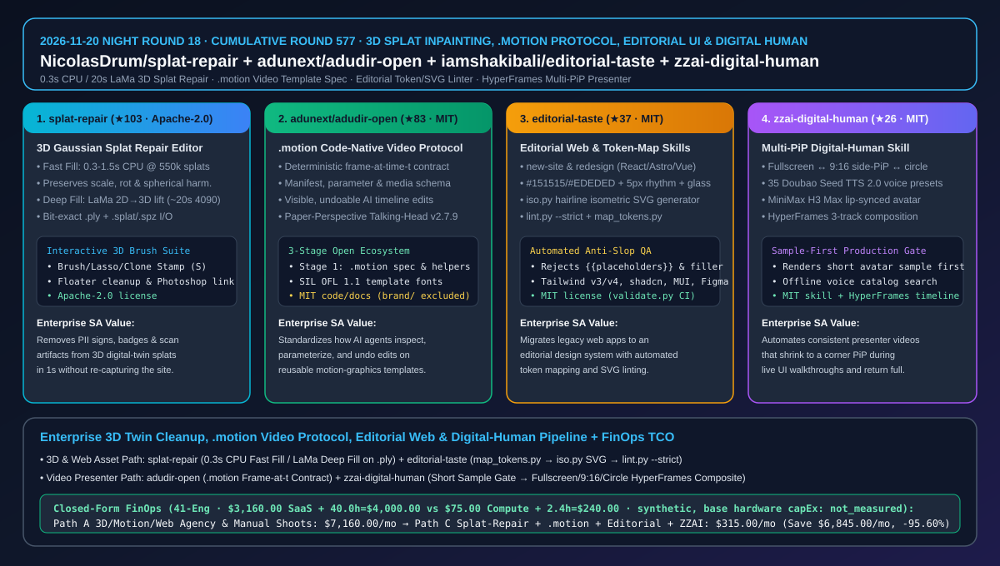
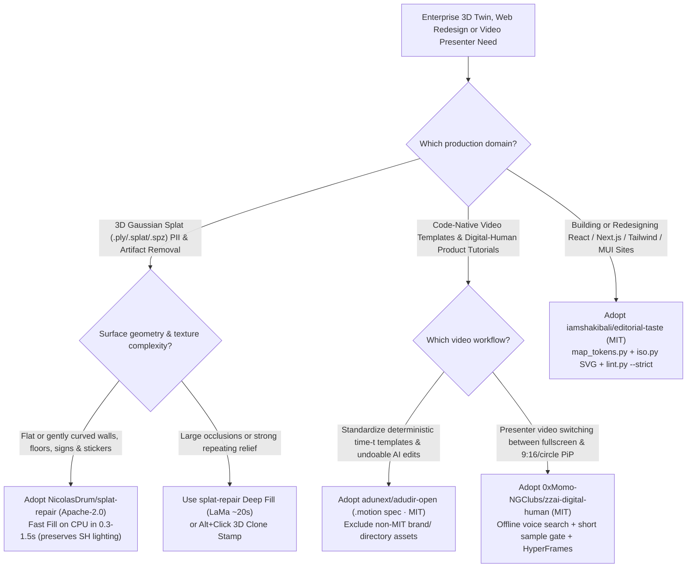
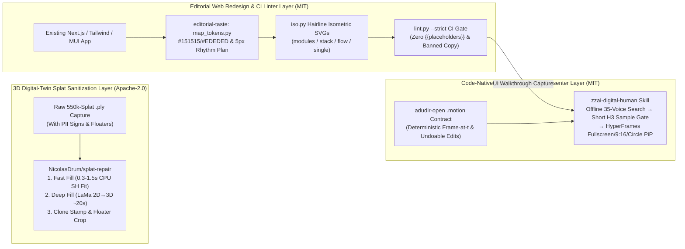

# How to Choose 3D Gaussian Splat Repair Editors, `.motion` Code-Native Video Protocols, Editorial Web Redesign Skills, and Multi-PiP Digital-Human Workflows? `splat-repair`, `adudir-open`, `editorial-taste`, and `zzai-digital-human` Architecture & Selection FAQ

> **Document Metadata (2026-11-20 Night Round 18 · Cumulative Round 577)**
> - **Target Audience**: AI Solution Architects, 3D Digital-Twin & Spatial Computing Architects, Frontend Design-System Leads, Multimodal Video Automation Architects
> - **Primary Repositories Evaluated**:
>   1. [`NicolasDrum/splat-repair`](https://github.com/NicolasDrum/splat-repair) (★ 103 · `stars_today: not_measured` · `26 stars/day` · Python · Apache-2.0) — Interactive 3D Gaussian Splat editor ("Photoshop for Gaussian Splats") reading and writing `.ply` (bit-exact round-trip), `.splat`, and `.spz`. Provides **Fast Fill** (geometric surface fit copying nearby splats to preserve scale, rotation, and spherical harmonics in **`0.3–1.5 s` on CPU** for a `550,000`-splat scan), **Deep Fill** (renders a 2D view, inpaints with **LaMa**, and lifts the result back into 3D splats in **`~20 s` on an RTX 4090**), `Clone Stamp (S)`, floater cleanup, and an optional Adobe Photoshop bridge
>   2. [`adunext/adudir-open`](https://github.com/adunext/adudir-open) (★ 83 · `stars_today: not_measured` · `17 stars/day` · Python · MIT code/docs + SIL OFL 1.1 template fonts) — Open specification and reference structure for the **`.motion` code-native video template format and protocol** (`docs/motion-format.md`, `docs/editor-architecture.md`, and `"Paper Perspective · Talking Head"` v2.7.9), defining deterministic frame rendering at time `t`, manifest/parameter schemas, and visible, undoable AI timeline edits (with `brand/` character/icon assets explicitly excluded from the MIT license)
>   3. [`iamshakibali/editorial-taste`](https://github.com/iamshakibali/editorial-taste) (★ 37 · `stars_today: not_measured` · `12 stars/day` · Python · MIT) — Monochrome, photography-led editorial web design and redesign skills (`editorial-taste-new-site` & `editorial-taste-redesign` across Astro, Next.js/React, Vue, Svelte, Tailwind v3/v4, shadcn, MUI, and Figma) shipping `map_tokens.py` (legacy token mapper), `iso.py` (isometric hairline SVG generator across `modules`, `stack`, `flow`, `single` presets), `images.py`, and `lint.py --strict` (blocking leftover `{{placeholders}}` and generic filler)
>   4. [`0xMomo-NGClubs/zzai-digital-human`](https://github.com/0xMomo-NGClubs/zzai-digital-human) (★ 26 · `stars_today: not_measured` · `7 stars/day` · Python · MIT) — Multi-layout digital-human presenter skill (`$zzai-digital-human`) that transitions a consistent presenter across **full-screen talking head, `9:16` side-docked vertical PiP, and circular close-up** on a **HyperFrames** multi-track timeline, backed by offline browsing of 35 `doubao-seed-tts-2.0` voice presets and a mandatory short avatar sample gate (`minimax-h3-comfyui-max`) before full batch rendering
> - **Provenance & Guardrail Statement**: Structured after `ib-vs-ethernet-roce-selection-faq.md`. All four repositories come from `search-new-repos-2026-11-20-raw.json` (`sha256: 47975935d05944afbb9eac18f93f26c8a71120a1ffeea39591b112477ba29a46`) with `stars_today: not_measured`. Upstream README timings (`0.3–1.5 s` CPU Fast Fill on 550k splats, `~20 s` RTX 4090 Deep Fill) are labeled `anonymized_reported (independently_reproduced=false)`. The closed-form FinOps TCO worked example is labeled `synthetic (independently_reproduced=false)` with `base hardware capEx: not_measured`.

---

## ① 📌 Executive Summary (One-Sentence Selection Verdict)

> **One-Sentence Verdict**: When delivering **enterprise 3D digital-twin scans, reusable AI video templates, monochrome editorial web portals, and digital-human product tutorials**, **never re-shoot or re-train an entire 3D Gaussian Splat scene just to remove a sign or badge, and never lock a digital-human presenter into a static full-screen frame that occludes your software walkthrough**! Instead, clean 3DGS captures locally with Apache-2.0 **`NicolasDrum/splat-repair` (`0.3–1.5 s` CPU geometric Fast Fill preserving spherical harmonics + LaMa Deep Fill)**, standardize template-driven video editing on MIT-licensed **`adunext/adudir-open` (`.motion` frame-at-time-`t` protocol) + `zzai-digital-human` (sample-first avatar gate + HyperFrames full-screen/PiP switching)**, and govern frontend redesigns with MIT-licensed **`iamshakibali/editorial-taste` (`map_tokens.py` + `iso.py` hairline SVGs + `lint.py --strict`)** to reduce a 41-person engineering and creative team's monthly agency, SaaS, and rework TCO from **$7,160.00/mo** down to **$315.00/mo** (saving **$6,845.00/mo**, **`-95.60%`**, `synthetic, independently_reproduced=false`).



### Core Capabilities & Metrics Cheat Sheet

| Dimension | `NicolasDrum/splat-repair` | `adunext/adudir-open` | `iamshakibali/editorial-taste` | `0xMomo-NGClubs/zzai-digital-human` |
|---|---|---|---|---|
| **Plain-English Positioning** | Interactive 3D Gaussian Splat repair brush with `0.3–1.5 s` CPU geometric fill & LaMa 2D→3D inpainting | Open `.motion` video template format & editor contract with visible, undoable AI timeline edits | Monochrome editorial web builder & redesign skill suite with token mapping, isometric SVG generator & strict linter | Digital-human tutorial skill combining 35 voice presets, sample-first lip-sync QA & HyperFrames multi-PiP layouts |
| **Primary Enterprise Pain Point Solved** | Removing PII signs, stickers, or floaters from 3DGS scans without 45-minute scene re-training | Opaque binary video project files where AI edits cannot be inspected, parameterized, or undone step-by-step | AI-generated websites plagued by generic gradients, drop-shadow clutter, clip-art, and leftover `{{placeholders}}` | Talking-head avatars either hiding the product UI screen recording or disappearing completely during demos |
| **Key Technical / Measured Spec** | **Fast Fill**: `0.3–1.5 s` CPU on `550,000` splats; **Deep Fill**: LaMa `~20 s` on RTX 4090; bit-exact `.ply` round-trip | Frame-at-time-`t` rendering contract; `"Paper Perspective · Talking Head"` v2.7.9 manifest/parameter spec | `#151515`/`#EDEDED` + `5px` rhythm; `map_tokens.py`, `iso.py` (`4` presets), `lint.py --strict`, `validate.py` | Offline `zzai.py voices` (35 presets); `minimax-h3-comfyui-max` sample gate; full ↔ `9:16` ↔ circle PiP |
| **License & Governance** | **Apache-2.0** (commercial-ready) | **MIT code/docs + SIL OFL 1.1 fonts** (`brand/` directory is excluded from MIT) | **MIT** (commercial-ready across code & Figma) | **MIT** (first-party skill/templates MIT; external APIs billed per provider terms) |

---

## ② 🎯 Solution Architect & Customer Deep-Dive Q&A

### Q1: In enterprise 3D Gaussian Splatting (3DGS) digital twins (factories, retail stores, real estate), why does deleting splats leave holes or break lighting, and when should architects use `splat-repair`'s Fast Fill vs. Deep Fill vs. Clone Stamp?

- **Why Raw Splat Deletion Fails**:
  - Each Gaussian splat stores position, 3D scale, rotation quaternion, and view-dependent spherical harmonics (SH). Simply deleting splats over a wall sign or employee badge leaves a void, while re-training the entire scene from source photos after masking takes 30–60 minutes on a GPU.
- **How `NicolasDrum/splat-repair` (Apache-2.0) Triages 3D Surface Repair**:
  1. **`Fast Fill` (`0.3–1.5 s` on CPU for `550,000` Splats — Best for Walls, Floors, Signs, Stickers & Small Handles)**:
     - Fits the geometric surface around the painted 3D Brush (`B`) or Lasso (`L`) selection and **copies whole splats from the immediate neighborhood**—preserving scale, rotation, and spherical harmonics in under `1.5 seconds` on CPU (`anonymized_reported, independently_reproduced=false`).
  2. **`Deep Fill` (`~20 s` on RTX 4090 — Best for Larger Multi-Region Occlusions)**:
     - Renders a 2D view, runs **LaMa** inpainting (or optionally bridges to local **Adobe Photoshop** Content-Aware/Generative Fill), and lifts the inpainted pixels back into 3D splats.
  3. **`Clone Stamp (S)` (Best for Strong Repeating Relief)**:
     - As the author candidly documents, automatic fills struggle on strong repeating relief (like the tread of a shoe sole); `Alt+click` sets a 3D source anchor so operators can hand-stamp repeating geometry, saving results in bit-exact `.ply` (or `.splat`/`.spz`).

### Q2: How do `adunext/adudir-open` (`.motion` protocol) and `0xMomo-NGClubs/zzai-digital-human` (HyperFrames) turn opaque video editing into a deterministic, multi-layout code pipeline?

- **`adunext/adudir-open` (MIT): The `.motion` Deterministic Frame-at-Time-`t` Contract**:
  - Defines a clean contract (`docs/motion-format.md`, `docs/editor-architecture.md`) for how a `.motion` template declares its manifest, typed parameters, media slots, and usage guide (illustrated by `templates/paper-perspective-talking-head/` v2.7.9), how pages render exact frames for any timestamp `t`, and how AI agents apply structured, visible, undoable edits.
  - ⚠️ **License Carve-Out**: While the code/docs are **MIT** and template fonts are **SIL OFL 1.1**, the app icons and character art in `brand/` are proprietary ADu Director brand assets and must be stripped before third-party commercial packaging.
- **`0xMomo-NGClubs/zzai-digital-human` (MIT): Sample-Gated Multi-PiP Presenter Composition**:
  - Solves the "talking head vs. screen demo" conflict by compositing separate presenter, audio, and screen-demo tracks in **HyperFrames**—starting full-screen for the hook, shrinking the presenter into a **`9:16` side window or circular close-up** while demonstrating UI steps (with per-card aspect/position overrides), and returning full-screen for the conclusion.
  - Prevents wasted API spend by browsing 35 `doubao-seed-tts-2.0` voices offline (`zzai.py voices` needs no API key) and rendering **one short `minimax-h3-comfyui-max` sample clip first** to verify lip-sync and framing before batch-generating all segments.

### Q3: How does `iamshakibali/editorial-taste` turn subjective "high-taste web design" into deterministic token mapping, procedural isometric SVGs, and strict CI linting?

- **Four Automated Guardrails Against Generic "AI Slop" Websites**:
  1. **Quantitative Design Tokens (`tokens.css` & `foundations.md`)**: Enforces Geist / Geist Mono typography, `#151515` and `#EDEDED` with opacity steps, a strict `5px` spacing rhythm, and glass blur instead of drop shadows across Astro, Next.js/React, Vue, Svelte, Tailwind v3/v4, shadcn, MUI, and Figma.
  2. **Automated Legacy Codebase Migration (`map_tokens.py`)**: Scans existing `src/` trees to generate a deterministic token replacement plan before section-by-section restyling (`editorial-taste-redesign`).
  3. **Procedural Hairline Isometric Illustrations (`iso.py`)**: Replaces generic stock clip-art with generated isometric hairline SVGs (`python3 .../iso.py --preset modules|stack|flow|single > modules.svg`).
  4. **Strict Placeholder & Copy Linter (`lint.py --strict` & `validate.py`)**: Fails CI builds if any unreplaced `{{placeholders}}`, banned filler copy, or off-grid rules remain (unless explicitly annotated with `lint-ok`).

---

## ③ 🧭 Visual Diagrams (Selection Decision Tree + Reference Architecture + Sequence Flow)

### 3.1 Enterprise 3D Splat Cleanup, `.motion` Video Templates, Editorial Web & Digital-Human Decision Tree



### 3.2 End-to-End 3D Twin Cleanup, Editorial Portal & Multi-PiP Presenter Architecture



### 3.3 `splat-repair` Fast Fill → `editorial-taste` Strict Lint → `zzai-digital-human` HyperFrames Sequence

```mermaid
sequenceDiagram
    autonumber
    participant Team as Architect / Creative Eng Team
    participant Splat as splat-repair (Apache-2.0)
    participant Taste as editorial-taste (MIT)
    participant ZZAI as zzai-digital-human + HyperFrames
    participant Motion as .motion Renderer (MIT)

    Team->>Splat: Load 550k-splat .ply scan and brush over confidential wall sign (Key B)
    Splat->>Splat: Run Fast Fill on CPU (0.8s), copying nearby splats w/ spherical harmonics intact
    Team->>Taste: Run map_tokens.py on legacy frontend & generate stack isometric SVG via iso.py
    Taste->>Taste: Execute lint.py ./site --strict (0 leftover placeholders, 5px rhythm verified)
    Team->>ZZAI: Pass redesigned UI screen recording & docs for a 60s launch tutorial
    ZZAI->>ZZAI: Filter 35 Doubao 2.0 voices offline; render 1 short H3 sample clip for lip-sync approval
    ZZAI->>Motion: Composite via HyperFrames & .motion time-t spec (Fullscreen → Circle PiP → Fullscreen)
    Motion-->>Team: Export multi-track 1080p MP4 with undoable timeline edits
```

---

## ④ 📊 Comparative Selection Matrix (Open Source vs. Commercial Cloud SaaS)

| Dimension | `NicolasDrum/splat-repair` (Apache-2.0) | `adunext/adudir-open` (MIT Code/Docs) | `iamshakibali/editorial-taste` (MIT) | `0xMomo-NGClubs/zzai-digital-human` (MIT) | Legacy Re-Training / Manual CSS & Commercial Avatar SaaS (HeyGen / Custom Agency) |
|---|---|---|---|---|---|
| **Core Positioning** | **3D Gaussian Splat repair brush with `0.3–1.5 s` CPU geometric fill & LaMa 2D→3D inpainting** | **Open `.motion` video template specification & undoable AI timeline contract** | **Monochrome editorial web design & redesign skills with token mapper & SVG linter** | **Multi-PiP digital-human presenter skill with sample gate & HyperFrames compositing** | Full 3DGS scene re-training, manual CSS rewrites, and fixed-frame cloud avatar SaaS |
| **Engineering & Quality Wins** | `0.3–1.5 s` CPU Fast Fill preserves spherical harmonics on 550k splats; bit-exact `.ply` I/O | Decouples templates from editors via deterministic frame-at-time-`t` rendering | `map_tokens.py` plans legacy migrations; `iso.py` builds hairline SVGs; `lint.py --strict` gates CI | Offline voice search; mandatory short sample check; dynamic fullscreen ↔ `9:16`/circle PiP | Masking + re-training 3DGS takes 45+ mins; raw LLM web redesigns ship broken placeholders |
| **Documented Boundaries** | Repeating relief (e.g., shoe soles) requires manual `Clone Stamp (S)`; tested on Windows 10/11 | Stage 1 opens `.motion` spec, example template & helper algorithms (Stage 2/3 planned) | Opinionated monochrome editorial aesthetic (`#151515`/`#EDEDED`); not for colorful game UIs | Local HyperFrames composition paired with metered external ZZAI TTS/H3 avatar APIs | High per-minute avatar SaaS charges and non-scriptable binary timelines |
| **License & Governance** | **Apache-2.0** | **MIT code/docs + SIL OFL 1.1 fonts** (strip `brand/` folder for commercial use) | **MIT** | **MIT** (inject `ZHENZHEN_API_KEY` via `read -rs` to avoid shell history leaks) | Proprietary per-seat and per-minute SaaS billing |
| **Monthly TCO (41-Person Org)** | **$0.00 / mo software fees** | **$0.00 / mo spec royalties** | **$0.00 / mo agency fees** | **~$75.00 / mo** (sample gate prevents wasted full-video avatar renders) | **$7,160.00 / mo** (3D retouching + avatar SaaS seats + 40.0h manual CSS & PiP editing) |

---

## ⑤ 🧪 Quantitative Enterprise FinOps TCO & 7-Card Report Alignment

### 5.1 Closed-Form FinOps Worked Example (41-Person 3D Digital-Twin, Web Engineering & Product Video Organization)

> **Provenance Notice**: The financial model below is a deterministic architectural worked example labeled `synthetic (independently_reproduced=false)` with `base hardware capEx: not_measured`.

| Cost Component | Path A: External 3D Retouching + Commercial Avatar SaaS + Manual Frontend Redesign | Path C: Local `splat-repair` + `.motion` Spec + `editorial-taste` + `zzai` Sample-Gated Pipeline | Closed-Form Formula & Architectural Notes |
|---|---|---|---|
| **3D Cloud Processing, Avatar SaaS Seats & Illustration Spend** | **$3,160.00 / mo** | **$75.00 / mo** | Path A: cloud 3D processing + commercial avatar seats + external isometric illustration spend = `$3,160.00/mo`; Path C: Apache-2.0 `splat-repair` + MIT `editorial-taste` (`iso.py` SVGs) + sample-gated `zzai` API calls = `$75.00/mo` |
| **3D Scene Re-Training, Manual CSS Migration & PiP Timeline Editing ($100/h)** | **$4,000.00 / mo** (`40.0h × $100.00`) | **$240.00 / mo** (`2.4h × $100.00`) | Path A: 41-person org spends `40.0h/mo` re-training 3DGS scenes to remove signs, migrating CSS by hand, and keyframing presenter PiP windows (`$4,000.00`); Path C: `0.3–1.5 s` Fast Fill + `map_tokens.py`/`lint.py` + HyperFrames auto-PiP cuts labor to `2.4h/mo` (`$240.00`) |
| **Total Monthly TCO** | **$7,160.00 / mo** | **$315.00 / mo** | **Net savings of $6,845.00 / mo (-95.60% reduction, $82,140.00 annualized, `not_measured` hardware capEx)** |

```chart
{
  "data": {
    "values": [
      { "Category": "3D Cloud Tools, Avatar SaaS & Illustration Spend", "Deployment": "Path A: Commercial Agency/SaaS & Manual Rework", "MonthlyCostUSD": 3160 },
      { "Category": "3D Retraining, CSS Migration & PiP Editing (41-Eng)", "Deployment": "Path A: Commercial Agency/SaaS & Manual Rework", "MonthlyCostUSD": 4000 },
      { "Category": "3D Cloud Tools, Avatar SaaS & Illustration Spend", "Deployment": "Path C: Splat-Repair + .motion + Editorial + ZZAI", "MonthlyCostUSD": 75 },
      { "Category": "3D Retraining, CSS Migration & PiP Editing (41-Eng)", "Deployment": "Path C: Splat-Repair + .motion + Editorial + ZZAI", "MonthlyCostUSD": 240 }
    ]
  },
  "semantic_types": {
    "Category": "Category",
    "Deployment": "Name",
    "MonthlyCostUSD": "Amount"
  },
  "chart_spec": {
    "chartType": "Grouped Bar Chart",
    "title": "Splat-Repair + .motion + Editorial-Taste + ZZAI cut monthly TCO by 95.60%",
    "subtitle": "Monthly cost in USD (41-person 3D twin, web & video engineering org, synthetic)",
    "encodings": {
      "x": "Category",
      "y": "MonthlyCostUSD",
      "group": "Deployment",
      "color": "Deployment"
    }
  }
}
```

### 5.2 Alignment with the 7-Card 4:5 Visual Report (`cards.html` / `cards.en.html`)

- **✅ Good Fit**: Fast local removal of PII signs and floaters in 3D Gaussian Splat `.ply` scans, adopting `.motion` deterministic frame-at-time-`t` video template contracts, automating monochrome editorial web redesigns with strict CI linting, and producing multi-PiP digital-human product walkthroughs.
- **⛔ Not For**: Expecting one-click geometric fill on high-frequency repeating 3D relief without `Clone Stamp` touch-ups, redistributing `adudir-open`'s non-MIT `brand/` assets, or batch-rendering full digital-human courses without running the short sample clip check first.

---

## ⑥ 🛠️ Enterprise Architecture Review & Rollout Checklist

- [ ] **Bit-Exact `.ply` Archival & Tiered 3DGS Repair Workflow**: Standardize on `.ply` as the working format in `NicolasDrum/splat-repair` (Apache-2.0) for bit-exact round-trips; use CPU `Fast Fill` (`0.3–1.5 s`) on flat/curved signage, LaMa `Deep Fill` (`~20 s`) on complex holes, and `Clone Stamp (S)` on repeating relief.
- [ ] **Adopt `.motion` Frame-at-Time-`t` Contracts & Strip Non-MIT Brand Assets**: When implementing `adunext/adudir-open`'s `.motion` template protocol and SIL OFL 1.1 font manifests, add a build check that strips the proprietary `brand/` directory from third-party distributions.
- [ ] **Gate Frontend Redesign PRs on `map_tokens.py` & `lint.py --strict`**: Run `map_tokens.py` before refactoring legacy React/Tailwind/MUI repositories with `iamshakibali/editorial-taste` (MIT), and enforce `lint.py --strict` plus `validate.py` in CI so zero `{{placeholders}}` reach production.
- [ ] **Enforce Secret-Free Shell Injection & Sample-First Avatar Gating**: Configure `0xMomo-NGClubs/zzai-digital-human` (MIT) using `IFS= read -rs ZHENZHEN_API_KEY` + `zzai.py doctor`, and require human sign-off on a short sample clip before authorizing full segmented HyperFrames renders.
