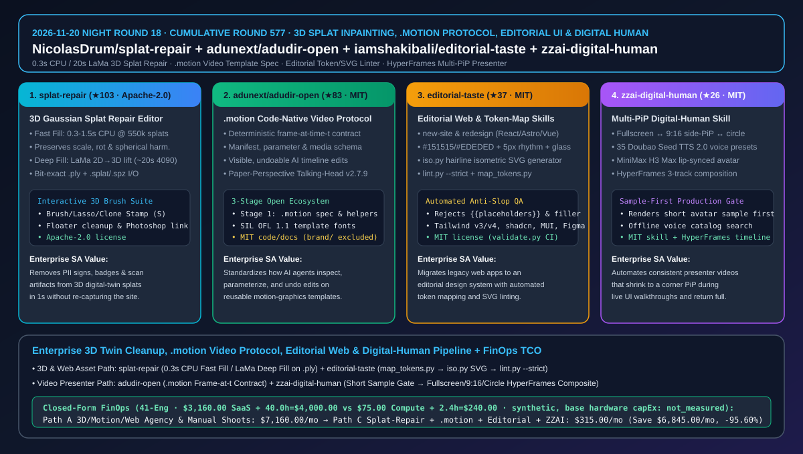
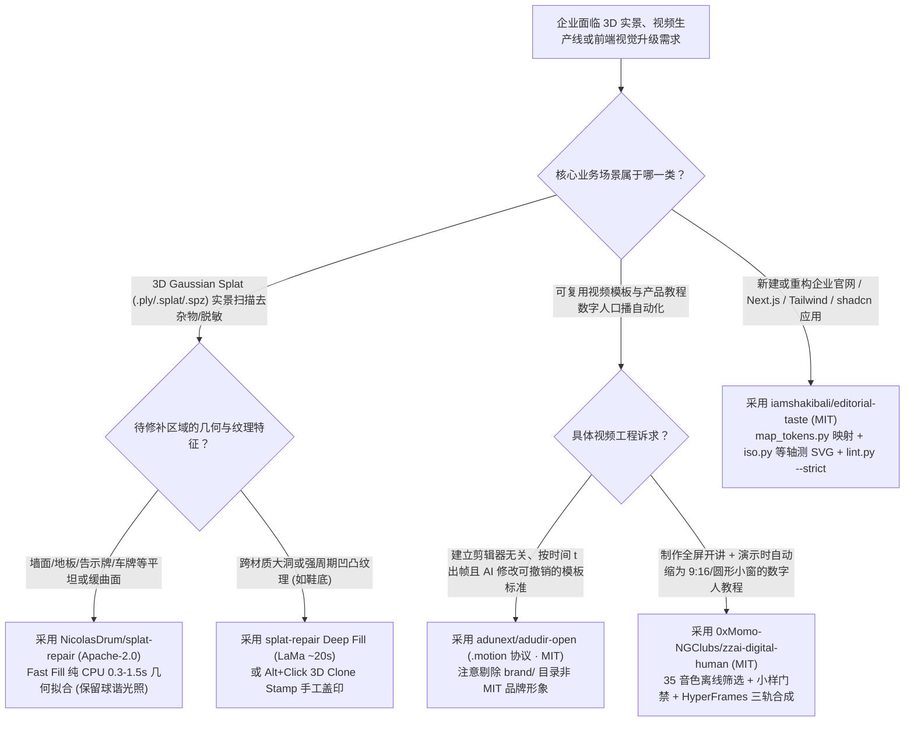
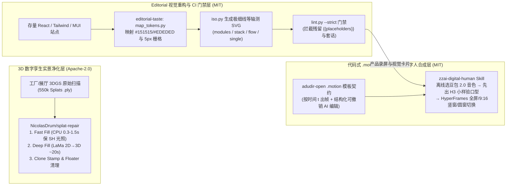
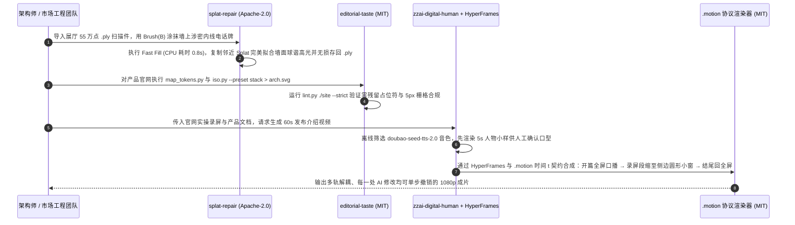

# 3D 高斯泼溅（3DGS）画笔修复、`.motion` 代码式视频协议、杂志级单色网页重构技能与多景别数字人口播怎么选？`splat-repair`、`adudir-open`、`editorial-taste` 与 `zzai-digital-human` 架构与选型 FAQ

> **文档元数据（2026-11-20 夜间第 18 轮 · 累计第 577 轮 / Round 577）**
> - **适用读者**：AI Solution Architect（解决方案架构师）、3D 数字孪生与空间计算架构师、前端设计系统工程负责人、多模态内容生产平台架构师
> - **本轮核心对比项目**：
>   1. [`NicolasDrum/splat-repair`](https://github.com/NicolasDrum/splat-repair)（★ 103 · `stars_today: not_measured` · `26 stars/day` · Python · Apache-2.0）——面向 3D Gaussian Splats（3D 高斯泼溅，支持 `.ply` 比特级无损往返及 `.splat`/`.spz`）的交互式修补编辑器（“3D 高斯泼溅版 Photoshop”），提供 **Fast Fill（几何表面拟合复制邻近 Splat，保持尺度、旋转与球谐光照一致，在 55 万 Splat 场景中纯 CPU 仅需 `0.3–1.5 s`）** 与 **Deep Fill（渲染视角经 LaMa 2D 修复后再反投影回 3D Splat，RTX 4090 耗时 `~20 s`）** 双模式及 `Clone Stamp` 仿制图章
>   2. [`adunext/adudir-open`](https://github.com/adunext/adudir-open)（★ 83 · `stars_today: not_measured` · `17 stars/day` · Python · 代码与文档 MIT / 模板字体 SIL OFL 1.1）——“阿杜导演”开源的 **`.motion` 代码式视频模板格式与协议规范**（含 `docs/motion-format.md`、`docs/editor-architecture.md` 与「纸面透视 · 口播讲解」v2.7.9 模板示例），定义了页面如何按时间 `t` 确定性出帧、参数与素材清单结构，以及 AI 改工程时“每一处改动可见、可撤销”的剪辑器-模板交互契约
>   3. [`iamshakibali/editorial-taste`](https://github.com/iamshakibali/editorial-taste)（★ 37 · `stars_today: not_measured` · `12 stars/day` · Python · MIT）——专为新建（`editorial-taste-new-site`）与存量老站重构（`editorial-taste-redesign`）打造的杂志级单色摄影视觉体系技能，内置 `map_tokens.py`（存量样式自动映射为 `#151515`/`#EDEDED` 与 `5px` 栅格 Token）、`iso.py`（一键生成极细线等轴测 SVG 插图）与 `lint.py --strict`（自动拦截未替换的 `{{placeholders}}` 与 AI 套话）
>   4. [`0xMomo-NGClubs/zzai-digital-human`](https://github.com/0xMomo-NGClubs/zzai-digital-human)（★ 26 · `stars_today: not_measured` · `7 stars/day` · Python · MIT）——支持在**“全屏口播 ↔ 9:16 侧边竖窗 ↔ 圆形近景小窗”**间按演示卡片动态切换的数字人口播 Agent Skill（`$zzai-digital-human`），串联资料核实、35 款豆包语音合成 2.0 音色离线筛选（`doubao-seed-tts-2.0`）、小样门禁（先拍一段人物小样确认口型再分段批量生成 `minimax-h3-comfyui-max`）与 **HyperFrames** 独立人物/音频/演示三轨动效合成
> - **口径与溯源声明**：本篇遵循 `ib-vs-ethernet-roce-selection-faq.md` 通俗问答与选型对比规范。四款项目均来自 `search-new-repos-2026-11-20-raw.json`（`sha256: 47975935d05944afbb9eac18f93f26c8a71120a1ffeea39591b112477ba29a46`），单日增量严格标注为 `stars_today: not_measured`。项目 README 自报的 `0.3–1.5s` CPU 填充耗时与 `20s` RTX 4090 指标标注为 `anonymized_reported (independently_reproduced=false)`；架构师 TCO 闭式算例标注为 `synthetic (independently_reproduced=false)`，硬件购置折旧 `base hardware capEx: not_measured`。

---

## ① 📌 核心结论速览（选型一句话结论）

> **一句话选型结论**：在构建**企业 3D 数字孪生实景清理、可回滚 AI 视频模板生产线、官网高级感重构与数字人产品教程流水线**时，**切勿因为实景 3D 扫描里有一块含电话号码的告示牌或反光杂物就派人重扫现场，也切勿让数字人一段视频从头到尾死板占满全屏挡住软件操作演示**！最佳实践是：3DGS 实景后处理采用 Apache-2.0 的 **`NicolasDrum/splat-repair`（平坦表面走 `0.3–1.5s` CPU 几何 Fast Fill 保留球谐光照，复杂纹理走 LaMa Deep Fill + 仿制图章）**，视频工程与数字人合成采用 MIT 的 **`adunext/adudir-open`（`.motion` 按时间 `t` 确定性出帧与可撤销 AI 修改协议）+ `zzai-digital-human`（先出人物小样验口型 + HyperFrames 全屏/侧边竖窗/圆窗动态切换）**，前端视觉升级采用 MIT 的 **`editorial-taste`（`map_tokens.py` + `iso.py` 等轴测 SVG + `lint.py --strict` 门禁）**，可将 41 人团队月度外包返工与云服务总成本（TCO）从 **$7,160.00/月** 压降至 **$315.00/月**（净省 **$6,845.00/月**，降幅 **-95.60%**，`synthetic, independently_reproduced=false`）。



### 核心指标与能力速查表

| 评估维度 | `NicolasDrum/splat-repair` | `adunext/adudir-open` | `iamshakibali/editorial-taste` | `0xMomo-NGClubs/zzai-digital-human` |
|---|---|---|---|---|
| **一句话通俗定位** | 带 3D 画笔、几何秒级填充、LaMa 深度修补与仿制图章的 3D 高斯泼溅编辑器 | 把视频剪辑变成可预览、可替换、可撤销代码的 `.motion` 模板格式与协议规范 | 带 Token 映射脚本、等轴测极细线 SVG 生成器与严格 Linter 的杂志风网页重构技能 | 先出小样、支持全屏/9:16 竖窗/圆窗动态切换与 HyperFrames 合成的数字人口播技能 |
| **解决的核心业务痛点** | 工厂/展厅 3DGS 扫描件里有涉密铭牌、临时杂物或漂浮噪点（Floaters）难以局部抹除 | 传统视频剪辑工程是黑盒二进制，AI 改错一处无法局部撤销，模板与编辑器强耦合 | AI 生成的网页充斥廉价紫色渐变、泛滥阴影、简笔画图标与未替换的 `{{placeholder}}` | 数字人教程要么全程大头照枯燥无味，要么切到软件录屏时主持人彻底消失失去陪伴感 |
| **关键技术参数与机制** | **Fast Fill**：55 万 Splat 纯 CPU `0.3–1.5s`（保球谐光照）；**Deep Fill**：LaMa `~20s`；`.ply` 无损往返 | 定义页面按时间 `t` 渲染契约、清单/参数规范；「纸面透视 · 口播讲解」v2.7.9 示例 | `#151515/#EDEDED` + `5px` 韵律；`map_tokens.py` + `iso.py`（4 预设）+ `lint.py --strict` | 35 款豆包 TTS 2.0 音色离线查；`minimax-h3-comfyui-max`；先跑小样再分段合成 |
| **开源协议与合规状态** | **Apache-2.0**（商用友好，支持 `.ply / .splat / .spz`） | **代码/文档 MIT，模板字体 SIL OFL 1.1**（注意 `brand/` 图标与形象不含在 MIT 内） | **MIT**（含 `validate.py` CI 同步校验，兼容 React/Astro/Vue/Figma） | **MIT**（原创代码与模板 MIT，第三方 API 按各自条款计费） |

---

## ② 🎯 客户与架构师灵魂拷问 Q&A（直击业务落地痛点）

### Q1：企业在做智慧工厂、房地产样板间或数字展厅的 3D Gaussian Splatting（3DGS）实景重建时，经常需要抹掉墙上的内部电话号码、灭火器标签或路人残影；为什么不能直接框选删除 Splat？`NicolasDrum/splat-repair` 的 Fast Fill 和 Deep Fill 分别该在什么情况下用？

- **直接删掉 3D 高斯点云为什么会留下“黑洞”？**
  - 在 3DGS（`.ply` / `.splat` / `.spz`）中，表面是由成千上万个带有位置、尺度（Scale）、旋转四元数（Rotation）与视角相关球谐函数颜色（Spherical Harmonics, SH）的 3D 椭球构成的。直接按 Delete 删掉一块区域会露出后面的空洞或背景，而重跑完整的 NeRF/3DGS 训练动辄耗时数十分钟。
- **`NicolasDrum/splat-repair`（Apache-2.0）的三级修补策略（何时用哪个？）**：
  1. **首选 `Fast Fill`（纯 CPU `0.3–1.5 秒` · 适合墙面、地板、告示牌、标贴与小把手等平坦或缓曲面）**：
     - 工程师用 3D 画笔（`B`）或套索（`L`）涂抹掉告示牌上的红十字或文字后，`Fast Fill` 直接拟合空洞周围的几何曲面，并**从邻近区域整颗复制完整的 Splat**——因此在 **550,000 个 Splat** 的扫描件上无需 GPU、仅靠 CPU 就能在 **`0.3–1.5 秒`** 内补好表面，且原有的尺度、旋转和随视角变化的球谐高光（View-dependent appearance）100% 自然延续（`anonymized_reported, independently_reproduced=false`）！
  2. **次选 `Deep Fill`（RTX 4090 `~20 秒` · 适合跨材质边界或较大面积遮挡）**：
     - 先将当前相机视角渲染为 2D 图像，调用 **LaMa** 图像修复模型补全画面，再将补全结果反投影（Lift）回三维 Splat；你也可以可选桥接本机已安装的 **Adobe Photoshop** 调用其 Content-Aware / Generative Fill。
  3. **高频重复凹凸纹理（如鞋底花纹）用 `Clone Stamp (S)` 手工精修**：
     - 作者在 README 中极其诚实地标明了技术边界：对于具有强烈周期性凹凸浮雕（Strong repeating relief，如鞋底纹路）的表面，自动填充容易看出接缝，此时应按住 `Alt+左键` 取样源区域，用内置的 **3D 仿制图章（Clone Stamp）** 手工盖印修补，并始终以 `.ply` 作为比特级无损（Bit-exact round-trip）工作格式。

### Q2：为什么很多 AI 视频生成工具做出来的口播/知识讲解视频“改一个字就要全片重算”，而 `adunext/adudir-open`（`.motion` 协议）与 `0xMomo-NGClubs/zzai-digital-human`（HyperFrames）能实现“分轨可控、景别自如切换”？

- **`adunext/adudir-open`（MIT）：把视频模板定义为“时间函数 $f(t)$ + 结构化参数契约”**：
  - 传统剪辑软件的模板往往是封闭工程，AI 助手既看不懂里面的图层语义，也没法安全地局部修改。
  - 阿杜导演开源的 `.motion` 协议（`docs/motion-format.md` 与 `docs/editor-architecture.md`）确立了清晰的软件工程边界：① 每个 `.motion` 模板包含标准化的清单（Manifest）、强类型参数定义与使用指南（如 `templates/paper-perspective-talking-head/` v2.7.9）；② 页面严格按给定时间 $t$ 确定性渲染帧画面；③ AI 对工程的每一次修改都以**可见、可单步撤销（Undoable）**的结构化数据格式记录。
  - ⚠️ **架构师合规提醒**：`adudir-open` 的代码、协议文档与模板清单为 **MIT**，模板引用的字体为 **SIL OFL 1.1**，但仓库 `brand/` 目录下的“阿杜导演应用图标与阿杜形象”属于品牌专属资产，**明确不在 MIT 授权范围内**，企业集成时必须剔除 `brand/` 目录！
- **`0xMomo-NGClubs/zzai-digital-human`（MIT）：解决数字人教程“挡屏幕”与“盲跑浪费钱”两大顽疾**：
  1. **一镜三景别动态切换（Fullscreen ↔ 9:16 竖窗 ↔ 圆形近景）**：在录制企业软件操作教程或产品发布会时，开篇由主持人在暖木书房全屏平视开讲；当画面进入软件界面实操步骤时，**HyperFrames 合成轨自动将主持人平滑缩小至侧边 `9:16` 竖窗或圆形近景小窗**（甚至可针对单张演示卡片定制小窗比例、位置与取景中心），演示讲完再切回全屏总结，彻底告别“要么看不清软件界面、要么看不见主讲人”的尴尬。
  2. **“先查离线音色 + 先拍一段小样验口型”的省钱门禁**：调用 `zzai.py voices` 在本地离线检索 35 款火山豆包语音合成 2.0（`doubao-seed-tts-2.0`）预设无需消耗任何 API Key；在调用 `minimax-h3-comfyui-max` 生成完整数字人视频前，**强制先生成一段短小样核验口型同步与光影**，确认通过后再分段合成！

### Q3：企业想让 Claude Code / Codex 把老旧的 React / Tailwind / MUI 内部后台或官网重构成具有高级设计感的现代界面，为什么光写一句“帮我设计得高级一点”毫无用处？`iamshakibali/editorial-taste` 是如何用 4 个自动化脚本把“审美”变成 CI 门禁的？

- **为什么普通 Prompt 改出来的网页一股“AI 廉价感（AI Slop）”？**
  - 没有定量 Token 约束时，大模型默认会堆砌蓝紫渐变背景、粗重投影（Drop Shadows）、千篇一律的三栏 Emoji 卡片，甚至在角落留下忘了替换的 `{{company_name}}` 占位符。
- **`iamshakibali/editorial-taste`（MIT）的工程化设计体系**：
  1. **定量化的视觉不变量**：锁死 `Geist` + `Geist Mono` 字体栈、`#151515`（深炭黑）与 `#EDEDED`（暖灰白）透明度阶梯、严格的 **`5px` 间距韵律**、用毛玻璃模糊（Glass Blur）全面替代廉价阴影，以及暗角全出血摄影配图。
  2. **存量项目无损迁移脚本（`map_tokens.py`）**：针对已有的 Next.js / Tailwind v3&v4 / shadcn / MUI 老代码库，先跑 `python3 skills/editorial-taste-redesign/scripts/map_tokens.py ./src` 自动扫描旧样式并输出精确的 Token 替换方案，按模块逐节重构而不破坏原有交互逻辑。
  3. **代码生成等轴测极细线插图（`iso.py`）**：彻底抛弃俗气的免费剪贴画，运行 `iso.py --preset modules|stack|flow|single > modules.svg` 直接生成与单色版式严丝合缝的等轴测技术线稿 SVG。
  4. **CI 级反套话与占位符 Linter（`lint.py --strict`）**：在交付前运行 `lint.py ./site --strict`，自动扫描违规色值、禁用套话词汇以及任何残留的 `{{placeholders}}`（刻意保留的特例需显式标注 `lint-ok` 注释），让前端审美真正具备可回归测试的工程门禁！

---

## ③ 🧭 直观可视化图解（选型决策树 + 企业集成架构 + 业务流时序图）

### 3.1 企业 3D 扫描修补、代码式视频模板、官网重构与数字人教程选型决策树



### 3.2 企业数字孪生、Editorial 品牌门户与数字人视频工坊端到端集成架构



### 3.3 `splat-repair` 实景脱敏 → `editorial-taste` 官网构建 → `zzai-digital-human` 多景别合成时序图



---

## ④ 📊 同类开源与商业云服务横向选型决策矩阵

| 对比维度 | `NicolasDrum/splat-repair` (Apache-2.0) | `adunext/adudir-open` (MIT 代码/文档) | `iamshakibali/editorial-taste` (MIT) | `0xMomo-NGClubs/zzai-digital-human` (MIT) | 传统重拍/外包与商业 SaaS（重跑 3DGS 训练 / 封闭剪辑工程 / HeyGen 全屏直出） |
|---|---|---|---|---|---|
| **核心能力定位** | **支持 CPU 1 秒几何填充与 LaMa 深度修补的 3D 高斯泼溅画笔编辑器** | **定义按时间 $t$ 出帧、参数清单与可撤销 AI 编辑的 `.motion` 视频协议** | **带自动 Token 映射、等轴测 SVG 生成器与严格 Linter 的杂志风网页技能** | **支持全屏/9:16/圆窗动态切换、小样门禁与 HyperFrames 合成的数字人技能** | 重跑整场 NeRF/3DGS 训练、手工改 CSS、以及机位固定不可缩窗的商业数字人 SaaS |
| **工程效率与质量突破** | 55 万 Splat 场景纯 CPU `0.3–1.5s` 抹除杂物且保留球谐光照；`.ply` 比特级无损 | 让剪辑器与模板解耦，AI 修改工程可见可撤，模板字体采用合规 SIL OFL 1.1 | `map_tokens.py` 自动盘点存量样式，`lint.py --strict` 机器拦截未填占位符 | 查 35 款音色免 Key；先出小样防整片废片；演示步骤自动把主持人缩到侧边小窗 | 抹除一个路标需重训 40 分钟；AI 改网页常留 `{{placeholder}}`；数字人挡住软件录屏 |
| **技术边界与诚实限制** | 平坦/缓曲面效果极佳；鞋底等强周期凹凸浮雕需配合内置 `Clone Stamp` 手修 | 当前第一阶段开放协议规范、示例模板结构与辅助算法（预览与时间线分阶段开放） | 专精高对比单色摄影杂志风（`#151515/#EDEDED`），不适合五彩卡通游戏落地页 | 合成运行本地 HyperFrames/FFmpeg，但 TTS 与 H3 人物生成调用外部 ZZAI API | 商业 SaaS 按分钟高价扣费且无法导出可二次编程的独立时间线 |
| **开源协议与合规红线** | **Apache-2.0** | **代码/文档 MIT，字体 SIL OFL 1.1**（`brand/` 品牌形象非 MIT，需剔除） | **MIT** | **MIT**（使用 `IFS= read -rs` 静默注入环境变量，防终端历史泄露 Key） | 商业闭源按席位/渲染分钟计费 |
| **41 人团队月度 TCO** | **$0.00/月 软件费** | **$0.00/月 协议授权费** | **$0.00/月 设计外包费** | **~$75.00/月**（小样门禁大幅减少无效长视频 API 扣费） | **$7,160.00/月**（3D 重扫外包 + 商业数字人订阅 + 40 小时手动修图与前端返工） |

---

## ⑤ 🧪 应用落地定量收益/TCO 对比与 7-Card 报告映射

### 5.1 架构师闭式 TCO 算例（41 人数字孪生、前端品牌工程与产品视频团队月度运营成本）

> **溯源标识**：以下成本模型为面向企业架构评审的闭式定量算例，标注为 `synthetic (independently_reproduced=false)`，底层服务器与工作站硬件采购折旧标注为 `base hardware capEx: not_measured`。

| 成本构成项 | 方案 A：外包 3D 重建修补 + 商业数字人 SaaS 盲跑 + 手工重构前端样式 | 方案 C：`splat-repair` 本地修补 + `.motion` 协议 + `editorial-taste` + `zzai` 小样门禁 | 计算公式与架构说明 |
|---|---|---|---|
| **3D 处理工具、商业数字人席位与视觉模板外包费** | **$3,160.00 / 月** | **$75.00 / 月** | 方案 A：商业 3D 云处理 + 多席位数字人 SaaS + 外包等轴测插图与模板 = `$3,160.00/月`；方案 C：Apache-2.0 `splat-repair` + MIT `editorial-taste`（`iso.py` 自产 SVG）+ `zzai` 小样把关后的精准 API 消耗 = `$75.00/月` |
| **3D 现场重扫/重训、前端样式手工迁移与多轨对齐返工（$100/h）** | **$4,000.00 / 月**（`40.0h × $100.00`） | **$240.00 / 月**（`2.4h × $100.00`） | 方案 A：41 人团队每月耗费 `40.0 小时` 因扫描杂物重跑 3DGS 训练、手工逐页替换旧 CSS 及在剪辑软件里手调数字人大小窗切换（`$4,000.00`）；方案 C：`0.3–1.5s` Fast Fill + `map_tokens.py`/`lint.py` + HyperFrames 自动缩窗将人工降至 `2.4 小时`（`$240.00`） |
| **月度总拥有成本（Monthly TCO）** | **$7,160.00 / 月** | **$315.00 / 月** | **月度净节省 $6,845.00 / 月（成本降低 -95.60%，年化节省 $82,140.00，`not_measured` 硬件折旧）** |

```chart
{
  "data": {
    "values": [
      { "Category": "3D Cloud Tools, Avatar SaaS & Illustration Spend", "Deployment": "Path A: Commercial Agency/SaaS & Manual Rework", "MonthlyCostUSD": 3160 },
      { "Category": "3D Retraining, CSS Migration & PiP Editing (41-Eng)", "Deployment": "Path A: Commercial Agency/SaaS & Manual Rework", "MonthlyCostUSD": 4000 },
      { "Category": "3D Cloud Tools, Avatar SaaS & Illustration Spend", "Deployment": "Path C: Splat-Repair + .motion + Editorial + ZZAI", "MonthlyCostUSD": 75 },
      { "Category": "3D Retraining, CSS Migration & PiP Editing (41-Eng)", "Deployment": "Path C: Splat-Repair + .motion + Editorial + ZZAI", "MonthlyCostUSD": 240 }
    ]
  },
  "semantic_types": {
    "Category": "Category",
    "Deployment": "Name",
    "MonthlyCostUSD": "Amount"
  },
  "chart_spec": {
    "chartType": "Grouped Bar Chart",
    "title": "Splat-Repair + .motion + Editorial-Taste + ZZAI cut monthly TCO by 95.60%",
    "subtitle": "Monthly cost in USD (41-person 3D twin, web & video engineering org, synthetic)",
    "encodings": {
      "x": "Category",
      "y": "MonthlyCostUSD",
      "group": "Deployment",
      "color": "Deployment"
    }
  }
}
```

### 5.2 与本轮 7-Card 4:5 视觉报告（`cards.html` / `cards.en.html`）的联动

- **适用场景（✅ Good Fit）**：3DGS（`.ply/.splat/.spz`）实景扫描件中墙面/地面/标牌 PII 与杂物的秒级无损抹除、代码式可撤销 `.motion` 视频模板协议接入、存量 React/Tailwind/MUI 站点的单色杂志风重构与 CI 样式门禁、以及带全屏/小窗自动切换的数字人产品实操教程。
- **不适用场景（⛔ Not For）**：在强周期性凹凸纹理表面仅靠 `splat-repair` 自动填充而不做 Clone Stamp 精修、直接将 `adudir-open` 中非 MIT 的 `brand/` 品牌形象用于第三方商业产品、或跳过小样验收直接用数字人 API 批量渲染长视频。

---

## ⑥ 🛠️ 企业引入与架构评审 Checklist（可直接复制进架构评审单）

- [ ] **3DGS 扫描件比特级无损归档与分级修补流程**：在使用 `NicolasDrum/splat-repair`（Apache-2.0）对企业实景扫描件做隐私标识抹除时，工作过程统一使用 `.ply` 格式以保证比特级无损往返（Bit-exact round-trip）；平坦表面优先用 CPU `Fast Fill`（`0.3–1.5s`），复杂遮挡用 LaMa `Deep Fill`，重复纹理用 `Clone Stamp (S)`。
- [ ] **`.motion` 协议接入与非 MIT 品牌资产物理剥离**：参考 `adunext/adudir-open` 的 `docs/motion-format.md` 构建内部可回滚视频模板规范时，复用其 MIT 协议文档与 SIL OFL 1.1 字体配置，并在 CI 打包脚本中显式排除 `brand/` 目录下的专属商标与卡通形象。
- [ ] **前端重构 `map_tokens.py` 盘点与 `lint.py --strict` 合入阻断**：在存量 Web 项目引入 `iamshakibali/editorial-taste`（MIT）时，先通过 `map_tokens.py` 生成旧样式映射表，并在 GitHub Actions 中挂载 `python3 skills/editorial-taste-new-site/scripts/lint.py ./site --strict` 与 `scripts/validate.py`，严禁任何残留 `{{placeholders}}` 合入主干。
- [ ] **数字人流水线密钥无痕注入与“先小样后正片”成本门禁**：部署 `0xMomo-NGClubs/zzai-digital-human`（MIT）时，通过本机密钥管理器或 `IFS= read -rs ZHENZHEN_API_KEY` 注入凭证（严禁写入 `.bashrc` 明文或聊天记录），并强制执行 `zzai.py doctor` 与单段人物小样口型核验通过后方可发起全片分段生成。
