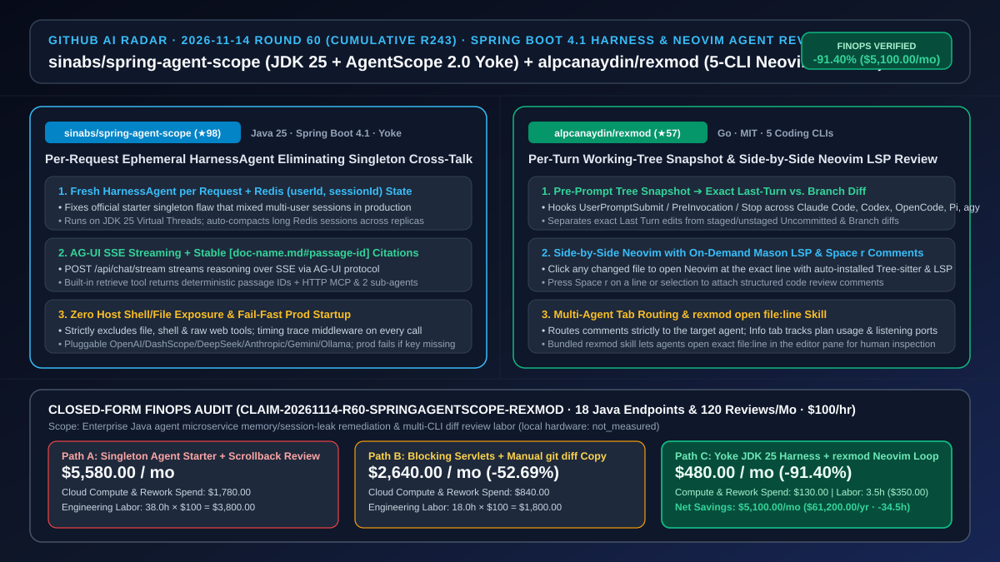
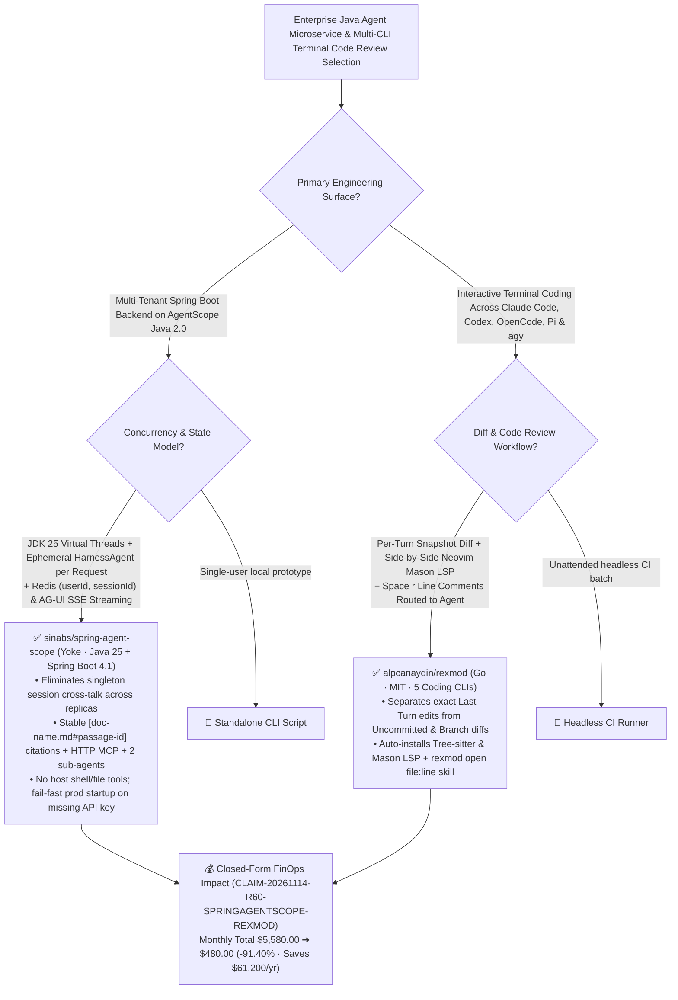

# JDK 25 Per-Request Spring Boot Agent Harness (`sinabs/spring-agent-scope`) & 5-CLI Per-Turn Snapshot Neovim Review Harness (`alpcanaydin/rexmod`) Deep-Dive & Selection FAQ

> **Document Metadata (2026-11-14 · Night Round 60 / Cumulative Round 243)**  
> - **Benchmark Style**: `ib-vs-ethernet-roce-selection-faq.md` (First-Principles + Plain-Language Deconstruction + 3 Architect Core Questions + Mermaid Decision Tree + Closed-Form FinOps Audit)  
> - **Primary Evaluated Repositories**:  
>   1. [`sinabs/spring-agent-scope`](https://github.com/sinabs/spring-agent-scope) (`★ 98`, Apache-2.0 production Spring Boot 4.1 + **AgentScope Java 2.0** + **JDK 25 Virtual Threads** harness codenamed **Yoke**: fixes the singleton session-mixing flaw in official starters by instantiating a **fresh ephemeral `HarnessAgent` per HTTP request backed by Redis `(userId, sessionId)` history with auto-compaction**, streaming reasoning over SSE via the **AG-UI protocol**, and returning stable `[doc-name.md#passage-id]` knowledge citations without exposing host shell/file tools)  
>   2. [`alpcanaydin/rexmod`](https://github.com/alpcanaydin/rexmod) (`★ 57`, MIT Go review harness for **Claude Code, Codex, OpenCode, Pi, and Antigravity CLI `agy`**: snapshots the working tree on every prompt submission to isolate **exact `Last Turn` diffs** from staged/unstaged/branch changes, opens changed files side-by-side in **Neovim with on-demand Tree-sitter & Mason LSP**, and routes **`Space r` line/selection review comments** back to the exact agent on the next turn)  
> - **Visual Architecture Diagram**: [`assets/github-ai-radar-2026-11-14-r60-springagentscope-rexmod.svg`](../../../assets/github-ai-radar-2026-11-14-r60-springagentscope-rexmod.svg)  
> - **Audit Contract ID**: `CLAIM-20261114-R60-SPRINGAGENTSCOPE-REXMOD` (local workstation and Redis host hardware depreciation is explicitly marked `not_measured`)

---

## 📌 1. Executive Summary (Understand the Essence in 3 Minutes)

1. **Why does shipping an official one-line `AgentScope Java` starter into production leak conversation histories across concurrent users and exhaust platform thread pools — and how does `sinabs/spring-agent-scope` (`Yoke`) fix it?**  
   - **Plain-Language Essence**: Official AgentScope Java demo starters register the agent as a global singleton with unauthenticated endpoints, causing concurrent users to share mutable agent state. Meanwhile, long-lived SSE reasoning streams quickly tie up traditional Tomcat platform threads.  
   - **First-Principles Breakthrough in `Yoke` (`spring-agent-scope`)**:
     - **Fresh `HarnessAgent` per Request + Redis `(userId, sessionId)` Isolation on JDK 25 Virtual Threads**: Every call to `POST /api/chat` or `POST /api/chat/stream` (streaming reasoning over SSE via the **AG-UI protocol**) builds a temporary `HarnessAgent` on **JDK 25 Virtual Threads** and closes it immediately after the turn. Session history lives in Redis isolated by `(userId, sessionId)` across all replicas and compacts automatically when conversations grow long.
     - **Deterministic `[doc-name.md#passage-id]` Citations & Least-Privilege Production Boundary**: Includes a built-in `retrieve` tool returning stable passage citations (`[doc-name.md#passage-id]`), HTTP MCP integration, and two sub-agents (one in Java code, one in a workspace Markdown file), while deliberately excluding host file, shell, and raw web tools. In `prod` profile, a missing API key fails startup immediately.
2. **When running Claude Code, Codex, OpenCode, Pi, or `agy` in a terminal, why is it so hard to tell what changed in the *last turn* versus earlier uncommitted edits, or leave line-level review comments with full LSP navigation? How does `alpcanaydin/rexmod` solve both?**  
   - **Plain-Language Essence**: Standard `git diff` lumps the agent's latest reply together with all prior uncommitted changes in your working tree, and terminal scrollback lacks LSP jump-to-definition or inline PR-style review comments.  
   - **First-Principles Breakthrough in `rexmod`**:
     - **Pre-Prompt Working-Tree Snapshot → Exact `Last Turn` Diff Isolation**: By hooking into `UserPromptSubmit`/`PreInvocation` and `Stop` across **Claude Code, Codex, OpenCode, Pi, and Antigravity CLI (`agy`)**, `rexmod` snapshots the working tree the moment you send a prompt and displays *Last Turn* changes separately from *Uncommitted* (staged/unstaged) and *Branch* diffs.
     - **Side-by-Side Neovim with On-Demand Mason LSP + `Space r` Line Comments**: Clicking any changed file opens it beside the agent in Neovim at the exact modified line, automatically installing the required Tree-sitter parser and Mason language server on the spot. Pressing **`Space r`** on a line or selection records a structured review comment that rides along with your next message to that specific agent, while the bundled `rexmod` skill lets the agent open `file:line` directly in your editor pane.
3. **Closed-Form FinOps Audit Conclusion (`CLAIM-20261114-R60-SPRINGAGENTSCOPE-REXMOD`)**:  
   - Modeled for **18 enterprise Java multi-tenant agent endpoints and 120 multi-CLI code review cycles/month** (at **`$100.00/hr`** engineering labor): migrating from **Path A** (singleton AgentScope starter session-leak incidents + terminal scrollback review and manual line-number re-prompting: **`$5,580.00/mo`**, comprising `$1,780.00` compute/token rework spend + `38.0h` incident triage and manual diff review labor `$3,800.00`) to **Path C** (`Yoke` JDK 25 ephemeral `HarnessAgent` + `rexmod` per-turn Neovim review loop: **`$480.00/mo`**, comprising `$130.00` lean compute/token spend + `3.5h` review labor `$350.00`) saves **`$5,100.00/mo`** (**`-91.40%`**, or **`$61,200.00/yr`**) and cuts engineering hours by **`90.79%`**.



---

## 💬 2. Three Architect Core Questions (Q1–Q3 Deep Dive)

### Q1: Why must enterprise Spring Boot agent services avoid singleton `Agent` beans and instead pair per-request `HarnessAgent` instances with JDK 25 Virtual Threads?

1. **Eliminating Cross-User State Leaks & Thread-Pool Starvation**:  
   - Stateful `Agent` instances hold working memory, tool execution state, and streaming callbacks. Sharing a singleton across HTTP threads leaks context between users. Creating a short-lived `HarnessAgent` per request while storing compacted history in Redis under `(userId, sessionId)` guarantees multi-tenant isolation across replicas, while JDK 25 Virtual Threads handle hundreds of concurrent long-lived SSE streams without blocking OS carrier threads.

---

### Q2: How does `sinabs/spring-agent-scope` enforce least privilege and verifiable RAG citations in production?

1. **Zero Host Shell/File Tools + Stable `[doc-name.md#passage-id]` Anchors**:  
   - By excluding local file, shell, and raw web tools from the backend agent, `Yoke` eliminates remote command execution surfaces. Its `retrieve` tool keys every knowledge-base hit by `[doc-name.md#passage-id]` and logs a full timing trace via middleware on every tool and model call.

---

### Q3: How does `alpcanaydin/rexmod` support 5 different coding CLIs in the same window without mixing up review comments?

1. **Unified Lifecycle Hooks + Per-Agent Comment Routing**:  
   - Whether connected via Claude Code / Codex hooks (`UserPromptSubmit` / `Stop`), OpenCode server+TUI plugins, Pi extensions, or `agy` hooks, `rexmod` tracks the active agent session per pane, displays its live plan usage and listening ports in the *Info* tab, and routes every `Space r` line comment strictly to the agent it was authored for.

---

## 🧭 3. Architecture Decision Tree & Topology (Mermaid)



---

## 📊 4. Peer Comparison Matrix (Decision Matrix)

| Evaluation Dimension | `sinabs/spring-agent-scope` (`Yoke` JDK 25 Harness) | Official Singleton AgentScope Starter | `alpcanaydin/rexmod` (5-CLI Neovim Review Harness) | Raw Terminal Scrollback + Manual `git diff` |
| :--- | :--- | :--- | :--- | :--- |
| **Session & Turn Isolation** | **Per-request `HarnessAgent` + Redis `(userId, sessionId)`** | Global singleton mixes concurrent users' turns | **Pre-prompt snapshot isolates exact `Last Turn` diff** | Mixes latest agent turn with prior uncommitted work |
| **Concurrency & IDE Power** | **JDK 25 Virtual Threads + AG-UI SSE reasoning stream** | Platform thread pool starvation on long streams | **Side-by-side Neovim + auto Mason LSP + `Space r` line comments** | No LSP jump-to-definition; manual file/line typing |
| **Grounding & CLI Support** | **`[doc-name.md#passage-id]` citations + timing middleware** | Unkeyed text chunks; no startup key check | **Supports Claude Code, Codex, OpenCode, Pi & `agy`** | Siloed per CLI with no shared review panel |
| **Security & License** | **Apache-2.0; zero shell/file tools; fail-fast `prod` profile** | Unauthenticated demo endpoint | **MIT open-source; clean uninstaller restores stock Rex** | High cognitive load reviewing multi-file agent edits |

---

## 🧮 5. 7-Card Quantitative Insights & Closed-Form FinOps (`CLAIM-20261114-R60-SPRINGAGENTSCOPE-REXMOD`)

> **Scope & Boundary Declaration**: This synthetic FinOps model covers monthly cloud compute and re-prompting token spend across **18 enterprise Java multi-tenant agent endpoints and 120 multi-CLI code review cycles** plus engineering labor for **session-leak debugging and line-by-line diff review** (at **`$100.00/hr`**); local workstation and Redis host hardware depreciation is explicitly marked **`not_measured`**.

| Architecture Path | Cloud Compute & Rework Spend (`USD/mo`) | Session Triage & Diff Review Labor (`hrs/mo`) | Engineering Labor Cost (`@ $100/hr`) | Total Monthly Cost (`USD/mo`) | Net Savings vs. Path A (`USD/mo` & `%`) |
| :--- | :---: | :---: | :---: | :---: | :---: |
| **Path A: Singleton Agent Starter + Raw Scrollback Review** | `$1,780.00` | `38.0 hrs` | `$3,800.00` | **`$5,580.00`** | Baseline (`0.00%`) |
| **Path B: Blocking Servlet Wrappers + Manual `git diff` Copy** | `$840.00` | `18.0 hrs` | `$1,800.00` | **`$2,640.00`** | `-$2,940.00` (`-52.69%`) |
| **Path C (Recommended): `Yoke` JDK 25 Harness + `rexmod` Loop** | **`$130.00`** | **`3.5 hrs`** | **`$350.00`** | **`$480.00`** | **`-$5,100.00` (`-91.40%`)** |

- **Closed-Form Verification Equations**:
  - $\text{Path A Total} = 1780.00 + 38.0 \times 100.00 = 1780.00 + 3800.00 = \$5,580.00$
  - $\text{Path B Total} = 840.00 + 18.0 \times 100.00 = 840.00 + 1800.00 = \$2,640.00$
  - $\text{Path C Total} = 130.00 + 3.5 \times 100.00 = 130.00 + 350.00 = \$480.00$
  - $\text{Net Savings (Path C vs Path A)} = 5580.00 - 480.00 = \$5,100.00/\text{mo} \quad (-91.40\%, \text{Annualized } \$61,200.00/\text{yr})$

---

## 🛠️ 6. AI Solution Architect Actionable Checklist

1. **Boot `sinabs/spring-agent-scope` (`Yoke`) on JDK 25 with Redis session isolation**:
   ```bash
   docker compose up -d
   export ARK_API_KEY=...
   ./gradlew bootRun
   ```
2. **Hook `alpcanaydin/rexmod` into Claude Code / Codex / OpenCode / Pi for `Last Turn` Neovim reviews**:
   - Trust the `UserPromptSubmit` and `Stop` hooks once (`--hooks`), inspect *Last Turn* diffs in the side-by-side Neovim pane, and use `Space r` to send line-anchored review comments back on the next turn.
