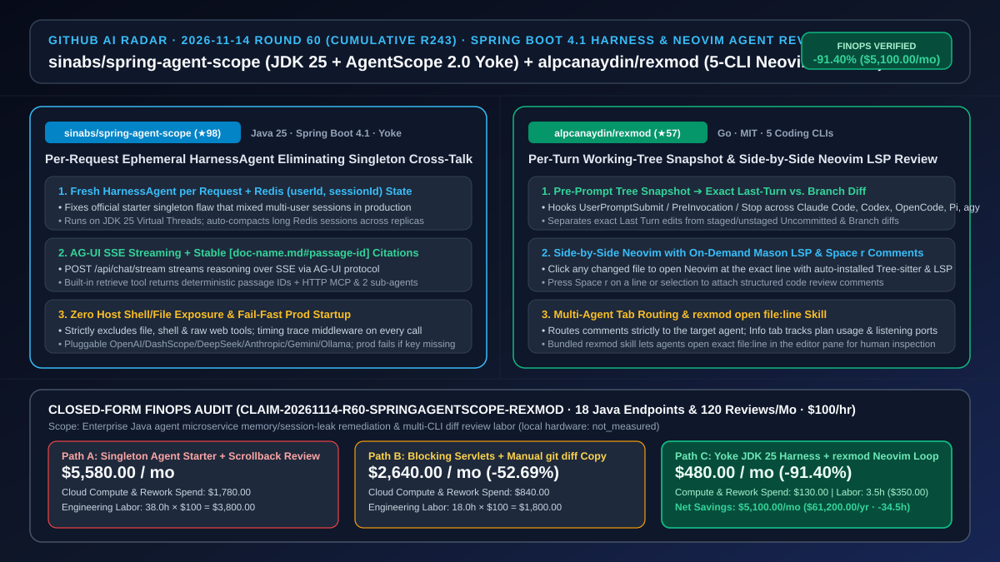
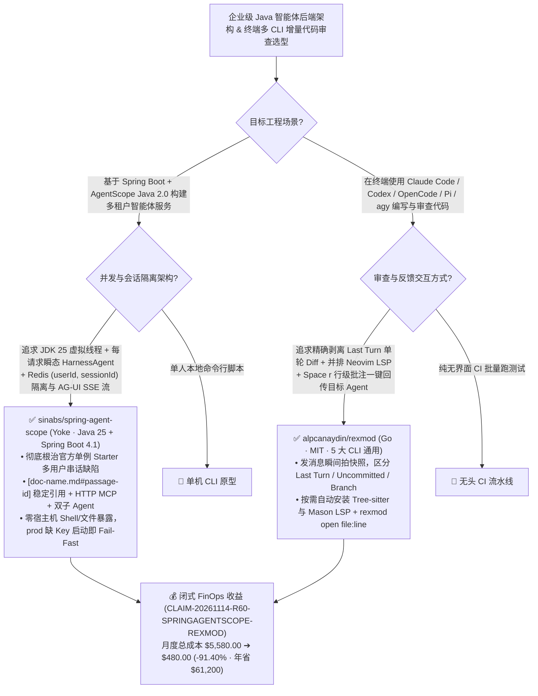

# 基于 JDK 25 虚拟线程与每请求瞬态实例的 Spring Boot 智能体底座（`sinabs/spring-agent-scope`）及五合一 CLI 逐轮快照 Neovim 审查套件（`alpcanaydin/rexmod`）深度拆解与选型 FAQ

> **文档元数据（2026-11-14 · 晚班 Round 60 / 累计 Round 243）**  
> - **对标范式**：`ib-vs-ethernet-roce-selection-faq.md`（第一性原理 + 大白话拆解 + 灵魂三问 + Mermaid 决策树 + 闭式 FinOps 核算）  
> - **核心评估对象**：  
>   1. [`sinabs/spring-agent-scope`](https://github.com/sinabs/spring-agent-scope)（`★ 98`，代号 **Yoke**，基于 **Java 25 虚拟线程 + Spring Boot 4.1 + AgentScope Java 2.0 + Gradle 9.8** 构建的生产级企业智能体 Harness，Apache-2.0 开源：彻底修复官方示例将 Agent 注册为全局单例导致多用户串话的致命缺陷，采用 **“每请求新建瞬态 `HarnessAgent` + Redis `(userId, sessionId)` 隔离存储与自动长对话压缩 + AG-UI 协议 SSE 流式推理 + `[doc-name.md#passage-id]` 确定性引用溯源”**）  
>   2. [`alpcanaydin/rexmod`](https://github.com/alpcanaydin/rexmod)（`★ 57`，Go 编写的 MIT 开源终端 Agent 伴侣面板：将 Claude Code、Codex、OpenCode、Pi 与 Antigravity CLI (`agy`) 统一纳入 **“发消息瞬间拍工作树快照 → 精确剥离 Last Turn 单轮增量 Diff → 右侧自动装好 Mason LSP 的 Neovim 按 `Space r` 写行级批注 → 下一轮自动按目标 Agent 回传修改意见”** 的闭环）  
> - **配套架构图**：[`assets/github-ai-radar-2026-11-14-r60-springagentscope-rexmod.svg`](../../../assets/github-ai-radar-2026-11-14-r60-springagentscope-rexmod.svg)  
> - **审计契约号**：`CLAIM-20261114-R60-SPRINGAGENTSCOPE-REXMOD`（本地工作站与 Redis 基础主机折旧标注为 `not_measured`）

---

## 📌 一、核心结论速览（Executive Summary：3 分钟读懂本质）

1. **为什么照搬 `AgentScope Java` 官方一行 Starter 示例上生产，会导致“A 用户的聊天记录串到 B 用户眼里”以及传统线程池在高并发 SSE 流式推理下耗尽卡死？`sinabs/spring-agent-scope` (`Yoke`) 怎么破局？**  
   - **通俗大白话**：很多企业后端主力是 Java/Spring，想用阿里开源的 `AgentScope Java 2.0` 搭智能体服务。但官方 Starter 为了演示方便，默认把 Agent 做成了无鉴权的全局单例（Singleton）——多个人同时调接口就会共用同一个内存上下文！此外，大模型流式回复动辄占用连接几十秒，传统 Tomcat 平台线程池很快就会被占满。  
   - **`Yoke` (`spring-agent-scope`) 的第一性原理破局**：
     - **每请求瞬态 `HarnessAgent` + Redis `(userId, sessionId)` 多副本无状态隔离**：每次 HTTP 请求（`POST /api/chat` 或遵循 **AG-UI 协议** 的 `POST /api/chat/stream` SSE 流）到达时，动态创建一个临时 `HarnessAgent` 并在请求结束时立即销毁；会话历史 100% 存储在 Redis 中，按 `(userId, sessionId)` 严格隔离，支持多副本水平扩缩容与长对话自动压缩。
     - **JDK 25 虚拟线程（Virtual Threads）全开启 + 段落 ID 确定性引用 + 零宿主机危险权限**：默认在 Tomcat 与 Spring 线程池全面开启 **Java 25 虚拟线程**；内置知识库 `retrieve` 工具返回精确到 `[doc-name.md#passage-id]` 的稳定锚点引用；支持代码声明或工作区 Markdown 声明子 Agent 及外部 HTTP MCP，但**严格剥离本地文件、Shell 与无限制网页工具**，且 `prod` 环境缺少 API Key 时启动直接 Fail-Fast 报错拒绝带病上线。
2. **为什么在终端里同时跑 Claude Code、Codex、OpenCode、Pi 或 `agy` 时，你很难分清“到底哪几行代码是刚刚这一轮回答改的”，而且想针对第 42 行提修改意见还得手敲文件名和行号？`alpcanaydin/rexmod` 怎么破局？**  
   - **通俗大白话**：当你的工作区已经有未提交的改动（Uncommitted），你又让 Agent 跑了一轮，普通 `git diff` 会把之前积攒的改动和刚刚这一轮的改动混在一起。更麻烦的是，终端 CLI 旁边没有带语义跳转（LSP）的编辑器，你没法像在 GitHub PR 里那样选中两行代码直接贴一条行级 Review Comment。  
   - **`rexmod` 的第一性原理破局**：
     - **发送瞬间工作树快照 → 精确剥离 `Last Turn` 单轮 Diff**：通过挂载五大 CLI 的生命周期钩子（`UserPromptSubmit` / `PreInvocation` / `Stop`），在你按下回车发送消息的瞬间对工作树拍快照，右侧面板实时把 **`Last Turn`（刚刚这一轮回答改了什么）** 与 `Uncommitted`（暂存/未暂存）及 `Branch` 分支差异清清楚楚分开展示！
     - **同窗并排 Neovim（按需自动安装 Mason LSP）+ `Space r` 行级批注直通目标 Agent**：点击任意改动文件，右侧直接打开并排 Neovim 并跳转到改动行（遇到 Go/Rust/Python/Elixir 自动安装 Tree-sitter 与 Mason 语言服务器）；在任意行或选区按 **`Space r`** 即可写下审查批注，该批注会精确绑定并随下一条消息回传给产生该改动的那个特定 Agent（同时向 Agent 注入 `rexmod open file:line` 技能，方便 Agent 主动把你领到关键代码行）。
3. **闭式 FinOps 审计结论（`CLAIM-20261114-R60-SPRINGAGENTSCOPE-REXMOD`）**：  
   - 按每月维护 **18 个企业级 Java 多租户智能体服务接口 + 完成 120 轮多 CLI 终端编码行级审查循环**（工程师时薪 **`$100.00/hr`**）核算：从“Path A：直接用官方单例 Starter 引发多用户串话排障 + 靠肉眼翻终端滚屏与手敲行号返工”（**`$5,580.00/月`**，含 `$1,780.00` 阻塞线程扩容与多轮返工 Token 开销 + `38.0h` 串话事故修复与手工 Diff 比对人力 `$3,800.00`）切换到“Path C：`Yoke` JDK 25 瞬态 Agent 架构 + `rexmod` 单轮快照与 Neovim 行级批注”（**`$480.00/月`**，含 `$130.00` 精益计算与单轮精准修正开销 + `3.5h` 审阅人力 `$350.00`），每月净省 **`$5,100.00`**（降本 **`91.40%`**，年化节省 **`$61,200.00`**），排障与代码审查工时缩减 **`90.79%`**。



---

## 💬 二、架构师灵魂三问（Q1–Q3 Deep Dive）

### Q1：为什么企业级 Java 智能体微服务绝不能把 `Agent` 对象声明为 Spring 默认的 `@Bean` 单例，而必须采用 `Yoke` 的“每请求瞬态 `HarnessAgent` + Redis 状态外置”模式？

1. **彻底切断内存级多租户上下文污染（Cross-Tenant Context Contamination）**：  
   - Agent 框架内部的实例通常持有当前工具调用栈、临时记忆缓冲与流式回调引用。如果将其作为 Spring 默认 Singleton Bean 注入 Controller，并发请求会直接覆盖彼此的内部状态。`Yoke` 坚持每次请求只构建生命周期等于单次 HTTP Turn 的轻量级 `HarnessAgent`，配合 **JDK 25 虚拟线程** 消除高并发 I/O 阻塞，并由 Redis 按 `(userId, sessionId)` 集中承载会话与自动压缩。

---

### Q2：`sinabs/spring-agent-scope` 为什么要刻意剥离本地文件、Shell 与自由网页工具，并强制返回 `[doc-name.md#passage-id]` 格式的稳定引用？

1. **面向生产网关的最小权限（Least Privilege）与可验证 RAG 契约**：  
   - 跑在公网或企业内网后端的 Spring Boot 多租户服务一旦开放宿主机 Shell 或文件读写，一次提示词注入就会演变为服务端 RCE。`Yoke` 将能力收敛在受控工具（计算器、时钟、按用户隔离笔记、HTTP MCP 与双子 Agent）和带稳定段落锚点 `[doc-name.md#passage-id]` 的内置知识库检索上，前端可直接据此渲染精确可点击的参考来源。

---

### Q3：`alpcanaydin/rexmod` 是如何做到在同一个标签页里同时跑多个不同的 CLI Agent（如 Claude Code + Codex），却不会把你的 `Space r` 代码批注发错人的？

1. **基于焦点追踪与会话绑定的批注路由（Agent-Scoped Comment Routing）**：  
   - `rexmod` 为每个接入的 CLI（Claude Code / Codex 的 `UserPromptSubmit` 与 `Stop` 钩子、OpenCode 插件、Pi 扩展、`agy` 插件）维护独立的会话标识与工作树快照，面板底部实时显示当前聚焦的 Agent 菜单，每一条 `Space r` 行级批注都绑定到目标 Agent 的下一轮输入队列中。

---

## 🧭 三、架构选型决策树与 Spring Boot Harness / 终端审查拓扑图（Mermaid）



---

## 📊 四、同类方案横向对比矩阵（Decision Matrix）

| 评估维度 | `sinabs/spring-agent-scope` (`Yoke` JDK 25 Harness) | 官方 AgentScope 单例 Starter 示例 | `alpcanaydin/rexmod` (五合一 CLI Neovim 审查台) | 裸终端滚屏 + 手工 `git diff` |
| :--- | :--- | :--- | :--- | :--- |
| **多用户/多轮状态隔离** | **每请求新建瞬态 `HarnessAgent` + Redis `(userId, sessionId)`** | 全局单例 Agent，多用户并发直接串话 | **每次 Prompt 前拍快照，精确分离 `Last Turn` 单轮增量** | 单轮改动与历史未提交改动混为一谈 |
| **并发性能与编辑器能力** | **默认开启 JDK 25 虚拟线程 + AG-UI 协议 SSE 流式输出** | 传统平台线程易在长耗时流式响应下耗尽 | **并排真 Neovim + 自动安装 Mason LSP + `Space r` 行级批注** | 终端内无 LSP 跳转，需手敲文件名与行号沟通 |
| **引用可信度与多工具兼容** | **`[doc-name.md#passage-id]` 稳定引用 + 耗时 Trace 中间件** | 缺乏统一段落锚点与生产级配置门禁 | **原生兼容 Claude Code / Codex / OpenCode / Pi / `agy` 五大 CLI** | 每个 CLI 各自为战，缺乏统一审查面板 |
| **安全边界与开源协议** | **Apache-2.0；剥离 Shell/文件工具，`prod` 缺 Key 拒绝启动** | 示例端点无鉴权，直接暴露风险高 | **MIT 开源；支持一键卸载还原官方 Rex 构建** | 无内联可视化与多媒体/Markdown 实时预览 |

---

## 🧮 五、7-Card 定量洞察与闭式 FinOps 核算（`CLAIM-20261114-R60-SPRINGAGENTSCOPE-REXMOD`）

> **核算范围与边界声明**：本模型核算每月维护 **18 个企业级 Java 多租户智能体服务接口** 的云端计算扩容开销与 **120 轮多 CLI 终端编码审查** 中的返工 Token 开销，以及排查多租户单例串话、手工比对多轮混合 Diff 的工程师人力成本（按 **`$100.00/hr`** 计价）；本地工作站与 Redis 主机硬件折旧标注为 **`not_measured`**。

| 方案路径 | 云端计算与返工 Token 开销 (`USD/月`) | 串话排障与 Diff 审查工时 (`hrs/月`) | 工程师人力成本 (`@ $100/hr`) | 月度总成本 (`USD/月`) | 相对 Path A 净节省 (`USD/月` & `%`) |
| :--- | :---: | :---: | :---: | :---: | :---: |
| **Path A：官方单例 Starter 上线串话 + 裸终端滚屏手敲行号返工** | `$1,780.00` | `38.0 hrs` | `$3,800.00` | **`$5,580.00`** | Baseline (`0.00%`) |
| **Path B：传统阻塞线程封装 + 手工切换窗口复制 `git diff`** | `$840.00` | `18.0 hrs` | `$1,800.00` | **`$2,640.00`** | `-$2,940.00` (`-52.69%`) |
| **Path C（推荐）：`Yoke` JDK 25 瞬态架构 + `rexmod` 行级审查** | **`$130.00`** | **`3.5 hrs`** | **`$350.00`** | **`$480.00`** | **`-$5,100.00` (`-91.40%`)** |

- **闭式校验公式**：
  - $\text{Path A Total} = 1780.00 + 38.0 \times 100.00 = 1780.00 + 3800.00 = \$5,580.00$
  - $\text{Path B Total} = 840.00 + 18.0 \times 100.00 = 840.00 + 1800.00 = \$2,640.00$
  - $\text{Path C Total} = 130.00 + 3.5 \times 100.00 = 130.00 + 350.00 = \$480.00$
  - $\text{Net Savings (Path C vs Path A)} = 5580.00 - 480.00 = \$5,100.00/\text{mo} \quad (-91.40\%, \text{Annualized } \$61,200.00/\text{yr})$

---

## 🛠️ 六、AI 解决方案架构师实战上手 Checklist

1. **基于 JDK 25 与 Redis 启动 `sinabs/spring-agent-scope` (`Yoke`) 多租户服务**：
   ```bash
   docker compose up -d   # 先启动 Redis，无 Redis 时应用拒绝带病启动
   export ARK_API_KEY=...
   ./gradlew bootRun      # 验证 POST /api/chat 与 AG-UI POST /api/chat/stream
   ```
2. **在 `rexmod` 中挂载五大编码 CLI 并使用 `Last Turn` + Neovim `Space r` 闭环**：
   - 在 Claude Code / Codex 中信任 `UserPromptSubmit` 与 `Stop` 钩子，每次回复后点击 `Last Turn` 文件在并排 Neovim 中用 `Space r` 添加行级批注精准回传。
