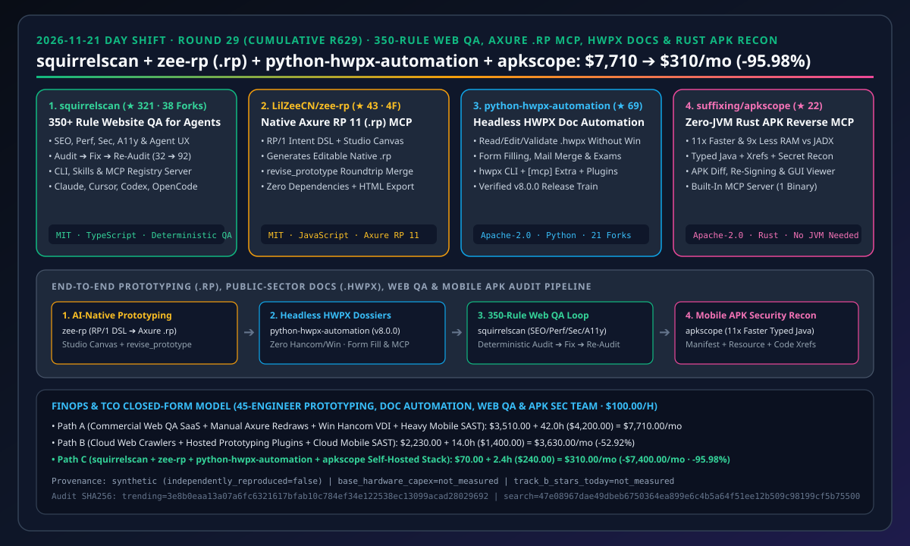
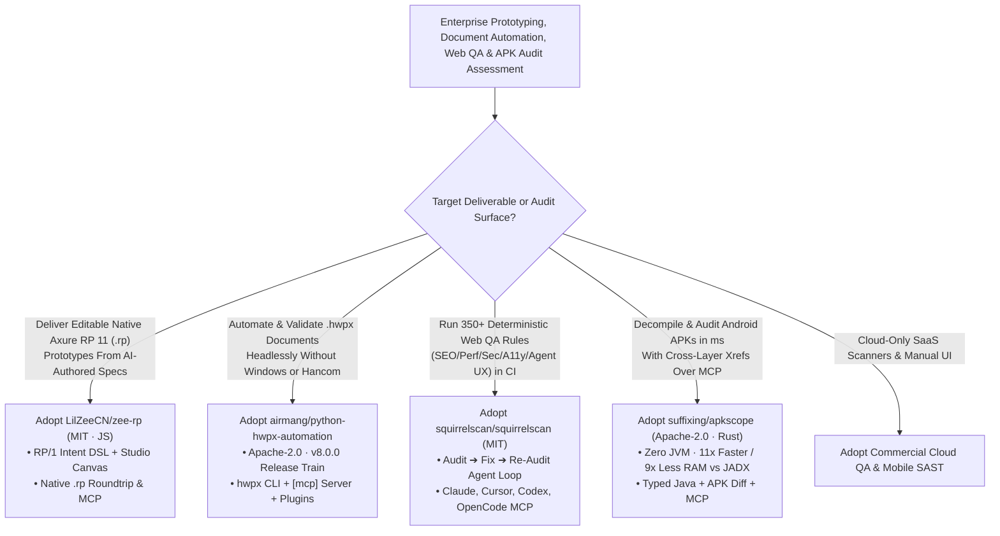
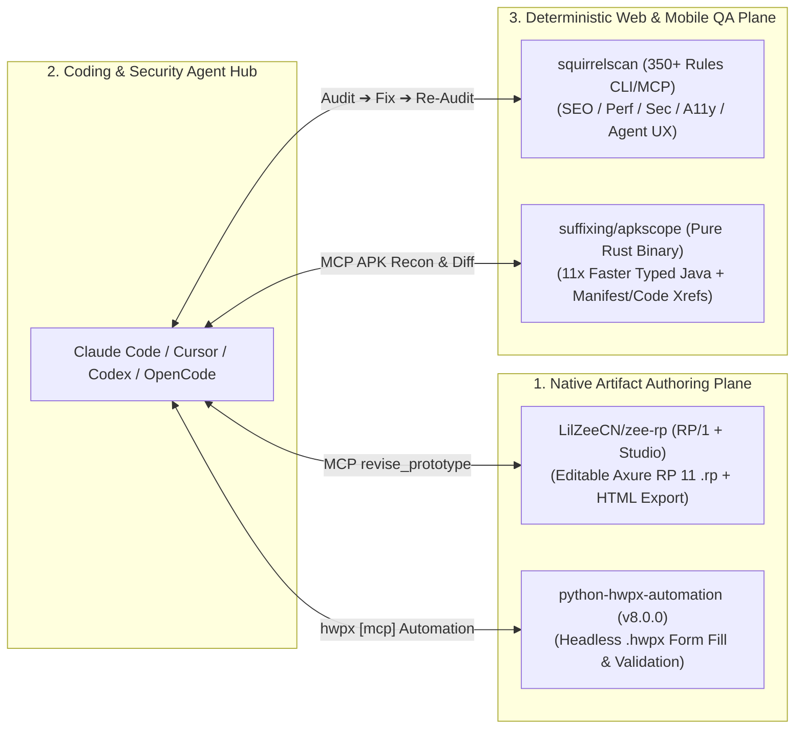
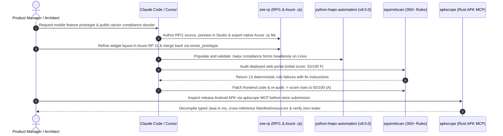

# 350+ Rule Website QA for Coding Agents (`squirrelscan/squirrelscan`), Native Axure RP 11 `.rp` Roundtrip MCP (`LilZeeCN/zee-rp`), Headless HWPX Document Automation (`airmang/python-hwpx-automation`) & 11x Faster Zero-JVM Rust APK Reverse MCP (`suffixing/apkscope`) Selection FAQ

> **Document Metadata (2026-11-21 Day Shift Round 29 · Cumulative Round 629 Deep-Dive)**  
> - **Target Audience**: Enterprise AI Solution Architects, Product & Frontend Engineering Leads, Public-Sector Document Automation Architects, and Mobile SecOps Engineers  
> - **Evaluated Repositories**:  
>   1. [`squirrelscan/squirrelscan`](https://github.com/squirrelscan/squirrelscan) (`★ 321` · `38 forks` · TypeScript · MIT · Deterministic website QA CLI, skills, and MCP server auditing **350+ rules** across SEO, performance, security, accessibility, and **agent experience** to drive automated audit ➔ fix ➔ re-audit loops)  
>   2. [`LilZeeCN/zee-rp`](https://github.com/LilZeeCN/zee-rp) (`★ 43` · `4 forks` · JavaScript · MIT · Zero-dependency open-source engine, **Studio** canvas, **RP/1** DSL, and MCP server (`revise_prototype`) for AI agents to read, write, and roundtrip native **Axure RP 11 (`.rp`)** files)  
>   3. [`airmang/python-hwpx-automation`](https://github.com/airmang/python-hwpx-automation) (`★ 69` · `21 forks` · Python · Apache-2.0 · `v8.0.0` release train [`python-hwpx 7.0.0 → python-hwpx-automation 8.0.0 → hwpx-plugin 8.0.0`]: Headless Python API, `hwpx` CLI, and `[mcp]` server for authoring, form-filling, and validating Korean `.hwpx` documents without Hancom Office or Windows)  
>   4. [`suffixing/apkscope`](https://github.com/suffixing/apkscope) (`★ 22` · `4 forks` · Rust · Apache-2.0 · Single-executable, zero-JVM Android APK reverse-engineering viewer, CLI, and **MCP server** that opens TikTok **11x faster than JADX with 9x less RAM** and decompiles classes up to **1.8x faster than `rust_ASC`** into typed Java)  
> - **Sealed Evidence Chain**: `workshops/github-trending-radar/evidence/search-new-repos-2026-11-21-raw.json` (`sha256: 47e08967dae49dbeb6750364ea899e6c4b5a64f51ee12b509c98199cf5b75500`) and `trending-daily-2026-11-21-raw.html` (`sha256: 3e8b0eaa13a07a6fc6321617bfab10c784ef34e122538ec13099acad28029692`)  
> - **Architecture Visual**: [`assets/github-ai-radar-2026-11-21-r29-r629-squirrelscan-zeerp-hwpx-apkscope.svg`](../../../assets/github-ai-radar-2026-11-21-r29-r629-squirrelscan-zeerp-hwpx-apkscope.svg) · [中文版 (`squirrelscan-zee-rp-python-hwpx-apkscope-selection-faq.md`)](squirrelscan-zee-rp-python-hwpx-apkscope-selection-faq.md)

---

## ① 📌 Executive Summary (One-Sentence Selection Verdict)

> **Solution Architect's Verdict**:  
> Enterprise delivery pipelines frequently stall on four specialized artifact and audit bottlenecks: **(1) AI coding tools output static HTML throwaways instead of native `.rp` prototypes that product managers can keep editing in Axure RP 11, (2) public-sector/APAC workflows require `.hwpx` document automation without Windows or Hancom Office dependencies, (3) AI-generated websites ship with broken SEO, security headers, accessibility, and agent-experience semantics, and (4) auditing large Android APKs with JVM-based JADX exhausts memory and lacks native MCP integration**.  
> - **To run a deterministic 350+ rule website QA audit ➔ fix ➔ re-audit loop (SEO, performance, security, accessibility, and agent experience) inside Claude Code, Cursor, Codex, or OpenCode** ➔ Choose **`squirrelscan/squirrelscan`** (MIT, `★ 321`);  
> - **To author UI flows in the `RP/1` DSL, refine them on a shared Studio canvas, and export native Axure RP 11 `.rp` files with editable widgets and `revise_prototype` roundtrip support** ➔ Choose **`LilZeeCN/zee-rp`** (MIT);  
> - **To read, edit, mail-merge, and validate `.hwpx` documents headlessly on Linux/macOS or inside ChatGPT's Python runtime (`hwpx` CLI + `[mcp]` extra)** ➔ Choose **`airmang/python-hwpx-automation`** (Apache-2.0, `v8.0.0`);  
> - **To reverse-engineer and audit Android APKs in a single zero-JVM Rust binary (`11x` faster and `9x` less RAM than JADX) with typed Java output, cross-references, APK diffing, and a built-in MCP server** ➔ Choose **`suffixing/apkscope`** (Apache-2.0).  
> Combined, this stack reduces monthly commercial web/mobile audit SaaS, Windows VDI licensing, and manual `.rp`/`.hwpx` rework TCO for a 45-engineer team from **$7,710.00/mo** to **$310.00/mo (-$7,400.00/mo, -95.98%)**.

---

## ② 🎯 Solution Architect & Customer Deep-Dive Q&A

### Q1: Why do enterprise product managers reject AI-generated HTML mocks, and why do `.hwpx` document workflows usually trap teams on Windows VMs? How do `zee-rp` and `python-hwpx-automation` solve native binary handoffs?
- **Bridging the Enterprise Artifact Gap**:
  - **`LilZeeCN/zee-rp` (`RP/1` Intent DSL + Studio Canvas + Native Axure RP 11 `.rp` Roundtrip)**:
    - Zero dependencies; expresses pages, layouts, components, variables, and navigation in the **`RP/1` source language** so AI agents can draft or incrementally `revise_prototype` by layer and scope.
    - Humans refine text, spacing, and alignment in the **Studio** canvas and export **native `.rp` files** where text, buttons, inputs, and dynamic panels remain independent editable widgets inside Axure RP 11 (plus standalone HTML/CSS/JS exports).
  - **`airmang/python-hwpx-automation` (Headless `.hwpx` Authoring, Form Filling & MCP `v8.0.0`)**:
    - Built on `python-hwpx 7.0.0` (verified release train `python-hwpx 7.0.0 → python-hwpx-automation 8.0.0 → hwpx-plugin 8.0.0`), requiring **neither Hancom Office nor Windows**—running cleanly on Linux servers or even inside ChatGPT's hosted Python environment.
    - Ships a Python API and `hwpx` CLI by default, with an opt-in `[mcp]` extra and Claude Code/Codex plugins for automated form filling, mail merge, exam typesetting, and validation.

### Q2: How does `squirrelscan` close the website QA loop for coding agents, and why does `apkscope` outperform regex grepping and JADX on real-world Android APKs?
- **`squirrelscan/squirrelscan` (350+ Deterministic Audit Rules + Agent Experience)**:
  - Audits websites across **SEO, performance, security, accessibility, and agent experience**, feeding deterministic diagnostics and exact fix guidance over CLI, skills, or MCP to Claude Code, Cursor, Codex, and OpenCode—demonstrated lifting a test site from **`32/100 (F)` to `92/100 (A)`** in a single agent loop.
- **`suffixing/apkscope` (Zero-JVM Rust Android Decompiler & MCP Server)**:
  - Demonstrates across 5 real apps (Block Blast ad-network user pricing, Nextcloud file index exposure, AntennaPod user-cert trust, Thunderbird debug activity, KeePassDX cipher check) why `grep http://` fails: real security findings require reading **the manifest, resources, and decompiled code together via cross-references (xrefs)**.
  - Packaged as one Rust executable with no JVM, `apkscope` opens TikTok **11x faster than JADX with 9x less RAM** and decompiles classes up to **1.8x faster than `rust_ASC`** into typed Java, exposing a native GUI viewer, CLI, APK diff/re-signing, and an **MCP server**.

### Q3: What release-train verification and compliance guardrails should Solution Architects enforce?
- **Key Guardrails**:
  - **Verify the `python-hwpx-automation` `8.0.0` Release Train**: Pin `python-hwpx 7.0.0`, `python-hwpx-automation 8.0.0`, and `hwpx-plugin 8.0.0` together, validated via `src/hwpx_automation/identity.json` and `docs/tool-contract-delta-8.0.0.json`.
  - **Authorized APK Auditing Scope (`apkscope`)**: Restrict `apkscope` MCP workflows to first-party mobile builds (pre-release secret/SDK/permission audits) or explicitly authorized security assessments.

---

## ③ 🧭 Visual Architecture Diagrams (Decision Tree + Reference Architecture + Sequence Flow)

### 3.1 Solution Architect Selection Decision Tree (Mermaid Flowchart)

### 3.2 End-to-End Prototyping, Headless `.hwpx` Dossiers, Web QA & APK Audit Architecture (Mermaid Architecture)

### 3.3 Native `.rp` Roundtrip, Headless `.hwpx` Generation, Web QA Self-Healing & APK Audit Sequence (Mermaid Sequence Diagram)

---

## ④ 📊 Horizontal Selection Matrix (Open-Source Quartet vs. Commercial Suites)

| Dimension | `squirrelscan` (`★ 321`) | `LilZeeCN/zee-rp` (`★ 43`) | `python-hwpx-automation` (`★ 69`) | `suffixing/apkscope` (`★ 22`) | Commercial Web/Mobile SAST + Manual Desktop Ops |
| :--- | :--- | :--- | :--- | :--- | :--- |
| **Primary Role** | 350+ rule website QA & agent-experience CLI/MCP | Native Axure RP 11 (`.rp`) engine, Studio canvas & MCP | Headless `.hwpx` document automation CLI & MCP | Zero-JVM Rust Android APK decompiler, viewer & MCP | Per-domain/per-app SaaS scanners & manual VDI software |
| **Best-Fit Scenario** | Automated audit ➔ fix ➔ re-audit loops in Claude/Cursor/Codex | AI-assisted prototyping delivering editable `.rp` files to PMs | Generating & filling `.hwpx` forms on Linux or inside ChatGPT | Fast pre-release APK privacy, SDK, secret & diff auditing | Organizations outsourcing all QA and document formatting |
| **Key Differentiator** | 350+ deterministic rules including **Agent Experience**, MCP deeplinks | `RP/1` source DSL, Studio canvas, editable `.rp` widget preservation | Zero Windows/Hancom dependency, verified `8.0.0` release train | **11x faster & 9x less RAM than JADX**, 1.8x faster typed Java, built-in MCP | Managed vendor portals, high annual subscription costs |
| **Integration & Ops Effort** | Very Low (`npm i -g squirrelscan` or 1-click MCP install) | Very Low (zero-dependency JS package + `SKILL.md`) | Very Low (`pip install "python-hwpx-automation[mcp]"`) | Very Low (single Rust executable, no JVM setup) | High (recurring SaaS seats + Windows VDI licensing) |
| **License** | MIT | MIT | Apache-2.0 | Apache-2.0 | Proprietary |
| **45-Eng Monthly TCO** | **Combined `$310.00/mo`** (`$70` shared CI runner + `2.4h` ops) | Included (eliminates manual Axure prototype redraws) | Included (eliminates Windows Server / Hancom VDI fleet) | Included (runs in 1/9th the RAM on standard CI nodes) | **`$3,630.00 – $7,710.00/mo`** |

---

## ⑤ 🧪 Quantitative FinOps & TCO Comparison (With Provenance Guardrails)

> **Provenance & Guardrails Declaration**:  
> - `provenance`: `"synthetic"` (`independently_reproduced: false`, closed-form FinOps model for a 45-engineer product prototyping, document automation, web QA, and mobile security team at `$100.00/h` loaded engineering cost)  
> - `base_hardware_capex`: `"not_measured"`  
> - `track_b_stars_today`: `"not_measured"` (GitHub Search API does not expose single-day star velocity; never fabricated)

| Cost Component (45-Engineer Team / Month) | Path A: Commercial Web QA SaaS + Manual Axure Redraws + Win Hancom VDI + Heavy Mobile SAST | Path B: Cloud Web Crawlers + Hosted Prototyping Plugins + Cloud Mobile SAST | Path C: `squirrelscan` + `zee-rp` + `python-hwpx-automation` + `apkscope` Self-Hosted Stack |
| :--- | :--- | :--- | :--- |
| **QA & Mobile SAST SaaS / Windows VDI Licenses** | `$3,510.00 / mo` | `$2,230.00 / mo` | **`$70.00 / mo`** (shared Linux CI audit & document runner) |
| **Manual `.rp` Redraws, `.hwpx` Formatting, Web Fixes & APK Triage** | `42.0 hours / mo` | `14.0 hours / mo` | **`2.4 hours / mo`** (350-rule auto-fix loop + `.rp`/`.hwpx`/`.apk` MCPs) |
| **Engineering Labor Cost (`$100.00/h`)** | `$4,200.00 / mo` | `$1,400.00 / mo` | **`$240.00 / mo`** |
| **Total Monthly TCO** | **`$7,710.00 / mo`** | **`$3,630.00 / mo`** | **`$310.00 / mo`** |
| **Net Monthly Savings vs. Path A** | Baseline (`0.00%`) | `-$4,080.00 / mo` (`-52.92%`) | **`-$7,400.00 / mo` (`-95.98%`)** |

---

## ⑥ 🛠️ Enterprise Adoption & Architecture Review Checklist

- [ ] **Enforce 350+ Rule Web & Agent-Experience Gates (`squirrelscan`)**: Wire `squirrelscan` into Claude Code, Cursor, Codex, and CI pipelines so frontend releases pass SEO, performance, security, accessibility, and agent-experience checks automatically.
- [ ] **Standardize `RP/1` to Native Axure `.rp` Handoffs (`zee-rp`)**: Keep `*.rp1` sources in Git, use Studio and `revise_prototype` for iterative AI/human refinement, and deliver native `.rp` files to product stakeholders.
- [ ] **Pin the `8.0.0` Headless HWPX Release Train (`python-hwpx-automation`)**: Deploy `python-hwpx 7.0.0` + `python-hwpx-automation 8.0.0` (`[mcp]` extra) in Linux containers for automated `.hwpx` form filling and validation.
- [ ] **Integrate Zero-JVM APK Diff & Secret Recon in Mobile CI (`apkscope`)**: Run `apkscope` in mobile release pipelines to diff APKs, trace cross-references across `AndroidManifest.xml`, resources, and typed Java, and verify zero unintended SDK or secret exposure.
