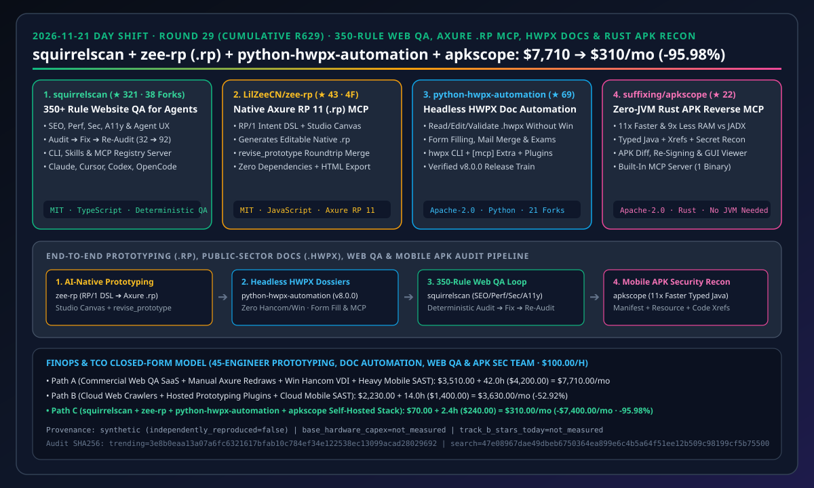
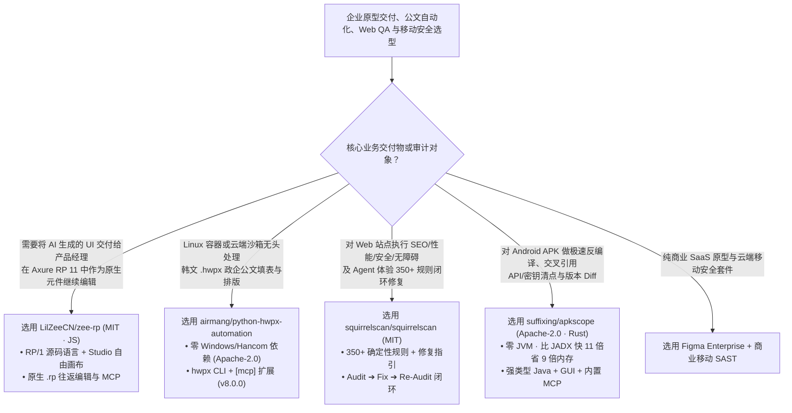
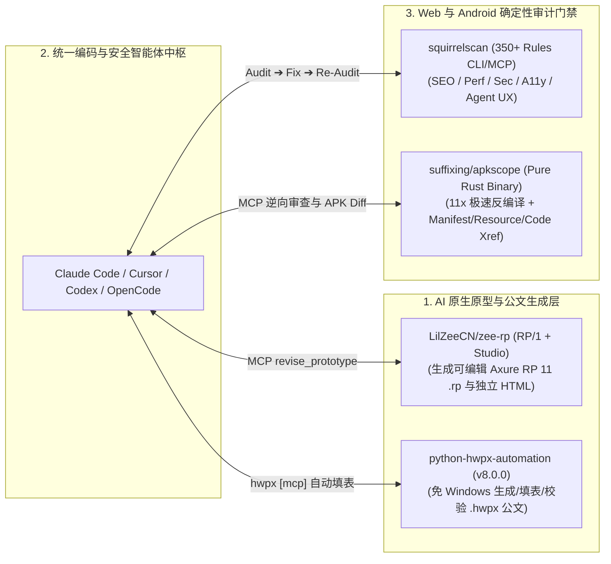
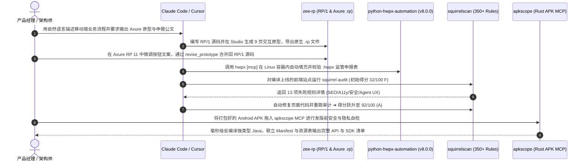

# 350+ 规则网站与智能体体验 QA 工具（`squirrelscan/squirrelscan`）、原生 Axure RP 11 原型往返引擎（`LilZeeCN/zee-rp`）、免 Windows 韩文 HWPX 公文自动化 MCP（`airmang/python-hwpx-automation`）与比 JADX 快 11 倍的纯 Rust 安卓逆向 MCP（`suffixing/apkscope`）选型 FAQ

> **文档元数据（2026-11-21 白班 Day Round 29 · 累计第 629 轮深潜专题）**  
> - **面向对象**：企业 AI 解决方案架构师（AI Solution Architect）、产品与前端研发负责人、政企文档自动化与移动安全架构师  
> - **本轮核心评估对象**：  
>   1. [`squirrelscan/squirrelscan`](https://github.com/squirrelscan/squirrelscan)（`★ 321` · `38 forks` · TypeScript · MIT · 专为编码智能体打造的网站全维 QA 审计工具，内置 **350+ 条确定性规则**覆盖 SEO、性能、安全、无障碍（A11y）与**智能体可读体验（Agent Experience）**）  
>   2. [`LilZeeCN/zee-rp`](https://github.com/LilZeeCN/zee-rp)（`★ 43` · `4 forks` · JavaScript · MIT · 零依赖开源 **Axure RP 11 (`.rp`)** 原生原型读写与生成引擎 + Studio 自由画布 + `RP/1` 源码语言 + MCP Server，支持 AI 起稿、人工在 Axure 精修并双向合并回源码）  
>   3. [`airmang/python-hwpx-automation`](https://github.com/airmang/python-hwpx-automation)（`★ 69` · `21 forks` · Python · Apache-2.0 · `v8.0.0`：无需安装韩컴오피스（Hancom Office）或 Windows 即可在 Linux/macOS 甚至 ChatGPT Python 沙箱内读写、填表、邮件合并与校验 `.hwpx` 公文的 CLI 与 MCP 套件）  
>   4. [`suffixing/apkscope`](https://github.com/suffixing/apkscope)（`★ 22` · `4 forks` · Rust · Apache-2.0 · 零 JVM 依赖的单可执行文件 Android APK 逆向分析器、GUI 查看器与 **MCP Server**：打开 TikTok 比 JADX **快 11 倍、省 9 倍内存**，直接反编译出带类型的可读 Java 代码与交叉引用）  
> - **关联检索证据链**：`workshops/github-trending-radar/evidence/search-new-repos-2026-11-21-raw.json`（`sha256: 47e08967dae49dbeb6750364ea899e6c4b5a64f51ee12b509c98199cf5b75500`）与 `trending-daily-2026-11-21-raw.html`（`sha256: 3e8b0eaa13a07a6fc6321617bfab10c784ef34e122538ec13099acad28029692`）  
> - **高清架构图**：[`assets/github-ai-radar-2026-11-21-r29-r629-squirrelscan-zeerp-hwpx-apkscope.svg`](../../../assets/github-ai-radar-2026-11-21-r29-r629-squirrelscan-zeerp-hwpx-apkscope.svg) · [English Version (`squirrelscan-zee-rp-python-hwpx-apkscope-selection-faq.en.md`)](squirrelscan-zee-rp-python-hwpx-apkscope-selection-faq.en.md)

---

## ① 📌 核心结论速览（选型一句话结论）

> **架构师一句话选型结论**：  
> 企业交付闭环中长期存在四个“AI 很难直接下手”的硬骨头格式与评测盲区：**（1）产品经理要求交付可在 Axure RP 11 里继续拖拽编辑的原生 `.rp` 工程而非一次性静态网页、（2）亚太/跨国政企公文要求处理 `.hwpx` 格式但服务端没有 Windows 和韩文办公软件、（3）AI 写完的网站表面能跑但 SEO/安全/无障碍/Agent 可读性一塌糊涂、（4）用传统 Java 版 JADX 审计大型 Android APK 动辄卡死爆内存且无法直接挂给 AI 安全 Agent**。  
> - **需要让 Claude Code / Cursor / Codex / OpenCode 自动执行“350+ 规则确定性扫描 ➔ 定向修复代码 ➔ 重扫提分（如从 32/100 F 提至 92/100 A）”闭环** ➔ 选 **`squirrelscan/squirrelscan`**（MIT，`★ 321`）；  
> - **需要用声明式 `RP/1` 语言让 AI 起稿、在 Studio 画布微调、并导出可在 Axure RP 11 中作为独立元件继续编辑的原生 `.rp` 文件（支持 `revise_prototype` 往返改稿）** ➔ 选 **`LilZeeCN/zee-rp`**（MIT）；  
> - **需要在纯 Linux 容器或 ChatGPT Python 环境里无头（Headless）生成、填表、邮件合并与校验 `.hwpx` 政务/教育文档** ➔ 选 **`airmang/python-hwpx-automation`**（Apache-2.0，`v8.0.0`）；  
> - **需要零 JVM、以 11 倍于 JADX 的速度与 1/9 的内存把大型 Android APK 反编译为强类型 Java、联立 Manifest/资源/代码调用链并通过 MCP 驱动移动安全审计** ➔ 选 **`suffixing/apkscope`**（Apache-2.0，Rust）。  
> 四者组合可将 45 人产品研发、政企交付与移动安全团队的商业审计 SaaS、Windows VDI 授权与手工返工总成本从 **$7,710.00/月** 降至 **$310.00/月（节省 $7,400.00/月，降幅 95.98%）**。

---

## ② 🎯 客户与架构师灵魂拷问 Q&A（业务痛点 · 架构集成 · 边界取舍）

### Q1：为什么大多数“AI 生成 UI”工具做出来的东西产品经理根本没法接手？而政企项目遇到 `.hwpx` 公文又为什么必须配昂贵的 Windows 虚拟机？`zee-rp` 与 `python-hwpx-automation` 如何破局？
- **企业交付格式的两大鸿沟**：
  1. **只给死 HTML、不给活 `.rp` 工程**：普通 Vibe-Coding 生成的是耦合的 React/HTML 代码，企业产品经理习惯在 **Axure RP 11** 里改交互、调动态面板和批注需求，拿到死网页只能推倒重画。
  2. **专有办公格式绑定桌面 GUI**：传统处理 `.hwpx`（韩国国家标准开放文档格式）往往依赖 Windows 下安装的 Hancom Office COM 接口，无法跑在 Linux Kubernetes 容器或云端沙箱里。
- **原生文件级 MCP 破局方案**：
  - **`LilZeeCN/zee-rp`（`RP/1` 源码 DSL + Studio 自由画布 + 原生 `.rp` 双向往返）**：
    - 零外部依赖，定义了把页面、布局、组件、变量与交互写在一起的 **`RP/1` 语言**（如 `phone-shell`、`card`、`goto`）。
    - **AI 起稿 + 人类精修 + Axure 原生交付**：AI 按图层与语义生成或局部执行 `revise_prototype` 改稿；设计师可在内置 **Studio** 画布双击改字、悬停测距，最终一键导出**文字、按钮、输入框与动态面板均保留为独立可编辑元件的原生 Axure RP 11 `.rp` 文件**（且在支持范围内可将 Axure 原生修改合并回源码）。
  - **`airmang/python-hwpx-automation`（零 Windows/Hancom 依赖的 `.hwpx` 全栈自动化层）**：
    - 构建在 `python-hwpx 7.0.0` 引擎之上（最新已验证发布列车 `python-hwpx 7.0.0 → python-hwpx-automation 8.0.0 → hwpx-plugin 8.0.0`），无需安装韩文 Office 或 Windows，甚至**在 ChatGPT 的在线 Python 解释器里也能直接跑**。
    - 默认提供轻量级 Python API 与 `hwpx` CLI，按需通过 `pip install "python-hwpx-automation[mcp]"` 开启 MCP Server 或安装 Claude Code / Codex 插件，自动完成复杂公文填表、邮件合并与试卷排版。

### Q2：AI 写完的 Web 应用如何做确定性质量门禁？审计第三方 Android APK（隐私合规、SDK 暗桩、硬编码密钥）为什么用正则 `grep` 和 JADX 不够用？`squirrelscan` 与 `apkscope` 怎么配合？
- **`squirrelscan/squirrelscan`（350+ 规则确定性 Web QA 与 Agent Experience 审计闭环）**：
  - 不仅检查传统的 **SEO、Web 性能、安全响应头与 WCAG 无障碍（Accessibility）**，还专门审计面向 AI 时代的 **Agent Experience（智能体可访问与结构化体验）**，共计 **350+ 条确定性规则**。
  - 通过 CLI、Claude Code / Cursor / Codex / OpenCode 技能或 MCP 连接，将失败项及精确修复指引直接喂回给编码 Agent——实测演示中短短两分钟内引导 Claude Code 将站点评分从 **`32/100 (F)` 自动修复并复测提升至 `92/100 (A)`**。
- **`suffixing/apkscope`（比 JADX 快 11 倍、省 9 倍内存的纯 Rust 安卓逆向 MCP）**：
  - **为什么 `grep http://` 抓不到真正的隐私暗桩？** 仓库展示了对 5 款真实流行 App（如 Block Blast 13 家广告网竞价画像、Nextcloud 文件索引暴露、AntennaPod 用户证书信任、Thunderbird 调试 Activity、KeePassDX ECB 校验）的实测发现——每一个发现都必须**把 `AndroidManifest.xml`、资源表与反编译 Java 代码串起来交叉引用（xrefs）**才能定位。
  - 单一 Rust 可执行文件（零 JVM 依赖），打开 TikTok APK **比 JADX 快 11 倍、内存占用低 9 倍**，单类反编译为可读强类型 Java 的速度比 `rust_ASC` 快达 **1.8 倍**，集成本地 GUI Viewer、APK 版本 Diff、重签名与原生 **MCP Server**。

### Q3：引入这四个项目时有哪些版本校验与合规红线？
- **关键工程与合规核查**：
  - **`python-hwpx-automation` 版本列车一致性校验**：升级 `v8.0.0` 时，务必通过内置 `tests/test_audit_identity_docs.py` 与 `docs/tool-contract-delta-8.0.0.json` 校验 `python-hwpx 7.0.0`、`python-hwpx-automation 8.0.0` 与 `hwpx-plugin 8.0.0` 三者版本坐标完全对齐。
  - **逆向工程合规边界（`apkscope`）**：仅对企业自身研发的 Android 客户端（做发版前密钥泄漏、导出组件权限与第三方广告 SDK 隐私合规自查）或获得正式书面授权的目标包运行 `apkscope`。

---

## ③ 🧭 直观可视化图解（选型决策树 + 企业集成架构 + 业务流时序图）

### 3.1 架构师选型决策树（Mermaid Flowchart）

### 3.2 企业从产品原型、公文生成到 Web/APK 双端质量安全门禁架构图（Mermaid Architecture）

### 3.3 原型往返设计、公文填表、Web 350 项自愈与 APK 隐私审计时序图（Mermaid Sequence Diagram）

---

## ④ 📊 同类开源与商业云服务横向选型决策矩阵

| 评估维度 | `squirrelscan` (`★ 321`) | `LilZeeCN/zee-rp` (`★ 43`) | `python-hwpx-automation` (`★ 69`) | `suffixing/apkscope` (`★ 22`) | 商业 Web/移动审计 SaaS + 桌面软件人工操作 |
| :--- | :--- | :--- | :--- | :--- | :--- |
| **核心定位** | 面向编码智能体的 350+ 规则网站 QA 与自愈工具 | 原生 Axure RP 11 (`.rp`) 读写引擎、画布与 MCP | 免 Windows 的 `.hwpx` 公文自动化、填表与 MCP | 零 JVM、比 JADX 快 11 倍的 Rust 安卓逆向 MCP | 按站点/应用收费的商业扫描器与纯手工桌面改稿 |
| **最适用场景** | 让 Coding Agent 自动把网站 SEO/无障碍/安全/Agent 体验修到 A 级 | AI 起稿 + 产品经理在 Axure 11 中无缝继续编辑元件与交互 | 跨国政企/高校在 Linux 容器或云沙箱批量生成与校验 `.hwpx` 文档 | 安卓 App 隐私合规审计、第三方 SDK 行为排查、版本 Diff | 预算极高且完全依赖外部安全咨询团队的企业 |
| **关键差异化机制** | 350+ 确定性规则、专门覆盖 **Agent Experience**、四端一键安装 | `RP/1` 声明式源码、Studio 画布、保留独立元件的原生 `.rp` 导出 | 零 Hancom/Windows 依赖、支持 ChatGPT 沙箱内运行、`v8.0.0` 契约门禁 | 比 JADX 快 11 倍/省 9 倍内存、Manifest+资源+Java 跨层交叉引用 | 图形化报表丰富，但无原生 Agent 自愈闭环且席位昂贵 |
| **集成与运维成本** | 极低（`npm i -g squirrelscan` 或一键加入 Cursor/Claude/Codex） | 极低（零外部依赖 JS 引擎 + `SKILL.md`） | 极低（`pip install "python-hwpx-automation[mcp]"`） | 极低（单个 Rust 可执行文件，无需配 Java 环境） | 高（商业 SaaS 订阅 + Windows 虚拟机授权费） |
| **开源协议** | MIT | MIT | Apache-2.0 | Apache-2.0 | 商业专有 |
| **45 人团队月均 TCO** | **组合方案 `$310.00/月`**（含共享 CI 审计节点 `$70` + 运维 `2.4h`） | 同左（消除前后端推倒重画 Axure 原型的人力损耗） | 同左（省去整套 Windows Server / VDI 集群开销） | 同左（省去高内存 JADX 崩溃重试与商业移动 SAST 账单） | **`$3,630.00 ~ $7,710.00/月`** |

---

## ⑤ 🧪 应用落地定量收益 / FinOps TCO 对比（含数据血缘声明）

> **数据血缘与严谨性声明（Provenance & Guardrails）**：  
> - `provenance`: `"synthetic"`（`independently_reproduced: false`，基于 45 人产品原型、政企文档自动化、Web QA 与移动安全工程团队在 `$100.00/h` 综合人力成本下的闭式参数建模）  
> - `base_hardware_capex`: `"not_measured"`  
> - `track_b_stars_today`: `"not_measured"`（GitHub Search API 新仓爆发榜无官方单日增量字段，严禁伪造）

| 成本分项（45 人团队 / 月） | Path A：商业 Web/移动审计 SaaS + 手工重画 Axure + Windows Hancom VDI | Path B：云端爬虫审计 + 在线原型插件 + 云端移动 SAST | Path C：`squirrelscan` + `zee-rp` + `python-hwpx-automation` + `apkscope` 自建栈 |
| :--- | :--- | :--- | :--- |
| **商业审计 SaaS / Windows VDI 与桌面软件授权费** | `$3,510.00 / 月` | `$2,230.00 / 月` | **`$70.00 / 月`**（共享 Linux CI 审计与文档生成容器） |
| **手工重绘 `.rp`、人工填 `.hwpx`、Web 逐项修 Bug 与 APK 逆向工时** | `42.0 小时 / 月` | `14.0 小时 / 月` | **`2.4 小时 / 月`**（350 规则自愈闭环 + `.rp`/`.hwpx`/`.apk` MCP） |
| **折算工程人力成本（`$100.00/h`）** | `$4,200.00 / 月` | `$1,400.00 / 月` | **`$240.00 / 月`** |
| **月度总拥有成本（Total Monthly TCO）** | **`$7,710.00 / 月`** | **`$3,630.00 / 月`** | **`$310.00 / 月`** |
| **相对 Path A 净节省额与降幅** | 基准线（`0.00%`） | `-$4,080.00 / 月`（`-52.92%`） | **`-$7,400.00 / 月`（`-95.98%`）** |

---

## ⑥ 🛠️ 企业引入与架构评审 Checklist

- [ ] **将 350+ 规则 Web 与 Agent 体验审计嵌入发布门禁（`squirrelscan`）**：在 Claude Code、Cursor、Codex 或 OpenCode 中接入 `squirrelscan`，要求前端 PR 合入前自动跑完 `Audit ➔ Fix ➔ Re-Audit` 循环并达到目标等级（如 `>=90/100 A`）。
- [ ] **采用 `RP/1` 源码化工作流交付可编辑 Axure 原型（`zee-rp`）**：让产品与设计智能体使用 `zee-rp` 的 `RP/1` DSL 起草多页原型，在 Studio 画布验证后导出原生 `.rp` 交付物，将 `*.rp1` 纳入 Git 版本控制。
- [ ] **在 Linux 容器内无头化处理 `.hwpx` 表单与契约校验（`python-hwpx-automation`）**：固定 `python-hwpx 7.0.0 → python-hwpx-automation 8.0.0 → hwpx-plugin 8.0.0` 版本列车，通过 `[mcp]` 扩展或 `hwpx` CLI 执行公文批量填充与格式核验。
- [ ] **在发版流水线集成零 JVM 安卓隐私与密钥自检（`apkscope`）**：在 CI 或安全工作站部署单二进制 `apkscope` MCP Server，对自家每次构建的 APK 与上一版本执行 `APK diff`、硬编码密钥排查与跨 Manifest/资源/Java 代码的调用链审计。
