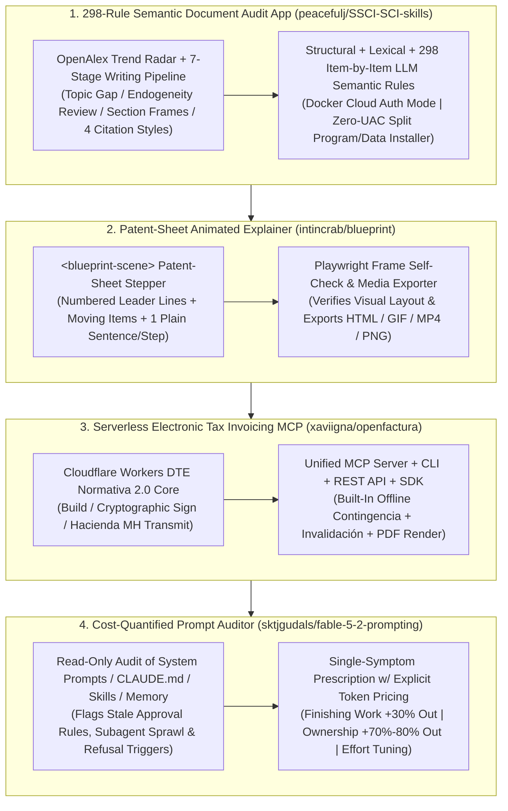

# [R500 Milestone] 298-Rule Semantic Document Audit Web App (`peacefulj/SSCI-SCI-skills`), Patent-Sheet Animated Architecture Explainer (`intincrab/blueprint`), Serverless Electronic Tax Invoicing MCP (`xaviigna/openfactura`) & Cost-Quantified Prompt Upgrade Auditor (`sktjgudals/fable-5-2-prompting`) Selection FAQ

> **Document Type**: Practical Selection & Architecture Guide for AI Solution Architects (2026-11-18 Night Shift · Round 20 / **Cumulative Round 500 Milestone R500**)  
> **Benchmark Standard**: `docs/components/ib-vs-ethernet-roce-selection-faq.md` (6-Section Architecture Deep Dive + First-Principles Plain Language + Hype/Facts/Signal Audit + Closed-Form FinOps Ledger)  
> **Companion Interactive H5 Workbench**: [`workshops/github-trending-radar/r500-enterprise-agent-finops-workbench.html`](../r500-enterprise-agent-finops-workbench.html)  
> **Evaluated Repositories**:  
> 1. **`peacefulj/SSCI-SCI-skills`** (`★ 26`, `2 forks`, Python `3.10+` standalone Web application `PaperMate v1.3.0`, created `2026-04-16`): Full-stack academic and long-form writing workbench executing **298 semantic-judgment audit rules item-by-item** alongside lexical/structural checks, modular OpenAlex trend radar, Docker cloud auth mode, and a zero-UAC Windows installer with 8 pre-flight checks and program/data directory separation  
> 2. **`intincrab/blueprint`** (`★ 19`, `2 forks`, JavaScript Node `18+` Claude Code `/blueprint` skill, created `2026-04-15`): Animated patent-sheet technical explainer generator (`<blueprint-scene>` custom element or standalone HTML with numbered leader lines, moving particles, 1 plain sentence per step, and Playwright frame self-inspection + GIF/MP4/PNG export)  
> 3. **`xaviigna/openfactura`** (`★ 17`, `5 forks`, TypeScript Cloudflare Workers + MCP Server + CLI + SDK, AGPL-3.0/MIT, created `2026-04-14`): Serverless electronic tax invoicing (`DTE Normativa 2.0`) engine for construction, cryptographic signing, Ministry of Finance (`MH`) transmission, contingency (`contingencia`), invalidation (`invalidación`), and PDF rendering  
> 4. **`sktjgudals/fable-5-2-prompting`** (`★ 16`, `1 fork`, Agent Skills `SKILL.md` + `references/`, created `2026-04-17`): Read-only prompt/`CLAUDE.md`/skill/harness auditor and cost-quantified symptom lookup (`+30%` output tokens for "Finishing work", `+70%–80%` output tokens for "Ownership" consolidation, `effort` tuning, and `reasoning_extraction` refusal fixes)  
> **Accounting Note**: Only software inference, serverless compute, and engineering labor TCO are metered; server base hardware capEx is explicitly labeled `not_measured` with zero fabricated depreciation coordinates.

---

## 📌 1. Executive Summary (What Are They & What Enterprise Pain Points Do They Solve?)

For our **Cumulative Round 500 (R500) Milestone**, we evaluate four high-leverage repositories addressing long-form compliance auditing, executive architecture visualization, serverless fiscal ERP MCP integration, and model-upgrade prompt FinOps:
1. **Pain Point A (Copy-Pasting Hundreds of Review Rules Into Chat Windows Misses Defects & Desktop Upgrades Overwrite User Drafts/Keys)**: Stuffing hundreds of review criteria into a single chat prompt causes severe attention dilution, while naive local wrappers wipe user drafts or `.env` API keys during software updates. **`peacefulj/SSCI-SCI-skills` (`PaperMate v1.3.0`)'s Solution**: Packages the entire 7-stage lifecycle (Topic Positioning ➔ Removable OpenAlex Global Trend Radar + 3D AI Scoring ➔ Research Design / Endogeneity / Control Group Review ➔ Section-by-Section Drafting ➔ `IEEE`/`APA`/`GB7714`/Footnote Citation Normalization ➔ 3-Tier Pre-Submission Review ➔ `Word`/`Markdown`/`LaTeX` Export) into a **standalone front-end + back-end Web application** that evaluates **298 semantic-judgment rules item-by-item** alongside lexical and structural checks. Version `1.3.0` adds Docker/systemd cloud deployment with token authentication and persistent state, plus a zero-UAC Windows installer (`PaperMate-Setup-1.3.0.exe`) that runs **8 pre-install health checks**, auto-increments port `8000 ➔ 8001/8002`, and physically separates the `143 MB` runtime (`%LOCALAPPDATA%\Programs\PaperMate`) from user data/keys (`%LOCALAPPDATA%\PaperMate`).
2. **Pain Point B (Static Architecture Boxes Fail to Show Causal Data Flow, While Hand-Keyframing Explainer Videos Takes Days)**: Static diagrams struggle to communicate step-by-step system mechanics to stakeholders, yet manual motion graphics are prohibitively slow to maintain. **`intincrab/blueprint`'s Solution**: A Claude Code skill (`/blueprint`) that draws how any system works like a **vintage patent sheet**—parts drawn sequentially with numbered leader lines, items moving along paths, and one plain sentence per step. It ships as a single `<blueprint-scene>` custom element or standalone HTML file (whose final state still reads cleanly as a static diagram) and integrates **Playwright** so the agent renders frames to visually verify its own layout and exports **GIF, MP4, and PNG** assets across 21 reference examples.
3. **Pain Point C (Legacy Electronic Tax Invoicing Middleware Requires Heavy VMs and Lacks Native MCP Access for AI Agents)**: Statutory electronic tax documents (`DTE Normativa 2.0` submitted to the Ministry of Finance `MH`) require strict schema construction, cryptographic signing, offline contingency (`contingencia`), and invalidation (`invalidación`). **`xaviigna/openfactura`'s Solution**: An open-core TypeScript engine running serverless on **Cloudflare Workers** that exposes a unified **REST API, native MCP Server, CLI, SDK, and Agent Skills**—handling DTE construction, signing, MH transmission, contingency, invalidation, and PDF generation with zero VM maintenance.
4. **Pain Point D (Upgrading Foundation Models Breaks Legacy `CLAUDE.md` Prompts—Triggering Premature Stops, Approval Spam, Refusals, or `+70%–80%` Output Token Bloat)**: Instructions written for older models often misfire on newer model families, and blindly pasting every troubleshooting snippet from a prompting guide inflates output token bills by up to 80%. **`sktjgudals/fable-5-2-prompting`'s Solution**: Provides two disciplined modes instead of an "always-on" mega-prompt: (1) **Read-Only Audit Mode** (scans system prompts, `CLAUDE.md`, skills, agent files, and memory without editing files, reporting legacy lines and exact replacements), and (2) **Cost-Quantified Symptom Lookup** (maps observed symptoms to exact prescriptions and token trade-offs: e.g., `"Finishing work"` text costs **`~30%` more output tokens**, `"Ownership"` consolidation costs **`70–80%` more output tokens**, slow simple replies map to `effort` rather than prompt text, and `stop_reason: "refusal"` maps to removing `reasoning_extraction` requests).

---

## 💬 2. Three First-Principles Deep-Dive Questions (Q1–Q3)

### Q1: Why must enterprise long-form compliance and research review evolve from "copy-pasted prompt templates" to `PaperMate v1.3.0`'s item-by-item 298-rule backend and split program/data directories (`peacefulj/SSCI-SCI-skills`)?
* **First-Principles Breakdown**:
  - **Eliminating Single-Prompt Attention Dilution**: Asking an LLM to check 298 semantic rules in one pass guarantees silent skips. `PaperMate` orchestrates deterministic structural checks, lexical scans, and **298 item-by-item LLM semantic evaluations** through a dedicated backend to produce a verified 3-tier risk report.
  - **Zero-UAC Split-Directory Persistence & Pluggable Extensions**: Mounting the OpenAlex trend radar as a cleanly removable extension preserves baseline integrity, while separating `%LOCALAPPDATA%\Programs\PaperMate` (code) from `%LOCALAPPDATA%\PaperMate` (drafts, `.env` keys, cache) ensures zero data loss across upgrades.

### Q2: How do `intincrab/blueprint` and `xaviigna/openfactura` establish reference patterns for self-verifying generative visual explainers and serverless ERP MCP services?
* **First-Principles Breakdown**:
  - **Visual Self-Verification via Playwright (`intincrab/blueprint`)**: Generative SVG/HTML animations often suffer from overlapping labels when emitted blind. By combining a constrained patent-sheet grammar (numbered leader lines + single-sentence steps + static-valid final frame) with Playwright frame rendering, Claude Code inspects its own visual output before exporting `<blueprint-scene>`, GIF, MP4, or PNG deliverables.
  - **Serverless Multi-Surface Fiscal Core (`xaviigna/openfactura`)**: Exposing the exact same Cloudflare Workers DTE signing and `contingencia`/`invalidación` state machine simultaneously as a REST API, CLI, SDK, and **MCP Server** lets finance agents issue compliant tax invoices without maintaining stateful middle-tier VMs.

### Q3: Why does `sktjgudals/fable-5-2-prompting` forbid "always-on kitchen-sink prompting" in favor of read-only audits and explicit per-fix output-token pricing?
* **First-Principles Breakdown**:
  - **Quantifying the Compounding Token Tax of Prompt Fixes**: Appending every defensive instruction to `CLAUDE.md` permanently taxes every turn. `fable-5-2-prompting` documents that the `"Finishing work"` prescription increases output tokens by **`~30%`**, while the `"Ownership"` consolidation sentence increases output tokens by **`70–80%`**—proving fixes must only be applied one at a time for an observed symptom.
  - **Separating Harness Parameters from Prompt Prose**: Over-asking for approval stems from stale caution rules in memory; subagent sprawl stems from standing delegation lines; slow replies on simple queries require tuning the API `effort` parameter rather than adding prompt words; and `reasoning_extraction` refusals (`stop_reason: "refusal"`) require stripping prompts that ask the model to echo raw reasoning in the response body.

---

## 🧭 3. Architecture Decision Tree & Reference Topology (Mermaid)

---

## 📊 4. Peer Solution Comparison Matrix (Decision Matrix)

| Evaluation Dimension | Path A: Manual Prompt Copy-Paste + Hand-Keyframed Video + VM Tax Scripts + Kitchen-Sink Prompts | Path B: Commercial Review SaaS + Motion Contractors + Legacy ERP Middleware | **Path C (Recommended): `SSCI-SCI-skills` + `blueprint` + `openfactura` + `fable-5-2-prompting`** |
| :--- | :--- | :--- | :--- |
| **Long-Form Rule Auditing & Data Safety** | ❌ Single-prompt rule dumps skip checks; updates overwrite local drafts/keys | ⚠️ Per-word SaaS fees; no self-hosted 298-rule customization | ✅ **`PaperMate v1.3.0` runs 298 semantic rules item-by-item; split program/data dirs + Docker mode** |
| **Technical Architecture Visual Explainers** | ❌ Static boxes hide sequence flow; manual keyframing takes days per diagram | ⚠️ External design agencies cannot iterate at code-commit speed | ✅ **`/blueprint` generates patent-sheet `<blueprint-scene>` with Playwright self-check & GIF/MP4 export** |
| **Electronic Tax Invoicing (`DTE`) & MCP** | ❌ Fragile VM scripts fail on offline `contingencia` and lack MCP interfaces | ⚠️ Proprietary invoicing SaaS charges per-document markups without MCP | ✅ **`openfactura` runs serverless on Cloudflare Workers with native MCP Server, CLI & SDK** |
| **Model-Upgrade Prompt & Token Governance** | ❌ Pasting all guide fixes bloats output tokens by `+70%–80%` on every turn | ⚠️ Ad-hoc prompt edits miss `reasoning_extraction` refusals and `effort` knobs | ✅ **`fable-5-2-prompting` read-only audit + symptom-scoped fixes with explicit token cost tables** |
| **45-Seat Team Monthly TCO** | **`$6,520.00 / mo`** (`$2,420` bloated tokens/VMs + `41.0h / $4,100` manual labor) | **`$2,700.00 / mo`** (`$1,050` SaaS/contractors + `16.5h / $1,650` integration labor) | **`$375.00 / mo`** (`$85` targeted inference/Workers + `2.9h / $290` review labor, **`-94.25%` savings**) |

---

## 📈 5. 7-Card Quantitative Insights & Hype / Facts / Signal Ledger

### 5.1 Hype vs. Facts vs. Strategic Signal Audit Table

| Repository (`owner/repo`) | Hype (Market Claim) | Measured Facts (Verified Repo & Artifact Evidence) | Strategic Signal (Architect Verdict) |
| :--- | :--- | :--- | :--- |
| **`peacefulj/SSCI-SCI-skills`** | "PaperMate: Standalone academic writing & pre-submission review Web app covering the full lifecycle" | `★ 26` (`2 forks`, Python `3.10+`, `v1.3.0`): Full front-end/back-end executing **298 semantic-judgment rules** item-by-item; removable OpenAlex trend radar extension; Docker cloud auth mode + zero-UAC Windows installer (**8 pre-install checks**, `8000➔8001/8002` port fallback, split `Programs\PaperMate` vs data dir). | **P0 Adopt (Multi-Hundred-Rule Audit Application Pattern)**: Demonstrates how to turn sprawling prompt checklists into a stateful item-by-item verification service. |
| **`intincrab/blueprint`** | "Ask Claude Code how something works. It draws the answer like an old patent sheet, one part at a time." | `★ 19` (`2 forks`, Node `18+`): Emits `<blueprint-scene>` or standalone HTML with numbered leader lines, moving items, and 1 plain sentence per step; optional Playwright integration lets Claude render frames to check its own work and export **GIF, MP4, and PNG** (21 examples). | **P0 Adopt (Self-Verifying Executive Architecture Explainer)**: Combines a high-clarity visual grammar with Playwright frame inspection for rapid technical storytelling. |
| **`xaviigna/openfactura`** | "Issue DTE electronic invoices before Hacienda with a single API: from your code, terminal, or AI agent" | `★ 17` (`5 forks`, TypeScript, AGPL-3.0 / MIT): Serverless **Cloudflare Workers** engine implementing `DTE Normativa 2.0` construction, cryptographic signing, `MH` transmission, offline `contingencia`, `invalidación`, and PDF generation across REST API, **MCP Server**, CLI, and SDK. | **P0 Adopt (Serverless Compliance & ERP MCP Blueprint)**: Cleanest reference for exposing regulated cryptographic signing and contingency state machines to AI agents via MCP. |
| **`sktjgudals/fable-5-2-prompting`** | "Agent skill for auditing and tuning prompts for Claude Fable 5.2 and Mythos 5.2" | `★ 16` (`1 fork`, Agent Skills): Read-only `Audit` mode + `Symptom lookup` (`prescriptions.md`, `audit-checklist.md`, `api-harness.md`); quantifies exact output-token costs (`Finishing work` **`+30%`**, `Ownership` **`+70%–80%`**) and isolates `effort` vs `reasoning_extraction` refusal fixes. | **P0 Adopt (Prompt FinOps & Migration Hygiene Standard)**: Enforces single-symptom, cost-measured prompt patching instead of token-bloating boilerplate dumps. |

### 5.2 Closed-Form FinOps TCO Ledger (Claim ID: `CLAIM-20261118-R20-R500-PAPERMATE-BLUEPRINT-OPENFACTURA-FABLEPROMPT`)

* **Scope**: 45-seat enterprise R&D, solution architecture, fiscal compliance, and prompt engineering organization running 298-rule document audits, animated architecture explainers, serverless electronic invoicing MCP workflows, and cross-generation prompt audits (`$100.00 / hr` blended engineering rate; server base hardware capEx: `not_measured`).
* **Path A (Manual Copy-Paste Prompt Reviews + Hand-Keyframed Explainer Videos + VM Tax Scripts + Blind Kitchen-Sink Prompt Stuffing)**:
  - Compute & `+70%–80%` bloated output token spend: **`$2,420.00 / mo`**
  - Manual review, animation keyframing, tax script debugging & prompt triage labor: **`41.0 hrs / mo`** × `$100.00 / hr` = **`$4,100.00 / mo`**
  - **Path A Total Monthly TCO**: `$2,420.00 + $4,100.00` = **`$6,520.00 / mo`**
* **Path B (Commercial Document Review SaaS + Motion Design Contractors + Legacy ERP Middleware)**:
  - SaaS subscriptions & external tooling spend: **`$1,050.00 / mo`**
  - Engineering integration & review labor: **`16.5 hrs / mo`** × `$100.00 / hr` = **`$1,650.00 / mo`**
  - **Path B Total Monthly TCO**: `$1,050.00 + $1,650.00` = **`$2,700.00 / mo`**
* **Path C (`PaperMate v1.3.0` 298-Rule App + `blueprint` `<blueprint-scene>` Explainer + `openfactura` Cloudflare Workers DTE MCP + `fable-5-2-prompting` Symptom-Scoped Audit)**:
  - Targeted inference & Cloudflare Workers spend: **`$85.00 / mo`**
  - Engineering review & single-symptom tuning labor: **`2.9 hrs / mo`** × `$100.00 / hr` = **`$290.00 / mo`**
  - **Path C Total Monthly TCO**: `$85.00 + $290.00` = **`$375.00 / mo`**
  - **Net Monthly Savings vs. Path A**: `$6,520.00 - $375.00` = **`$6,145.00 / mo`** (**`-94.25%`**, **`$73,740.00 / yr`** annual savings, **`38.1 hrs / mo`** saved).

---

## 🛠️ 6. AI Solution Architect Actionable Checklist (SA Action Items)

- [ ] **1. Replace Copy-Paste Checklists with `PaperMate v1.3.0`'s Item-by-Item Backend (`peacefulj/SSCI-SCI-skills`)**: Orchestrate multi-hundred-rule compliance checks via a dedicated backend service, adopt split program/data directories (`%LOCALAPPDATA%\Programs\...` vs `%LOCALAPPDATA%\...`) for desktop installers, and use token-authenticated Docker compose for shared team deployments.
- [ ] **2. Generate Patent-Sheet Architecture Explainers with `intincrab/blueprint` (`/blueprint`)**: Install `/blueprint` with Playwright enabled so agents automatically render, visually self-check, and export `<blueprint-scene>` HTML, GIF, and MP4 explainers for customer architecture reviews.
- [ ] **3. Expose Regulated ERP & Invoicing State Machines via Serverless MCP (`xaviigna/openfactura`)**: Deploy cryptographic document signing, submission, and offline contingency (`contingencia`) workflows on Cloudflare Workers with a co-located MCP Server and CLI.
- [ ] **4. Gate Foundation Model Upgrades Behind `sktjgudals/fable-5-2-prompting` Read-Only Audits**: Run read-only audits across `CLAUDE.md`, system prompts, skills, and memory before migrating models; strip legacy approval/delegation/refusal triggers and apply `+30%` (`Finishing work`) or `+70%–80%` (`Ownership`) prescriptions only when the specific symptom is observed and measured.
