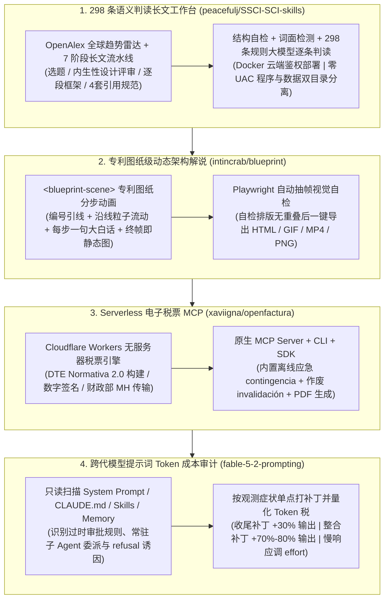

# 【R500 里程碑】298 条语义判读长文工作台（`peacefulj/SSCI-SCI-skills`）、专利图纸级动态架构解说（`intincrab/blueprint`）、Serverless 电子税务发票 MCP（`xaviigna/openfactura`）与模型升级 Token 成本审计（`sktjgudals/fable-5-2-prompting`）选型 FAQ

> **文档类型**：AI Solution Architect（AI 解决方案架构师）实战选型与架构内功指南（2026-11-18 Night Shift · Round 20 / **累计第 500 轮里程碑 R500**）  
> **对标标杆**：`docs/components/ib-vs-ethernet-roce-selection-faq.md`（六段式架构拆解 + 第一性原理大白话 + Hype/Facts/Signal 审计 + 闭式 TCO 账本）  
> **配套交互式 H5 选型工作台**：[`workshops/github-trending-radar/r500-enterprise-agent-finops-workbench.html`](../r500-enterprise-agent-finops-workbench.html)  
> **本轮评估对象**：  
> 1. **`peacefulj/SSCI-SCI-skills`**（`★ 26`, `2 forks`, Python `3.10+` 独立 Web 应用 `PaperMate v1.3.0`, `2026-04-16` 新建）：将学术与深度研究写作规则封装为前后端一体 Web 应用（直连大模型逐条执行 **298 条语义判读规则** + OpenAlex 全球趋势雷达可插拔扩展 + 免 UAC 程序/数据分离安装器与云端 Docker/口令鉴权部署）  
> 2. **`intincrab/blueprint`**（`★ 19`, `2 forks`, JavaScript Node `18+` Claude Code `/blueprint` 技能, `2026-04-15` 新建）：把系统架构与算法原理绘制成“复古专利图纸风格”的分步动态技术解说（编号引线 + 数据沿线流动 + 每步一句大白话 + 单 `<blueprint-scene>` 标签 + Playwright 帧自检与 GIF/MP4/PNG 导出）  
> 3. **`xaviigna/openfactura`**（`★ 17`, `5 forks`, TypeScript Cloudflare Workers + MCP Server + CLI + SDK, AGPL-3.0/MIT, `2026-04-14` 新建）：基于 Cloudflare Workers 的 Serverless 电子税务发票（`DTE Normativa 2.0`）API 与原生 MCP Server（支持报文构建、数字签名、财政部 `MH` 传输、离线应急 `contingencia`、作废 `invalidación` 与 PDF 渲染）  
> 4. **`sktjgudals/fable-5-2-prompting`**（`★ 16`, `1 fork`, Agent Skills `SKILL.md` + `references/`, `2026-04-17` 新建）：面向新一代 Claude 模型的只读 Prompt / `CLAUDE.md` / Harness 审计与按症状定量开方技能（精确量化每条补丁的 Token 代价：如收尾补丁 `+30%` 输出 Token、所有权整合补丁 `+70%–80%` 输出 Token，杜绝盲目全量粘贴）  
> **审计折算说明**：本报告仅计量开发运维与软件推理/人力 TCO，底层服务器硬件采购（base hardware capEx）标注为 `not_measured`，严禁虚构硬件折旧坐标。

---

## 📌 一、核心结论速览（Executive Summary：它到底是什么？解决什么业务痛点？）

在累计第 500 轮（R500）架构选型里程碑中，我们聚焦企业将 Agent 落地到“深度长文审查、客户技术架构汇报、ERP 财税合规开票与跨代模型提示词迁移”四大高频场景时的核心矛盾：
1. **痛点 A（拿着几百条审查规则手动复制粘贴到聊天窗，漏检率高且升级重装容易丢稿件与密钥）**：无论是学术论文还是企业白皮书，若靠人工把几百条质量检查项分批粘进对话框，不仅变成半自动体力活，而且普通桌面工具升级时常把用户配置与历史稿件一并覆盖。**`peacefulj/SSCI-SCI-skills` (`PaperMate v1.3.0`) 的破局之道**：直接把知识库包装成**独立前后端 Web 应用**，后端直连 DeepSeek / Anthropic 等大模型，结合结构自检、词面检测与 **298 条语义判读规则的逐条自动判读**，打通“选题定位 ➔ OpenAlex 全球趋势雷达 + AI 三维评估（以可整包无损卸载的扩展挂载）➔ 研究设计内生性/对照组评审 ➔ 逐段初稿框架 ➔ 四套引用规范（`IEEE`/`APA`/`GB7714`/脚注）➔ 三层投稿前审查 ➔ Word/Markdown/LaTeX 一键成稿”全生命周期；`v1.3.0` 同时提供支持口令鉴权与状态落盘的 Docker/systemd 云端部署，以及免管理员权限（零 UAC）的 Windows 安装器（安装前执行 **8 项环境体检**、端口 `8000 ➔ 8001/8002` 自动顺延，并将 `143 MB` 程序本体 `%LOCALAPPDATA%\Programs\PaperMate` 与用户数据 `%LOCALAPPDATA%\PaperMate` 物理分离，升级重装绝不丢稿件与 `.env` Key）。
2. **痛点 B（向客户或高管解释复杂系统架构时，静态框图看不懂数据流向，手K动画视频又得花几天时间）**：架构师画的普通静态架构图缺乏时序因果感，而用 AE/Keynote 手工制作分步动画极其耗时。**`intincrab/blueprint` 的破局之道**：只需告诉 Claude Code `/blueprint <主题>`，它就会像绘制经典**工程专利图纸（Patent Sheet）**一样，用带编号的引线（numbered leader lines）逐个画出组件、让请求与数据沿线条动态流动，并在每一步配上一句通俗大白话解释；产物既可作为单个 `<blueprint-scene>` Web 组件或独立 HTML 交付（最终定格画面本身就是一张完整静态原理图），还能调用 Playwright 让大模型自己渲染抽帧检查视觉效果并一键导出 **GIF、MP4 与 PNG**（内置 21 个经典架构示例）。
3. **痛点 C（企业财税电子发票系统绑定笨重的传统虚拟机中间件，且 AI Agent 无法直接通过标准协议安全触发合规开票、应急离线申报与作废）**：电子税务发票（如萨尔瓦多财政部 `MH` 的 `DTE Normativa 2.0`）涉及严格的结构校验、数字签名、断网应急（`contingencia`）与作废（`invalidación`）流程。**`xaviigna/openfactura` 的破局之道**：用 TypeScript 构建运行在 **Cloudflare Workers** 上的 Serverless 开源电子发票核心，将“构建 DTE ➔ 数字签名 ➔ 传输至财政部 MH ➔ 处理应急与作废 ➔ 生成合规 PDF”统一收敛至一套 API，并原生提供 **MCP Server、CLI、SDK 与 Agent Skills**，既可零运维自托管在企业自己的 Cloudflare 账号下，也可直接被财务 Agent 安全调用。
4. **痛点 D（底层大模型升级换代后，沿用旧版 `CLAUDE.md` 与系统提示词反而引发提前停机、过度索要审批、子 Agent 泛滥或输出 Token 暴增 70%–80%）**：不同代际模型（如从旧版迁移至 Fable 5.2 / Mythos 5.2）对提示词指令的敏感度截然不同；若把官方迁移指南里的所有补丁无脑全粘进系统提示词，每次回复都会白白多烧近一倍的输出 Token。**`sktjgudals/fable-5-2-prompting` 的破局之道**：拒绝做成“常驻全量提示词”，而是提供**只读审计（Audit）**与**按症状查方（Symptom Lookup）**双模式——只读扫描 `CLAUDE.md`、系统提示词、Skill 与 Memory（绝不擅自改写文件），精准定位旧版残留反模式并给出每个补丁的**实测 Token 成本账单**（例如：修复“任务未完提前停机”的 `Finishing work` 文本会增加约 **`30%` 输出 Token**；修复“只追加不整合旧代码”的 `Ownership` 语句会增加 **`70%–80%` 输出 Token**；简单请求回复慢应调 `effort` 参数而非改提示词；`stop_reason: "refusal"` 需移除在正文中索要推理过程的指令），强制遵循“观测到一个具体症状 ➔ 只打一个对应补丁 ➔ 实测评估”的工程纪律。

---

## 💬 二、三大灵魂拷问（Q1–Q3 First-Principles Deep Dive）

### Q1：为什么深度长文与技术方案审查必须从“复制粘贴 Prompt 模板”进化为“`PaperMate v1.3.0` 独立前后端 + 298 条规则逐条判读 + 程序/数据双目录隔离”（`peacefulj/SSCI-SCI-skills`）？
* **第一性原理剖析**：
  - **突破单次上下文注意力稀释**：把 298 条审查规则塞进一次对话里让大模型“通篇检查”，模型只会挑前几条敷衍了事。`PaperMate` 通过独立后端调度结构自检、词面正则检测与 298 条语义规则的逐条大模型判读，输出结构化三层风险清单。
  - **可插拔能力包与零 UAC 雙目录持久化**：将 OpenAlex 全球发文趋势雷达设计为默认展开但可整包无损卸载的扩展模块（卸载后与 `v1.2.0` 原包一字不差）；在桌面分发上采用免管理员权限安装，安装前执行 8 项硬件/目录/端口体检，并将程序本体（`%LOCALAPPDATA%\Programs\PaperMate`）与用户资产（`%LOCALAPPDATA%\PaperMate` 下的稿件、`.env` API Key、缓存）彻底解耦，同时支持 `v1.3.0` 云端 Docker 口令鉴权部署。

### Q2：在技术传播与业务系统接入中，`intincrab/blueprint` 的“专利图纸 `<blueprint-scene>` + Playwright 抽帧自检”与 `xaviigna/openfactura` 的“Cloudflare Workers + 原生 MCP Server”各自确立了怎样的架构范式？
* **第一性原理剖析**：
  - **生成式可视化的“自检闭环 + 动静合一”（`blueprint`）**：大模型盲写 SVG/Canvas 动画极易出现文字重叠或引线错位。`/blueprint` 一方面规定了高信息密度的“专利图纸语言”（编号引线 + 沿线运动粒子 + 每步一句大白话，且动画结束后的定格画面本身就是一张完整静态图），另一方面通过 Playwright 让 Claude Code 自动渲染关键帧检查自身排版质量，并直接输出 `<blueprint-scene>`、GIF、MP4 与 PNG。
  - **严肃财税接口的“Serverless + 协议四位一体”（`openfactura`）**：传统财税中间件往往只有 SOAP/REST 接口，Agent 接入需额外写胶水层。`openfactura` 在 Cloudflare Workers 无服务器底座上同时暴露 **REST API + MCP Server + CLI + SDK**，并把最棘手的离线应急（`contingencia`）与作废（`invalidación`）状态机内置在核心库中，使 AI 财务助手无需维护常驻服务器即可合规签发 `DTE Normativa 2.0` 税票。

### Q3：为什么 `sktjgudals/fable-5-2-prompting` 严禁将模型调优指南做成“常驻全量 System Prompt”，而是坚持“只读审计 + 单症状 Token 成本标价”？
* **第一性原理剖析**：
  - **每条提示词补丁都有隐藏的复利 Token 税**：许多架构师在升级模型后喜欢把网上搜集的所有“防偷懒、强制重构、详细汇报”指令全部塞进 `CLAUDE.md`。`fable-5-2-prompting` 的实测基准揭示了惊人的代价——加入 `Finishing work` 补丁会让输出 Token 膨胀约 **`+30%`**，而加入 `Ownership`（代码整合）语句更会让输出 Token 暴增 **`+70%–80%`**！
  - **对症下药与配置解耦**：当遇到“过度请求审批”时，根因往往是 Memory 与旧规则里的过时谨慎条款而非缺提示词；当遇到“子 Agent 泛滥”时，根因是常驻委派指令（standing delegation lines）与工具描述过宽；当遇到“简单问题响应慢”时，正确解法是调整 API 的 `effort` 档位而非往 Prompt 里加字；当遇到 `reasoning_extraction` 触发 `stop_reason: "refusal"` 时，则必须删掉要求模型在正文中复述思维链的语句。

---

## 🧭 三、架构选型决策树与端到端参考架构图（Mermaid）

---

## 📊 四、同类方案横向选型对比矩阵（Decision Matrix）

| 评估维度 | 路径 A：手工复制粘贴审查 Prompt + 手工K帧做架构动画 + 传统虚拟机税控脚本 + 盲目堆砌全量系统提示词 | 路径 B：商业文档审校 SaaS + 外包动画制作 + 闭源财税中间件 | **路径 C（推荐）：`SSCI-SCI-skills` + `blueprint` + `openfactura` + `fable-5-2-prompting`** |
| :--- | :--- | :--- | :--- |
| **长文深度审查与数据持久化** | ❌ 单次对话塞百条规则严重漏检；工具升级常覆盖本地稿件与 `.env` | ⚠️ 商业 SaaS 按字数高价计费，不支持私有化部署与自定义规则扩展 | ✅ **`PaperMate v1.3.0` 直连模型逐条跑 298 条语义规则；零 UAC 程序/数据双目录分离 + Docker 部署** |
| **复杂系统架构动态可视化** | ❌ 静态框图缺乏因果流向；手工用 AE/Keynote 制作动画耗费数天 | ⚠️ 外包动画沟通成本极高，代码架构变更后无法随改随出 | ✅ **`/blueprint` 自动生成专利图纸风 `<blueprint-scene>`，Playwright 抽帧自检并导出 GIF/MP4/PNG** |
| **电子税务发票与 Agent 集成** | ❌ 需常驻运维虚拟机，断网应急（`contingencia`）与签名极易出错 | ⚠️ 闭源 SaaS 按张抽成，缺乏标准 MCP Server 供 Agent 原生调用 | ✅ **`openfactura` 基于 Cloudflare Workers 零运维签发 `DTE Normativa 2.0`，原生带 MCP Server 与 CLI** |
| **跨代模型升级提示词治理** | ❌ 盲目把所有调优补丁全粘进 `CLAUDE.md`，导致输出 Token 暴增 `70%–80%` | ⚠️ 人工凭感觉删改提示词，无法根治 `reasoning_extraction` 拒答与审批泛滥 | ✅ **`fable-5-2-prompting` 只读审计 + 按症状单点开方并明码标价 Token 成本与 `effort` 参数映射** |
| **45 人团队月度综合 TCO** | **`$6,520.00 / 月`**（膨胀 Token 与算力 `$2,420` + 审校/制图/排障人力 `41.0h / $4,100`） | **`$2,700.00 / 月`**（SaaS 与中间件 `$1,050` + 协调人力 `16.5h / $1,650`） | **`$375.00 / 月`**（按需推理与 Workers `$85` + 治理人力 `2.9h / $290`，**净省 `-94.25%`**） |

---

## 📈 五、7-Card 定量洞察与 Hype / Facts / Signal 审计账本

### 5.1 Hype vs. Facts vs. Strategic Signal 审计表

| 仓库 (`owner/repo`) | Hype（市场宣传口径） | Measured Facts（代码库与文档实测事实） | Strategic Signal（架构师选型信号） |
| :--- | :--- | :--- | :--- |
| **`peacefulj/SSCI-SCI-skills`** | “PaperMate 开源论文搭子：覆盖从选题到投稿返修完整生命周期的独立 Web 应用” | `★ 26`（`2 forks`，Python `3.10+`，`v1.3.0`）：前后端分离直连大模型完成 **298 条语义判读规则**逐条审查；集成 OpenAlex 全球趋势雷达扩展包；支持云端 Docker 口令鉴权部署与 Windows 免 UAC 安装器（含 **8 项安装前体检**、`8000➔8001/8002` 端口顺延及 `Programs\PaperMate` 与数据目录分离）。 | **P0 采纳（大规模规则集工程化落地标杆）**：证明超过 200 条的复杂审核规范必须下沉为独立后端逐条调度，绝不能停留在单次聊天 Prompt。 |
| **`intincrab/blueprint`** | “问 Claude Code 某个系统怎么工作，它会像古老专利图纸一样一步步把答案画出来” | `★ 19`（`2 forks`，Node `18+`）：输出带编号引线、沿线运动动画与单句说明的 `<blueprint-scene>` 组件或独立 HTML（定格画面即完整静态图）；集成 Playwright 实现大模型对自身渲染帧的视觉自检及 **GIF / MP4 / PNG** 导出（附 21 个在线示例）。 | **P0 采纳（AI 解决方案架构师客户汇报利器）**：用 `<blueprint-scene>` + Playwright 自检在几分钟内生成高审美专利图纸级动态架构解说。 |
| **`xaviigna/openfactura`** | “用单一 API 从代码、终端或 AI Agent 签发电子税务发票（DTE）” | `★ 17`（`5 forks`，TypeScript，AGPL-3.0 / MIT）：原生运行于 **Cloudflare Workers**，完整实现 `DTE Normativa 2.0` 报文构建、数字签名、财政部 `MH` 传输、离线应急（`contingencia`）、作废（`invalidación`）与 PDF 渲染，同时暴露 REST API、**MCP Server**、CLI 与 SDK。 | **P0 采纳（企业严肃业务系统 MCP 化范本）**：展示了如何将强合规政企数字签名工作流无服务器化并直接暴露为标准 MCP 服务。 |
| **`sktjgudals/fable-5-2-prompting`** | “针对新一代 Claude 模型进行提示词与 Harness 审计调优的技能” | `★ 16`（`1 fork`，Agent Skills）：提供只读 `Audit` 与 `Symptom lookup` 双模式（`prescriptions.md` / `audit-checklist.md` / `api-harness.md`），明确量化各补丁成本（`Finishing work` **`+30%` 输出 Token**、`Ownership` **`+70%–80%` 输出 Token**），并精准定位 `reasoning_extraction` 拒答与 `effort` 参数调优。 | **P0 采纳（提示词 FinOps 治理必修课）**：“按观测症状单点打补丁 + 明码标价 Token 增幅”是防止企业 Agent 升级后账单失控的核心纪律。 |

### 5.2 闭式 FinOps TCO 核算账本（Claim ID：`CLAIM-20261118-R20-R500-PAPERMATE-BLUEPRINT-OPENFACTURA-FABLEPROMPT`）

* **核算范围**：45 人企业研发、解决方案架构、财税合规与提示词工程团队（长文档 298 规则审查、客户方案动态专利图纸制作、Serverless 电子发票 MCP 自动化与跨代模型提示词升级审计；工程师综合时薪 `$100.00 / hr`；底层服务器硬件采购成本 `base hardware capEx: not_measured`）。
* **路径 A（手工复制粘贴审查规则 + 手工制作架构动画 + 传统虚拟机税控脚本 + 盲目全量粘贴提示词补丁）**：
  - 算力与盲目堆砌提示词导致的 `+70%–80%` 冗余输出 Token 支出：**`$2,420.00 / 月`**
  - 人工逐条审校、手绘动画、税控排障与提示词回滚耗时：**`41.0 小时 / 月`** × `$100.00 / hr` = **`$4,100.00 / 月`**
  - **路径 A 月度总成本**：`$2,420.00 + $4,100.00` = **`$6,520.00 / 月`**
* **路径 B（商业文档审校 SaaS + 外包动效设计 + 闭源财税中间件订阅）**：
  - SaaS 订阅与外包工具支出：**`$1,050.00 / 月`**
  - 工程对接与人工复核耗时：**`16.5 小时 / 月`** × `$100.00 / hr` = **`$1,650.00 / 月`**
  - **路径 B 月度总成本**：`$1,050.00 + $1,650.00` = **`$2,700.00 / 月`**
* **路径 C（`PaperMate v1.3.0` 298 规则独立应用 + `blueprint` 专利图纸动态解说 + `openfactura` Cloudflare Workers DTE MCP + `fable-5-2-prompting` 按症状定量调优）**：
  - 按需推理与 Cloudflare Workers 极低开销：**`$85.00 / 月`**
  - 工程审阅与单症状精准调优耗时：**`2.9 小时 / 月`** × `$100.00 / hr` = **`$290.00 / 月`**
  - **路径 C 月度总成本**：`$85.00 + $290.00` = **`$375.00 / 月`**
  - **月度净节省（对比路径 A）**：`$6,520.00 - $375.00` = **`$6,145.00 / 月`**（降幅 **`-94.25%`**，年度净省 **`$73,740.00 / 年`**，每月释放工程师工时 **`38.1 小时`**）。

---

## 🛠️ 六、AI 解决方案架构师实战上手 Checklist（SA Action Items）

- [ ] **1. 用 `peacefulj/SSCI-SCI-skills` (`PaperMate v1.3.0`) 架构升级企业长文合规审查台**：将超过百条的企业架构评审或学术合规规则迁出单次聊天窗口，采用独立后端逐条执行语义判读；桌面端分发借鉴其“8 项安装前体检 + 程序本体与用户数据双目录物理隔离”设计，团队共享则开启 `v1.3.0` Docker 口令鉴权模式。
- [ ] **2. 在客户 PoC 与架构宣讲中引入 `intincrab/blueprint` (`/blueprint`)**：通过 `npx skills add intincrab/blueprint` 安装技能并配置 Playwright，将缓存穿透、异步工作树分流、零信任网关等核心机制一键渲染为带编号引线的 `<blueprint-scene>` 动态专利图纸及 MP4/GIF 演示资产。
- [ ] **3. 参考 `xaviigna/openfactura` 将企业 ERP/财税签章服务改造为 Serverless MCP**：在 Cloudflare Workers 或无服务器底座上封装核心数字签名、正常申报与离线应急（`contingencia`）状态机，并同步暴露 REST API、CLI 与标准 MCP Server 供内部业务 Agent 调用。
- [ ] **4. 建立基于 `sktjgudals/fable-5-2-prompting` 的模型升级只读提示词审计门禁**：每次切换或升级主力大模型时，先对仓库内所有 `CLAUDE.md`、System Prompt、Skill 与 Memory 执行只读 Audit，清理过时的宽泛审批指令、常驻子 Agent 委派与 `reasoning_extraction` 拒答诱因，仅对实际观测到的症状按 Token 成本账单（`+30%` vs `+70%–80%`）单点打补丁。
