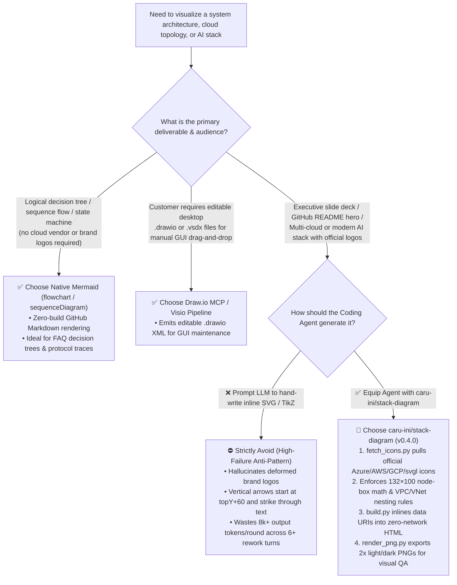
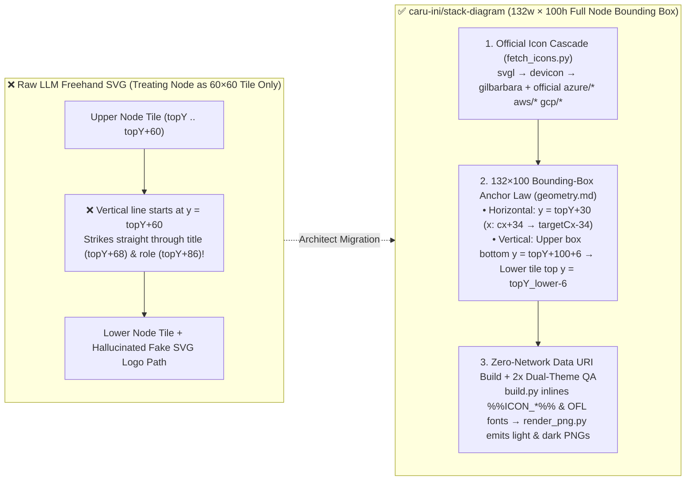

# Agent-Driven Cloud Architecture Diagramming Selection FAQ: `caru-ini/stack-diagram` (Official Vendor Icons + `132×100` Node-Box Collision Math + Visual Self-Check) vs. Raw LLM SVG Generation & Mermaid/Draw.io

> **Language / 语言**: [中文 (`stack-diagram-official-icons-vs-mermaid-svg-selection-faq.md`)](stack-diagram-official-icons-vs-mermaid-svg-selection-faq.md) | **English (Current)**  
> **Style Benchmark**: Modeled strictly on the 6-part plain-language, first-principles architecture selection guide standard (`ib-vs-ethernet-roce-selection-faq.md`)  
> **Target Audience**: AI Solution Architects, Cloud Infrastructure Architects, Pre-Sales Engineers, Agent Tooling Leads  
> **Related Daily Digest**: [2026-11-08 GitHub AI Trending Radar Digest (`../daily/2026-11-08.en.md`)](../daily/2026-11-08.en.md) · [Round 12 SVG Summary (`../../../assets/github-ai-radar-2026-11-08-r12-stack-diagram-icons.svg`)](../../../assets/github-ai-radar-2026-11-08-r12-stack-diagram-icons.svg)  
> **Primary Source Verification**: `caru-ini/stack-diagram` `v0.4.0` (released `2026-11-03`, `MIT` license, bundled fonts `SIL OFL 1.1`; created `2026-11-01`, 7-day breakout repository recorded in archived Search API snapshot `evidence/search-new-repos-2026-11-08-raw.json` [`sha256: b63e1547...`] with **2,114 Total Stars** / live GitHub REST API **2,121 Total Stars, 104 Forks**, **creation-to-date lifecycle velocity ≈302★/day** [`measured`]; **24h `stars_today`: `not_measured` [absent from the archived Daily Trending raw HTML snapshot; creation-to-date average is never conflated with single-day delta]**).

---

## 📌 Executive Summary (3-Minute Architect Takeaways)

1. **What It Really Is (Plain-Language Essence)**:
   AI Solution Architects draw system architecture diagrams every day. Historically, you faced two painful options: **either use Mermaid flowcharts** (which lack official full-color logos for Azure, AWS, GCP, Next.js, or Supabase, forcing you to spend an hour manually redrawing and pasting icons in Draw.io/PowerPoint for executive decks) **or ask an LLM to write raw SVG code** (where the LLM hallucinates brand logos into deformed geometric blobs and draws vertical arrows straight through node text labels). **`caru-ini/stack-diagram`** is an **Agent Skill (`npx skills add caru-ini/stack-diagram`) that pairs a deterministic official-icon fetcher with strict `132×100` node-box collision geometry and a headless Chromium 2x screenshot self-check loop**. You describe your stack in one sentence (e.g., *"Azure Front Door in front of Blob Storage and App Service, reaching Azure SQL and Managed Redis via private endpoints in a VNet"*), and it fetches official vendor SVGs, routes orthogonal arrows around text boxes, and outputs a **zero-network self-contained HTML file + light/dark 2x PNGs + a dependency-free React TSX component**.
2. **Core Selection Boundary (When to Choose `stack-diagram` vs. Mermaid / Draw.io)**:
   - When producing **customer-facing architecture decks, RFP deliverables, GitHub README hero diagrams, or multi-cloud/AI stack overviews** requiring authentic brand marks (`Azure` / `AWS` / `GCP` / `svgl`), vendor-compliant VPC/VNet/Subnet nesting, and automatic light/dark themes: **choose `caru-ini/stack-diagram`**.
   - When documenting **purely logical decision trees, state machines, or API sequence flows** inside Markdown without brand logos: **keep using native Mermaid (`flowchart` / `sequenceDiagram`)**.
   - **Hard Anti-Pattern**: Never ask an LLM to hand-code inline `<svg><path>` brand logos or guess vertical line coordinates without a bounding-box spec—it wastes `8,000+` output tokens per turn and guarantees deformed logos and arrows striking through labels.
3. **Quantified FinOps & SA Productivity Net Benefit (Closed-Form Parametric Verification)**:
   For an architecture team producing **`D_month = 40` customer architecture diagrams per month** (`$3.00/1M` input, `$15.00/1M` output counted strictly once; **API-only scope—commercial Visio/Lucidchart seat licenses and external design agency bills are explicitly marked `not_measured`**) under our closed-form synthetic model (`synthetic, independently_reproduced=false`), switching from **Path A (Raw LLM Freehand SVG with 6 rework rounds/diagram: `$46.80/mo` API-only + `60.0h/mo` manual icon/layout repair)** to **Path C (`caru-ini/stack-diagram` `fetch_icons.py` + `132×100` geometry + Chromium self-check: `$3.60/mo` API-only + `8.0h/mo` review)** saves **`$43.20/mo` (`$518.40/yr`, `-92.31%` API-only)** and cuts manual SA diagram formatting time from `60.0h/mo` to **`8.0h/mo` (saving `52.0h/mo`, `-86.67%`)**.

---

## 1. First-Principles Q&A (Q1–Q3: Why Raw LLM Architecture Diagrams Fail and How `stack-diagram` Fixes Them)

### Q1: Why do LLMs almost always produce fake logos and arrows crossing through text when asked to generate SVG architecture diagrams directly?

From first principles, asking an autoregressive LLM to emit raw SVG architecture diagrams violates two basic engineering invariants:

1. **Failure Mode 1: Treating deterministic brand trademarks as probabilistic token generation**
   - Official icons for Azure SQL Database, AWS Fargate, Google Cloud Run, Next.js, or Supabase are multi-path vector assets (`1 KB–15 KB`).
   - When an LLM writes inline `<svg><path d="..."/></svg>` tokens at `$15.00/1M`, it cannot reproduce exact trademark Bézier curves. Monochrome icon fonts (`simple-icons`) also fail because users immediately spot wrong colors on multi-cloud diagrams.
   - **First-Principles Fix**: **The LLM should never generate icon geometry—it should only emit `%%ICON_azure_sql%%` placeholders**, while a deterministic local script (`scripts/fetch_icons.py`) downloads authentic vendor SVGs and `scripts/build.py` inlines them as Base64 data URIs.
2. **Failure Mode 2: Treating a node as only its `60×60` icon tile and ignoring the `40px` label band underneath**
   - Every architecture node consists of a **`60×60` icon tile** (`topY .. topY+60`) **plus** two lines of text underneath (`~13px` service title at `topY+68` and `~10px` monospace role at `topY+86`), occupying a **`132w × 100h` bounding box** (`bottom ≈ topY + 100`).
   - Raw LLMs anchor vertical downward arrows at the bottom of the icon tile (`y = topY + 60`), driving the line and arrowhead straight through the service name and role text below the tile!

---

### Q2: How do the 4 core engineering mechanisms inside `caru-ini/stack-diagram` work under the hood?

Verified directly against the primary source files of `caru-ini/stack-diagram` `v0.4.0` (`skills/stack-diagram/SKILL.md`, `scripts/fetch_icons.py`, `scripts/build.py`, `scripts/render_png.py`, and `references/geometry.md`, `measured`):

| Core Mechanism | Primary Source File | Problem Solved & Low-Level Implementation |
| :--- | :--- | :--- |
| **1. Cascading Official Icon Fetcher** | `skills/stack-diagram/scripts/fetch_icons.py` | Uses Python 3.9+ stdlib only:<br>• **Modern dev/AI brands**: Queries **`svgl.app` → `devicon` → `gilbarbara/logos`** in order (deliberately excluding monochrome `simple-icons`), saving `<name>` (light) and `<name>_dark` (dark group label) plus `manifest.json` with a `white_fill` detector (putting white marks on `.tile.dark` rather than recoloring brand fills).<br>• **Official Cloud Vendor Packages**: Supports `name:azure/<Name>` (official Microsoft Azure icons, e.g., `aks`, `vnet`, `front-door`, `ai-search`, `cosmos`), `name:aws/<Name>` (official AWS Architecture Icons), and `name:gcp/<Product>` (official Google Cloud icons, blocking retired hexagon copies).<br>• **Abstract Concepts**: Fetches Lucide line icons via `name:lucide/<icon>` (`terminal`, `clock`, `database`). |
| **2. Cloud-Vendor-Specific Topology Rules** | `skills/stack-diagram/SKILL.md` (Step 2) | Enforces cloud-architect topology invariants per provider:<br>• **Azure Rules**: A `VNet` belongs to a single `Region` (placed inside the `region` group); global services (`Azure Front Door`) stay outside the region; PaaS databases reached via Private Endpoint sit inside the VNet with role `private endpoint`; full Microsoft service names (`Azure SQL Database`, not bare `SQL`) are enforced with `width: 152px` (`left: centerX - 76px`) to prevent awkward wrapping.<br>• **AWS Rules**: Uses `tile bare` (no double frame), separates `Public Subnet` (ALB) and `Private Subnet` (Fargate/RDS/ElastiCache) inside VPCs, and uses open arrowheads `marker-end="url(#open)"`.<br>• **GCP Rules**: Places regional `Region` boxes *inside* global `VPC` boxes (never a VPC inside a region). |
| **3. `132×100` Node-Box Collision Math** | `skills/stack-diagram/references/geometry.md` | Treats every node as a **`132w × 100h` bounding box** (`centerX ± 66, topY .. topY + 100`):<br>• **Horizontal edges (same row)**: Connect tile side to tile side at `y = topY + 30` (`x = centerX + 34` to `targetCenterX - 34`).<br>• **Vertical edges (row to row)**: Connect **upper box bottom (`y = topY_upper + 100 + 6`) to lower tile top (`y = topY_lower - 6`)**—mathematically eliminating arrows striking through node labels.<br>• **Two-Layer Defense**: Edge labels use `paint-order: stroke` paper halos, and node labels sit inside paper-backed `<span>` elements. |
| **4. Single-Source HTML Build & 2x Chromium Visual Loop** | `scripts/build.py` + `scripts/render_png.py` | • `build.py` replaces `%%ICON_<name>%%` and bundled SIL OFL 1.1 fonts (`%%FONT_DISPLAY%%` Geist / `%%FONT_JBM%%` JetBrains Mono) with Base64 data URIs inside `assets/template.html`, failing loudly on any unresolved token.<br>• `render_png.py` runs headless Chromium (`--scale 2`) to emit both `out.png` (light) and `out-dark.png` (dark) so the agent visually inspects the rendered output before delivery. |

---

### Q3: When should an AI Solution Architect choose `caru-ini/stack-diagram` vs. Mermaid, Excalidraw, or Draw.io MCP?

- **Choose `caru-ini/stack-diagram`**: When you want to turn a 1-sentence stack description into a **publication-grade cloud/AI architecture diagram with authentic vendor icons, compliant Azure/AWS/GCP group boundaries, light/dark 2x PNGs, a zero-network HTML file, and a React TSX component in under 3 minutes**.
- **Choose Native Mermaid (`flowchart` / `sequenceDiagram`)**: When authoring decision trees, state machines, or protocol sequence diagrams inside Markdown where zero-build text diffs matter more than brand logos.
- **Choose Draw.io MCP / Visio**: When a customer contract explicitly requires editable `.drawio` or `.vsdx` desktop files for manual drag-and-drop editing by non-developer operations teams.

---

## 2. Selection Decision Tree & Node-Box Collision Architecture (Mermaid Diagrams)

### 2.1 Architecture Diagramming Tool Selection Decision Tree



### 2.2 Raw LLM SVG Text-Collision Failure vs. `stack-diagram` `132×100` Node-Box Geometry



---

## 3. 4-Way Architecture Selection Matrix

| Evaluation Dimension | Path A: Raw LLM Freehand Inline SVG | Path B: Mermaid Flowchart + Manual Draw.io Redraw | Path C: `caru-ini/stack-diagram` (`v0.4.0`) |
| :--- | :--- | :--- | :--- |
| **Brand & Cloud Icon Authenticity** | ❌ **Poor** (hallucinated `<path>` blobs or plain text boxes) | ⚠️ **No official full-color logos in Mermaid** (requires manual Draw.io redraw) | ✅ **100% Official Marks** (`svgl`/`devicon`/`gilbarbara` + official Azure/AWS/GCP packages) |
| **Cloud Topology Rules (Azure/AWS/GCP)** | ❌ Frequently inverts VNet/Region/VPC nesting | ⚠️ Relies entirely on manual layout memory | ✅ **Built-in Provider Rules** (Azure VNet inside Region, GCP Region inside global VPC, AWS public/private subnets) |
| **Arrow-Through-Text Collision Prevention** | ❌ High collision rate (lines start at `topY+60` across labels) | ✅ Dagre avoids text overlap but lacks orthogonal control | ✅ **`132×100` Node-Box Math + Paper Stroke Halo + 2x Chromium Self-Check** |
| **Dual-Theme (Light / Dark) Support** | ❌ Dark logos vanish on dark backgrounds | ⚠️ Basic line inversion only; no dark-variant brand marks | ✅ **Native Light & Dark Rendering** (white tiles + `<name>_dark` or `.plate` group badges) |
| **Deliverable Formats & Offline Portability** | ⚠️ Fragile external image URLs | ✅ Markdown text (manual export needed for slide decks) | ✅ **Zero-Network Self-Contained HTML + 2x Light/Dark PNGs + Zero-Dep React TSX** |
| **LLM Output Tokens per Turn** | ❌ **High** (`~8,000` output tokens/round writing verbose paths) | ✅ Low (`~4,000` output tokens/round, but high human redraw time) | ✅ **Minimal** (`~2,000` output tokens/round emitting `%%ICON_*%%` tokens & coordinates) |

---

## 4. Closed-Form FinOps & SA Productivity Worked Example

> **Provenance & Reproducibility Gate**:
> - **`measured` (Primary Source & Archived Evidence)**: Repository metadata for `caru-ini/stack-diagram` (`2,114` stars in archived `evidence/search-new-repos-2026-11-08-raw.json` [`sha256: b63e1547...`] / `2,121` live REST stars, `MIT` license, created `2026-11-01`, `≈302★/day` creation-to-date lifecycle velocity; `stars_today: not_measured`) and geometry constants (`132×100` node box, `60×60` tile, `≥140px` horizontal/vertical spacing) are verified directly from GitHub REST API and `skills/stack-diagram/references/geometry.md`.
> - **`synthetic, independently_reproduced=false` (Closed-Form Parametric Worked Example)**: The monthly FinOps and engineering-hour model below is derived strictly in closed form from the explicit parameters listed below, with input and output token costs calculated separately and output counted strictly once. **Scope is strictly API-only; commercial Visio/Lucidchart software seat costs and external design agency bills are explicitly marked `not_measured`.**

### 4.1 Explicit Input Parameters

Consider an AI Solution Architect team producing **`D_month = 40` customer system architecture diagrams per month** for RFP responses, Azure/AWS/GCP landing zones, and PoC documentation:
- **LLM API Pricing**: Input **`p_in = $3.00 / 1M tokens`**, Output **`p_out = $15.00 / 1M tokens`** (counted strictly once).
- **Path A (Raw LLM Freehand Inline SVG)**:
  - Due to deformed logos and arrows crossing through text labels, each diagram averages **`R_A = 6` prompt/rework rounds**, totaling `N_A = 40 × 6 = 240 rounds/mo`.
  - Each round consumes **`i_A = 0.025M` (25k) input tokens** + **`o_A = 0.008M` (8k) output tokens** (verbose inline SVG paths).
  - Manual SA cleanup and icon replacement still require **`h_A = 1.5h/diagram × 40 = 60.0h/mo`**.
- **Path B (Mermaid Draft + Manual Draw.io / PowerPoint Icon Redraw)**:
  - Averages **`R_B = 3` rounds/diagram**, totaling `N_B = 40 × 3 = 120 rounds/mo`.
  - Each round consumes **`i_B = 0.015M` (15k) input tokens** + **`o_B = 0.004M` (4k) output tokens**.
  - Because executive slide decks require authentic cloud vendor icons and VPC group styling, manual redraw in Draw.io/PowerPoint takes **`h_B = 1.0h/diagram × 40 = 40.0h/mo`**.
- **Path C (`caru-ini/stack-diagram` `fetch_icons.py` + `132×100` Geometry + Chromium 2x Self-Check)**:
  - Official icons are fetched locally and injected via `%%ICON_<name>%%` data URIs (`0` SVG path output tokens), requiring **`R_C = 1.5` rounds/diagram**, totaling `N_C = 40 × 1.5 = 60 rounds/mo`.
  - Each round consumes **`i_C = 0.010M` (10k) input tokens** + **`o_C = 0.002M` (2k) output tokens**.
  - SA review and minor coordinate tuning take **`h_C = 0.2h/diagram (12 min) × 40 = 8.0h/mo`**.

### 4.2 Closed-Form Formula & Component-Level Verification Table

$$\text{Monthly API Cost} = N_{\text{rounds}} \times \left(i_{\text{round}} \times \$3.00 + o_{\text{round}} \times \$15.00\right)$$

| Diagramming Path | Monthly Rounds (`N_rounds`) | Input Cost / Round (`i × $3`) | Output Cost / Round (`o × $15`, counted once) | Monthly Input Bill | Monthly Output Bill | **Monthly API Total (API-Only)** | SA Manual Formatting Hours | Commercial Tool / Agency Bill |
| :--- | :--- | :--- | :--- | :--- | :--- | :--- | :--- | :--- |
| **Path A: Raw LLM Freehand SVG** | `240 rounds` (`40×6`) | `$0.0750` (`0.025M`) | `$0.1200` (`0.008M`) | `$18.00/mo` | `$28.80/mo` | **`$46.80 / mo`** (`$561.60/yr`) | **`60.0h / mo`** | `not_measured` |
| **Path B: Mermaid + Manual Draw.io Redraw** | `120 rounds` (`40×3`) | `$0.0450` (`0.015M`) | `$0.0600` (`0.004M`) | `$5.40/mo` | `$7.20/mo` | **`$12.60 / mo`** (`$151.20/yr`) | **`40.0h / mo`** | `not_measured` |
| **Path C: `caru-ini/stack-diagram`** | **`60 rounds`** (`40×1.5`) | **`$0.0300`** (`0.010M`) | **`$0.0300`** (`0.002M`) | **`$1.80/mo`** | **`$1.80/mo`** | **`$3.60 / mo`** (`$43.20/yr`) | **`8.0h / mo`** | `not_measured` |
| **Net Savings (Path C vs. Path A)** | **`-180 rounds/mo`** (`-75.00%`) | **`-$0.0450/round`** | **`-$0.0900/round`** | **`-$16.20/mo`** | **`-$27.00/mo`** | **`-$43.20 / mo`** (**`-92.31%`**) | **`-52.0h / mo`** (**`-86.67%`**) | `not_measured` |

---

## 5. 30-Minute Customer Demo Runbook & Production Readiness Checklist

### 5.1 30-Minute Executive Demo Runbook ("One-Sentence Azure Enterprise AI Landing Zone Diagram")

1. **Step 1 — Install the Agent Skill (3 min)**:
   ```bash
   npx skills add caru-ini/stack-diagram
   ```
2. **Step 2 — Fetch Official Microsoft Azure + AI Stack Icons (5 min)**:
   ```bash
   python3 skills/stack-diagram/scripts/fetch_icons.py /tmp/azure-ai-icons \
     "azure:azure/Azure-A" "fd:azure/front-door" "blob:azure/blob" \
     "app:azure/app-service" "vnet:azure/vnet" "sql:azure/sql-database" \
     "redis:azure/redis" "search:azure/ai-search" nextjs claude
   ```
3. **Step 3 — Build the Zero-Network HTML and Export 2x Light/Dark PNGs (10 min)**:
   ```bash
   python3 skills/stack-diagram/scripts/build.py my-azure-ai-stack.html /tmp/azure-ai-icons out.html \
     --fonts skills/stack-diagram/assets/fonts
   python3 skills/stack-diagram/scripts/render_png.py out.html out.png --selector .canvas --scale 2
   ```
4. **Step 4 — Showcase Three Highlights to the Customer (12 min)**:
   - Open `out.html` offline to prove 100% Data URI self-containment (zero external font or icon requests);
   - Compare `out.png` (light theme for printed RFP docs) and `out-dark.png` (dark theme for executive slides), highlighting zero arrow-through-text collisions and automatic dark group-label switching.

### 5.2 SA Production Readiness Checklist

- [ ] **Official Cloud Namespace Prefix Enforcement**: Always prefix cloud vendor services with `azure/`, `aws/`, or `gcp/` (`sql:azure/sql-database`) so `fetch_icons.py` pulls from the official vendor package rather than third-party redraws; keep loose downloaded vendor icon folders out of public Git repos per vendor redistribution guidelines.
- [ ] **`132×100` Vertical Anchor Verification**: Confirm every downward vertical edge starts at `y1 = topY_upper + 100 + 6` (below the full node text box) and ends at `y2 = topY_lower - 6`, never at `topY_upper + 60`.
- [ ] **Cloud-Provider Group Nesting Compliance**:
  - **Azure**: Place `VNet` inside `Region`, keep global services (`Azure Front Door`) outside `Region`, write full Microsoft service names (`Azure SQL Database`), and widen wrapping nodes to `width: 152px` (`left: centerX - 76px`);
  - **GCP**: Place `Region` inside global `VPC`;
  - **AWS**: Separate `Public Subnet` and `Private Subnet` inside `VPC` and use `tile bare`.
- [ ] **Mandatory 2x Visual Self-Check**: Always execute `render_png.py --scale 2` and inspect both `out.png` and `out-dark.png` to verify no white-on-white invisible marks (`white_fill` uses `.tile.dark` or `.plate`) and no clipped borders.
- [ ] **Customer Data Sanitization Gate**: Skip `share.py` gallery uploads for customer engagements; strip internal hostnames, private IP ranges, and customer names before sharing any reference diagram externally.
