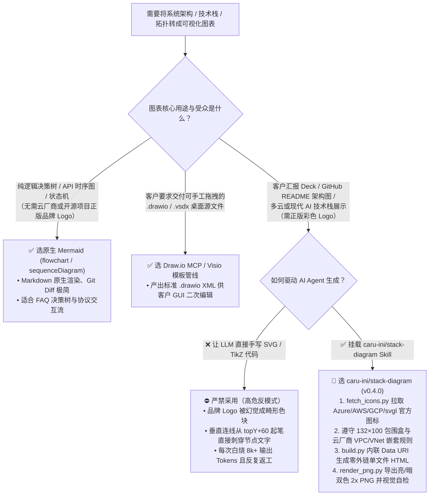
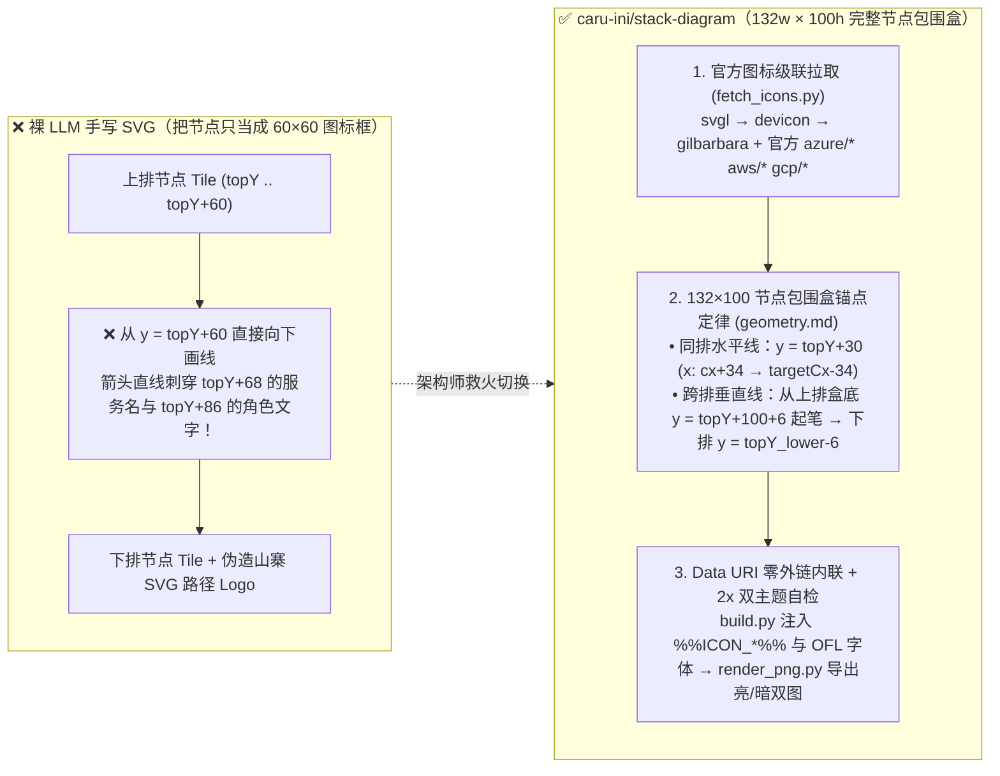

# 云架构图 Agent 技能与生成方案选型 FAQ：`caru-ini/stack-diagram`（官方云厂商图标 + `132×100` 节点碰撞几何 + 视觉自检）vs 裸 LLM 手写 SVG & Mermaid/Draw.io

> **语言 / Language**：**中文 (当前)** | [English (`stack-diagram-official-icons-vs-mermaid-svg-selection-faq.en.md`)](stack-diagram-official-icons-vs-mermaid-svg-selection-faq.en.md)  
> **对标文风标杆**：严格对标 `ib-vs-ethernet-roce-selection-faq.md` 六段式架构师实战指南（通俗大白话 + 第一性原理 + Mermaid 决策树 + 定量闭式算例 + 生产级 Checklist）  
> **适用读者**：AI 解决方案架构师（AI Solution Architect）、云基础架构师、售前技术专家、Agent 工具链负责人  
> **关联日刊**：[2026-11-08 GitHub AI 趋势雷达日报 (`../daily/2026-11-08.md`)](../daily/2026-11-08.md) · [Round 12 SVG 可视化总结 (`../../../assets/github-ai-radar-2026-11-08-r12-stack-diagram-icons.svg`)](../../../assets/github-ai-radar-2026-11-08-r12-stack-diagram-icons.svg)  
> **一手源码核验版本**：`caru-ini/stack-diagram` `v0.4.0`（2026-11-03 发布，`MIT` 开源协议，内置字体 `SIL OFL 1.1`；建仓于 2026-11-01，7 天新建黑马仓库，封存 Search API 快照 `evidence/search-new-repos-2026-11-08-raw.json` [`sha256: b63e1547...`] 录得 **2,114 Total Stars** / GitHub REST API 实时核验 **2,121 Total Stars, 104 Forks**，**建仓以来日均 ≈302★/天** [`measured`]；**今日单日新增 `stars_today`: `not_measured` [未出现在当日 Trending Raw HTML 快照中，严禁将 7 天总 Stars 除以天数冒充今日单日增量]**）。

---

## 📌 核心结论速览（Executive Summary — 3 分钟掌握选型本质）

1. **它到底是个什么东西（大白话本质）**：
   AI 解决方案架构师每天都要画系统架构图。以前只有两条痛苦的路：**要么用 Mermaid 画框图**（没有 Azure/AWS/GCP/Next.js/Supabase 的正版彩色官方图标，拿去给客户 CIO 汇报显得像草稿，还得花 1 小时去 Draw.io 手动贴图标重画）；**要么让大模型直接手写 SVG 代码**（大模型会把品牌 Logo 瞎画成四不像的几何色块，而且连线箭头经常直接从文字标签正中间穿过去）。**`caru-ini/stack-diagram`** 是一个专门给 Claude Code / Codex / Cursor 装上的**“带正版官方图标拉取器 + 严格防穿字坐标几何规范 + Chromium 截图自检闭环”的架构图生成技能包（Agent Skill）**——你只用一句话描述技术栈（例如“Azure Front Door 接 Blob 和 App Service，通过 Private Endpoint 访问 VNet 里的 Azure SQL 与 Managed Redis”），它自动从微软/AWS/GCP/svgl 官方包拉取正版 SVG 图标、按 `132×100` 节点包围盒算出绝不穿字的折线坐标，打包成**单文件零外链离线 HTML + 明暗双主题高清 PNG + 零依赖 React TSX 组件**。
2. **核心选型红线（什么时候用 `stack-diagram` vs 什么时候用 Mermaid / Draw.io）**：
   - 当你需要画**面向客户交付物、售前方案 Deck、GitHub README 顶图、技术博客或架构评审看板**（涉及 Azure / AWS / GCP 云服务 + 现代 AI/全栈工具链如 Next.js、Claude、Supabase、Vercel、Stripe，要求正版彩色品牌图标、VPC/VNet/Subnet 规范嵌套分组、明暗双色自适应）：**无脑选 `caru-ini/stack-diagram`**。
   - 当你只需要在 Markdown 文档里快速表达**纯逻辑状态机、时序图（Sequence Diagram）或算法分支决策树**（不需要品牌图标）：**继续用原生 Mermaid（`flowchart` / `sequenceDiagram`）**。
   - **绝对反模式**：严禁让大模型在没有外部图标字典与包围盒规则的情况下**凭空手写内联 `<svg>` 品牌 Logo 路径或盲猜连线坐标**——不仅每次白烧 `8,000+` 输出 Tokens，而且 100% 出现伪造商标与箭头穿字事故。
3. **定量 TCO 与架构师工时净收益（闭式参数化模型验证）**：
   在月产 **`D_month = 40` 张客户级系统架构图**（输入 `$3.00/1M`、输出 `$15.00/1M` 严格单次计入；**仅统计纯 API Token 费用，Visio/Lucidchart 商业软件授权与外包设计费用明确标为 `not_measured`**）的闭式合成算例（`synthetic, independently_reproduced=false`）下，从“裸 LLM 手写 SVG 反复返工（Path A：`$46.80/月` API-only，人工修图换标 `60.0h/月`）”切换到“`caru-ini/stack-diagram` 官方图标注入 + `132×100` 几何防碰撞 + 截图自检（Path C：`$3.60/月` API-only，人工微调 `8.0h/月`）”，**每月节省 `$43.20/月`（年省 `$518.40/年`，API 降本 `-92.31%`），并将架构师每月花在排版对齐与找正版图标上的无效工时从 `60.0h/月` 砍到 `8.0h/月`（月省 `52.0h/月`，提效 `-86.67%`）**。

---

## 1. 第一性原理灵魂三问（Q1–Q3：彻底看懂为什么 LLM 直接画架构图总是翻车）

### Q1：为什么让大模型直接生成 SVG 架构图，十有八九会出现“山寨图标”和“箭头穿过文字”？

用第一性原理拆解大模型直接写 SVG 架构图的两个致命物理缺陷：

1. **缺陷一：把“确定性品牌资产”当成“概率性 Token 续写”（Logo 幻觉与 Token 浪费）**
   - 微软 Azure SQL、AWS Fargate、Google Cloud Run、Next.js 或 Supabase 的官方图标是精确的多路径矢量文件（通常 1KB–15KB）。
   - 如果让 LLM 在回答里手写 `<svg><path d="..."/></svg>`，大模型既记不住精确贝塞尔曲线控制点，又禁止使用单色简笔画（如 `simple-icons` 的黑白重绘在多云架构图里难以辨认）。结果大模型花几千个 `$15/1M` 的输出 Tokens 憋出一堆歪七扭八的圆圈和方块。
   - **正解**：**LLM 绝不应该“画”图标，而应该只写占位符 `%%ICON_azure_sql%%`**，由本地确定性 Python 脚本（`scripts/fetch_icons.py`）从官方图标库抓回原版 SVG/PNG，再由构建脚本（`scripts/build.py`）以 `data:image/svg+xml;base64,...` 零损耗内联进 HTML。
2. **缺陷二：把“节点（Node）”错误理解成“只有图标方块（60×60 Tile）”，忽略了下方的两行文字高度（箭头穿字根因）**
   - 在架构图里，一个节点由两部分组成：上面的 **`60×60` 白色图标瓷砖（Tile）** + 下面的 **`13px` 服务名称与 `10px` 角色副标题**（合占约 `40px` 高）。
   - 裸 LLM 画垂直向下的连线（比如从上排 `API` 节点连到下排 `Postgres` 节点）时，习惯从上排图标底边 `y = topY + 60` 起笔——这根线就会**像糖葫芦签子一样直接刺穿上排图标正下方的服务名称和角色文字**！

---

### Q2：`caru-ini/stack-diagram` 的底层 4 大工程机制是怎么运作的？

根据对 `caru-ini/stack-diagram`（`v0.4.0`）仓库源码（`skills/stack-diagram/SKILL.md`、`scripts/fetch_icons.py`、`scripts/build.py`、`scripts/render_png.py` 与 `references/geometry.md`）的一手核验（`measured`）：

| 核心工程机制 | 源码文件位置 | 解决什么痛点 & 底层硬核细节 |
| :--- | :--- | :--- |
| **① 多级官方正版图标级联拉取器** | `skills/stack-diagram/scripts/fetch_icons.py` | 零第三方依赖（仅用 Python 3.9+ 标准库）：<br>• **通用现代技术栈**：按精确顺序级联查询 **`svgl.app` → `devicon` → `gilbarbara/logos`**（刻意剔除单色重绘的 `simple-icons`），自动识别明/暗双版本并标记 `white_fill`（白色图标自动配深色瓷砖 `tile dark`，**绝不篡改品牌原色**）。<br>• **三大公有云官方图标包直连**：支持 `name:azure/<Name>`（微软官方 Azure 架构图标包，支持 `aks`、`vnet`、`front-door`、`ai-search`、`cosmos` 等缩写）、`name:aws/<Name>`（AWS 官方图标包）与 `name:gcp/<Product>`（Google Cloud 官方图标包，禁用已废弃的旧六边形图标）。<br>• **抽象组件图标**：队列、定时任务、终端等无品牌概念节点通过 `name:lucide/<icon>` 自动拉取 Lucide 线性图标。 |
| **② 三大云厂商专属拓扑分组规范** | `skills/stack-diagram/SKILL.md` (Step 2) | 内置云架构师级别的拓扑校验规则：<br>• **Azure 规范**：`VNet` 必须位于单 `Region` 内部；`Azure Front Door` 等全局服务必须位于 `Region` 外部；通过 Private Endpoint 接入的 PaaS 数据库放入 VNet 内并标注 `private endpoint` 角色；服务名必须写微软规范全称（如 `Azure SQL Database` 而非裸写 `SQL`）。<br>• **AWS 规范**：使用 `tile bare`（不套白底框以免双重边框），VPC 内强制区分 `Public Subnet`（ALB）与 `Private Subnet`（Fargate / RDS / ElastiCache），连线采用开放箭头 `marker-end="url(#open)"`。<br>• **GCP 规范**：由于 GCP 的 `VPC` 是全球资源而 `Subnet` 是区域资源，强制将 `Region` 画在 `VPC` 内部（严禁把 VPC 画在 Region 里）。 |
| **③ `132×100` 节点包围盒与防穿字正交布线几何** | `skills/stack-diagram/references/geometry.md` | 将每个节点严格定义为 **`132px 宽 × 100px 高` 的完整碰撞包围盒**（`centerX ± 66, topY .. topY + 100`，其中 `topY..topY+60` 为 `60×60` 瓷砖，`topY+68` 为名称，`topY+86` 为角色）：<br>• **水平连线（同排）**：从 `x = centerX + 30 + 4` 连到 `targetCenterX - 30 - 4`，高度固定在瓷砖中线 `y = topY + 30`。<br>• **垂直连线（上下排）**：强制从**上排完整包围盒底边 `y = topY_upper + 100 + 6`** 连到**下排瓷砖顶边 `y = topY_lower - 6`**，从数学上根除“箭头穿透节点下方文字”的顽疾。<br>• **双重视觉防御**：连线标签采用 `paint-order: stroke` 纸色光晕（Halo），节点文字包裹纸色背景 `<span>`。 |
| **④ 单一事实源构建与 Chromium 2x 截图自检** | `scripts/build.py` + `scripts/render_png.py` | • `build.py` 将 `assets/template.html` 中的 `%%ICON_<name>%%` 与内置开源字体 `%%FONT_DISPLAY%%`（Geist）/ `%%FONT_JBM%%`（JetBrains Mono，`SIL OFL 1.1`）全部转为 Base64 Data URI，生成**100% 离线自包含的单文件 HTML**（有任何未解析占位符立即报错终止）。<br>• `render_png.py` 调用 Playwright Chromium（`--scale 2`）一键导出**亮色 `out.png` + 暗色 `out-dark.png`**，强制 Agent 在交付前肉眼核验无穿字、无裁切、无白标隐形。 |

---

### Q3：什么时候选 `caru-ini/stack-diagram`，什么时候选 Mermaid、Excalidraw 或 Draw.io MCP？

- **选 `caru-ini/stack-diagram`**：当你要在 **3 分钟内把一段自然语言系统描述变成一张带正版彩色官方图标、符合 Azure/AWS/GCP 官方拓扑规范、同时具备亮/暗双色高清 PNG + 离线 HTML + React 组件的系统架构图**。
- **选原生 Mermaid（`flowchart` / `sequenceDiagram`）**：当你在写技术选型 FAQ、ADR 决策树、API 调用时序图，重点是**分支逻辑与纯文本可读性**，且需要在 GitHub Markdown 里零构建直接渲染。
- **选 Draw.io MCP / Visio**：当企业客户要求交付 `.drawio` / `.vsdx` 源文件以便客户方不懂代码的 IT 运维人员后续在桌面 GUI 里手工拖拽修改。

---

## 2. 架构选型决策树与几何防穿字原理图（Mermaid Visualizations）

### 2.1 AI 解决方案架构师画图工具选型决策树



### 2.2 为什么裸 LLM 画图必穿字 vs `stack-diagram` 的 `132×100` 包围盒锚点定律



---

## 3. 四维架构选型对比矩阵（Selection Decision Matrix）

| 评估维度 | Path A：裸 LLM 手写内联 SVG / HTML | Path B：Mermaid Flowchart + 手工 Draw.io 贴图 | Path C：`caru-ini/stack-diagram` (`v0.4.0`) |
| :--- | :--- | :--- | :--- |
| **品牌与云厂商图标真实度** | ❌ **极差**（LLM 瞎编 `<path>` 或退化为文字方块） | ⚠️ **Mermaid 无官方彩色标**（需人工去 Draw.io 找图标重画） | ✅ **100% 官方正版图标**（`svgl`/`devicon`/`gilbarbara` + Azure/AWS/GCP 官方包） |
| **三大公有云拓扑规范（Azure/AWS/GCP）** | ❌ 经常把 VNet/Region/VPC 包含关系画反 | ⚠️ 完全靠人工记忆 | ✅ **内置硬性拓扑规则**（Azure VNet 在 Region 内、GCP Region 在全局 VPC 内、AWS 公私子网分离） |
| **连线穿字与排版碰撞控制** | ❌ 高频出现箭头刺穿文字、标签重叠 | ✅ Dagre 自动布局不穿字，但复杂正交线不可控 | ✅ **`132×100` 包围盒锚点公式 + 纸色 Halo 光晕 + 2x 截图自检闭环** |
| **明暗双主题（Light / Dark）自适应** | ❌ 暗色模式下黑色 Logo 直接隐形消失 | ⚠️ 仅支持基础线条变色，无品牌暗色标切换 | ✅ **原生同时渲染亮/暗双主题**（白色瓷砖保底 + 分组栏自动切换 `<name>_dark` 或加白底衬板 `plate`） |
| **交付产物形态与离线可移植性** | ⚠️ 散落外部图片链接易裂图 | ✅ Markdown 文本（但转高清双色宣发图需手工导出） | ✅ **单文件零外链离线 HTML（含内联字体/图标）+ 2x 亮/暗 PNG + 零依赖 React TSX** |
| **单张图 LLM Output Token 消耗** | ❌ **极高**（`~8,000` Output Tokens/轮，手写冗余路径） | ✅ 低（`~4,000` Output Tokens/轮，但人工贴图耗时长） | ✅ **极低**（`~2,000` Output Tokens/轮，只输出 `%%ICON_*%%` 占位符与简洁坐标） |

---

## 4. 定量 FinOps 与架构师工时算例（Closed-Form Parametric Worked Example）

> **数据来源与可复算声明（Provenance & Reproducibility Gate）**：
> - **`measured`（实测一手源码与归档证据）**：`caru-ini/stack-diagram` 仓库元数据（`2,114` Search API 归档 Stars / `2,121` 实时 Stars，`MIT` 协议，2026-11-01 创建，建仓日均 `≈302★/天`；今日新增 `stars_today: not_measured`）及 `skills/stack-diagram/SKILL.md`、`references/geometry.md` 中的几何常数（`132×100` 包围盒、`60×60` 瓷砖、水平间距 `≥140px`、垂直间距 `140px`）均来自 GitHub API 与封存 JSON `evidence/search-new-repos-2026-11-08-raw.json`（`sha256: b63e1547...`）。
> - **`synthetic, independently_reproduced=false`（架构师显式参数化闭式算例）**：以下月度 FinOps 与工时算例严格由显式参数通过闭式公式推导，输入与输出费用独立核算且输出严格只计一次；**仅覆盖 LLM API Token 账单（API-only），Visio/Lucidchart 商业软件订阅费与外部设计公司账单均明确标为 `not_measured`**。

### 4.1 显式输入参数设定（Explicit Input Parameters）

设某 AI 解决方案架构师团队每月需为客户方案、PoC 评审与技术文档交付 **`D_month = 40` 张系统架构图**：
- **主流推理/编程模型 API 单价**：输入 **`p_in = $3.00 / 1M tokens`**，输出 **`p_out = $15.00 / 1M tokens`**（输出严格只计入一次）。
- **Path A（裸 LLM 手写内联 SVG 反复返工）**：
  - 因 Logo 畸形与箭头穿字，平均每张图需 **`R_A = 6` 轮 Prompt 返工**，月总轮次 `N_A = 40 × 6 = 240 轮/月`。
  - 每轮消耗 **`i_A = 0.025M`（25k）输入 Tokens** + **`o_A = 0.008M`（8k）输出 Tokens**（手写大量冗长 SVG `<path>`）。
  - 架构师仍需人工导入矢量软件修图与替换正版图标：**`h_A = 1.5 小时/张 × 40 = 60.0 小时/月`**。
- **Path B（Mermaid 草图 + 手工 Draw.io 贴正版图标重绘）**：
  - 平均每张图需 **`R_B = 3` 轮 Prompt**，月总轮次 `N_B = 40 × 3 = 120 轮/月`。
  - 每轮消耗 **`i_B = 0.015M`（15k）输入 Tokens** + **`o_B = 0.004M`（4k）输出 Tokens**。
  - 因客户 Deck 需要正版云图标与 VPC 分组框，架构师需在 Draw.io/PPT 手工重绘：**`h_B = 1.0 小时/张 × 40 = 40.0 小时/月`**。
- **Path C（`caru-ini/stack-diagram` 官方图标脚本 + `132×100` 几何规范 + 截图自检）**：
  - 图标由本地 `fetch_icons.py` 抓取并由 `build.py` 注入 `%%ICON_<name>%%`，大模型零 SVG Path 负担，配合 `render_png.py` 一次或微调即成，平均每张图仅需 **`R_C = 1.5` 轮**，月总轮次 `N_C = 40 × 1.5 = 60 轮/月`。
  - 每轮消耗 **`i_C = 0.010M`（10k）输入 Tokens** + **`o_C = 0.002M`（2k）输出 Tokens**。
  - 架构师审阅微调耗时仅 **`h_C = 0.2 小时/张（12 分钟） × 40 = 8.0 小时/月`**。

### 4.2 闭式复算公式与逐项对账表（100% Closed-Form Verification Table）

$$\text{Monthly API Cost} = N_{\text{rounds}} \times \left(i_{\text{round}} \times \$3.00 + o_{\text{round}} \times \$15.00\right)$$

| 架构图生产路径 | 月总轮次 (`N_rounds`) | 单轮输入成本 (`i × $3`) | 单轮输出成本 (`o × $15`，单次计入) | 月度输入账单 | 月度输出账单 | **月度 API 总账单 (API-Only)** | 架构师人工修图耗时 | 商业绘图软件/外包账单 |
| :--- | :--- | :--- | :--- | :--- | :--- | :--- | :--- | :--- |
| **Path A：裸 LLM 手写内联 SVG** | `240 轮` (`40×6`) | `$0.0750` (`0.025M`) | `$0.1200` (`0.008M`) | `$18.00/月` | `$28.80/月` | **`$46.80 / 月`** (`$561.60/年`) | **`60.0 小时/月`** | `not_measured` |
| **Path B：Mermaid + 手工 Draw.io 重绘** | `120 轮` (`40×3`) | `$0.0450` (`0.015M`) | `$0.0600` (`0.004M`) | `$5.40/月` | `$7.20/月` | **`$12.60 / 月`** (`$151.20/年`) | **`40.0 小时/月`** | `not_measured` |
| **Path C：`caru-ini/stack-diagram`** | **`60 轮`** (`40×1.5`) | **`$0.0300`** (`0.010M`) | **`$0.0300`** (`0.002M`) | **`$1.80/月`** | **`$1.80/月`** | **`$3.60 / 月`** (`$43.20/年`) | **`8.0 小时/月`** | `not_measured` |
| **Path C vs Path A 净节省** | **`-180 轮/月`** (`-75.00%`) | **`-$0.0450/轮`** | **`-$0.0900/轮`** | **`-$16.20/月`** | **`-$27.00/月`** | **`-$43.20 / 月`** (**`-92.31%`**) | **`-52.0 小时/月`** (**`-86.67%`**) | `not_measured` |

---

## 5. 30 分钟客户 Demo 复刻与生产级上手核验清单（SA Production Checklist）

### 5.1 30 分钟高管冲击力 Demo 剧本（“一句话生成 Azure 企业级 AI 落地架构图”）

1. **Step 1 — 一键安装技能包（3 分钟）**：
   ```bash
   npx skills add caru-ini/stack-diagram
   ```
2. **Step 2 — 拉取微软 Azure + 现代 AI 栈官方正版图标（5 分钟）**：
   ```bash
   python3 skills/stack-diagram/scripts/fetch_icons.py /tmp/azure-ai-icons \
     "azure:azure/Azure-A" "fd:azure/front-door" "blob:azure/blob" \
     "app:azure/app-service" "vnet:azure/vnet" "sql:azure/sql-database" \
     "redis:azure/redis" "search:azure/ai-search" nextjs claude
   ```
3. **Step 3 — 按 `132×100` 包围盒构建零外链单文件 HTML 并导出 2x 亮/暗双色 PNG（10 分钟）**：
   ```bash
   python3 skills/stack-diagram/scripts/build.py my-azure-ai-stack.html /tmp/azure-ai-icons out.html \
     --fonts skills/stack-diagram/assets/fonts
   python3 skills/stack-diagram/scripts/render_png.py out.html out.png --selector .canvas --scale 2
   ```
4. **Step 4 — 现场向客户展示三大亮点（12 分钟）**：
   - 打开 `out.html` 断网演示：所有正版 Azure 图标与 Geist/JetBrains Mono 字体 100% Data URI 内联，零外部请求；
   - 对比 `out.png`（亮色白底汇报用）与 `out-dark.png`（暗色深邃大屏展示用），展示分组栏图标自动暗色适配与零箭头穿字效果。

### 5.2 生产级交付核验清单（Production Readiness Checklist）

- [ ] **官方图标前缀校验**：凡涉及三大公有云服务，必须显式加上 `azure/`、`aws/` 或 `gcp/` 命名空间前缀（例如 `sql:azure/sql-database`），禁止裸写服务名回退到第三方非官方重绘图标；且遵守厂商商标条款，**不要将解包后的零散原始云厂商图标目录直接提交进公开业务代码仓**（仅提交内联构建后的架构图产物）。
- [ ] **`132×100` 垂直防穿字公式核验**：所有跨排垂直连线（Vertical Edge）的起点 `y1` 必须设为上排节点 `topY + 100 + 6`（包围盒底边下方 6px），绝不能设为瓷砖底边 `topY + 60`。
- [ ] **云厂商拓扑包含关系核验**：
  - **Azure 图**：确认 `VNet` 框在 `Region` 框内部，`Front Door` 等全局服务在 `Region` 外部，且每个图标旁写出微软规范全称（如 `Azure Managed Redis`），名称超长时将节点加宽至 `width: 152px`（`left: centerX - 76px`）；
  - **GCP 图**：确认 `Region` 框在全局 `VPC` 框内部；
  - **AWS 图**：确认 VPC 内区分了 `Public Subnet` 与 `Private Subnet`，并使用 `tile bare`。
- [ ] **交付前 2x 截图肉眼质检**：每次执行 `build.py` 后必须运行 `render_png.py --scale 2` 并检查亮/暗两张 PNG，确认无白标隐形（`white_fill` 已加 `tile dark` 或 `plate`）、无文字越界裁切。
- [ ] **外部分享脱敏门禁**：默认跳过 `share.py` 公开画廊上传；若确需分享公开参考架构，必须先剔除客户名称、内部域名、私有网段 IP 与订阅 ID，并经过双重人工确认。
