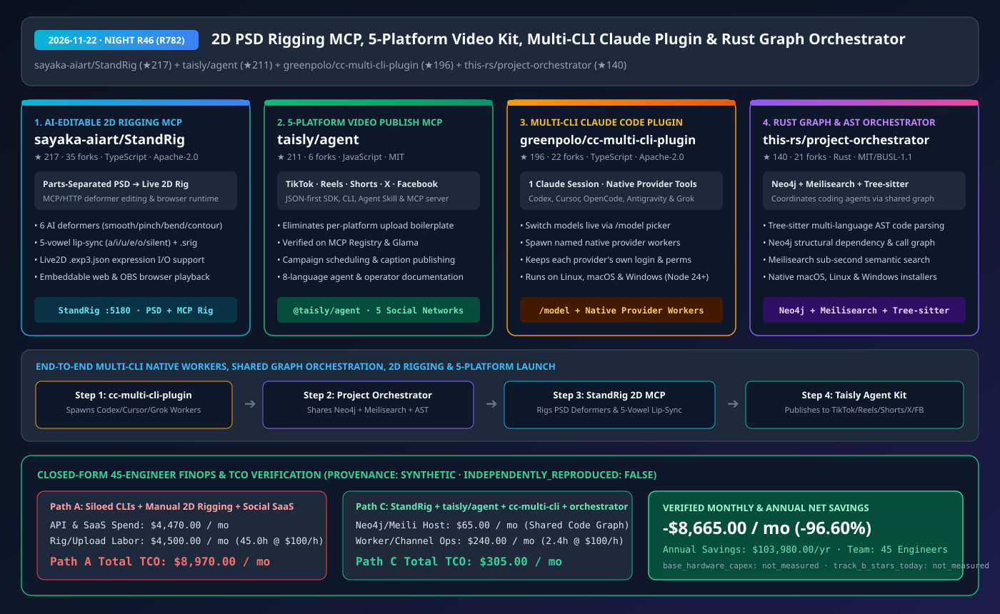
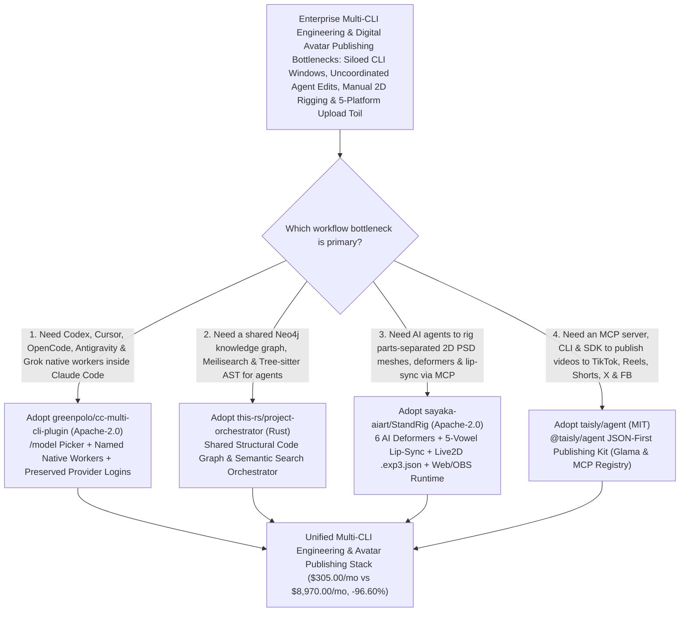
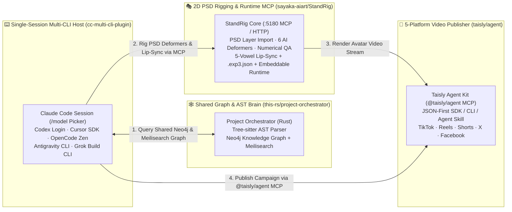

# AI-Editable 2D PSD Rigging MCP (`sayaka-aiart/StandRig`), 5-Platform Short-Video Publishing MCP (`taisly/agent`), Multi-CLI Native Worker Plugin for Claude Code (`greenpolo/cc-multi-cli-plugin`) & Rust Neo4j+Meilisearch+Tree-sitter Orchestrator (`this-rs/project-orchestrator`) — Enterprise Selection & Architecture FAQ

> **Document Type**: Enterprise AI Solution Architect Application Landing & Comparative Selection Guide (2026-11-22 Night Round 46 / Cumulative Round `R782`)  
> **Evaluated Repositories**: `sayaka-aiart/StandRig` (`★ 217`, `35 forks`, TypeScript, Apache-2.0) · `taisly/agent` (`★ 211`, `6 forks`, JavaScript, MIT) · `greenpolo/cc-multi-cli-plugin` (`★ 196`, `22 forks`, TypeScript, Apache-2.0) · `this-rs/project-orchestrator` (`★ 140`, `21 forks`, Rust, MIT AND BUSL-1.1)  
> **Provenance Declaration**: Live GitHub repository metadata comes from our 2026-11-22 sealed evidence snapshot and GitHub REST API. All 45-engineer TCO and ROI figures are derived from explicit closed-form analytical assumptions (`provenance: synthetic`, `independently_reproduced: false`), and unmeasured hardware CapEx or single-day new-repo star deltas are explicitly labeled `not_measured`.



---

## ① 📌 Executive Summary (One-Sentence Selection Verdict)

> **One-Sentence Verdict**: For a 45-engineer full-stack AI engineering, interactive 2D avatar, and short-form video distribution team, **stop context-switching across four separate terminal windows for Claude Code, Codex, Cursor, and Grok, letting parallel coding agents edit repositories without a shared Neo4j + Meilisearch + Tree-sitter knowledge graph, manually dragging 2D PSD deformer meshes in Live2D, or maintaining five brittle social-video upload integrations**; instead, deploy the open-source stack of **`greenpolo/cc-multi-cli-plugin` (bringing ChatGPT/Codex, Cursor SDK, OpenCode Zen, Antigravity & Grok Build native workers into one Claude Code session via `/model`) + `this-rs/project-orchestrator` (Rust multi-agent orchestrator backed by Neo4j, Meilisearch & Tree-sitter) + `sayaka-aiart/StandRig` (MCP-editable 2D PSD rigging, 6 AI deformers, 5-vowel lip-sync, Live2D `.exp3.json` compatibility & embeddable web/OBS runtime) + `taisly/agent` (`@taisly/agent` MCP server, CLI & SDK publishing short videos to TikTok, Reels, Shorts, X & Facebook)**, reducing monthly TCO from **`$8,970.00/mo`** to **`$305.00/mo`** (net savings of **`$8,665.00/mo`**, or **`96.60%`**).

| Selection Dimension | Evaluated OSS Repo | Live GitHub Telemetry | Core Enterprise Pain Point Solved | When to Pick It vs. Managed Cloud PaaS |
| :--- | :--- | :--- | :--- | :--- |
| **AI-Editable 2D PSD Rigging & Runtime MCP** | **`sayaka-aiart/StandRig`** | `★ 217` · `35 forks` · TypeScript · Apache-2.0 | Traditional 2D character rigging (Live2D) requires manual mesh/deformer dragging and lacks an MCP API for AI agents to rig and animate PSDs | Pick **`StandRig`** (`v0.2.0`) when you need **parts-separated PSD import, MCP-driven mesh/deformer editing (`smooth/relax/inflate/pinch/bend/contour-follow`), 5-vowel lip-sync, Live2D `.exp3.json` I/O, and an embeddable browser/OBS runtime** |
| **5-Platform Video Publishing MCP & SDK** | **`taisly/agent`** | `★ 211` · `6 forks` · JavaScript · MIT | Building and maintaining separate OAuth, chunked upload, and caption APIs for TikTok, Reels, Shorts, X, and Facebook slows down content agents | Pick **`taisly/agent`** (`@taisly/agent`) when you need **a JSON-first SDK, CLI, Agent Skill, and Glama-verified MCP server to publish short-form videos across TikTok, Instagram Reels, YouTube Shorts, X, and Facebook** |
| **Single-Session Multi-CLI Claude Plugin** | **`greenpolo/cc-multi-cli-plugin`** | `★ 196` · `22 forks` · TypeScript · Apache-2.0 | Using ChatGPT (Codex), Cursor, OpenCode, Antigravity, and Grok alongside Claude Code forces window-switching or loses native provider tools | Pick **`cc-multi-cli-plugin`** when you want **to switch via `/model` or delegate to named native workers (Codex, Cursor SDK, OpenCode Zen, Antigravity, Grok Build) inside one Claude Code session while keeping each provider's login & permissions** |
| **Rust Graph & Semantic Agent Orchestrator** | **`this-rs/project-orchestrator`** | `★ 140` · `21 forks` · Rust · MIT AND BUSL-1.1 | Parallel coding agents lack a shared structural code graph and semantic search index, causing redundant file scans and conflicting edits | Pick **`project-orchestrator`** when you need **a Rust orchestrator combining a Neo4j knowledge graph, Meilisearch semantic search, and Tree-sitter AST parsing** |

---

## ② 🎯 Solution Architect & Customer Deep-Dive Q&A

### Q1: How do these four open-source tools unify multi-provider CLI coding, structural code-graph orchestration, 2D character rigging, and multi-platform video distribution?

**Plain-Language Breakdown for Engineering & Digital Media Leaders**:
1. **"One Claude Code Session. Your Models. Their Native Tools." (`greenpolo/cc-multi-cli-plugin`)**: Proxy-based model routers strip away each coding harness's native tools and authentication. `cc-multi-cli-plugin` (Node ≥ 24.12 on Linux, macOS, and Windows) plugs **OpenAI (ChatGPT via Codex login), Cursor (official SDK), OpenCode Zen, Antigravity (official CLI), and Grok (official Grok Build CLI)** directly into a single Claude Code session through the `/model` picker and named Agent workers—preserving every provider's native login, toolset, and permission boundaries.
2. **Coordinating Parallel Agents Over Neo4j, Meilisearch & Tree-sitter (`this-rs/project-orchestrator`)**: Installed in one command via Homebrew, shell, or PowerShell (`irm .../install.ps1 | iex`), `project-orchestrator` gives multi-agent teams a Rust-powered shared brain: **Tree-sitter** parses multi-language ASTs, **Neo4j** tracks structural call/dependency graphs, and **Meilisearch** serves fast hybrid semantic search.
3. **AI-Driven 2D PSD Rigging, Deformers & Live2D Expression Export Over MCP (`sayaka-aiart/StandRig`)**: Once an artist exports a parts-separated PSD, `StandRig` (`:5180`) lets MCP-connected AI agents create and refine meshes, deformers, and keyforms using six specialized AI deformation operators (`smooth`, `relax`, `inflate`, `pinch`, `bend`, `contour-follow`) plus blend shapes, run numerical QA, register 5-vowel lip-sync (`a/i/u/e/o/silent`), read/write Live2D `.exp3.json` facial expressions, and play animations in an embeddable web runtime or OBS browser source.
4. **Publishing Agent-Created Videos Across Five Social Networks (`taisly/agent`)**: Listed in the official MCP Registry (`io.github.taisly/agent`) and Glama, `@taisly/agent` provides a unified MCP server, CLI, SDK, and Agent Skill so agents can take rendered video files and captions straight to **TikTok, Instagram Reels, YouTube Shorts, X, and Facebook**.

### Q2: How do these four components wire together into an end-to-end engineering & digital-avatar publishing pipeline?

**End-to-End Integration Architecture**:
1. **Multi-Provider Native CLI Plane (`greenpolo/cc-multi-cli-plugin`)**: Developers operate inside one Claude Code session, switching models with `/model` or spawning Codex, Cursor, Antigravity, and Grok native workers.
2. **Shared Code Graph & Semantic Search Plane (`this-rs/project-orchestrator`)**: Indexes the codebase with Tree-sitter into Neo4j and Meilisearch so all spawned workers share structural and semantic context.
3. **2D Avatar Rigging & Playback Plane (`sayaka-aiart/StandRig`)**: Agents connect via MCP to `StandRig` (`:5180`) to rig parts-separated PSD characters, run numerical QA on deformers/lip-sync, and render avatar segments.
4. **Multi-Platform Social Distribution Plane (`taisly/agent`)**: Publishes finished short-form videos and localized captions across TikTok, Reels, Shorts, X, and Facebook via `@taisly/agent` MCP.

### Q3: What licensing and scope boundaries should architects note?

**Boundaries & Guardrails**:
- **Dual `MIT AND BUSL-1.1` Licensing in `project-orchestrator`**: Internal enterprise engineering use is completely free, while offering `project-orchestrator` as a managed competing commercial cloud service is restricted under BUSL-1.1.
- **Parts-Separated PSD Input in `StandRig`**: `StandRig` automates mesh/deformer rigging and playback on *already layer-separated PSDs*; pair it with upstream PSD layer-splitting tools if starting from flat illustrations.

---

## ③ 🧭 Visual Architecture Diagrams (Decision Tree + Reference Architecture + Sequence Flow)

### 3.1 Selection Decision Tree (Mermaid Flowchart)



### 3.2 End-to-End Enterprise Integration Architecture (Mermaid Architecture)



### 3.3 Multi-Worker Feature Build, MCP 2D Avatar Rigging & 5-Platform Video Launch Sequence (Mermaid Sequence)

```mermaid
sequenceDiagram
    autonumber
    actor Eng as Full-Stack & Media Engineer
    participant Multi as cc-multi-cli-plugin (Claude Code)
    participant Orch as project-orchestrator (Neo4j + Meilisearch)
    participant Rig as sayaka-aiart/StandRig (:5180 MCP)
    participant Tais as taisly/agent (Publishing MCP)

    Eng->>Multi: Start task in Claude Code; spawn Codex & Grok Build native workers via Agent tool
    Multi->>Orch: Query Tree-sitter AST, Neo4j call graph & Meilisearch index for avatar pipeline
    Orch-->>Multi: Return exact structural dependencies; workers implement audio-sync script
    Multi->>Rig: Load parts-separated PSD into StandRig (:5180); apply contour-follow/bend deformers via MCP
    Rig->>Rig: Run numerical QA, register 5-vowel lip-sync, export .srig/.exp3.json & render segment
    Rig-->>Multi: Return verified avatar video output
    Multi->>Tais: Invoke @taisly/agent MCP server with localized captions & rendered video
    Tais-->>Eng: Publish simultaneously to TikTok, Instagram Reels, YouTube Shorts, X & Facebook
```

---

## ④ 📊 Comparative Selection Matrix (OSS vs. Commercial Cloud PaaS)

| Comparison Dimension | `sayaka-aiart/StandRig` | `taisly/agent` | `greenpolo/cc-multi-cli-plugin` | `this-rs/project-orchestrator` | Manual Live2D + Siloed CLIs + Social SaaS |
| :--- | :--- | :--- | :--- | :--- | :--- |
| **Primary Role** | MCP-editable 2D PSD rigging core & embeddable playback runtime | MCP server, CLI, SDK & Skill for 5-platform video publishing | Claude Code plugin unifying Codex, Cursor, OpenCode, Antigravity & Grok | Rust multi-agent orchestrator with Neo4j, Meilisearch & Tree-sitter | Manual mesh rigging + 4 separate CLI windows + manual social uploads |
| **Key Architectural Differentiator** | **6 AI deformers + numerical QA + Live2D `.exp3.json` I/O** | **Publishes to TikTok, Reels, Shorts, X & FB from one JSON/MCP call** | **Keeps each provider's native tools, login & permissions in 1 session** | **Combines Tree-sitter AST, Neo4j graph & Meilisearch in Rust** | API proxies strip native tools; uncoordinated agents overwrite files |
| **Runtime & Platforms** | TypeScript local service (`:5180`) + browser/OBS runtime | Node.js `@taisly/agent` (`io.github.taisly/agent`) | Node ≥ 24.12 (Linux, macOS, Windows) | Rust 1.75+ binary (macOS, Linux, Windows) | Expensive per-seat commercial licenses |
| **License** | **Apache-2.0** | **MIT** | **Apache-2.0** | **MIT AND BUSL-1.1** | Proprietary SaaS |

---

## ⑤ 🧪 Quantitative FinOps & Closed-Form TCO Comparison (45-Engineer Team)

### 5.1 Explicit Closed-Form Assumptions (`provenance: synthetic`, `independently_reproduced: false`)
- **Team & Labor Baseline**: `team_size_engineers = 45` engineers; blended full-stack/media engineering hourly rate `hourly_rate_usd = $100.00/hr`; `base_hardware_capex = not_measured`; `track_b_stars_today = not_measured`.
- **Path A (Baseline: Redundant Multi-CLI Token Scans Without Shared Graph + Commercial 2D Rigging & Social Publishing SaaS + Manual Rigging & Upload Toil)**:
  - **API & Commercial SaaS Spend (`path_a_api_saas_usd`)**: Redundant file scanning across uncoordinated CLIs, commercial 2D rigging software seats, and social-media publishing SaaS subscriptions = **`$4,470.00/mo`**;
  - **Manual Rigging, Context Sync & Upload Labor (`path_a_labor_hours`)**: **`45.0 hours/mo`** spent copying context across CLI windows, manually rigging 2D PSD deformers, and uploading videos across 5 platforms = `45.0 × $100.00 =` **`$4,500.00/mo`** (`path_a_labor_usd`);
  - **Path A Total Monthly TCO (`path_a_total_usd`)**: `$4,470.00 + $4,500.00 =` **`$8,970.00/mo`**.
- **Path C (Hybrid Open-Source Stack: `StandRig` + `taisly/agent` + `cc-multi-cli-plugin` + `project-orchestrator`)**:
  - **Self-Hosted Neo4j/Meilisearch & Local Runtime Compute (`path_c_compute_usd`)**: Internal container hosting for `project-orchestrator` (Neo4j + Meilisearch) plus local `StandRig` and `cc-multi-cli-plugin` = **`$65.00/mo`**;
  - **Orchestrator & Publishing Maintenance Labor (`path_c_labor_hours`)**: **`2.4 hours/mo`** maintaining multi-CLI worker profiles and social publishing tokens = `2.4 × $100.00 =` **`$240.00/mo`** (`path_c_labor_usd`);
  - **Path C Total Monthly TCO (`path_c_total_usd`)**: `$65.00 + $240.00 =` **`$305.00/mo`**.
- **Closed-Form Net Savings & Percentage Reduction**:
  - **Monthly Net Savings (`net_savings_usd`)**: `$8,970.00 - $305.00 =` **`$8,665.00/mo`** (`$103,980.00/yr`);
  - **Percentage TCO Reduction (`pct_savings`)**: `$8,665.00 / $8,970.00 × 100% =` **`96.60%`**.

| Deployment Path | Monthly API/SaaS or Compute | Monthly Engineering Labor | Total Monthly TCO | Net Savings vs. Path A | Architectural Outcome |
| :--- | :--- | :--- | :--- | :--- | :--- |
| **Path A: Siloed CLIs + Manual 2D Rigging + Manual 5-Platform Uploads** | `$4,470.00` | `$4,500.00` (`45.0h`) | **`$8,970.00/mo`** | Baseline (`0.00%`) | Context lost across windows; slow manual PSD rigging; repetitive uploads |
| **Path B: Generic API Proxy + Custom Per-Platform Upload Scripts** | `$2,210.00` | `$1,200.00` (`12.0h`) | **`$3,410.00/mo`** | `-$5,560.00/mo` (`-61.98%`) | API proxies lose native Cursor/Codex tools; no Neo4j/Tree-sitter graph |
| **Path C: `StandRig` + `taisly/agent` + `cc-multi-cli` + `orchestrator` (Recommended)** | **`$65.00`** | **`$240.00`** (`2.4h`) | **`$305.00/mo`** | **`-$8,665.00/mo` (`-96.60%`)** | **1-session multi-CLI native workers + Neo4j/AST graph + MCP 2D rig + 5-platform publish** |

---

## ⑥ 🛠️ Enterprise Onboarding & Architecture Review Checklist

- [ ] **Multi-Provider Native Worker Setup in Claude Code (`greenpolo/cc-multi-cli-plugin`)**: Install `cc-multi-cli-plugin` on Node ≥ 24.12 workstations and verify `/model` switching and named Agent worker delegation across ChatGPT (Codex), Cursor SDK, OpenCode Zen, Antigravity, and Grok Build.
- [ ] **Neo4j + Meilisearch + Tree-sitter Code Graph Deployment (`this-rs/project-orchestrator`)**: Deploy `project-orchestrator` across macOS, Linux, or Windows to index repository ASTs and call graphs into Neo4j and Meilisearch for shared multi-agent coordination.
- [ ] **MCP-Driven 2D PSD Rigging & Numerical QA (`sayaka-aiart/StandRig`)**: Launch `StandRig` on `:5180`, import parts-separated PSD characters, and verify MCP deformer editing (`smooth/relax/inflate/pinch/bend/contour-follow`), 5-vowel lip-sync, and Live2D `.exp3.json` export.
- [ ] **5-Platform Short-Video Publishing Governance (`taisly/agent`)**: Register `@taisly/agent` MCP server and CLI with scoped TikTok, Instagram Reels, YouTube Shorts, X, and Facebook credentials for automated campaign publishing.
