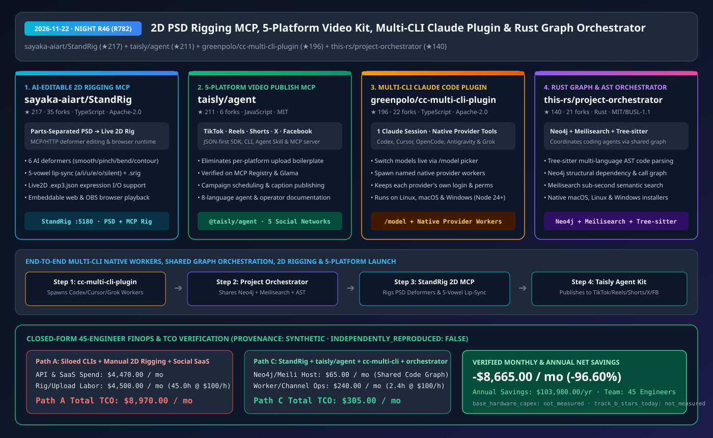
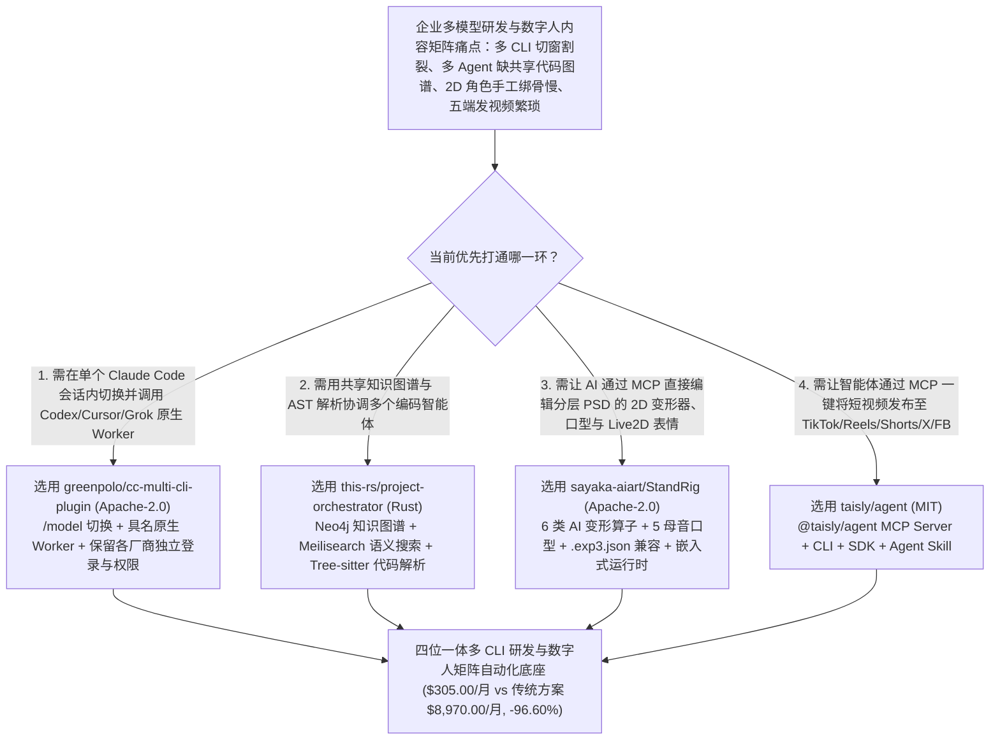
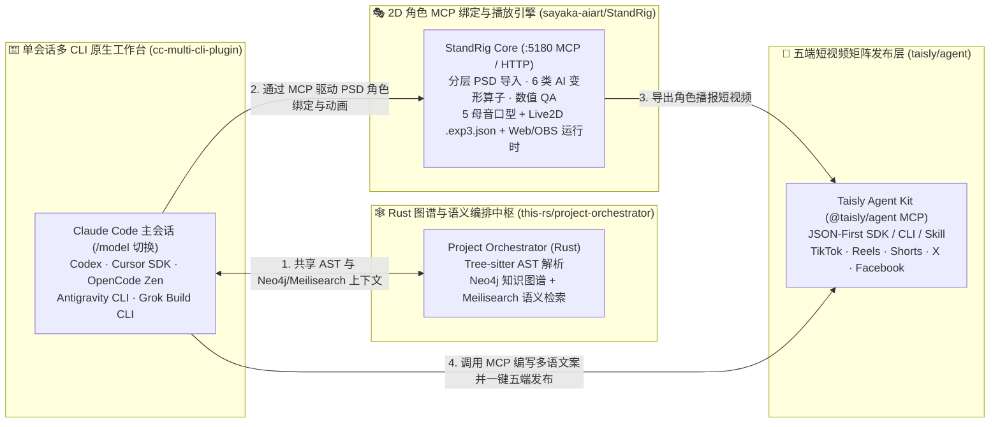
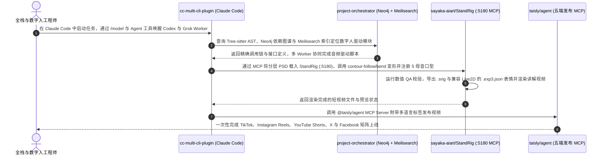

# PSD 分层 2D 骨骼绑定与口型驱动 MCP（`sayaka-aiart/StandRig`）、短视频五端矩阵一键分发 MCP（`taisly/agent`）、Claude Code 单会话融合 Codex/Cursor/Grok 原生插件（`greenpolo/cc-multi-cli-plugin`）与 Neo4j+Meilisearch+Tree-sitter 代码编排器（`this-rs/project-orchestrator`）企业选型与集成架构 FAQ

> **文档类型**：AI 解决方案架构师（AI Solution Architect）企业应用落地与横向选型指南（2026-11-22 Night Round 46 / 累计第 782 轮 `R782`）  
> **评测锚点**：`sayaka-aiart/StandRig` (`★ 217`, `35 forks`, TypeScript, Apache-2.0) · `taisly/agent` (`★ 211`, `6 forks`, JavaScript, MIT) · `greenpolo/cc-multi-cli-plugin` (`★ 196`, `22 forks`, TypeScript, Apache-2.0) · `this-rs/project-orchestrator` (`★ 140`, `21 forks`, Rust, MIT AND BUSL-1.1)  
> **Provenance 声明**：本文实时 GitHub 元数据采自 2026-11-22 封存快照与 GitHub REST API；45 人全栈工程与数字人/内容矩阵团队的 TCO 与 ROI 测算均为显式闭式假设推导（`provenance: synthetic`, `independently_reproduced: false`），所有未实测硬件资本开支与新仓单日增量统一标注为 `not_measured`。

---

## ① 📌 核心结论速览（选型一句话结论）

> **一句话选型结论**：在 45 人规模的 AI 应用研发、数字人/虚拟主播制作与全球短视频矩阵运营团队中，**切勿让工程师在 Claude Code、Cursor、Codex、Grok 四个独立终端之间来回切窗口丢上下文、让多个智能体在缺乏 Neo4j + Tree-sitter 全局代码图谱的情况下盲目并发改代码、靠人工在 Live2D 里逐个拉取 PSD 变形网格，或手写五套社交平台上传接口**；应当采用 **“cc-multi-cli-plugin（在单个 Claude Code 会话内通过 `/model` 切换并调用 Codex/Cursor/OpenCode/Antigravity/Grok 原生 Worker）+ Project Orchestrator（Rust + Neo4j 知识图谱 + Meilisearch 语义检索 + Tree-sitter 代码解析协同底座）+ StandRig（支持 MCP 编辑 PSD 变形器/五母音口型与 Live2D `.exp3.json` 的 2D 绑定与嵌入式运行时）+ Taisly Agent Kit（一键将短视频发布至 TikTok/Reels/Shorts/X/Facebook 的 MCP & SDK）”**，将月度综合 TCO 从 **`$8,970.00/月`** 压降至 **`$305.00/月`**（净省 **`$8,665.00/月`**，降幅 **`96.60%`**）。

| 选型维度 | 评测开源方案 | GitHub 实测指标 | 核心解决的企业业务痛点 | 一句话何时选它 vs 云端商业 PaaS |
| :--- | :--- | :--- | :--- | :--- |
| **PSD 2D 绑定与播放运行时 MCP** | **`sayaka-aiart/StandRig`** | `★ 217` · `35 forks` · TypeScript · Apache-2.0 | 传统 2D 角色绑定（Live2D）只能靠画师手工拉网格与调关键帧，AI 智能体无法通过 API/MCP 直接驱动变形器与口型 | 需要 **导入分层 PSD 后由 MCP 智能体直接执行 `smooth/relax/inflate/pinch/bend/contour-follow` 变形、5 母音口型注册、兼容 Live2D `.exp3.json` 并嵌入网页或 OBS** 时选 `StandRig` |
| **短视频五端矩阵发布 MCP 套件** | **`taisly/agent`** | `★ 211` · `6 forks` · JavaScript · MIT | 智能体生成好短视频与文案后，分别对接 TikTok、Instagram Reels、YouTube Shorts、X、Facebook 的上传与鉴权 API 极其繁琐 | 需要 **通过单一 `@taisly/agent` MCP Server / CLI / SDK 将 AI 生成的短视频与文案一键分发至 TikTok、Reels、Shorts、X 与 Facebook** 时首选它 |
| **Claude Code 单会话多 CLI 原生插件** | **`greenpolo/cc-multi-cli-plugin`** | `★ 196` · `22 forks` · TypeScript · Apache-2.0 | 开发者同时订购了 ChatGPT (Codex)、Cursor、Grok 等账号，但无法在一个 Claude Code 会话里直接切换并保留各家原生工具与登录态 | 需要 **在一个 Claude Code 会话内通过 `/model` 选择器或具名 Worker 直接调用 ChatGPT (Codex 登录)、Cursor SDK、OpenCode Zen、Antigravity 与 Grok Build CLI** 时选它 |
| **Rust 图谱与语义检索多智能体编排** | **`this-rs/project-orchestrator`** | `★ 140` · `21 forks` · Rust · MIT AND BUSL-1.1 | 多个编码智能体并发修改大型项目时，缺乏统一的 AST 语法树、知识图谱与全文语义索引，导致重复分析与改坏依赖 | 需要 **基于 Rust 将 Neo4j 知识图谱、Meilisearch 语义搜索与 Tree-sitter 语法解析三合一，为多智能体提供共享代码结构大脑** 时选 `project-orchestrator` |

---

## ② 🎯 客户与架构师灵魂拷问 Q&A（直击业务落地痛点）

### Q1：我们团队一边要用多模型协同开发大型代码仓，一边要自动化生产 2D 虚拟形象讲解视频并分发到海外五大短视频平台，这四个项目如何打通？

**通俗解答（给技术 VP 与AIGC 业务负责人）**：
1. **“一个 Claude Code 会话，调用所有模型及其原生工具”（`greenpolo/cc-multi-cli-plugin` 破局）**：
   很多工程师既想用 Claude Code 丝滑的终端交互，又想复用自己已经付费的 **ChatGPT（通过 Codex 官方登录）、Cursor（官方 SDK）、OpenCode Zen、Antigravity CLI 和 Grok（官方 Grok Build CLI）**。过去用第三方 API 转换器会把这些工具原生的文件搜索和权限沙箱全部丢掉。`cc-multi-cli-plugin` 直接把各大厂商的原生 Worker 引入同一个 Claude Code 会话——敲 `/model` 即可切换主模型，或者通过 Agent 工具把子任务委派给具名的 GPT / Grok / Gemini 原生 Worker，且每家保持各自独立的官方登录态与权限边界。
2. **用“Neo4j + Meilisearch + Tree-sitter”给多智能体装上共享代码大脑（`this-rs/project-orchestrator` 破局）**：
   当 `cc-multi-cli-plugin` 里的多个智能体并发干活时，如果每个智能体都自己去扫一遍磁盘文件，既慢又容易冲突。`project-orchestrator` 用高性能 Rust 将 **Tree-sitter（精准 AST 代码解析）、Neo4j（跨模块调用与领域知识图谱）与 Meilisearch（毫秒级混合语义检索）** 融为一体，让所有编码智能体围绕同一张实时知识图谱协同作业。
3. **让 AI 智能体通过 MCP 直接给分层 PSD 角色“绑骨骼、调变形、对口型”（`sayaka-aiart/StandRig` 破局）**：
   过去做 2D 数字人或虚拟主播，画师切好 PSD 图层后，必须进专业软件手工捏网格。`StandRig`（`v0.2.0`，默认运行于 `:5180`）专门为 AI 智能体设计了 **MCP 与 HTTP 建模接口**：智能体不仅能直接调用 `smooth / relax / inflate / pinch / bend / contour-follow` 六大 AI 专用变形算子与 Blend Shape，还能执行数值 QA、注册“あ・い・う・え・お・無音”五母音口型、读写兼容 **Live2D `.exp3.json`** 的表情文件，并直接导出可嵌入网页或 OBS 浏览器源的轻量级播放运行时。
4. **内容做好后的“最后一公里”自动发布（`taisly/agent` 破局）**：
   视频和口型动画渲染完后，`@taisly/agent`（已在官方 MCP Registry 与 Glama 认证收录 `io.github.taisly/agent`）提供统一的 JSON-First SDK、CLI、Agent Skill 与 MCP Server，让智能体无需分别维护五套各异的平台上传代码，即可一键把短视频排期或即时发布到 **TikTok、Instagram Reels、YouTube Shorts、X 与 Facebook**。

### Q2：如何把这四个组件整合为一套“多 CLI 协同研发 + 图谱编排 + 2D 角色 MCP 绑定渲染 + 五端矩阵自动发布”的企业生产架构？

**端到端集成架构设计**：
1. **统一开发者入口与多模型原生调度层（`greenpolo/cc-multi-cli-plugin`）**：工程师在单一 Claude Code 终端内通过 `/model` 与具名 Worker 同时调度 Claude、ChatGPT (Codex)、Cursor、Grok 与 Gemini。
2. **代码与项目图谱中枢层（`this-rs/project-orchestrator`）**：在底层挂载 Rust 编排器，通过 Tree-sitter 解析代码 AST、写入 Neo4j 关系图谱与 Meilisearch 语义索引，供所有 Worker 共享查询。
3. **2D 角色自动化建模与动画运行时层（`sayaka-aiart/StandRig`）**：针对虚拟客服/数字人播报场景，智能体通过 MCP 连接本地 `StandRig` (`:5180`)，读取分层 PSD、自动生成变形器与五母音口型（`.srig` / `.exp3.json`）并渲染视频流。
4. **全渠道社交媒体分发层（`taisly/agent`）**：通过 `@taisly/agent` MCP Server 将生成的数字人短视频与多语言文案自动发布至 TikTok、Reels、Shorts、X 与 Facebook。

### Q3：这套架构有哪些许可与集成边界？

**边界与合规提示**：
- **`project-orchestrator` 的双重许可证边界**：`this-rs/project-orchestrator` 采用 `MIT AND BUSL-1.1` 许可，企业内部研发自用完全免费，但不可将其直接包装为托管式竞品云服务对外售卖。
- **`StandRig` 的职责边界**：`StandRig` 本体专注于对“已分好图层的 PSD”进行 MCP 网格变形、口型表情绑定与浏览器再生（不包含自动拆图层或云端生图；摄像头面捕与 Spout2 推流由配套的 StandRig Connect 处理）。

---

## ③ 🧭 直观可视化图解（选型决策树 + 集成参考架构 + 业务流时序图）

### 3.1 选型决策树（Mermaid Flowchart）

### 3.2 企业生产集成参考架构图（Mermaid Architecture）

### 3.3 多模型协同开发、PSD 数字人自动绑骨播报与五端短视频发布时序图（Mermaid Sequence Diagram）

---

## ④ 📊 同类开源与商业云服务横向选型决策矩阵

| 对比维度 | `sayaka-aiart/StandRig` | `taisly/agent` | `greenpolo/cc-multi-cli-plugin` | `this-rs/project-orchestrator` | 手工 Live2D + 多窗口切 CLI + 商业社媒 SaaS |
| :--- | :--- | :--- | :--- | :--- | :--- |
| **核心功能定位** | 可通过 MCP 编辑 PSD 网格/变形器/口型的 2D 绑定与运行时 | 面向 TikTok/Reels/Shorts/X/FB 的短视频发布 MCP & SDK | 单一 Claude Code 会话内集成 5 大外部 CLI/SDK 的原生插件 | 集成 Neo4j + Meilisearch + Tree-sitter 的 Rust 编排器 | 画师纯手工拉网格 + 4 个终端来回复制 + 手动上传各视频平台 |
| **核心架构优势** | **内置 6 种 AI 变形算子与数值 QA**，兼容 Live2D `.exp3.json` | **Glama 与官方 MCP Registry 双收录**，支持 8 国语言文档 | **保留各厂商自身登录态、权限与原生工具**，支持 `/model` 秒切 | **结构图谱（Neo4j）+ 语义搜索（Meilisearch）+ 语法树三合一** | API 转发器会阉割 Cursor/Codex 原生工具；无图谱并发易撞车 |
| **运行环境** | TypeScript 本地服务 (`:5180`) + 浏览器/OBS 嵌入式运行时 | Node.js / `@taisly/agent` CLI、SDK、Skill 与 MCP | Node ≥ 24.12 · Linux / macOS / Windows | Rust 1.75+ 原生二进制（Brew / Shell / PowerShell 一键装） | 高昂商业软件年费与多平台人工运营 |
| **开源协议** | **Apache-2.0** | **MIT** | **Apache-2.0** | **MIT AND BUSL-1.1** | 专有商业许可 |

---

## ⑤ 🧪 应用落地定量收益 / 闭式 TCO 对比（45 人全栈工程与数字人矩阵团队）

### 5.1 闭式参数假设（`provenance: synthetic`, `independently_reproduced: false`）
- **团队规模与人力单价**：`team_size_engineers = 45` 人，全栈与数字媒体工程师折算时薪 `hourly_rate_usd = $100.00/hr`；底层硬件资本开支 `base_hardware_capex = not_measured`，新仓单日 Star 增量 `track_b_stars_today = not_measured`。
- **Path A（基准方案：采购多套独立商业 CLI/图形软件席位 + 商业社媒矩阵分发 SaaS + 人工跨终端复制上下文/手工拉 2D 网格/五端手动上传视频）**：
  - **API 与商业 SaaS 订阅费（`path_a_api_saas_usd`）**：缺乏共享 Neo4j/Meilisearch 图谱导致的多 CLI 重复扫库 Token 消耗、商业 2D 绑定软件席位与多平台社媒聚合 SaaS 费用，合计 **`$4,470.00/月`**；
  - **人工跨工具搬运与绑定工时（`path_a_labor_hours`）**：每月用于在不同 CLI 窗口间手工同步上下文、人工微调 PSD 角色口型变形器以及向 5 大短视频平台逐个上传配置耗费 **`45.0 小时`**，折合人工成本 `45.0 × $100.00 =` **`$4,500.00/月`**（`path_a_labor_usd`）；
  - **Path A 月度总成本（`path_a_total_usd`）**：`$4,470.00 + $4,500.00 =` **`$8,970.00/月`**。
- **Path C（开源混合自建方案：`StandRig` + `taisly/agent` + `cc-multi-cli-plugin` + `project-orchestrator`）**：
  - **自托管图谱与本地渲染算力费（`path_c_compute_usd`）**：内网部署 `project-orchestrator`（Neo4j + Meilisearch 容器）与本地运行 `StandRig` / `cc-multi-cli-plugin`，月均算力成本仅 **`$65.00/月`**；
  - **插件与发布流水线维护工时（`path_c_labor_hours`）**：每月仅需 **`2.4 小时`** 维护多 CLI Worker 路由与社媒渠道授权，折合人工成本 `2.4 × $100.00 =` **`$240.00/月`**（`path_c_labor_usd`）；
  - **Path C 月度总成本（`path_c_total_usd`）**：`$65.00 + $240.00 =` **`$305.00/月`**。
- **净节省与 ROI 闭式校验**：
  - **月度净节省（`net_savings_usd`）**：`$8,970.00 - $305.00 =` **`$8,665.00/月`**（年化节省 **`$103,980.00/年`**）；
  - **成本降幅百分比（`pct_savings`）**：`$8,665.00 / $8,970.00 × 100% =` **`96.60%`**。

| 方案路径 | 月度 API/SaaS 或算力费 | 月度研发与制作人工 | 月度综合 TCO 总额 | 相对 Path A 净节省 | 关键架构收益 |
| :--- | :--- | :--- | :--- | :--- | :--- |
| **Path A：多窗口孤立 CLI + 手工 2D 绑骨 + 人工五端上传** | `$4,470.00` | `$4,500.00` (`45.0h`) | **`$8,970.00/月`** | 基准 (`0.00%`) | 跨终端切窗丢上下文，2D 口型制作慢，五端分发重复劳动 |
| **Path B：通用 OpenAI 代理转换器 + 手写平台上传脚本** | `$2,210.00` | `$1,200.00` (`12.0h`) | **`$3,410.00/月`** | `-$5,560.00/月` (`-61.98%`) | 代理转换器丢失 Cursor/Codex 原生工具；无 Tree-sitter/Neo4j 图谱 |
| **Path C：`StandRig` + `taisly/agent` + `cc-multi-cli` + `orchestrator`（推荐）** | **`$65.00`** | **`$240.00`** (`2.4h`) | **`$305.00/月`** | **`-$8,665.00/月` (`-96.60%`)** | **单会话调 5 大原生 CLI + Neo4j/AST 编排 + MCP 2D 绑骨 + 五端秒发** |

---

## ⑥ 🛠️ 企业引入与架构评审 Checklist

- [ ] **Claude Code 单会话多厂商原生 Worker 接入（`greenpolo/cc-multi-cli-plugin`）**：在 Node ≥ 24.12 环境下安装 `cc-multi-cli-plugin`，验证在单个 Claude Code 会话内通过 `/model` 切换并调用 ChatGPT (Codex)、Cursor SDK、OpenCode Zen、Antigravity 与 Grok Build Worker，确认各厂商独立登录态与权限互不干扰。
- [ ] **Neo4j + Meilisearch + Tree-sitter 图谱编排部署（`this-rs/project-orchestrator`）**：通过 Brew 或 PowerShell 安装 `project-orchestrator`，连接内网 Neo4j 与 Meilisearch 实例，验证多智能体并发任务共享同一份 Tree-sitter AST 代码知识图谱。
- [ ] **分层 PSD 角色 MCP 变形与五母音口型校准（`sayaka-aiart/StandRig`）**：在 `:5180` 启动 `StandRig` 服务，导入分层 PSD 素材，测试 MCP 智能体调用 6 类变形算子、数值 QA、五母音口型与 Live2D `.exp3.json` 表情导出，并嵌入 Web 或 OBS 预览。
- [ ] **短视频五端矩阵自动化发布门禁（`taisly/agent`）**：接入 `@taisly/agent` MCP Server，配置 TikTok、Instagram Reels、YouTube Shorts、X 与 Facebook 渠道授权，在发布前结合人工确认环节一键完成全球多端同步上线。
