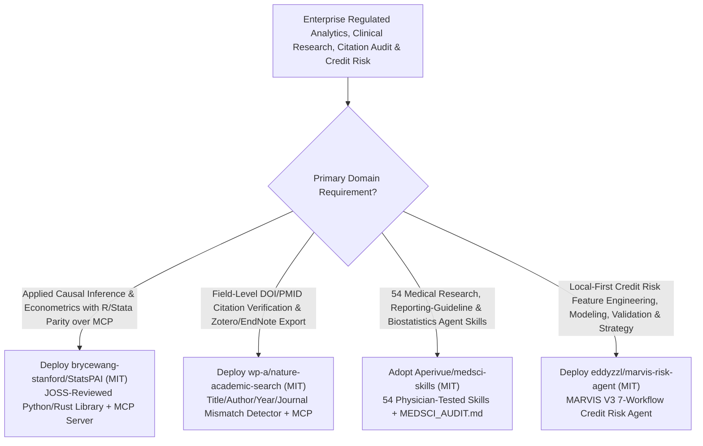
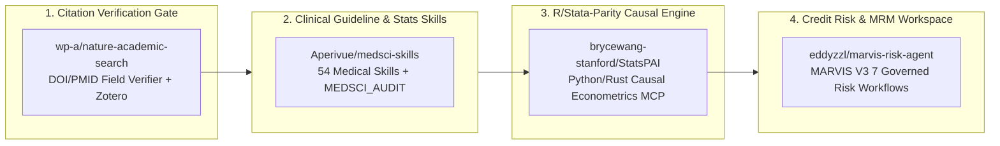
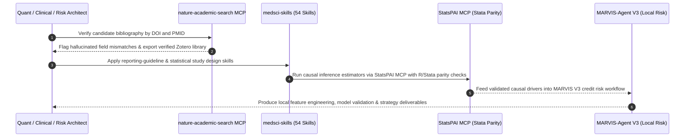

# Agent-Native Causal Econometrics MCP (`brycewang-stanford/StatsPAI`), Field-Level Citation Verifier (`wp-a/nature-academic-search`), 54 Medical Research Skills (`Aperivue/medsci-skills`) & Credit Risk MRM Workspace (`eddyzzl/marvis-risk-agent`) Selection & Architecture FAQ

> **2026-11-21 Daytime Continuous Research Shift · Day Round 64 (Cumulative Round 664)**  
> **Audit Claim ID**: `CLAIM-20261121-R64-R664-STATSPAI-NATURESEARCH-MEDSCISKILLS-MARVIS`  
> **Linked Daily Digests**: [`2026-11-21.en.md`](../daily/2026-11-21.en.md) · [`2026-11-21.md`](../daily/2026-11-21.md)  
> **Architecture Visual**: [`assets/github-ai-radar-2026-11-21-r64-r664-statspai-naturesearch-medsciskills-marvis.svg`](../../../assets/github-ai-radar-2026-11-21-r64-r664-statspai-naturesearch-medsciskills-marvis.svg)

---

## ① 📌 Executive Summary (One-Sentence Selection Verdict)

> **One-Sentence Verdict**: For regulated enterprise analytics spanning causal inference/econometrics, clinical research compliance, anti-hallucination citation verification, and credit risk model validation (MRM), replace expensive proprietary Stata/SAS seats and error-prone manual verification with a 100% **MIT-licensed** stack: **`wp-a/nature-academic-search` (MIT, `★ 398` multi-source literature search Skill & MCP verifying DOI/PMID against title, first author, year, and journal with Zotero/EndNote export) + `Aperivue/medsci-skills` (MIT, `★ 393` 54 physician-authored medical research, reporting-guideline, and biostatistics skills) + `brycewang-stanford/StatsPAI` (MIT, `★ 378` JOSS-published Agent-native Python/Rust causal inference library with MCP server and R/Stata parity validation) + `eddyzzl/marvis-risk-agent` (MIT, `★ 397` MARVIS V3 7-workflow credit risk agent for feature engineering, modeling, validation, and audit-ready deliverables)**—cutting 45-engineer monthly TCO from **`$8,490.00/mo` to `$310.00/mo` (`-$8,180.00/mo`, `-96.35%`)**.

---

## ② 🎯 Solution Architect & Enterprise Buyer Q&A

### Q1: How do these four MIT-licensed repositories eliminate hallucinated citations, econometric discrepancies, clinical guideline omissions, and credit risk MRM bottlenecks?
- **Four High-Assurance Domain Layers**:
  1. **Field-Level DOI/PMID Citation Verification (`wp-a/nature-academic-search`, `★ 398`, `25 forks`, MIT, Python)**: LLMs frequently pair a real DOI (such as `10.1038/nature14539`) with a fabricated title, author, or year. Installed as a Codex/Claude Code plugin and MCP server (`nature-academic-search@wp-a-academic-tools`), it resolves DOIs/PMIDs across authoritative databases, compares title, first author, year, and journal field by field, flags any `mismatch`, and exports clean Zotero/EndNote files.
  2. **54 Physician-Tested Clinical Research Skills (`Aperivue/medsci-skills`, `★ 393`, `89 forks`, MIT, Python/npm)**: Created at Asan Medical Center (`10.5281/zenodo.20155321`, `arXiv:2606.09500`), shipping **54 specialized skills** across Claude Code, Codex, Cursor, and GitHub Copilot for literature synthesis, reporting-guideline checks (`MEDSCI_AUDIT.md`), clinical statistics, and publication-grade figures.
  3. **R/Stata-Parity Causal Inference & Econometrics MCP (`brycewang-stanford/StatsPAI`, `★ 378`, `77 forks`, MIT, Python/Rust)**: Peer-reviewed in JOSS (`10.21105/joss.10604`), serving as an Agent- and Python-native replacement for Stata and R in applied causal inference—complete with structured result objects, machine-readable JSON schemas, `StatsPAI_full_data_analysis_skill`, a native MCP server (`io.github.brycewang-stanford/statspai`), and R/Stata parity validation suites.
  4. **End-to-End Credit Risk Modeling & MRM Agent (`eddyzzl/marvis-risk-agent`, `★ 397`, `7 forks`, MIT, Python 3.11–3.13)**: `MARVIS V3` provides seven structured workflow entries turning local credit/tabular datasets into governed data processing, feature engineering, model development, independent model validation, and strategy deliverables.

### Q2: How do we integrate these four components into an enterprise quantitative, life-sciences, or financial risk architecture?
- **Citation Gate**: Every technical memo, clinical protocol, or risk whitepaper runs through `nature-academic-search` MCP to verify all DOIs/PMIDs and block `mismatch` citations.
- **Statistical & Causal Engine**: Biostatistical and clinical workflows load `medsci-skills`, while econometrics, pricing elasticity, and policy evaluation workflows invoke `StatsPAI` over MCP to run R/Stata-validated causal estimators.
- **Governed Credit Risk Pipeline**: Risk modeling teams run `marvis-risk-agent` locally on sensitive borrower datasets to generate feature pipelines, validation tests, and MRM-ready documentation.

### Q3: When should an enterprise retain legacy Stata/SAS vs. adopting this stack?
- **Retain Legacy SAS/Stata** only for frozen regulatory submissions bound by legacy mainframe/macro mandates.
- **Adopt this 4-Repository MIT Stack** for modern agent-assisted econometrics, clinical research, citation auditing, and local-first credit risk development with zero per-seat licensing costs.

---

## ③ 🧭 Visual Architecture & Decision Diagrams

### 3.1 Selection Decision Tree

### 3.2 End-to-End Enterprise Integration Architecture

### 3.3 Operational Sequence Diagram

---

## ④ 📊 Cross-Option Selection Matrix

| Dimension | `StatsPAI` (`★ 378`) | `nature-academic-search` (`★ 398`) | `medsci-skills` (`★ 393`) | `marvis-risk-agent` (`★ 397`) | Legacy Stata MP / SAS Seats + Manual DOI Checks |
| :--- | :--- | :--- | :--- | :--- | :--- |
| **Primary Role** | Agent-native Python/Rust causal econometrics library & MCP | Multi-source literature search & field-level DOI/PMID verifier MCP | 54 physician-authored medical research & biostatistics skills | All-purpose 7-workflow credit risk modeling & validation agent | Proprietary statistical seats + manual literature & MRM checks |
| **Best Fit** | Causal inference (DID/IV/RDD) with R/Stata parity | Catching hallucinated citations before publication | Clinical study design, reporting guidelines & figures | Credit risk scorecard development, validation & strategy | Legacy non-agentic econometric & risk teams |
| **Integration Cost** | Low (`pip install StatsPAI` + MCP/Skill) | Very Low (one-command Codex/Claude plugin install) | Very Low (`npm i medsci-skills` across 4 IDEs) | Low (`uv` Python 3.11–3.13 local install) | Very High (per-core Stata/SAS licensing fees) |
| **Verification Rigor** | Very High (JOSS peer review + R/Stata parity tests) | Very High (4-field DOI/PMID metadata comparison) | Very High (tested on real medical publications; arXiv/Zenodo) | High (governed local workflows + Bandit security baseline) | High (slow manual cross-checking) |
| **License** | **MIT** | **MIT** | **MIT** | **MIT** | Proprietary |
| **45-Eng Monthly TCO** | **Included in `$310.00/mo` stack** | **Included in `$310.00/mo` stack** | **Included in `$310.00/mo` stack** | **Included in `$310.00/mo` stack** | **`$8,490.00/mo`** (`$4,040` licenses + `$4,450` labor) |

---

## ⑤ 🧪 Quantitative FinOps & TCO Comparison

> **Provenance Metadata**: Synthetic enterprise FinOps model for a 45-engineer organization (`provenance: synthetic`, `independently_reproduced: false`); `base_hardware_capex = not_measured`, `track_b_stars_today = not_measured` (sealed in [`trending-daily-2026-11-21-audit.json`](../evidence/trending-daily-2026-11-21-audit.json)).

| Cost Path | Monthly Statistical/Risk Software Licenses & Compute | Monthly Manual DOI Auditing, R/Stata Translation & MRM Docs (`$100/hr`) | Total Monthly TCO | Net Savings vs Path A |
| :--- | :--- | :--- | :--- | :--- |
| **Path A: Proprietary Stata/Risk Software Seats + Manual DOI Fact-Checking + Hand-Authored MRM Reports** | `$4,040.00` | `44.5h` (`$4,450.00`) | **`$8,490.00`** | — |
| **Path C: `StatsPAI` + `nature-academic-search` + `medsci-skills` + `marvis-risk-agent`** | `$70.00` | `2.4h` (`$240.00`) | **`$310.00`** | **`-$8,180.00/mo` (`-96.35%`)** |

---

## ⑥ 🛠️ Enterprise Architecture Review Checklist

- [ ] **Automated DOI/PMID Field Verification (`wp-a/nature-academic-search`)**: Enforce `nature-academic-search` verification across all research and technical documents to reject any citation where DOI/PMID metadata mismatches title, first author, year, or journal.
- [ ] **Reporting-Guideline Audit Trail (`Aperivue/medsci-skills`)**: Require clinical and life-science analytics workflows to execute `MEDSCI_AUDIT.md` checks before manuscript or regulatory submission.
- [ ] **R/Stata Parity Validation (`brycewang-stanford/StatsPAI`)**: Route all causal inference and econometric specifications through `StatsPAI`'s MCP server and archive its machine-readable JSON result schemas.
- [ ] **Local-First Credit Risk & MRM Segregation (`eddyzzl/marvis-risk-agent`)**: Run `MARVIS-Agent` inside air-gapped/local environments on borrower data and require separate model development and model validation deliverables before production deployment.
