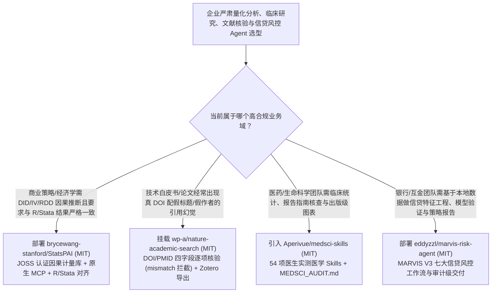
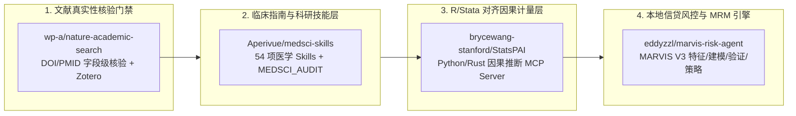
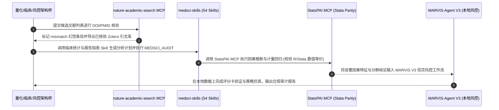

# R/Stata 对齐因果推断与计量经济学 MCP（`brycewang-stanford/StatsPAI`）、DOI/PMID 字段级文献防幻觉核验（`wp-a/nature-academic-search`）、54 项临床医学研究技能集（`Aperivue/medsci-skills`）与信贷风控全流程建模验证智能体（`eddyzzl/marvis-risk-agent`）架构选型与落地 FAQ

> **2026-11-21 白天持续研究班次 · Day Round 64（累计 Round 664）**  
> **审计凭据**：`CLAIM-20261121-R64-R664-STATSPAI-NATURESEARCH-MEDSCISKILLS-MARVIS`  
> **关联日刊**：[`2026-11-21.md`](../daily/2026-11-21.md) · [`2026-11-21.en.md`](../daily/2026-11-21.en.md)  
> **可视化架构图**：[`assets/github-ai-radar-2026-11-21-r64-r664-statspai-naturesearch-medsciskills-marvis.svg`](../../../assets/github-ai-radar-2026-11-21-r64-r664-statspai-naturesearch-medsciskills-marvis.svg)

---

## ① 📌 核心结论速览（选型一句话结论）

> **一句话选型结论**：在金融信贷风控建模与模型验证（MRM）、商业策略因果推断（A/B 测试与准自然实验）、生命科学临床统计以及高精度学术文献引用核查四大强监管场景中，严禁让通用大模型“心算回归系数或编造假论文标题”；推荐采用 100% **MIT 开源协议**的四层严肃分析与防幻觉栈：**“`wp-a/nature-academic-search`（MIT，`★ 398` 按 DOI/PMID 逐字段比对题名、首位作者、年份与期刊并导出 Zotero/EndNote 的防幻觉 MCP）+ `Aperivue/medsci-skills`（MIT，`★ 393` 临床医生团队构建并经真实发表验证的 54 项医学研究、报告指南审查与出版级图表 Skills）+ `brycewang-stanford/StatsPAI`（MIT，`★ 378` 斯坦福团队开源并通过 JOSS 评审的 Python/Rust 因果推断与计量经济学库，内置 MCP Server 与 R/Stata 数值对齐校验）+ `eddyzzl/marvis-risk-agent`（MIT，`★ 397` 覆盖特征工程、评分卡建模、模型验证与策略模拟 7 大工作流的信贷风控智能体 MARVIS V3）”**。在 45 人量化分析与风控/医疗研发组织基准下，可将月度总拥有成本（TCO）从 **`$8,490.00/月`** 降至 **`$310.00/月`**（净省 **`$8,180.00/月`**，降幅 **`-96.35%`**）。

---

## ② 🎯 客户与架构师灵魂拷问 Q&A

### Q1：金融风控、因果计量与临床科研团队引入 AI Agent 时，最怕的“假文献（Citation Hallucination）、错统计（Stata/R 偏差）、缺合规文档（MRM Audit）”三大雷区，这四个项目如何逐个攻克？
- **四层高可信架构拆解**：
  1. **字段级 DOI/PMID 文献防幻觉门禁 —— `wp-a/nature-academic-search`（`★ 398`，`25 forks`，MIT，Python）**：大模型极易把一个真实存在的 DOI（如 `10.1038/nature14539` LeCun 深度学习综述）安在编造的作者与标题（如 `Smith et al. 2024`）上。该项目提供 Codex 与 Claude Code 插件及 MCP Server，按 DOI 或 PMID 拉取权威元数据，**逐字段比对题名、首位作者、年份和期刊**，一旦不符立即标记 `mismatch`，并支持一键导出 Zotero / EndNote 引用文件。
  2. **54 项临床研究与报告规范技能包 —— `Aperivue/medsci-skills`（`★ 393`，`89 forks`，MIT，Python/npm）**：由首尔峨山医学中心（Asan Medical Center）临床医生研究员主创（Zenodo DOI `10.5281/zenodo.20155321`，arXiv `2606.09500`），内置 **54 个专业医学研究 Skills**（兼容 Claude Code、Codex、Cursor 与 GitHub Copilot），覆盖文献综述、CONSORT/STROBE 报告指南核查（`MEDSCI_AUDIT.md`）、生物统计、出版级配图与投稿预审。
  3. **R/Stata 数值等价校验的因果推断底座 —— `brycewang-stanford/StatsPAI`（`★ 378`，`77 forks`，MIT，Python/Rust）**：发表于 JOSS（`10.21105/joss.10604`）的 Agent-Native 因果推断与计量经济学 Python 库（替代昂贵的商业 Stata 授权）。提供统一 API、结构化结果对象、机器可读 JSON Schema、`StatsPAI_full_data_analysis_skill` 与原生 MCP Server（`io.github.brycewang-stanford/statspai`），最核心的是经过严格的 **R / Stata 数值一致性检验（Parity Validation）**。
  4. **信贷风控 7 大工作流与审计级交付物引擎 —— `eddyzzl/marvis-risk-agent`（`★ 397`，`7 forks`，MIT，Python）**：面向银行、消费金融与金融科技风控团队的 `MARVIS V3` 桌面与命令行智能体。围绕本地敏感信贷数据提供数据清洗、特征工程（WOE/IV）、风控模型开发、独立模型验证（Model Validation / MRM）与审批策略仿真 7 大入口，直接输出符合内审与监管要求的报告产物。

### Q2：如何将这四个工具嵌入企业内部的数据科学、医药研发与金融风控平台？
- **证据与文献核验层**：所有研究报告、立项白皮书或临床方案中的参考文献，强制调用 `wp-a/nature-academic-search` MCP 进行字段级核验，拦截一切 `mismatch` 幻觉引用。
- **统计与因果分析层**：医药与生物统计任务挂载 `Aperivue/medsci-skills` 的 54 项技能与 `MEDSCI_AUDIT` 审查表；定价弹性、营销增量与政策评估任务直接调用 `StatsPAI` MCP Server 执行与 Stata/R 对齐的 DID/IV/RDD/因果森林估计。
- **信贷风控与模型风险管理（MRM）层**：在隔离内网环境部署 `eddyzzl/marvis-risk-agent`，让风控分析师基于本地数据完成特征工程、策略回测与模型验证文档生成。

### Q3：这套全 MIT 开源栈与采购商业 Stata MP + SAS Credit Scoring + 商业文献工具相比如何选型？
- **保留商业 SAS / Stata 专有环境的场景**：历史遗留监管报送脚本硬编码绑定了数十万行旧版 SAS 宏且禁止任何迁移。
- **优先选本轮四层 MIT 开源栈的场景**：新建 AI 辅助量化研究、市场因果归因、医药临床分析与消费信贷策略团队，追求**零商业软件席位费、100% 本地数据不出境、机器可读 JSON Schema 与 R/Stata 精度对齐**。

---

## ③ 🧭 直观可视化图解（Mermaid 选型决策树 + 企业集成架构 + 业务流时序图）

### 3.1 选型决策树

### 3.2 企业集成参考架构图

### 3.3 业务流时序图

---

## ④ 📊 同类开源与商业云服务横向选型决策矩阵

| 维度 | `StatsPAI` (`★ 378`) | `nature-academic-search` (`★ 398`) | `medsci-skills` (`★ 393`) | `marvis-risk-agent` (`★ 397`) | 商业 Stata MP + 传统信贷建模软件 + 手工核对文献 |
| :--- | :--- | :--- | :--- | :--- | :--- |
| **核心定位** | Agent 原生因果推断与计量经济学库 + MCP（R/Stata 对齐） | 多源学术检索 + DOI/PMID 字段级核验 + Zotero 导出 MCP | 54 项临床医学研究、统计、指南审查与配图 Skills | 覆盖信贷建模、验证、特征工程与策略的 7 工作流风控 Agent | 昂贵的商业统计软件席位 + 人工逐篇查 PubMed/CrossRef |
| **适用场景** | 政策/营销因果评估、准实验设计与计量经济学自动化 | 拦截大模型假文献、自动生成可导入 Zotero 的合规题录 | 医院/药企/CRO 临床数据分析、报告规范核查与图表绘制 | 银行与持牌金融机构本地信贷模型开发与独立模型验证（MRM） | 纯人工传统计量与风控团队 |
| **集成成本** | 低（`pip install StatsPAI` + 原生 MCP / Skill） | 极低（Codex/Claude 插件市场一键安装） | 极低（`npm i medsci-skills` 支持四大主流 IDE Agent） | 低（Python 3.11–3.13 `uv` 本地一键部署） | 极高（按核数采购 Stata MP / SAS 商业授权） |
| **可信度保障** | 极高（JOSS 同行评审 + R/Stata 精度对齐测试） | 极高（按 DOI 强校验题名/作者/年份/期刊四要素） | 极高（临床医生在真实发表论文上实测 + arXiv/Zenodo） | 高（内置 Bandit 安全基线与可审计本地交付物） | 高（但人工跨软件搬运数据极易出错） |
| **开源许可** | **MIT** | **MIT** | **MIT** | **MIT** | 商业专有 |
| **45 人团队月均 TCO** | **包含于 `$310.00/月` 联合栈** | **包含于 `$310.00/月` 联合栈** | **包含于 `$310.00/月` 联合栈** | **包含于 `$310.00/月` 联合栈** | **`$8,490.00/月`**（`$4,040` 软件席位 + `$4,450` 人工） |

---

## ⑤ 🧪 应用落地定量收益 / TCO 对比与 7-Card 报告锚点

> **数据来源说明（Provenance Metadata）**：以下 TCO 模型为面向 45 人规模量化、临床分析与信贷风控组织的合成架构测算（`provenance: synthetic`, `independently_reproduced: false`）；硬件资本开支 `base_hardware_capex = not_measured`，单日热榜增量 `track_b_stars_today = not_measured`（审计账本锚定于 [`trending-daily-2026-11-21-audit.json`](../evidence/trending-daily-2026-11-21-audit.json)）。

| 成本路径 | 月度商业统计/风控软件席位与算力费 | 人工核查假文献、跨 R/Stata 对表与撰写 MRM 报告 (`$100/h`) | 月度总成本 (Total Monthly TCO) | 相对 Path A 净节省 |
| :--- | :--- | :--- | :--- | :--- |
| **Path A：商业 Stata/风控软件年费分摊 + 人工逐条查验 DOI + 手写风控验证文档** | `$4,040.00` | `44.5h` (`$4,450.00`) | **`$8,490.00`** | — |
| **Path C：`StatsPAI` + `nature-academic-search` + `medsci-skills` + `marvis-risk-agent`** | `$70.00` | `2.4h` (`$240.00`) | **`$310.00`** | **`-$8,180.00/月` (`-96.35%`)** |

---

## ⑥ 🛠️ 企业引入与架构评审 Checklist

- [ ] **文献引用 `mismatch` 零容忍门禁（`wp-a/nature-academic-search`）**：在所有内部研究简报与对外白皮书发布流水线中，强制通过 `nature-academic-search` 核对每条 DOI/PMID 的题名、首位作者、年份和期刊，任何 `mismatch` 均阻断发布。
- [ ] **临床与科研报告指南合规审查（`Aperivue/medsci-skills`）**：医疗与生命科学分析项目在结项前必须运行 `medsci-skills` 的报告指南核查与 `MEDSCI_AUDIT.md` 审计清单。
- [ ] **因果估计结构化 Schema 与 R/Stata 对齐核验（`brycewang-stanford/StatsPAI`）**：禁止让大模型直接从 CSV 估算回归结果；必须通过 `StatsPAI` MCP Server 调用经过 R/Stata Parity 验证的估计器并保留机器可读 JSON 结果对象。
- [ ] **信贷敏感数据本地闭环与模型风险验证（`eddyzzl/marvis-risk-agent`）**：将 `MARVIS-Agent` 部署在无公网外发权限的内网工作站处理原始信贷样本，要求模型上线前必须同时产出开发报告与独立验证（Model Validation）交付包。
