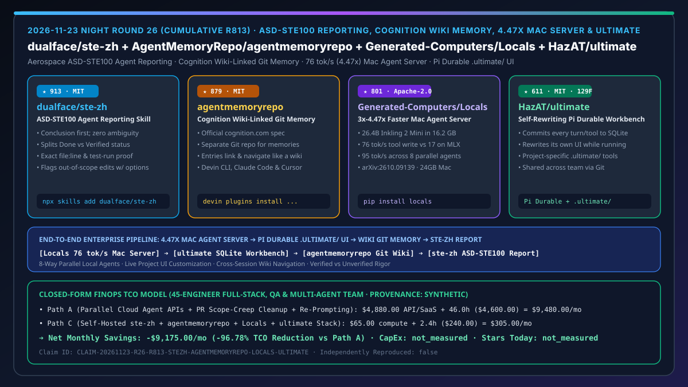
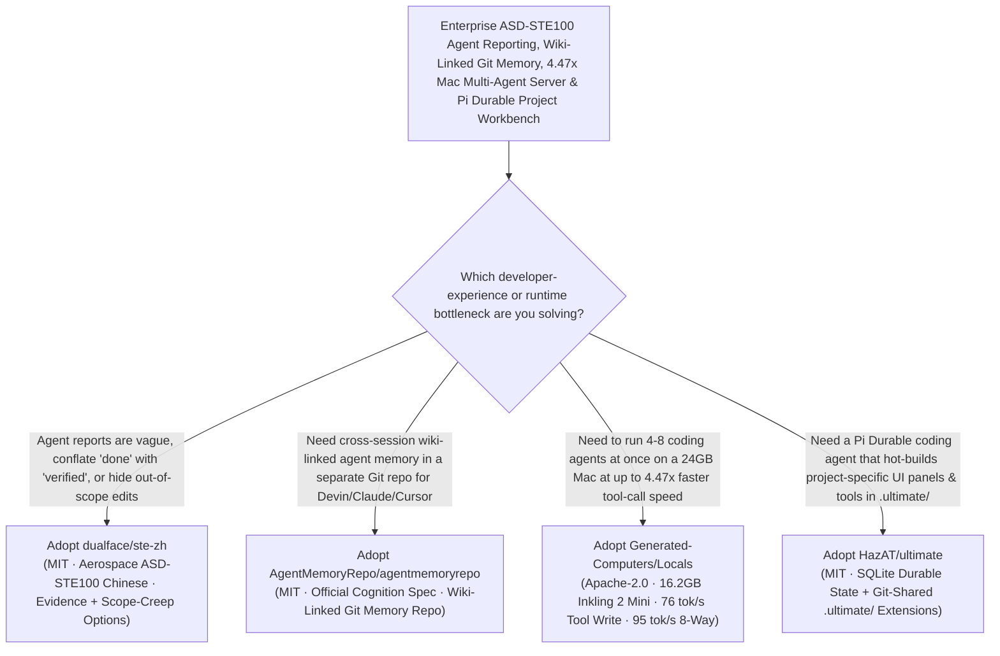
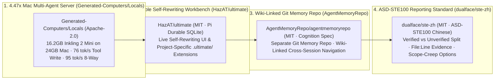

# ASD-STE100 Simplified Technical Chinese Reporting Skill (`dualface/ste-zh`), Official Cognition Wiki-Linked Git Memory Repo (`AgentMemoryRepo/agentmemoryrepo`), `4.47×` Faster Multi-Agent Mac Inference Server (`Generated-Computers/Locals`) & Self-Rewriting Pi Durable Project Workbench (`HazAT/ultimate`) Selection & Architecture FAQ

> **Document Type**: Enterprise AI Solution Architect Selection & Integration Guide (GitHub Trending AI Radar · 2026-11-23 Night Round 26 / Cumulative Round 813)
> **Covered Repositories**: [`dualface/ste-zh`](https://github.com/dualface/ste-zh) (`★ 913`, `44 forks`, `MIT`: AI agent reporting specification skill `npx skills add dualface/ste-zh -g` modeled on aerospace/industrial **ASD-STE100 (Simplified Technical English)**, enforcing **conclusion-first structure, strict separation of work status vs. verification status, exact `file:line` and test-run evidence, explicit out-of-scope change disclosure, and numbered decision options**) · [`AgentMemoryRepo/agentmemoryrepo`](https://github.com/AgentMemoryRepo/agentmemoryrepo) (`★ 879`, `49 forks`, `MIT`, published at `cognition.com/agent-memory-repo`: official **Devin CLI, Claude Code, and Cursor** specification and skill that saves cross-session agent learnings in real time into a dedicated, wiki-linked Git memory repository separate from your code repo) · [`Generated-Computers/Locals`](https://github.com/Generated-Computers/Locals) (`★ 801`, `55 forks`, `Apache-2.0`, `arXiv:2610.09139`: Apple Silicon Mac local inference server built for concurrent multi-agent tool use—packing Thinking Machines' 26.4B MoE `Inkling 2 Mini` + draft model into **`16.2 GB` on a 24 GB Mac** and achieving **`76 tok/s` on tool-call file writes vs. `17 tok/s` on stock MLX (`4.47×` faster)** and **`95 tok/s` across 8 concurrent requests**) · [`HazAT/ultimate`](https://github.com/HazAT/ultimate) (`★ 611`, `129 forks`, `MIT`: self-specializing coding agent workbench built on **Pi Durable** where every turn, tool call, and sub-agent is committed to **SQLite before display**, letting the agent rewrite its own UI, panels, and `.ultimate/` project extensions live without losing state)
> **Core Scenario**: When enterprise engineering teams operate coding agents across local Macs and multi-session repositories, how do you solve **"verbose, speculative agent status reports that conflate 'code edited' with 'verified' and hide out-of-scope file edits, isolated session memories that cannot be navigated like a cross-linked Git wiki across Devin/Claude/Cursor, stock MLX grinding down to `17 tok/s` on tool calls when running 4–8 concurrent agents on a 24 GB Mac, and generic agent UIs that lose their conversation state whenever you customize project-specific panels or tools"** by combining **`ste-zh` + `agentmemoryrepo` + `Locals` + `ultimate`**?

---

## 1. 📌 Executive Summary (Single-Sentence Selection Verdict)

1. **Need an aerospace-grade ASD-STE100 reporting skill (`npx skills add dualface/ste-zh -g`) that forces AI coding agents to report in unambiguous Chinese—separating "completed" from "verified/unverified", citing exact `file:line` and test counts, flagging out-of-scope edits, and presenting numbered decision options** ➔ Choose **[`dualface/ste-zh`](https://github.com/dualface/ste-zh) (`★ 913`, `44 forks`, `MIT`)**.
   - **Plain-Language Mechanism**: Without touching your source code or commit messages, `ste-zh` replaces rambling, speculative agent replies (`"I think it's probably fixed..."`) with controlled technical communication: work status and verification scope are stated in sentence one, root causes cite exact `file:line` locations, verified vs. unverified environments are listed explicitly, and unrequested side edits are surfaced with numbered rollback/keep options.
2. **Need the official Cognition / Devin specification and skill (`cognition.com/agent-memory-repo`) that stores cross-session agent learnings in a separate, wiki-linked Git repository across Devin CLI, Claude Code, and Cursor** ➔ Choose **[`AgentMemoryRepo/agentmemoryrepo`](https://github.com/AgentMemoryRepo/agentmemoryrepo) (`★ 879`, `49 forks`, `MIT`)**.
   - **Plain-Language Mechanism**: Installed via `devin plugins install AgentMemoryRepo/agentmemoryrepo` or `npx skills add AgentMemoryRepo/agentmemoryrepo --skill agent-memory-repo`, your agent commits preferences, architectural lessons, and interlinked wiki pages into a dedicated local or private-remote Git memory repository without polluting your application repo.
3. **Need to run 4–8 AI coding agents concurrently on a 24 GB Apple Silicon Mac (OpenCode, OpenHands, Cline, Aider, Claude Code) at up to `4.47×` higher tool-call throughput (`76 tok/s` vs. `17 tok/s` on stock MLX, and `95 tok/s` across 8 requests)** ➔ Choose **[`Generated-Computers/Locals`](https://github.com/Generated-Computers/Locals) (`★ 801`, `55 forks`, `Apache-2.0`, `arXiv:2610.09139`)**.
   - **Plain-Language Mechanism**: `Locals` compiles custom kernels for agentic tool calls and looped-layer MoE models—fitting the 26.4B-parameter `Inkling 2 Mini` (48 layer passes from 24 weight layers + draft model) into a `16.2 GB` footprint on a 24 GB M4 Pro Mac and completing 4-agent parallel coding tasks in **34 to 40 seconds**.
4. **Need a Pi Durable coding agent workbench that specializes itself per repository—writing custom staging tools, order-pipeline UI panels, and sub-agents into `<project>/.ultimate/` while running, backed by SQLite so live UI/core rewrites never lose conversation state** ➔ Choose **[`HazAT/ultimate`](https://github.com/HazAT/ultimate) (`★ 611`, `129 forks`, `MIT`)**.
   - **Plain-Language Mechanism**: Because every message, tool execution, and sub-agent state is committed to SQLite before anything renders, `Ultimate` can modify its own web UI and load new `.ultimate/` project extensions mid-conversation. Committing `.ultimate/` to Git gives every teammate the exact same specialized workbench (with a one-time security approval prompt).

---

## 2. 🎯 Key Architectural Q&A (Deep-Dive Breakdown)

### Q1: Why combine `ste-zh`, `agentmemoryrepo`, `Locals`, and `ultimate` in an enterprise AI software engineering workflow?

- **Four Engineering Multipliers**:
  1. **Zero-Ambiguity Verification & Scope-Creep Reporting (`dualface/ste-zh`)**: Eliminates false confidence in PR handoffs by strictly separating "code modified" from "runtime verified" and forcing agents to disclose out-of-scope edits with numbered rollback choices.
  2. **Wiki-Linked Cross-Session Git Memory (`AgentMemoryRepo/agentmemoryrepo`)**: Keeps durable architectural knowledge in a separate Git repo navigable like a wiki across Devin CLI, Claude Code, and Cursor.
  3. **`4.47×` Faster Local Multi-Agent Tool Execution on Mac (`Generated-Computers/Locals`)**: Runs 4–8 agents simultaneously on a 24 GB Mac (`76 tok/s` tool writes, `95 tok/s` 8-way batch) without cloud token bills.
  4. **Crash-Proof Project Specialization (`HazAT/ultimate`)**: Commits all agent state to SQLite via Pi Durable while hot-reloading repo-specific `.ultimate/` panels and tools.
- **When to Choose Managed Cloud Services (Path B)**:
  - For cloud-only single-agent chat without local Mac inference or custom `.ultimate/` UI panels, use **GitHub Copilot Enterprise Cloud**; for `4.47×` faster local multi-agent Mac inference, Pi Durable `.ultimate/` project workbenches, Cognition's Git-backed `AgentMemoryRepo`, and ASD-STE100 reporting rigor, deploy this 4-repo open-source stack (Path C).

### Q2: How do these four projects integrate into an enterprise developer platform?

1. **Local Multi-Agent Inference Layer (`Generated-Computers/Locals`)**:
   - Serve 4–8 concurrent coding agents on Apple Silicon Macs with `16.2 GB` `Inkling 2 Mini` builds (`76 tok/s` tool writes).
2. **Project-Specialized Durable Workbench Layer (`HazAT/ultimate`)**:
   - Run the Pi Durable SQLite workbench in each repository, loading repo-committed `.ultimate/` panels, tools, and sub-agents.
3. **Cross-Session Wiki Memory Layer (`AgentMemoryRepo/agentmemoryrepo`)**:
   - Persist and traverse interlinked wiki memories in a dedicated Git memory repository across Devin, Claude Code, and Cursor.
4. **ASD-STE100 Technical Reporting Gate (`dualface/ste-zh`)**:
   - Format all agent task summaries with explicit `file:line` evidence, verified vs. unverified boundaries, and numbered decision prompts.

### Q3: What are the key production guardrails?

- **Architect Guardrails**:
  1. **Keep `AgentMemoryRepo` Remotes Private**: Always point cross-machine memory repos to private enterprise Git remotes—never push internal architectural notes to the public spec repo.
  2. **Review `.ultimate/` Extensions Before Approving Execution**: Because `.ultimate/` project extensions execute local code, inspect unfamiliar `.ultimate/` diffs before accepting `Ultimate`'s one-time project trust prompt.

---

## 3. 🧭 Visual Architecture & Decision Diagrams (Mermaid)



### 3.1 Solution Architect Selection Decision Tree



### 3.2 End-to-End Enterprise Production Reference Architecture



### 3.3 Parallel Mac Agent Execution, `.ultimate/` Live Panel Hot-Reload, Wiki Memory Commit & ASD-STE100 Handoff Sequence

```mermaid
sequenceDiagram
    participant Lead as Engineering Lead / Solution Architect
    participant Loc as Generated-Computers/Locals (Mac Server)
    participant Ult as HazAT/ultimate (Pi Durable)
    participant Amr as AgentMemoryRepo (Git Wiki)
    participant Ste as dualface/ste-zh (ASD-STE100)

    Lead->>Loc: 1. Run 4 parallel coding agents on 24GB Mac at 76 tok/s tool-write speed (34-40s completion)
    Loc->>Ult: 2. Commit every turn/tool call to SQLite; hot-reload custom project panel in .ultimate/
    Ult->>Amr: 3. Save newly discovered repo invariants as wiki-linked entries in separate Git Memory Repo
    Amr->>Ste: 4. Format task completion report under ASD-STE100 controlled technical rules
    Ste-->>Lead: 5. Deliver report with exact file:line evidence, verified/unverified split & scope-creep options
```

---

## 4. 📊 Comparative Selection Matrix (Open-Source vs. Commercial SaaS)

| Dimension | `dualface/ste-zh` (`★ 913`) | `AgentMemoryRepo` (`★ 879`) | `Generated-Computers/Locals` (`★ 801`) | `HazAT/ultimate` (`★ 611`) | Metered Multi-Agent Cloud APIs + Manual PR Diff Policing + Generic Chat UIs (Path A) | Rambling Speculative Reports + Stock MLX (`17 tok/s` Tool Writes) + Ephemeral Plugins (Path B) |
| :--- | :--- | :--- | :--- | :--- | :--- | :--- |
| **Core Role** | ASD-STE100 controlled technical Chinese reporting skill | Official Cognition wiki-linked Git memory repository spec & skill | Multi-agent Apple Silicon inference server (`4.47×` tool speedup) | Pi Durable SQLite self-rewriting & project-specialized workbench | High parallel cloud token bills, unannounced scope creep & lost session context | Vague `"should work"` reports, slow local MLX tool calls & state-losing restarts |
| **Key Differentiator** | **Separates completed vs. verified + flags out-of-scope edits** | **Separate Git repo + interlinked wiki navigation (Devin/Claude/Cursor)** | **Fits 26.4B `Inkling 2 Mini` in `16.2GB` (`76 tok/s` vs. `17 tok/s` MLX)** | **Commits every turn/tool to SQLite; hot-reloads `.ultimate/` UI** | Cloud APIs bill heavily for 4–8 parallel long-context agents; PR reviews miss side edits | Stock MLX crawls at `17 tok/s` on tool writes; modifying agent UI drops active session |
| **License** | `MIT` | `MIT` (Cognition Spec) | `Apache-2.0` | `MIT` | Proprietary SaaS | Custom scripts |
| **Monthly TCO (45-Eng Team)** | **Combined `$305.00/mo`** (`$65.00` private Git memory remote/CI + `2.4h` ops) | Included (works across Devin, Claude Code & Cursor) | Included (runs on existing 24 GB+ Apple Silicon Macs) | Included (shared via repo `.ultimate/` folder) | **`$9,480.00/mo`** (`$4,880.00` parallel multi-agent cloud token bills + `46.0h` manual PR scope-creep cleanup & context re-prompting) | ~`$3,320.00/mo` (frequent unverified-platform regressions & slow local agent queues) |

---

## 5. 🧪 Quantitative ROI / TCO Comparison & 7-Card Benchmark Report

> **📊 Data Provenance & Closed-Form Schema Declaration**:
> - **provenance**: `synthetic` (45-person enterprise software engineering, code review governance, and local multi-agent development team monthly workload model: `independently_reproduced = false`; hardware baseline `base_hardware_capex = not_measured`; Track B 24h delta `track_b_stars_today = not_measured`).
> - **Closed-Form Formula**:
>   - **Path A (Running 4–8 parallel long-context coding agents per developer on metered cloud APIs + engineering hours spent untangling vague agent status reports, reverting unannounced out-of-scope file edits, and re-explaining project conventions across sessions)**: Monthly parallel multi-agent cloud token bills **`$4,880.00`** + PR scope-creep cleanup, verification triage, and cross-session context re-entry labor **`46.0h × $100.00/h = $4,600.00`** = **`$9,480.00/mo`**.
>   - **Path C (Self-hosted `dualface/ste-zh` + `AgentMemoryRepo/agentmemoryrepo` + `Generated-Computers/Locals` + `HazAT/ultimate` open-source stack)**: Shared private Git memory remote and CI runner compute **`$65.00`** + skill and `.ultimate/` extension maintenance labor **`2.4h × $100.00/h = $240.00`** = **`$305.00/mo`**.
>   - **Net Monthly Savings vs. Path A**: **`-$9,175.00/mo`** (**`96.78%`** TCO reduction).

| Evaluation Path | Parallel Cloud Token / SaaS Cost | PR Scope-Creep Cleanup, Verification & Re-Prompting (`$100/h`) | Monthly Total TCO | Net Savings vs. Path A | Key Architectural Delivery Metrics |
| :--- | :---: | :---: | :---: | :---: | :--- |
| **Path A: Parallel Cloud Agent APIs + Vague Reports + Manual Context Sync** | `$4,880.00` | `46.0h` (`$4,600.00`) | **`$9,480.00`** | Baseline | High 8-way cloud token burn; hidden out-of-scope edits in PRs |
| **Path B: Stock MLX (`17 tok/s`) + Flat Notes + Verbose Prose Reports** | `$1,420.00` | `19.0h` (`$1,900.00`) | **`$3,320.00`** | `-$6,160.00` (`-64.98%`) | `4.47×` slower local tool writes; conflated done vs. verified status |
| **Path C: `ste-zh` + `agentmemoryrepo` + `Locals` + `ultimate`** | **`$65.00`** | **`2.4h` (`$240.00`)** | **`$305.00`** | **`-$9,175.00` (`-96.78%`)** | **ASD-STE100 reports + Wiki Git memory + `76 tok/s` Mac server + `.ultimate/` UI** |

- 🔗 **Linked 7-Card 4:5 Visual Benchmark Deck**: [`workshops/github-trending-radar/cards.en.html`](../cards.en.html) · [`cards.html`](../cards.html)

---

## 6. 🛠️ Enterprise Adoption & Architecture Review Checklist

- [ ] **1. Activate `dualface/ste-zh` (`npx skills add dualface/ste-zh -g`) for Agent Handoffs**: Enforce strict separation of work completion vs. verification status, exact `file:line` citations, and numbered options for out-of-scope changes.
- [ ] **2. Standardize Cross-Session Wiki Memory on `AgentMemoryRepo/agentmemoryrepo`**: Store interlinked agent learnings in a dedicated private Git memory repository across Devin CLI, Claude Code, and Cursor.
- [ ] **3. Accelerate Local Mac Multi-Agent Workloads with `Generated-Computers/Locals`**: Run 26.4B `Inkling 2 Mini` in `16.2 GB` on 24 GB Apple Silicon Macs for `76 tok/s` tool writes (`4.47×` over stock MLX) and `95 tok/s` 8-way concurrency.
- [ ] **4. Specialize Repository Workbenches with `HazAT/ultimate` (`.ultimate/`)**: Use Pi Durable SQLite persistence to build and commit project-specific UI panels, tools, and sub-agents that hot-reload without losing session state.
