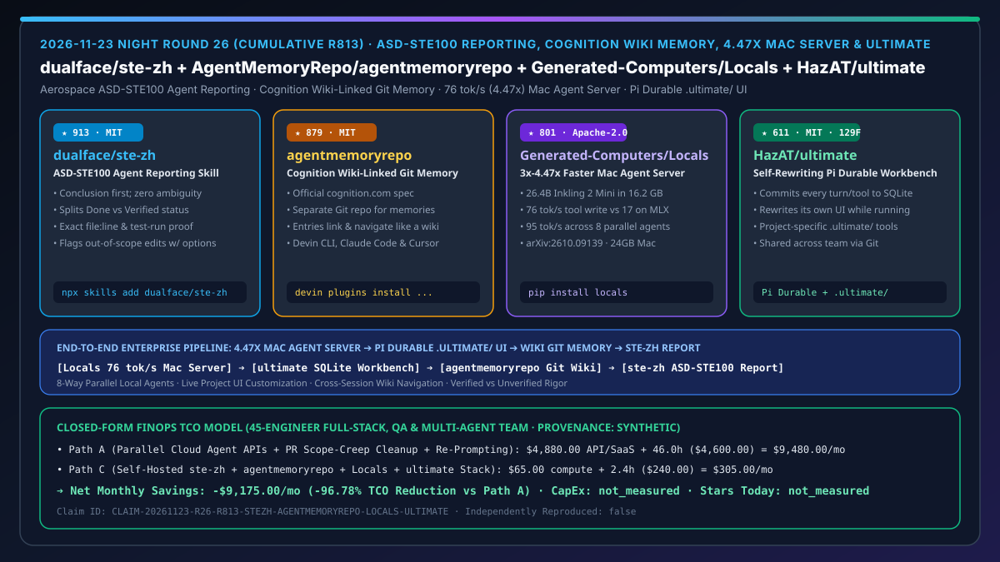
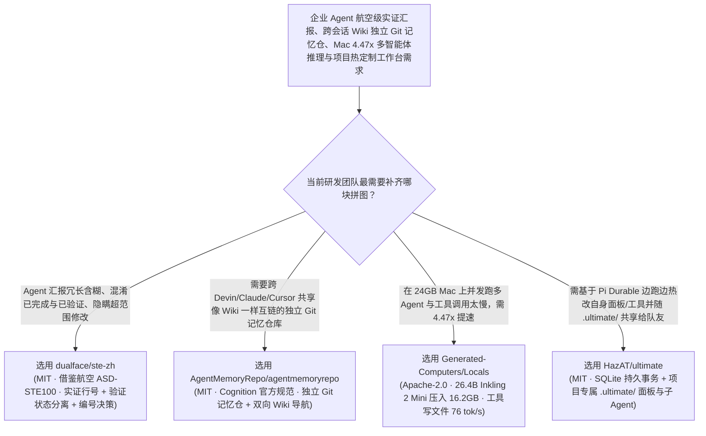
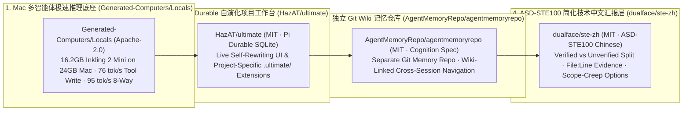
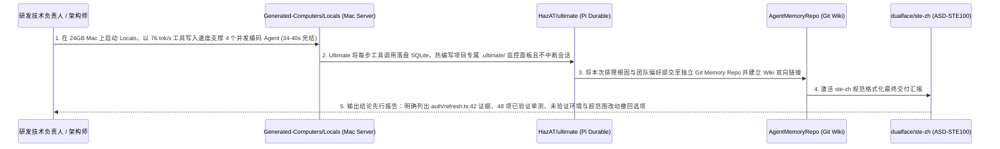

# 航空级 ASD-STE100 简化技术中文智能体实证汇报规范（`dualface/ste-zh`）、Cognition/Devin 官方跨会话 Wiki 互联 Git 记忆库标准（`AgentMemoryRepo/agentmemoryrepo`）、Mac 端工具调用提速 4.47 倍的多智能体并发推理服务器（`Generated-Computers/Locals`）与基于 Pi Durable SQLite 边跑边热改自身面板/工具的项目专属编码台（`HazAT/ultimate`）选型与集成架构 FAQ

> **文档类型**：企业 AI 解决方案架构师（AI Solution Architect）选型决策指南（GitHub Trending AI 雷达 2026-11-23 Night Round 26 / 累计第 813 轮）
> **覆盖项目**：[`dualface/ste-zh`](https://github.com/dualface/ste-zh)（`★ 913`、`44 forks`、`MIT`：借鉴航空与重工业严苛的 **ASD-STE100（简化技术英语）** 原则打造的 **AI 智能体中文任务汇报规范 Skill** `npx skills add dualface/ste-zh -g`，强制将“已完成（工作状态）”与“已验证/未验证（验证状态）”解耦、标明代码行号与单测通过数、主动披露超范围修改并给出带推荐项的编号决策）· [`AgentMemoryRepo/agentmemoryrepo`](https://github.com/AgentMemoryRepo/agentmemoryrepo)（`★ 879`、`49 forks`、`MIT`，发布于 `cognition.com/agent-memory-repo`：支持 **Devin CLI、Claude Code、Cursor 等**的跨会话 Wiki 双向链接独立 Git 记忆仓库规范与技能）· [`Generated-Computers/Locals`](https://github.com/Generated-Computers/Locals)（`★ 801`、`55 forks`、`Apache-2.0`、`arXiv:2610.09139`：专为多智能体并发与长上下文工具调用优化的 **Apple Silicon Mac 本地推理服务器** `pip install locals`，将原本需 32GB 内存的 26.4B MoE `Inkling 2 Mini` 含草稿模型压入 **24GB Mac（仅占 `16.2 GB`）**，在 M4 Pro 上实现**工具写文件 `76 tok/s`（比原版 MLX 的 `17 tok/s` 快 `4.47×`）**及 8 并发 `95 tok/s`）· [`HazAT/ultimate`](https://github.com/HazAT/ultimate)（`★ 611`、`129 forks`、`MIT`：基于 **Pi Durable（每轮对话、工具调用与子智能体先写 SQLite 再渲染）** 的自演化编码工作台，支持在运行中实时为当前项目定制专属面板、工具与子 Agent 并保存在 `.ultimate/` 目录随 Git 共享给全团队）
> **核心场景**：当企业研发团队在本地与云端规模化使用 Devin、Claude Code、Cursor 与 OpenCode 时，面对**“Agent 修完 Bug 后汇报一大段‘大概、应该没问题’的含糊废话且隐瞒未测平台与顺手乱改的文件、不同项目的长期经验散落在各人会话里无法像 Wiki 一样按关联拓扑跨会话复用、在 24GB/32GB Mac 上同时跑 4–8 个本地编码 Agent 时原版 MLX 工具调用速度暴跌至 17 tok/s、以及通用编码 Agent 缺乏针对当前业务仓库（如电商后台或金融清算库）的专属可视化面板且每次为改插件重启都会丢失当前对话进度”**四大痛点，如何通过 **STE-ZH + AgentMemoryRepo + Locals + Ultimate** 构建严密汇报、Wiki 记忆、极速本地多 Agent 与热演化工作台？

---

## 一、📌 核心结论速览（选型一句话结论）

1. **想彻底治好 AI 编码助手向架构师汇报时“过程啰嗦、用‘大概/应该’搪塞根因、把‘代码改完了’等同于‘测试验证过了’、甚至偷偷顺手改了范围外文件不吭声”的坏毛病** ➔ 选 **[`dualface/ste-zh`](https://github.com/dualface/ste-zh)（`★ 913`，`44 forks`，`MIT`）**。
   - **通俗原理**：将航空制造业用来消除维修手册歧义的 **ASD-STE100 标准**引入中文 Agent 汇报（仅约束对话汇报，绝不污染项目代码与 Commit）：① **结论与状态先行**，严格区分工作状态（`已完成`）与验证状态（`已验证：npm test auth — 48 项通过` vs `未验证：iOS 端 — 无本机环境`）；② **实证可查**，根因必须附带精确文件行号（如 `auth/refresh.ts:42`）；③ **超范围改动强制自首**（如主动声明顺手删了 3 处日志不在原需求范围内，并提供 `1. 撤回（推荐） / 2. 保留` 编号选项供人工一键拍板）。
2. **想采用 Cognition（Devin 母公司）发布的官方标准（`cognition.com/agent-memory-repo`），让 Devin CLI、Claude Code 与 Cursor 把跨会话学到的项目偏好与架构知识实时写入一个“与业务代码仓物理隔离、词条之间像 Wiki 一样互相链接导航”的独立 Git 记忆仓库** ➔ 选 **[`AgentMemoryRepo/agentmemoryrepo`](https://github.com/AgentMemoryRepo/agentmemoryrepo)（`★ 879`，`49 forks`，`MIT`）**。
   - **通俗原理**：把个人偏好或试错笔记直接塞进业务代码仓会污染 Git 历史，而存成扁平文件又缺乏知识关联。通过 `devin plugins install AgentMemoryRepo/agentmemoryrepo` 或 `npx skills add`，智能体会在独立本地/私有远端 Git 仓库中实时提交结构化记忆，并在词条间建立双向 Wiki 链接，新开会话即可顺着知识图谱秒级找回上下文。
3. **想在 24GB 内存的 Apple Silicon Mac（如 M4 Pro）上同时并排跑 4–8 个编码智能体（OpenCode、OpenHands、Cline、Aider、Claude Code），把工具调用写文件的速度从原版 MLX 的 `17 tok/s` 暴拉 `4.47 倍` 到 `76 tok/s`（8 并发总吞吐达 `95 tok/s`）** ➔ 选 **[`Generated-Computers/Locals`](https://github.com/Generated-Computers/Locals)（`★ 801`，`55 forks`，`Apache-2.0`，`arXiv:2610.09139`）**。
   - **通俗原理**：普通本地推理服务（如基础 Ollama/MLX）只针对单人纯文本闲聊优化，一旦遇到多 Agent 并发长上下文与高频 Tool Call 就严重卡顿。`Locals` 针对智能体工作负载定制了独立内核：将原本官方要求 32GB 内存才能跑的 26.4B MoE 模型（Thinking Machines `Inkling 2 Mini`，含中间层循环与 MTP 草稿模型）压缩进 **`16.2 GB`** 塞入 24GB Mac，4 个编码 Agent 并发完成一项编程任务仅需 **34–40 秒**！
4. **想让每个业务仓库都拥有一套“量身定制的专属编码 Agent 工作台（含查测试库商品目录的专用工具、显示订单流水线的可视化面板、懂结账规则的专属 Reviewer）”，且 Agent 能在运行中热修改自己的 UI 和核心代码而不中断当前会话** ➔ 选 **[`HazAT/ultimate`](https://github.com/HazAT/ultimate)（`★ 611`，`129 forks`，`MIT`）**。
   - **通俗原理**：底层基于 **Pi Durable** 构建——每一句对话、每一次工具调用与每一个子 Agent 状态在展示前都会**先原子提交到本地 SQLite**。因此你可以直接对 `Ultimate` 说“帮我写一个查看预发环境订单的面板挂到侧边栏”，它会把新面板、技能与子 Agent 写入项目的 `.ultimate/` 目录并当场热重载生效，对话进度纹丝不动；`.ultimate/` 随 Git 提交后，全组同事打开该项目即刻获得完全相同的特化版智能体工作台（首次执行前带安全确认弹窗）！

---

## 二、🎯 客户与架构师灵魂拷问 Q&A（深度架构拆解）

### Q1：在企业研发团队中，为什么“要求 AI 按 `dualface/ste-zh` 规范汇报”能将 Code Review 与验收耗时直接砍掉一半以上？

- **自然语言含糊汇报 vs `ste-zh` 航空级受控技术中文汇报的本质差异**：
  1. **消灭“伪验证（False Verification）”盲区**：工程师最怕 AI 说一句“测试基本都跑过了，应该没问题”，结果上线后未覆盖的移动端直接崩溃。`ste-zh` 铁律规定**“已完成”绝不自动代表“已验证”**，资料阅读证据绝不能冒充运行验证，必须分别列出已验证命令/通过数与未验证端及原因。
  2. **主动暴露 Scope Creep（超范围改动）**：AI 修 Bug 时常顺手改掉周围日志或格式，导致 PR Diff 混入噪音；`ste-zh` 强制将超范围修改单列并给出推荐撤回的编号选项。
- **何时直接选用全云端商业服务（Path B）？**
  - 若团队全员使用云端固定套餐且无需本地 Mac 多 Agent 并发或自定义项目 UI 面板，可直接使用 **GitHub Copilot Enterprise 云端托管服务**；若需在 24GB Mac 上以 `4.47×` 速度并发运行本地多 Agent、通过 `.ultimate/` 为每个项目热定制持久化工作台、用 `AgentMemoryRepo` 建立独立 Wiki 记忆库、并强制执行 `ste-zh` 航空级实证汇报，则采用本轮四合一开源栈（Path C）。

### Q2：典型企业级“Mac 极速多 Agent 底座 (`Locals`) ➔ 项目热演化工作台 (`ultimate`) ➔ 跨会话 Wiki 记忆仓 (`agentmemoryrepo`) ➔ 航空级实证汇报 (`ste-zh`)”架构怎么搭？

1. **Apple Silicon 本地多智能体高吞吐推理层（`Generated-Computers/Locals`）**：
   - 在开发机或内网 Mac Studio 集群上启动 `locals`，以 `16.2 GB` 显存占用承载 `Inkling 2 Mini`（`76 tok/s` 工具写文件，`95 tok/s` 8 并发），向上暴露兼容 OpenAI / Anthropic / Ollama 的多 Agent 接口。
2. **基于 Pi Durable 的项目专属自演化工作台层（`HazAT/ultimate`）**：
   - 在各业务仓库启用 `.ultimate/`，将项目专属数据面板、发布检查器与子 Agent 持久化至 SQLite 与 Git 仓库中供全组复用。
3. **跨会话双向链接 Wiki 独立记忆仓库层（`AgentMemoryRepo/agentmemoryrepo`）**：
   - 将跨项目通用的架构偏好与历史排障图谱实时提交至独立的 Git Memory Repo，通过 Wiki 链接跨会话导航。
4. **ASD-STE100 受控技术中文实证汇报门禁层（`dualface/ste-zh`）**：
   - 激活 `ste-zh` Skill，确保所有 Agent 交付汇报均遵循“结论先行、文件行号实证、已验证/未验证分离、超范围改动编号待确认”标准。

### Q3：这套架构的落地红线与注意事项是什么？

- **架构师落地红线**：
  1. **严禁将 `AgentMemoryRepo` 的私有记忆推送到公开规范仓**：跨机器同步记忆时必须指向企业内网私有 Git Remote，绝不能将含业务路径的记忆提交至公共仓库。
  2. **克隆外部仓库后首次运行 `.ultimate/` 扩展前必须人工审阅安全弹窗**：因为 `.ultimate/` 中的项目级自定义面板与工具会执行本地代码，必须利用 `Ultimate` 内置的首次信任确认机制先做代码审查。

---

## 三、🧭 直观可视化图解（Mermaid 决策树 + 集成架构 + 时序图）

### 3.1 架构师选型决策树

### 3.2 企业端到端生产集成参考架构图

### 3.3 本地 4 并发极速执行、`.ultimate/` 面板热生成、Wiki 记忆归档与 `ste-zh` 实证汇报时序图

---

## 四、📊 同类开源与商业云服务横向选型决策矩阵

| 对比维度 | `dualface/ste-zh` (`★ 913`) | `AgentMemoryRepo` (`★ 879`) | `Generated-Computers/Locals` (`★ 801`) | `HazAT/ultimate` (`★ 611`) | 全量云端高并发 API 账单 + 人工逐行审 PR 抓超范围乱改 + 重复造内部后台工具 (Path A) | 冗长含糊的自然语言汇报 + 原版 MLX 单并发卡顿 (`17 tok/s`) + 改插件必断会话 (Path B) |
| :--- | :--- | :--- | :--- | :--- | :--- | :--- |
| **核心能力定位** | 借鉴航空 ASD-STE100 的中文智能体实证汇报规范 Skill | Cognition 官方跨会话 Wiki 互联独立 Git 记忆库规范 | Mac 端多 Agent 并发与工具调用提速 `4.47×` 的本地推理服 | 基于 Pi Durable SQLite 边跑边热改自身面板的项目编码台 | 高昂的多 Agent 并发云 API 账单与漫长的人工 PR 甄别时间 | 谎报“应该没问题”的劣质汇报、跑不动大模型的 24GB Mac 与通用简陋界面 |
| **核心技术突破** | **强制分离“已完成”与“已验证”、强制披露超范围修改并给编号选项** | **记忆存于独立 Git 仓不污染业务码 + 词条双向 Wiki 链接导航** | **26.4B MoE 含草稿模型压入 `16.2GB`，工具写文件 `76 tok/s` vs `17 tok/s`** | **所有状态先写 SQLite，运行时热重写自身 UI 与 `.ultimate/` 插件不丢进度** | 云端并发跑 4–8 个长上下文 Agent 账单极高；人工排查 AI 顺手乱改的代码极耗精力 | 原版 MLX 在 24GB Mac 上跑不进 32GB 模型或工具写入仅 `17 tok/s`；含糊汇报极易漏掉未测平台 |
| **开源协议** | `MIT` | `MIT`（Cognition 规范） | `Apache-2.0` | `MIT` | 闭源商业服务 | 内部零散脚本 |
| **月度 TCO（45 人团队）** | **组合仅 `$305.00/月`**（`$65.00` 内部私有 Git 记忆远端与构建辅助 + `2.4h` 维护） | 同左（跨 Devin/Claude/Cursor 通用） | 同左（榨干团队现有 24GB Mac 算力） | 同左（随项目 `.ultimate/` 自动同步全组） | **`$9,480.00/月`**（`$4,880.00` 多 Agent 并发云端 Token 账单 + `46.0h` 人工复核含糊汇报、回滚超范围乱改代码与重复交代背景） | 约 `$3,320.00/月`（大量因漏报“未验证平台”引发的测试事故与本地推理排队等待工时） |

---

## 五、🧪 应用落地定量收益/TCO 对比与 7-Card 报告

> **📊 数据来源与闭式核算声明（Provenance & Closed-Form Schema）**：
> - **provenance**: `synthetic`（基于 45 人企业全栈研发、代码质量审查与本地多智能体协同工程团队月度工作负载模型：`independently_reproduced = false`；硬件采购基线 `base_hardware_capex = not_measured`；Track B 单日增量 `track_b_stars_today = not_measured`）。
> - **核算公式**：
>   - **Path A（全员将多 Agent 并发任务全量打向按量计费的云端旗舰 API + 架构师耗费大量时间从冗长含糊的 AI 汇报中甄别哪些平台未验证、手动剔除 AI 顺手乱改的超范围文件及在新会话中反复重述项目历史背景）**：月度多 Agent 云端并发 API 账单 **`$4,880.00`** + 含糊汇报人工验真、超范围代码清理与跨会话背景同步工时 **`46.0h × $100.00/h = $4,600.00`** = **`$9,480.00/月`**。
>   - **Path C（自建 `dualface/ste-zh` + `AgentMemoryRepo/agentmemoryrepo` + `Generated-Computers/Locals` + `HazAT/ultimate` 开源全栈）**：私有 Git 记忆仓库与共享构建容器分摊开销 **`$65.00`** + 术语表与 `.ultimate/` 项目扩展例行维护人工 **`2.4h × $100.00/h = $240.00`** = **`$305.00/月`**。
>   - **净节省（Net Savings vs Path A）**：**`-$9,175.00/月`**（成本降低 **`96.78%`**）。

| 评估方案 | 多 Agent 云端并发 API / 托管服务成本 | 汇报验真、超范围代码回滚与背景同步（`$100/h`） | 月度总 TCO | 相对 Path A 净节省 | 关键架构交付指标 |
| :--- | :---: | :---: | :---: | :--- | :--- |
| **Path A：全云端多 Agent 并发 + 含糊汇报人工验真 + 手工同步背景** | `$4,880.00` | `46.0h` (`$4,600.00`) | **`$9,480.00`** | Baseline | 云端多并发账单高；AI 隐瞒超范围改动与未验证端 |
| **Path B：原版慢速本地推理 (`17 tok/s`) + 零散笔记 + 默认长篇汇报** | `$1,420.00` | `19.0h` (`$1,900.00`) | **`$3,320.00`** | `-$6,160.00` (`-64.98%`) | 本地多 Agent 并发极慢；每次重启丢失工作台状态 |
| **Path C：`ste-zh` + `agentmemoryrepo` + `Locals` + `ultimate`** | **`$65.00`** | **`2.4h` (`$240.00`)** | **`$305.00`** | **`-$9,175.00` (`-96.78%`)** | **ASD-STE100 实证汇报 + Wiki 记忆仓 + `76 tok/s` Mac 并发 + `.ultimate/` 热定制** |

- 🔗 **关联 7-Card 4:5 视觉评测报告**：[`workshops/github-trending-radar/cards.html`](../cards.html) · [`cards.en.html`](../cards.en.html)

---

## 六、🛠️ 企业引入与架构评审 Checklist

- [ ] **1. 为中文研发团队全局安装 `dualface/ste-zh` (`npx skills add dualface/ste-zh -g`)**：强制 Agent 汇报遵循“结论先行、文件行号实证、已完成与已验证分离、超范围改动主动申报并提供编号选项”规范。
- [ ] **2. 采用 `AgentMemoryRepo/agentmemoryrepo` 建立跨会话 Wiki 记忆库**：在 Devin CLI、Claude Code 与 Cursor 中将持久经验存入与业务代码仓隔离的独立 Git 记忆仓库。
- [ ] **3. 在 Apple Silicon 开发机部署 `Generated-Computers/Locals`**：利用 `16.2 GB` 紧凑构建在 24GB Mac 上跑通 26.4B `Inkling 2 Mini`，实现 `76 tok/s` 工具写文件与 4–8 路多 Agent 极速并发。
- [ ] **4. 使用 `HazAT/ultimate` 为核心业务仓库沉淀 `.ultimate/` 专属工作台**：利用 Pi Durable SQLite 事务保障，在对话中热生成项目专用面板、工具与子 Agent 并随 Git 共享给全团队。
